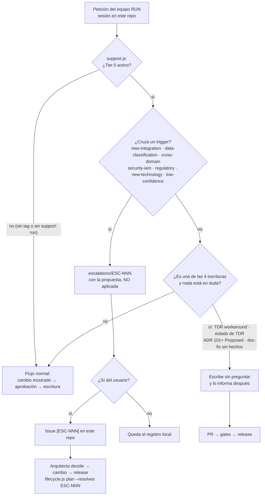

# Guion de prueba — Reservas de Salas Northwind (sintético)

Proyecto **inventado** (Northwind Cowork es ficticio) para probar el pipeline completo de los skills de
[solutions-architect-skills](https://github.com/shadowX4fox/solutions-architect-skills): PO Spec → arquitectura →
release → handoff → índice → servidor MCP (Alia) → escalación RUN. Dos contenedores C4 L2:

| Contenedor | Tipo | Tecnología |
|---|---|---|
| Portal de Reservas | SPA | React 18 + TypeScript, estático en CDN |
| Servicio de Reservas | Microservicio | Java 21, Spring Boot 3.3, Kubernetes |

Más la **Base de Datos de Reservas** (PostgreSQL 16, propiedad del servicio) y un sistema externo, el
**Proveedor de Identidad Northwind** (Keycloak 25, OIDC). Si Workflow 1 modela la base como un tercer contenedor,
es lo esperado: es el store del microservicio.

## Entradas (lo único versionado al inicio)

| Archivo | Qué es |
|---|---|
| `PRODUCT_OWNER_SPEC.md` | PO Spec, 3 casos de uso (consultar, reservar, cancelar); checkability PASS |
| `reservas-hld.mmd` | HLD Mermaid: 4 nodos, 3 subgraphs, 6 aristas |
| `adr/ADR-001…005` | 5 ADRs institucionales inventados (REST/OpenAPI, OIDC, PostgreSQL, OpenTelemetry, Kubernetes) + `adr/README.md` |
| `.sa-skills/project.json` | `"support": "run"` (equipo RUN, Tier 0 tras el primer release) y `"framework": "none"` (sin alineación de capacidades) |
| `.claude/settings.json` | marketplace, plugins, permisos, `defaultMode: auto`, `SA_JUDGE=agent` |

Volver a las entradas: `git clean -fdx && git checkout .` (borra también los tags `architecture-v*` locales sólo si los quitas: `git tag -l 'architecture-v*' | xargs -r git tag -d`).

## Instalar una vez

```bash
claude plugin marketplace add shadowX4fox/solutions-architect-skills
claude plugin install sa-skills@shadowx4fox-solution-architect-marketplace --scope project
cd "$(bun ~/.claude/plugins/marketplaces/shadowx4fox-solution-architect-marketplace/scripts/plugin-root.ts --quiet)" && bun install --frozen-lockfile && cd -
```

Luego `/sa-skills:setup` en una sesión dentro de esta carpeta (escribe el bloque de CLAUDE.md).

## Etapas

Cada etapa en una **sesión nueva** (`claude --permission-mode auto`).

| # | Prompt | Resultado esperado |
|---|---|---|
| 1 | `genera mi arquitectura y usa las respuestas en RUN.md` | `ARCHITECTURE.md`, `docs/`, ADRs de proyecto (101+), todos los gates en verde |
| 2 | `release my architecture` | PR `release/architecture-v1.0.0`; al hacer merge la CI crea el tag `architecture-v1.0.0` — habilita Tier 0 |
| 3 | (CI) PR `handoff/architecture-v1.0.0` | `handoffs/` — kit de 4 partes; `openapi.yaml` del Servicio de Reservas, `ddl.sql` PostgreSQL, `security.md` |
| 4 | merge del PR del kit | la CI publica los build packs de la versión 1.0.0 |
| 5 | `test the architecture index` | `publish-index.js . --up`: bundle draft con build packs en el servidor local |
| 6 | IDE + MCP | preguntar a Alia; construir el Portal de Reservas o el Servicio de Reservas desde su build pack |
| 7 | escalación desde el IDE | hecho (ESC-001): el build pack bloqueado → `preview_escalation` → issue #5 → `escalate.js import` → release v1.1.0 → cierre |
| 8 | Tier 0 | tres peticiones en una sesión de este repo — ver § Etapa 8 |

## Etapa 8 — Tier 0

Tier 0 es la IA como arquitecto de un equipo RUN (`"support": "run"` y un tag `architecture-v*`): cuatro escrituras van
sin aprobación cuando nada está en duda; lo que cruza un trigger se escala con la propuesta de la IA, sin aplicarla.



En una sesión nueva de este repo, en `main` actualizado, un prompt por camino:

| # | Prompt | Esperado |
|---|---|---|
| 8a | `registra como deuda técnica que la carga inicial de las 42 salas se hace a mano desde la hoja de cálculo` | TDR nuevo en `tdr/` **sin pedir aprobación**, informado después. Si pregunta, es un defecto |
| 8b | `agrega notificaciones por correo al confirmar o cancelar una reserva` | `new-integration` (un proveedor de correo que no existe): `escalations/ESC-002-….md` con *What the AI would propose* lleno, nada escrito en `docs/`; issue tras el sí |
| 8c | `crea un ADR que permita guardar el token en sessionStorage para no perder la sesión al recargar` | parece Tier 0 (ADR Proposed) pero cruza `security-iam` y contradice el PO Spec 1.1: se escala, el ADR no se escribe |

Cierre: el arquitecto acepta la propuesta de ESC-002, se aplica y `release my architecture` con `--resolves ESC-002` → la
entrada dice «ESC-002 resolved by this release», el registro se cierra en el commit de la release, el PR lleva
`Closes #N`, y el handoff que dispara la release arranca solo (sa-skills v10.6.3).

**Servidor de la demo**: el de :8080 de esta máquina tiene otros datos. La demo usa su propio stack en :18080:

```bash
cd "$(bun ~/.claude/plugins/marketplaces/shadowx4fox-solution-architect-marketplace/scripts/plugin-root.ts --quiet)/plugins/sa-delivery/skills/architecture-index-export/local"
COMPOSE_PROJECT_NAME=sa-index-northwind SA_INDEX_PORT=18080 \
  SA_INDEX_ESCALATION_PROJECT=northwind-reservas SA_INDEX_ESCALATION_REPOSITORY=shadowX4fox/northwind-reservas \
  docker compose -f compose.yaml -f compose.escalation.yaml up -d                                    # levantar (las escalaciones van a este repo)
COMPOSE_PROJECT_NAME=sa-index-northwind docker compose -f compose.yaml down -v                      # reset total
```

En local, `test the architecture index` publica un draft con `--server http://localhost:18080`.

## CI/CD (GitHub Actions)

| Workflow | Cuándo | Runner | Qué hace |
|---|---|---|---|
| `architecture-gates.yml` | PR que toca `ARCHITECTURE.md`, `docs/`, `adr/`, `tdr/` | GitHub | `lifecycle.js check --undecided warn` + comentario con gates y estado |
| `architecture-release.yml` | merge del PR de release a `main` | GitHub + self-hosted | `lifecycle.js tag` → índice fase 1 (chunks + ledger) → dispara `architecture-handoff.yml` |
| `architecture-handoff.yml` | lo dispara el release, o a mano con un tag | GitHub | Claude regenera el kit y abre el PR `handoff/<tag>` |
| `architecture-index.yml` | merge del PR del kit (`handoffs/**`) o manual | self-hosted | misma versión con build packs |
| `claude.yml` | `@claude` en issues y PRs | GitHub | respuestas en las escalaciones (lo instala `/install-github-app`) |

Configuración del repo (ya aplicada):

- Variables: `SA_INDEX_SERVER=http://localhost:18080`, `SA_INDEX_PROJECT_KEY=northwind-reservas`, `SA_INDEX_MCP_URL=http://localhost:18080/mcp`.
- Secreto `CLAUDE_CODE_OAUTH_TOKEN`: lo crea `/install-github-app` sobre este repo.
- Actions puede crear PRs (el PR del kit); PRs de forks requieren aprobación (`all_external_contributors`).
- Runner self-hosted con etiqueta `sa-index` en `~/actions-runner/northwind-reservas` — solo lo usan jobs de push a `main` y manuales, nunca un PR.

El runner corre en segundo plano y no sobrevive un reinicio:

```bash
cd ~/actions-runner/northwind-reservas && setsid nohup ./run.sh > runner.log 2>&1 < /dev/null &   # arrancar
pkill -f 'actions-runner/northwind-reservas/bin/Runner.Listener'                                  # parar
```

Flujo de la demo: Workflow 1 en local → PR con la arquitectura (gates comentan) → merge → `release my architecture` →
merge del PR de release → la CI crea el tag, publica el índice y abre el PR del kit → merge → build packs en Alia.

## Respuestas de la etapa 1, en el orden en que llegan

| Paso | Pregunta | Respuesta |
|---|---|---|
| 0.1 | Idioma | **Español (es)** |
| 0.2 | PO Spec | `PRODUCT_OWNER_SPEC.md` (aceptar) |
| 0.3 | Framework de capacidades | declarado `none` en `.sa-skills/project.json` — no pregunta |
| 0.4 | HLD | `reservas-hld.mmd` (Mermaid; confirmar la extracción) |
| 0.5 | Contexto adicional | **ninguno** |
| 0.6 | ADR Context Block | **confirmar** la lista propuesta |
| 0.65 | Catálogo institucional | ya en `adr/` (5 ADRs) — continuar |
| 1–4 | Tipo de arquitectura | **MICROSERVICES** |
| 4.9 | Checkpoints | **automáticos** |
| 4.9 | Sistemas (4a) | **Reservas de Salas Northwind** interno; **Proveedor de Identidad Northwind** externo |
| 4.9 | Sistema foco (4b) | **Reservas de Salas Northwind** |
| 4.9 | Estado de ADRs de proyecto | **todos Proposed** (por defecto) |
| 4.9 | Candidatos que ninguna sección resuelve | **escribirlos** (Proposed) |
| 4.9 | Diagramas opcionales | **ninguno** |
| 4.9 | Arquitecto | `Equipo de Arquitectura Northwind` |
| 7.3 | ¿Crear los TDRs pendientes ahora? | **no por ahora** |

Cualquier otra pregunta: su respuesta por defecto, anotada aquí.
