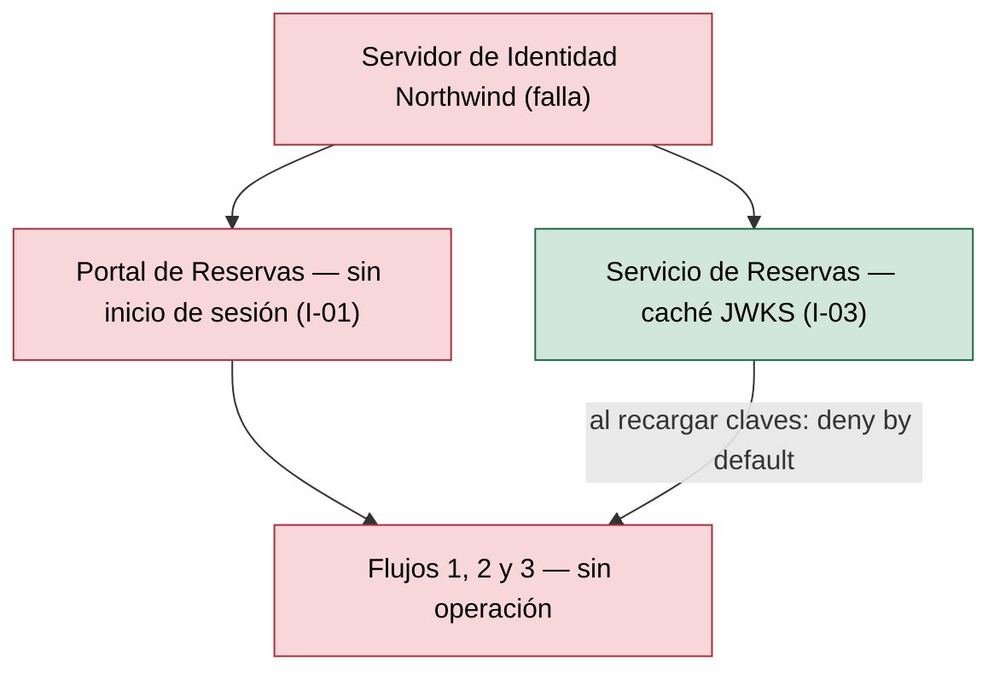
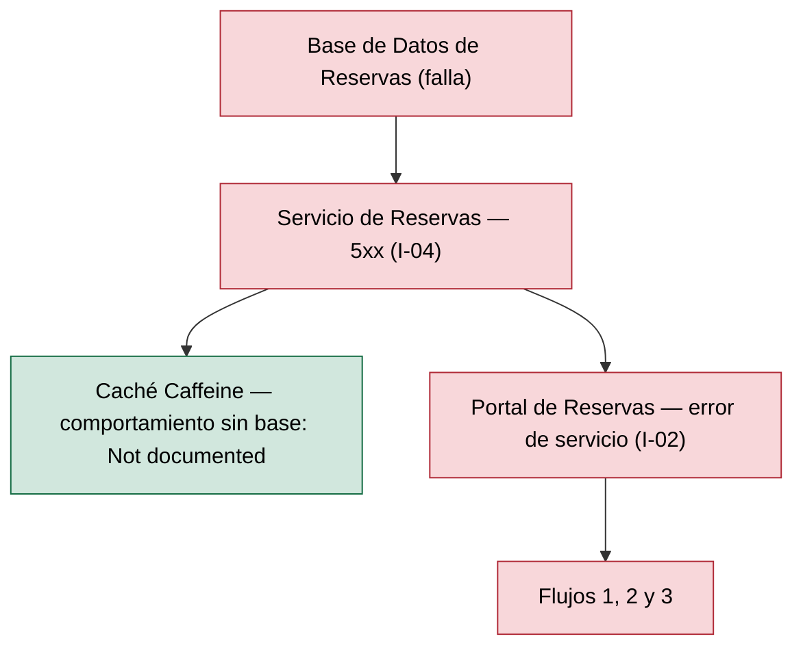
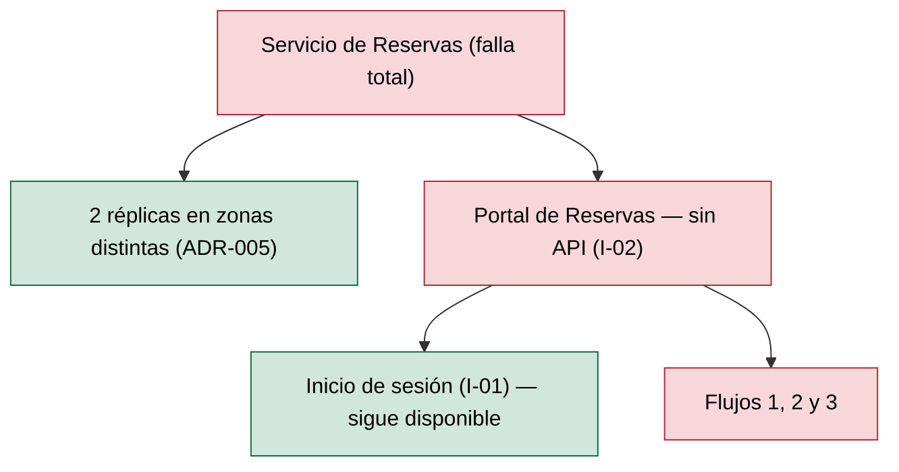

# Análisis de Radio de Impacto — Reservas de Salas Northwind - Autoservicio de reservas de salas de reunión v1.10.5

**Fecha de análisis**: 2026-11-02  
**Fuente de arquitectura**: `ARCHITECTURE.md` v1.10.5 (Status: Released)  
**Analista**: Architecture Analysis Skill

---

## 1. Resumen Ejecutivo <!-- SECTION: Executive Summary -->

Ningún componente supera el umbral de alto radio de impacto: el abanico total máximo es 2 (`Servidor de Identidad Northwind` y `Base de Datos de Reservas`), frente al umbral > 3. La tabla de componentes de alto radio queda vacía y no hay ids B.

El riesgo no está en el abanico sino en la severidad: con 4 integraciones síncronas request-response (I-01 a I-04) y ninguna asíncrona (docs/05 § 7), la caída de `Servidor de Identidad Northwind`, `Base de Datos de Reservas` o `Servicio de Reservas` corta los 3 flujos de usuario (S1). La única contención documentada es la caché local de claves JWKS en I-03 y las 2 réplicas en zonas distintas del `Servicio de Reservas` (ADR-005).

El escenario más grave es la caída de `Servidor de Identidad Northwind`: sin sesión (I-01) no hay operación y, al recargar claves, I-03 rechaza todo (deny by default). La prioridad de remediación es documentar timeouts, cortacircuitos y RTO/RPO: docs/09 § 11.3 declara RTO y RPO como Not documented, y docs/05 no declara timeouts en I-02 ni I-04.

No hay informe SPOF en disco para el cruce ⚡ SPOF+Blast; el informe STRIDE del 2026-10-18 ya registra T7-D (indisponibilidad JWKS) y T11-D (agotamiento de conexiones JDBC), que coinciden con los escenarios 1 y 2.

---

## 2. Hallazgos <!-- SECTION: Findings -->

### 2.1 Componentes de Alto Radio de Impacto <!-- SECTION: High-Blast Components -->

_Sin hallazgos en esta corrida._

### 2.2 Componentes Aislados <!-- SECTION: Isolated Components -->

| # | Component | Type | Why Isolated |
|---|---|---|---|
| 1 | `Portal de Reservas` | Web Application | Abanico 0: ningún componente lo consume (docs/05 § 7). Su caída no se propaga a otros componentes, pero deja sin interfaz a los 3 flujos; los archivos estáticos se sirven desde el CDN de Plataforma Northwind (ADR-107). |

### 2.3 Rutas de Cascada — Los 3 Peores Escenarios <!-- SECTION: Cascade Paths -->

#### Escenario 1 — Caída de `Servidor de Identidad Northwind`

Dependientes directos: `Portal de Reservas` (I-01) y `Servicio de Reservas` (I-03). Sin I-01 el portal no inicia sesión y la fase 1 corta los flujos 1, 2 y 3 (S1, Fail-closed). En I-03 la caché local de claves JWKS mantiene la validación de tokens vigentes; al recargar claves sin proveedor, el servicio rechaza toda solicitud (docs/05 § 7, I-03). La duración de esa caché y la vida del token: Not documented. STRIDE T7-D registra el mismo riesgo.

#### Escenario 2 — Caída de `Base de Datos de Reservas`

Dependiente directo: `Servicio de Reservas` (I-04); indirecto: `Portal de Reservas` (I-02). La falla de conexión responde error de servicio (docs/05 § 7, I-04): las fases 3, 4 y 5 fallan con 5xx y caen los flujos 1, 2 y 3 (S1, Fail-closed). Si la caché Caffeine sirve consultas durante la caída: Not documented. La conexión `LISTEN` también cae (ADR-109). Respaldo diario y PITR de 7 días; RPO Not documented (docs/09 § 11.3).

#### Escenario 3 — Caída de `Servicio de Reservas`

Dependiente directo: `Portal de Reservas` (I-02). La caída de una réplica la absorbe la segunda réplica en otra zona (docs/09 § 11.1, ADR-005). La caída total corta los flujos 1, 2 y 3 (S1, Fail-closed); el portal sigue cargando desde el CDN y el inicio de sesión (I-01) sigue disponible. Timeout y reintento del portal sobre I-02: Not documented.

### 2.4 MTTR Estimado por Componente <!-- SECTION: MTTR Estimate -->

| # | Component | Failure Type | Estimated MTTR | Source |
|---|---|---|---|---|
| 1 | `Base de Datos de Reservas` | Pérdida o corrupción de datos; caída de la instancia gestionada | [NOT DOCUMENTED] — RTO y RPO Not documented; respaldo diario, retención de 30 días, PITR de 7 días | docs/09 § 11.3 |
| 2 | `Servicio de Reservas` | Caída de réplica o de las 2 réplicas | [NOT DOCUMENTED] — 2 réplicas en zonas distintas; método de reversión Not documented | docs/09 § 11.1; ADR-005 |
| 3 | `Servidor de Identidad Northwind` | Proveedor externo no disponible | [NOT DOCUMENTED] | docs/05 § 7 (I-01, I-03) |
| 4 | `Portal de Reservas` | CDN no disponible o bundle defectuoso | [NOT DOCUMENTED] | docs/09 § 11.1; ADR-107 |

### 2.5 Recomendaciones de Mampara <!-- SECTION: Bulkhead Recommendations -->

_Sin hallazgos en esta corrida._

## 3. Mapa de Calor <!-- SECTION: Heat Map -->

_Sin hallazgos en esta corrida._

## 4. Top 5 Recomendaciones de Remediación <!-- SECTION: Top Recommendations -->

---

## 5. Veredicto <!-- SECTION: Summary Verdict -->

La arquitectura mantiene un grafo pequeño y acíclico: 4 integraciones, abanico máximo 2, ningún componente de alto radio. La base pertenece solo al `Servicio de Reservas` (I-04) y el servicio corre en 2 réplicas en zonas distintas (ADR-005). El tema dominante es la propagación síncrona Fail-closed: cada una de las 3 dependencias de backend corta los 3 flujos. El mínimo de remediación es documentar timeouts y cortacircuitos en I-02 e I-04, la vida de la caché JWKS en I-03 y el RTO/RPO en docs/09 § 11.3.

---

## 6. Brechas de Documentación <!-- SECTION: Documentation Gaps -->

- [ ] `[NOT DOCUMENTED]` `Servidor de Identidad Northwind` — docs/05 § 7 nombra el destino de I-01 e I-03 como `Proveedor de Identidad Northwind` (el sistema L1), no como el contenedor L2 `Servidor de Identidad Northwind`; las métricas de grafo le asignan abanico 0 al contenedor por esa deriva (docs/05-integration-points.md § 7)
- [ ] `[NOT DOCUMENTED]` `Base de Datos de Reservas` — RTO, RPO y ubicación del respaldo (docs/09-operational-considerations.md § 11.3)
- [ ] `[NOT DOCUMENTED]` I-02 e I-04 — timeout, reintento con backoff y cortacircuitos entre `Portal de Reservas` → `Servicio de Reservas` y `Servicio de Reservas` → `Base de Datos de Reservas` (docs/05-integration-points.md § 7; docs/08-scalability-and-performance.md)
- [ ] `[NOT DOCUMENTED]` I-03 — duración de la caché local de claves JWKS y vida del token de acceso (docs/05-integration-points.md § 7 (I-03); adr/ADR-002)
- [ ] `[NOT DOCUMENTED]` `Servicio de Reservas` — comportamiento de la caché Caffeine durante la caída de la base (si sirve entradas vigentes o responde 5xx) (docs/04-data-flow-patterns.md (fase 3); adr/ADR-109)
- [ ] `[NOT DOCUMENTED]` `Servicio de Reservas`, `Servidor de Identidad Northwind`, `Portal de Reservas` — MTTR o RTO por componente (docs/09-operational-considerations.md)
- [ ] `[NOT DOCUMENTED]` `Servidor de Identidad Northwind` — versión y capacidad del contenedor (docs/components/proveedor-de-identidad-northwind.md)

---

**Fuentes citadas**: `ARCHITECTURE.md`, `docs/04-data-flow-patterns.md`, `docs/05-integration-points.md`, `docs/09-operational-considerations.md`, `adr/ADR-002`, `adr/ADR-005`, `adr/ADR-107`, `adr/ADR-109`, `analysis/STRIDE-2026-10-18.md`
