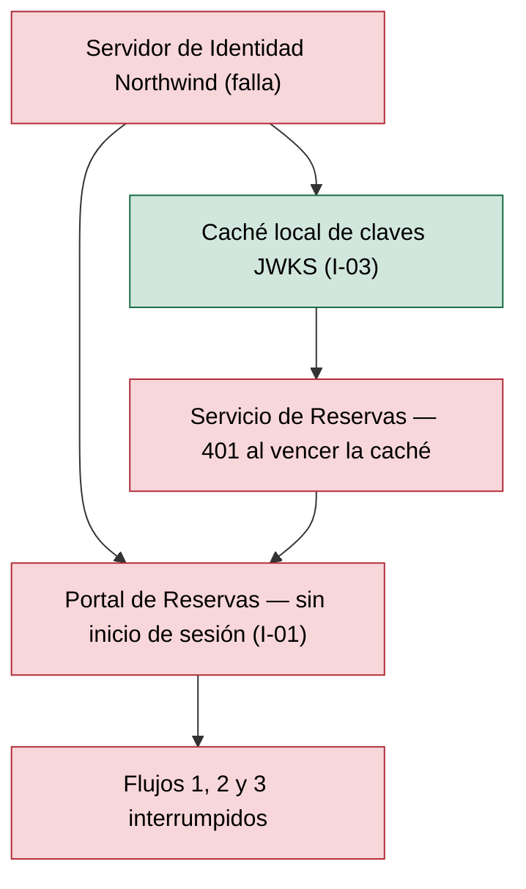
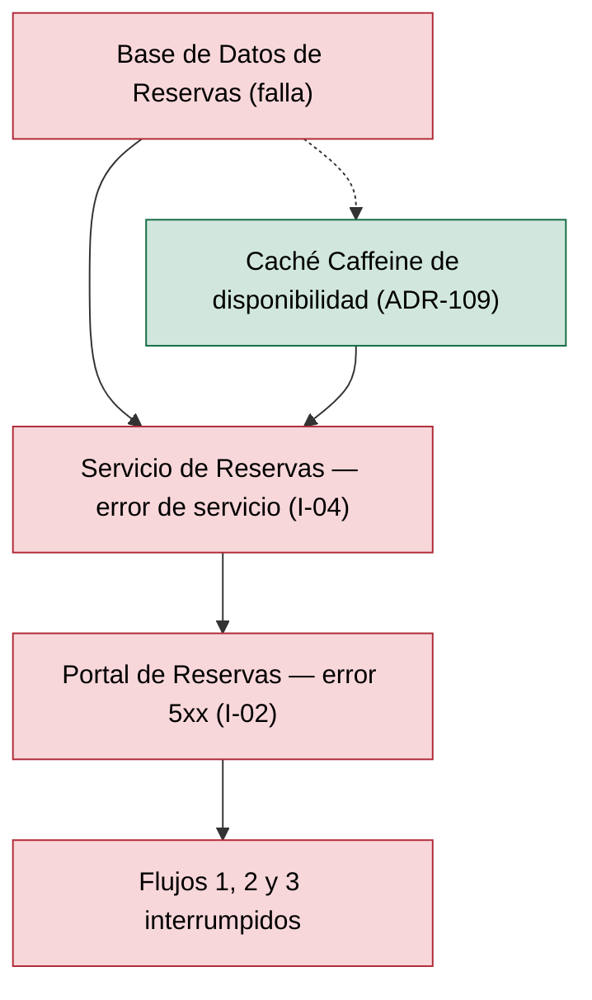
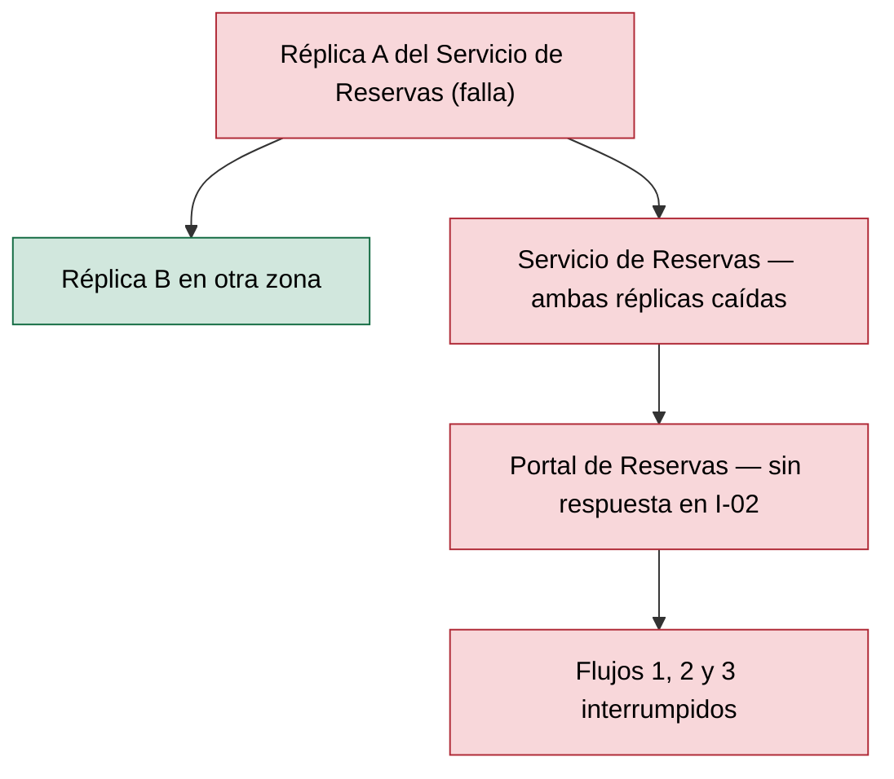

# Análisis de Radio de Impacto — Reservas de Salas Northwind - Autoservicio de reservas de salas de reunión v1.10.5

**Fecha de análisis**: 2026-11-03  
**Fuente de arquitectura**: `ARCHITECTURE.md` v1.10.5 (Status: Released)  
**Analista**: Architecture Analysis Skill

---

## 1. Resumen Ejecutivo <!-- SECTION: Executive Summary -->

Ningún componente supera el umbral de alto radio de impacto (abanico total > 3): el abanico máximo es 2, en `Servidor de Identidad Northwind` (2 dependientes directos por I-01 e I-03) y en `Base de Datos de Reservas` (1 directo, 1 indirecto por I-04 → I-02). La tabla de componentes de alto radio y la de mamparas quedan vacías; el Mapa de Calor no tiene entradas.

El abanico bajo no implica impacto bajo. La topología es una cadena síncrona de 4 componentes sin integraciones asíncronas (docs/05 § 7). La caída de `Servidor de Identidad Northwind` o de `Base de Datos de Reservas` interrumpe los 3 flujos de usuario (100 %, severidad S1); ambos ya figuran como SPOF críticos C2 y C1 en analysis/SPOF-2026-11-03.md, aunque su abanico (2) no alcanza el umbral de la intersección SPOF+Blast.

La única contención documentada es parcial: la caché local de claves JWKS en I-03 y la caché Caffeine invalidada por LISTEN/NOTIFY (ADR-109). Timeouts, cortacircuitos, reintentos con backoff, TTL de la caché JWKS y RTO/MTTR por componente: Not documented. La prioridad es documentar el TTL de la caché JWKS y el comportamiento del Servicio de Reservas ante la caída de la base, y fijar un RTO en docs/09 § 11.3.

---

## 2. Hallazgos <!-- SECTION: Findings -->

### 2.1 Componentes de Alto Radio de Impacto <!-- SECTION: High-Blast Components -->

_Sin hallazgos en esta corrida._

### 2.2 Componentes Aislados <!-- SECTION: Isolated Components -->

| # | Component | Type | Why Isolated |
|---|---|---|---|
| 1 | `Portal de Reservas` | Web Application | Abanico 0: ningún componente lo consume (docs/05 § 7, solo origen de I-01 e I-02). Su caída no se propaga a otros componentes, pero deja sin acceso a los 3 flujos de usuario (SPOF C3). |

### 2.3 Rutas de Cascada — Los 3 Peores Escenarios <!-- SECTION: Cascade Paths -->

#### Escenario 1 — Caída de `Servidor de Identidad Northwind` (S1, abanico 2)

Sin el IdP, I-01 falla y el Portal de Reservas no abre sesión (fase 1). En I-03 el Servicio de Reservas valida con la caché local de claves JWKS; al vencer la caché, rechaza toda solicitud (deny by default, docs/05 § I-03; STRIDE T12-D). Resultado: los 3 flujos caen, fail-closed tras el vencimiento de la caché, cuyo TTL no está documentado.

#### Escenario 2 — Caída de `Base de Datos de Reservas` (S1, abanico 2)

Una falla de conexión en I-04 hace que el Servicio de Reservas responda error de servicio (docs/05 § I-04). Reservar y cancelar (fases 4 y 5) fallan. La consulta (fase 3) pasa primero por la caché Caffeine (ADR-109), pero el catálogo de fases declara error 5xx con la base no disponible. La conexión LISTEN también cae y la invalidación de la caché se detiene. Resultado: los 3 flujos caen, fail-closed.

#### Escenario 3 — Caída de `Servicio de Reservas` (S1, abanico 1)

El servicio corre con al menos 2 réplicas en zonas distintas (docs/09 § 11.1), lo que contiene la caída de una réplica. Con las 2 réplicas caídas, el Portal de Reservas no completa ninguna llamada de I-02 y los 3 flujos caen. Timeouts, reintentos y mensaje al usuario del portal ante la caída: Not documented.

### 2.4 MTTR Estimado por Componente <!-- SECTION: MTTR Estimate -->

| # | Component | Failure Type | Estimated MTTR | Source |
|---|---|---|---|---|
| 1 | `Base de Datos de Reservas` | Pérdida o corrupción de datos; caída de la instancia | [NOT DOCUMENTED] — RTO y RPO no documentados; respaldo diario y PITR de 7 días | docs/09 § 11.3 |
| 2 | `Servicio de Reservas` | Caída de las 2 réplicas | [NOT DOCUMENTED] | docs/09 § 11.1 |
| 3 | `Servidor de Identidad Northwind` | Indisponibilidad del IdP | [NOT DOCUMENTED] | docs/components/proveedor-de-identidad-northwind.md |
| 4 | `Portal de Reservas` | Indisponibilidad del CDN o publicación defectuosa | [NOT DOCUMENTED] — método de reversión no documentado | docs/09 § 11.1 |

### 2.5 Recomendaciones de Mampara <!-- SECTION: Bulkhead Recommendations -->

_Sin hallazgos en esta corrida._

## 3. Mapa de Calor <!-- SECTION: Heat Map -->

_Sin hallazgos en esta corrida._

## 4. Top 5 Recomendaciones de Remediación <!-- SECTION: Top Recommendations -->

---

## 5. Veredicto <!-- SECTION: Summary Verdict -->

La arquitectura mantiene el radio de impacto acotado por diseño: 4 componentes, una base por servicio (ADR-101), ningún abanico mayor que 2 y 2 réplicas del Servicio de Reservas en zonas distintas. El riesgo dominante no es la propagación amplia sino la cadena síncrona sin mamparas documentadas: la caída de `Servidor de Identidad Northwind` o de `Base de Datos de Reservas` detiene el 100 % de los flujos. El conjunto mínimo es documentar el TTL de la caché JWKS de I-03, los timeouts de I-02 e I-04 y el RTO por componente en docs/09 § 11.3.

---

## 6. Brechas de Documentación <!-- SECTION: Documentation Gaps -->

- [ ] `[NOT DOCUMENTED]` `Servidor de Identidad Northwind` (I-03) — TTL de la caché local de claves JWKS: define cuánto tiempo el Servicio de Reservas sigue operando con el IdP caído (docs/05-integration-points.md § I-03)
- [ ] `[NOT DOCUMENTED]` I-02 e I-04 — Timeouts, cortacircuitos y reintentos con backoff entre Portal de Reservas, Servicio de Reservas y Base de Datos de Reservas (docs/08-scalability-and-performance.md o docs/05-integration-points.md § 7)
- [ ] `[NOT DOCUMENTED]` `Base de Datos de Reservas` — RTO y RPO (docs/09-operational-considerations.md § 11.3)
- [ ] `[NOT DOCUMENTED]` `Servicio de Reservas`, `Servidor de Identidad Northwind`, `Portal de Reservas` — MTTR o RTO por componente; método de reversión del despliegue (docs/09-operational-considerations.md § 11.1 y § 11.3)
- [ ] `[NOT DOCUMENTED]` `Base de Datos de Reservas` (fase 3) — Si la caché Caffeine sirve la consulta de disponibilidad con la base caída o si responde 5xx (docs/04-data-flow-patterns.md § Clasificación de fallas)
- [ ] `[NOT DOCUMENTED]` `Portal de Reservas` (I-02) — Comportamiento del portal ante 5xx o falta de respuesta del Servicio de Reservas (docs/04-data-flow-patterns.md § Clasificación de fallas)

---

**Fuentes citadas**: `ARCHITECTURE.md`, `docs/04-data-flow-patterns.md`, `docs/05-integration-points.md`, `docs/09-operational-considerations.md`, `docs/components/proveedor-de-identidad-northwind.md`, `adr/ADR-002-oidc-keycloak-identity.md`, `adr/ADR-109-invalidacion-de-la-cache-con-listen-notify.md`, `analysis/SPOF-2026-11-03.md`
