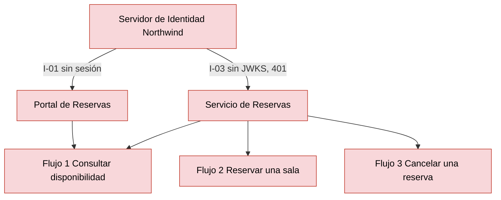
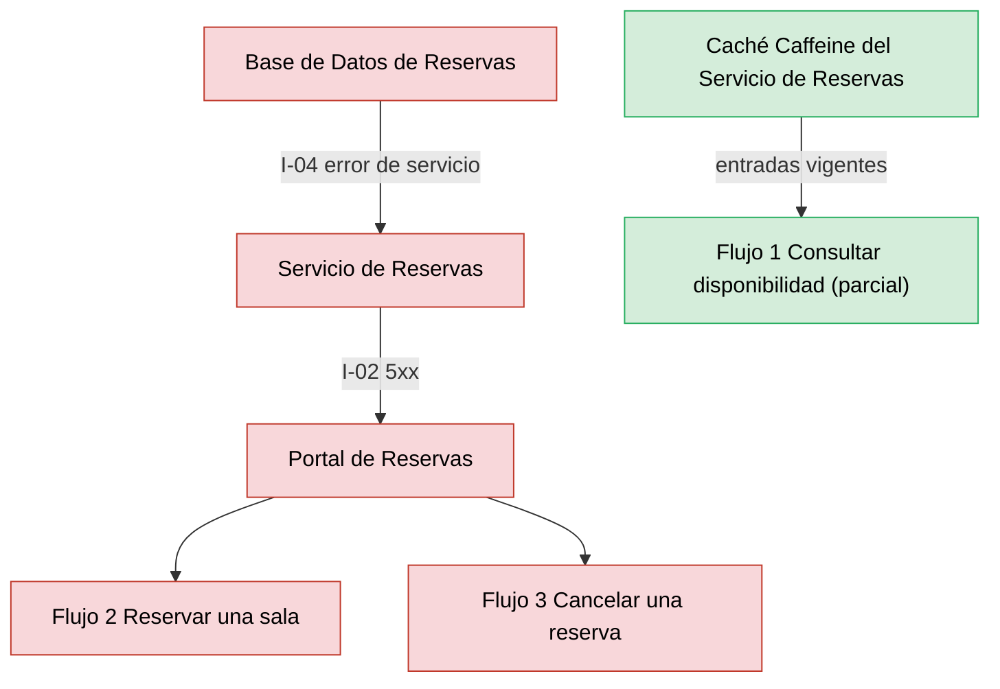
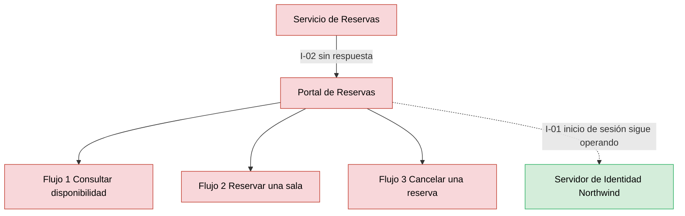

# Análisis de Radio de Impacto — Reservas de Salas Northwind - Autoservicio de reservas de salas de reunión v1.10.5

**Fecha de análisis**: 2026-11-03  
**Fuente de arquitectura**: `ARCHITECTURE.md` v1.10.5 (Status: Released)  
**Analista**: Architecture Analysis Skill

---

## 1. Resumen Ejecutivo <!-- SECTION: Executive Summary -->

Ningún componente supera el umbral de alto radio de impacto: el abanico total máximo es 2, en `Servidor de Identidad Northwind` (consumido por I-01 e I-03) y en `Base de Datos de Reservas` (I-04 directo, `Portal de Reservas` a 2 saltos). La tabla de componentes de alto radio queda vacía y el mapa de calor no tiene entradas.

El radio pequeño no implica contención. Las 4 integraciones son síncronas request-response (docs/05 § 7) y ninguna documenta circuit breaker, timeout ni reintento con backoff. `Servidor de Identidad Northwind` falla cerrado: sin claves JWKS el `Servicio de Reservas` rechaza toda solicitud (docs/05 I-03) y sin sesión no hay operación (docs/04 fase 1). Su caída corta los 3 flujos de usuario: nivel S1.

`Base de Datos de Reservas` y `Servicio de Reservas` también cortan los 3 flujos al fallar (docs/04 fases 3–5; docs/05 I-04): nivel S1 con abanico 2 y 1. Ningún SPOF crítico de `analysis/SPOF-2026-11-02.md` (C1, C2, C4) tiene abanico mayor que 3, así que no hay marca SPOF+Blast.

Prioridad de remediación: documentar timeouts y la política de degradación de I-02, I-03 e I-04, y el RTO/RPO de `Base de Datos de Reservas`, hoy `Not documented` en docs/09 § 11.3.

---

## 2. Hallazgos <!-- SECTION: Findings -->

### 2.1 Componentes de Alto Radio de Impacto <!-- SECTION: High-Blast Components -->

_Sin hallazgos en esta corrida._

### 2.2 Componentes Aislados <!-- SECTION: Isolated Components -->

| # | Component | Type | Why Isolated |
|---|---|---|---|
| 1 | `Portal de Reservas` | Web Application | Abanico 0: ningún componente lo consume (docs/05 § 7, solo origen de I-01 e I-02). Su falla no se propaga a otros componentes, pero deja a los usuarios sin los 3 flujos (SPOF C4). |

### 2.3 Rutas de Cascada — Los 3 Peores Escenarios <!-- SECTION: Cascade Paths -->

#### Escenario 1 — Falla de `Servidor de Identidad Northwind`

Dependientes directos: `Portal de Reservas` (I-01) y `Servicio de Reservas` (I-03). Sin inicio de sesión, el portal no obtiene token (docs/04 fase 1). Con la caché de claves JWKS vencida, el `Servicio de Reservas` rechaza cada solicitud con deny by default (docs/05 I-03). Resultado: 3/3 flujos caídos, falla cerrada, nivel S1. La duración de la caché JWKS es `Not documented`.

#### Escenario 2 — Falla de `Base de Datos de Reservas`

Dependiente directo: `Servicio de Reservas` (I-04); indirecto: `Portal de Reservas` (I-02). Una falla de conexión devuelve error de servicio (docs/05 I-04). Las fases 4 y 5 fallan; la fase 3 responde solo con entradas vigentes de la caché Caffeine y, sin ellas, devuelve 5xx (docs/04, ADR-109). Resultado: flujos 2 y 3 caídos, flujo 1 parcial; nivel S1.

#### Escenario 3 — Falla de `Servicio de Reservas`

Dependiente directo: `Portal de Reservas` (I-02). El portal no tiene otra ruta hacia los datos: los 3 flujos pasan por la fase 2 en el servicio (docs/04). Las 2 réplicas en zonas distintas (docs/09 § 11.1) cubren la pérdida de un pod o una zona, no un defecto de versión ni la saturación (STRIDE T9-D). Resultado: 3/3 flujos caídos, nivel S1.

### 2.4 MTTR Estimado por Componente <!-- SECTION: MTTR Estimate -->

| # | Component | Failure Type | Estimated MTTR | Source |
|---|---|---|---|---|
| 1 | `Base de Datos de Reservas` | Pérdida o corrupción de datos; restauración desde respaldo diario o PITR de 7 días | [NOT DOCUMENTED] | docs/09 § 11.3 (RTO y RPO: Not documented) |
| 2 | `Servicio de Reservas` | Caída de réplicas o versión defectuosa | [NOT DOCUMENTED] | docs/09 § 11.1 (método, reversión y frecuencia: Not documented) |
| 3 | `Servidor de Identidad Northwind` | Indisponibilidad del login OIDC y del endpoint JWKS | [NOT DOCUMENTED] | docs/09 (sin entrada); docs/05 I-01, I-03 |
| 4 | `Portal de Reservas` | Publicación defectuosa o indisponibilidad del CDN | [NOT DOCUMENTED] | docs/09 § 11.1 (ADR-107; reversión: Not documented) |

### 2.5 Recomendaciones de Mampara <!-- SECTION: Bulkhead Recommendations -->

_Sin hallazgos en esta corrida._

## 3. Mapa de Calor <!-- SECTION: Heat Map -->

_Sin hallazgos en esta corrida._

## 4. Top 5 Recomendaciones de Remediación <!-- SECTION: Top Recommendations -->

---

## 5. Veredicto <!-- SECTION: Summary Verdict -->

La topología es corta: 4 componentes, 4 integraciones síncronas, sin ciclos y con abanico máximo 2, así que ningún componente entra en la categoría de alto radio. `Base de Datos de Reservas` tiene un único consumidor (I-04) y la caché Caffeine con invalidación LISTEN/NOTIFY (ADR-109) sostiene en parte el flujo 1. El riesgo dominante es la profundidad, no la amplitud: `Servidor de Identidad Northwind`, `Servicio de Reservas` y `Base de Datos de Reservas` cortan cada uno los 3 flujos, sin timeouts ni circuit breakers documentados. Remediación mínima: documentar timeouts y degradación en I-02, I-03 e I-04, la vigencia de la caché JWKS y el RTO/RPO de docs/09 § 11.3.

---

## 6. Brechas de Documentación <!-- SECTION: Documentation Gaps -->

- [ ] `[NOT DOCUMENTED]` I-02, I-03, I-04 — Timeout, reintento con backoff y circuit breaker de cada integración síncrona (docs/05-integration-points.md § 7 y docs/08-scalability-and-performance.md)
- [ ] `[NOT DOCUMENTED]` `Servidor de Identidad Northwind` (I-03) — Vigencia de la caché local de claves JWKS del `Servicio de Reservas` (docs/05-integration-points.md § 7, I-03)
- [ ] `[NOT DOCUMENTED]` `Base de Datos de Reservas` — RTO y RPO; ubicación de los respaldos (docs/09-operational-considerations.md § 11.3)
- [ ] `[NOT DOCUMENTED]` `Servicio de Reservas`, `Portal de Reservas` — Método de despliegue, reversión y frecuencia (MTTR de una versión defectuosa) (docs/09-operational-considerations.md § 11.1)
- [ ] `[NOT DOCUMENTED]` `Servidor de Identidad Northwind` — MTTR o RTO del proveedor de identidad externo (docs/09-operational-considerations.md o docs/components/proveedor-de-identidad-northwind.md)
- [ ] `[NOT DOCUMENTED]` Presupuestos de latencia I-02 e I-04 — Presupuesto por salto, base para fijar timeouts (docs/04-data-flow-patterns.md, Presupuesto de latencia)

---

**Fuentes citadas**: `ARCHITECTURE.md`, `docs/04-data-flow-patterns.md`, `docs/05-integration-points.md`, `docs/09-operational-considerations.md`, `adr/ADR-109`, `analysis/SPOF-2026-11-02.md`, `analysis/STRIDE-2026-11-02.md`
