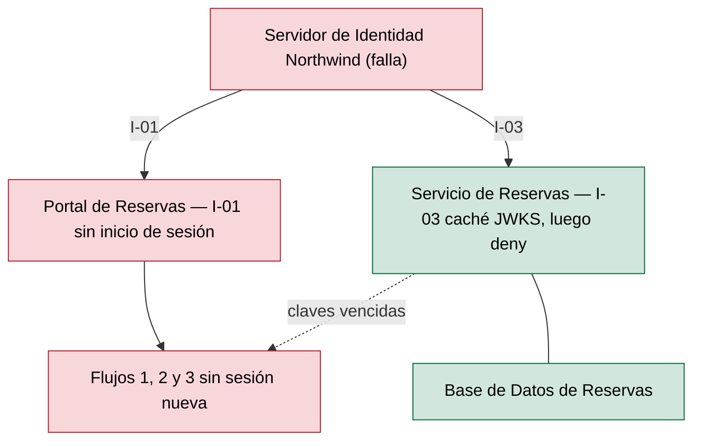
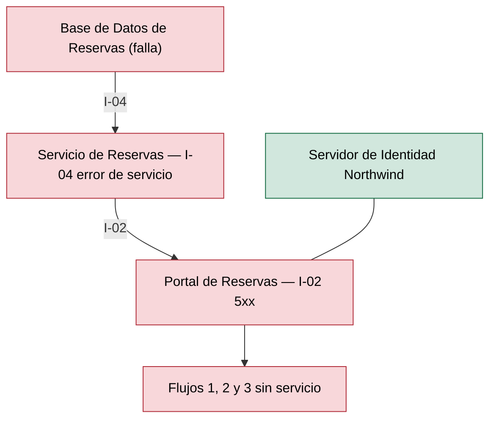
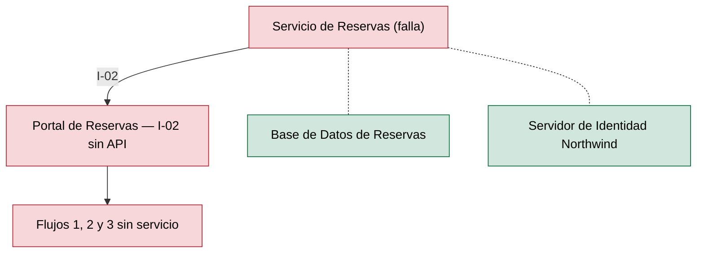

# Análisis de Radio de Impacto — Reservas de Salas Northwind - Autoservicio de reservas de salas de reunión v1.10.5

**Fecha de análisis**: 2026-11-03  
**Fuente de arquitectura**: `ARCHITECTURE.md` v1.10.5 (Status: Released)  
**Analista**: Architecture Analysis Skill

---

## 1. Resumen Ejecutivo <!-- SECTION: Executive Summary -->

Ningún componente supera el umbral de High-Blast: el mayor abanico total es 2, en `Servidor de Identidad Northwind` (consumidores directos `Portal de Reservas` y `Servicio de Reservas`, I-01 e I-03) y en `Base de Datos de Reservas` (`Servicio de Reservas` directo vía I-04, `Portal de Reservas` indirecto vía I-02). La topología tiene 4 componentes y 4 integraciones síncronas request-response, sin ciclos ni integraciones asíncronas (docs/05 § 7).

El abanico bajo no implica impacto bajo. Las 4 integraciones son síncronas y fail-closed: I-03 rechaza la solicitud sin claves JWKS (deny by default) e I-04 responde error de servicio ante una falla de conexión (docs/05 § 7). La caída de `Servidor de Identidad Northwind`, `Base de Datos de Reservas` o `Servicio de Reservas` corta los 3 flujos de usuario (docs/04, Flujos 1–3), un impacto de nivel S1 por el criterio de flujos.

La intersección con el informe SPOF (analysis/SPOF-2026-11-03.md) es vacía en la tabla de High-Blast: C1, C2, C3 y C4 son SPOF críticos, pero ninguno tiene abanico mayor a 3. El único elemento de contención documentado es la caché local de claves JWKS de I-03; ningún documento declara timeouts, circuit breakers ni RTO por componente (docs/09 § 11.3: RTO y RPO Not documented).

Prioridad de remediación: documentar timeouts y la política ante falla en I-02, I-03 e I-04, y fijar RTO y RPO de `Base de Datos de Reservas` y `Servidor de Identidad Northwind` en docs/09 § 11.3. Sin hallazgos B, la tabla de mamparas, el mapa de calor y el Top 5 quedan vacíos.

---

## 2. Hallazgos <!-- SECTION: Findings -->

### 2.1 Componentes de Alto Radio de Impacto <!-- SECTION: High-Blast Components -->

_Sin hallazgos en esta corrida._

### 2.2 Componentes Aislados <!-- SECTION: Isolated Components -->

| # | Component | Type | Why Isolated |
|---|---|---|---|
| 1 | `Portal de Reservas` | Web Application | Abanico 0: ningún componente lo consume (docs/05 § 7). Su caída no se propaga a otros componentes, pero deja sin los 3 flujos a los usuarios; se publica como archivos estáticos en el CDN de Plataforma Northwind (docs/09 § 11.1, ADR-107). |

### 2.3 Rutas de Cascada — Los 3 Peores Escenarios <!-- SECTION: Cascade Paths -->

#### Escenario 1 — Caída de `Servidor de Identidad Northwind`

Sin el proveedor, `Portal de Reservas` no inicia sesión por I-01 y, sin sesión, no hay operación (docs/04, Fase 1). `Servicio de Reservas` valida tokens con claves JWKS en caché local por I-03; al vencer o recargar las claves rechaza toda solicitud (docs/05 § 7, I-03). La duración de la caché JWKS es Not documented. Resultado: los 3 flujos caen para sesiones nuevas.

#### Escenario 2 — Caída de `Base de Datos de Reservas`

`Servicio de Reservas` responde error de servicio ante la falla de conexión JDBC de I-04 (docs/05 § 7). `Portal de Reservas` recibe el error por I-02: la consulta devuelve 5xx (docs/04, Fase 3) y la creación y cancelación no se completan (Fases 4 y 5). La caché Caffeine no está documentada como respaldo ante la caída de la base. Resultado: los 3 flujos caen.

#### Escenario 3 — Caída de `Servicio de Reservas`

`Portal de Reservas` pierde la API REST de I-02 y no consulta, reserva ni cancela. `Base de Datos de Reservas` y `Servidor de Identidad Northwind` no dependen del servicio y quedan contenidos. El servicio corre con al menos 2 réplicas en zonas distintas (docs/09 § 11.1, ADR-005), que contienen la caída de un pod; la caída total corta los 3 flujos.

### 2.4 MTTR Estimado por Componente <!-- SECTION: MTTR Estimate -->

| # | Component | Failure Type | Estimated MTTR | Source |
|---|---|---|---|---|
| 1 | `Base de Datos de Reservas` | Pérdida o corrupción de datos; caída del motor PostgreSQL 16 | [NOT DOCUMENTED] — respaldo diario, retención de 30 días y PITR de 7 días; RTO y RPO Not documented | docs/09 § 11.3 |
| 2 | `Servicio de Reservas` | Caída de réplicas | [NOT DOCUMENTED] — al menos 2 réplicas en zonas distintas | docs/09 § 11.1; adr/ADR-005 |
| 3 | `Servidor de Identidad Northwind` | Proveedor no disponible | [NOT DOCUMENTED] | docs/09 § 11.3 (sin fila); docs/components/proveedor-de-identidad-northwind.md |
| 4 | `Portal de Reservas` | Falla de publicación en el CDN | [NOT DOCUMENTED] — método de reversión Not documented | docs/09 § 11.1; adr/ADR-107 |

### 2.5 Recomendaciones de Mampara <!-- SECTION: Bulkhead Recommendations -->

_Sin hallazgos en esta corrida._

## 3. Mapa de Calor <!-- SECTION: Heat Map -->

_Sin hallazgos en esta corrida._

## 4. Top 5 Recomendaciones de Remediación <!-- SECTION: Top Recommendations -->

---

## 5. Veredicto <!-- SECTION: Summary Verdict -->

La arquitectura mantiene un grafo pequeño y acíclico: 4 componentes, 4 integraciones síncronas y abanico máximo de 2, sin componentes High-Blast. `Base de Datos de Reservas` solo la accede `Servicio de Reservas` (I-04) y las 2 réplicas en zonas distintas contienen la caída de un pod. El riesgo dominante es la falla cerrada síncrona: `Servidor de Identidad Northwind`, `Base de Datos de Reservas` y `Servicio de Reservas` cortan cada uno los 3 flujos. El conjunto mínimo de remediación es documentar timeouts y política ante falla en I-02, I-03 e I-04, la duración de la caché JWKS, y RTO y RPO por componente en docs/09 § 11.3.

---

## 6. Brechas de Documentación <!-- SECTION: Documentation Gaps -->

- [ ] `[NOT DOCUMENTED]` `Base de Datos de Reservas` — RTO, RPO y ubicación del respaldo (docs/09-operational-considerations.md § 11.3)
- [ ] `[NOT DOCUMENTED]` `Servidor de Identidad Northwind` — MTTR o RTO del proveedor y su disponibilidad comprometida (docs/09-operational-considerations.md § 11.3; docs/components/proveedor-de-identidad-northwind.md)
- [ ] `[NOT DOCUMENTED]` `Servicio de Reservas` — MTTR por caída total y método de reversión del despliegue (docs/09-operational-considerations.md § 11.1)
- [ ] `[NOT DOCUMENTED]` `Portal de Reservas` — MTTR y método de reversión de la publicación en el CDN (docs/09-operational-considerations.md § 11.1)
- [ ] `[NOT DOCUMENTED]` I-02, I-03, I-04 — Timeouts, reintentos y circuit breakers en las llamadas síncronas (docs/05-integration-points.md § 7; docs/08-scalability-and-performance.md)
- [ ] `[NOT DOCUMENTED]` I-03 (caché JWKS de `Servicio de Reservas`) — Duración de la caché de claves y comportamiento al vencer con el proveedor caído (docs/05-integration-points.md § 7, I-03)
- [ ] `[NOT DOCUMENTED]` Caché Caffeine de `Servicio de Reservas` — Si sirve disponibilidad desde caché cuando `Base de Datos de Reservas` no responde (docs/04-data-flow-patterns.md, Fase 3; adr/ADR-109)

---

**Fuentes citadas**: `ARCHITECTURE.md`, `docs/04-data-flow-patterns.md`, `docs/05-integration-points.md`, `docs/09-operational-considerations.md`, `docs/components/proveedor-de-identidad-northwind.md`, `adr/ADR-005`, `adr/ADR-107`, `adr/ADR-109`, `analysis/SPOF-2026-11-03.md`
