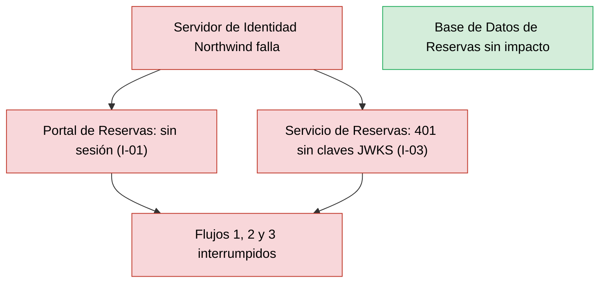
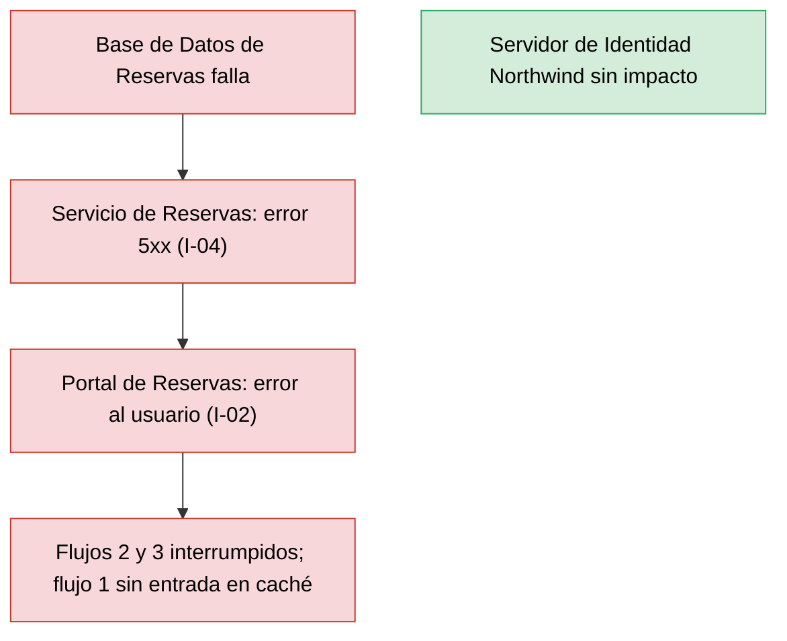
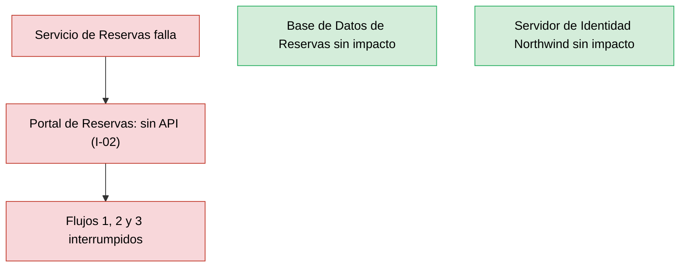

# Análisis de Radio de Impacto — Reservas de Salas Northwind - Autoservicio de reservas de salas de reunión v1.10.5

**Fecha de análisis**: 2026-11-03  
**Fuente de arquitectura**: `ARCHITECTURE.md` v1.10.5 (Status: Released)  
**Analista**: Architecture Analysis Skill

---

## 1. Resumen Ejecutivo <!-- SECTION: Executive Summary -->

Ningún componente supera el umbral de alto radio de impacto: el abanico total máximo es 2 (`Servidor de Identidad Northwind` y `Base de Datos de Reservas`), sobre 4 integraciones síncronas I-01 a I-04 (docs/05 § 7). La tabla de componentes de alto radio queda vacía y no hay B-ids.

El abanico bajo no implica contención. Los 3 contenedores del camino crítico son de nivel S1: la caída del `Servidor de Identidad Northwind`, del `Servicio de Reservas` o de la `Base de Datos de Reservas` interrumpe los 3 flujos de usuario. Las 4 integraciones son fail-closed y ninguna documenta timeout, circuit breaker ni fallback.

Cruce con SPOF: los 4 hallazgos críticos C1 a C4 de `analysis/SPOF-2026-11-03.md` caen sobre componentes con abanico 2 o menor, por lo que ningún C-id coincide con un nodo de alto radio. El riesgo se concentra en la profundidad (todo el flujo es una cadena síncrona), no en la amplitud.

Prioridad de remediación: documentar timeouts y el TTL de la caché JWKS en I-03 e I-04, y declarar RTO y RPO en docs/09 § 11.3, hoy `Not documented`.

---

## 2. Hallazgos <!-- SECTION: Findings -->

### 2.1 Componentes de Alto Radio de Impacto <!-- SECTION: High-Blast Components -->

_Sin hallazgos en esta corrida._

### 2.2 Componentes Aislados <!-- SECTION: Isolated Components -->

| # | Component | Type | Why Isolated |
|---|---|---|---|
| 1 | `Portal de Reservas` | Web Application | Abanico 0: ningún componente consume el portal (docs/05 § 7). Su falla no se propaga a otros componentes, pero corta los 3 flujos de usuario (SPOF C4); se publica como archivos estáticos en el CDN (ADR-107). |

### 2.3 Rutas de Cascada — Los 3 Peores Escenarios <!-- SECTION: Cascade Paths -->

#### Escenario 1 — Falla del Servidor de Identidad Northwind (S1, abanico 2)

Sin el proveedor, el `Portal de Reservas` no inicia sesión por I-01 y el `Servicio de Reservas` rechaza toda solicitud por I-03 cuando no tiene claves JWKS (deny by default, docs/05 § 7 I-03). La caché local de claves contiene la falla solo mientras dura su vigencia; el TTL es `Not documented` (STRIDE T6-D). La `Base de Datos de Reservas` no se ve afectada.

#### Escenario 2 — Falla de la Base de Datos de Reservas (S1, abanico 2)

El `Servicio de Reservas` responde error de servicio ante la falla de conexión JDBC por I-04 (docs/05 § 7 I-04), y el `Portal de Reservas` lo recibe por I-02. Los flujos 2 y 3 fallan; el flujo 1 falla en cada consulta sin entrada vigente en la caché Caffeine (fase 3, docs/04). Si la caché sirve entradas durante la caída es `Not documented`. RTO y RPO: `Not documented` (docs/09 § 11.3).

#### Escenario 3 — Falla del Servicio de Reservas (S1, abanico 1)

El `Portal de Reservas` depende del servicio por I-02 para los 3 flujos; sin respuesta, ninguna consulta, reserva ni cancelación prospera. Las 2 réplicas en zonas distintas (docs/09 § 11.1, ADR-005) contienen la falla de un pod, no la de una versión defectuosa desplegada en ambas. El `Servidor de Identidad Northwind` y la `Base de Datos de Reservas` no se ven afectados.

### 2.4 MTTR Estimado por Componente <!-- SECTION: MTTR Estimate -->

| # | Component | Failure Type | Estimated MTTR | Source |
|---|---|---|---|---|
| 1 | `Base de Datos de Reservas` | Pérdida de la instancia o corrupción de datos | [NOT DOCUMENTED] — respaldo diario y PITR de 7 días; RTO y RPO sin valor | docs/09 § 11.3 |
| 2 | `Servicio de Reservas` | Caída de réplicas o despliegue defectuoso | [NOT DOCUMENTED] — método de reversión sin documentar | docs/09 § 11.1 |
| 3 | `Servidor de Identidad Northwind` | Proveedor no disponible | [NOT DOCUMENTED] | docs/09 § 11 (sin fila para el proveedor) |
| 4 | `Portal de Reservas` | Publicación defectuosa en el CDN | [NOT DOCUMENTED] | docs/09 § 11.1 |

### 2.5 Recomendaciones de Mampara <!-- SECTION: Bulkhead Recommendations -->

_Sin hallazgos en esta corrida._

## 3. Mapa de Calor <!-- SECTION: Heat Map -->

_Sin hallazgos en esta corrida._

## 4. Top 5 Recomendaciones de Remediación <!-- SECTION: Top Recommendations -->

---

## 5. Veredicto <!-- SECTION: Summary Verdict -->

La arquitectura mantiene un radio de impacto estrecho: 4 componentes, 4 integraciones síncronas, abanico máximo 2 y ningún ciclo. El tema dominante es la cadena síncrona fail-closed: 3 de 4 componentes son S1 y ninguna integración documenta timeout, circuit breaker ni fallback. El mínimo de remediación es documentar timeouts en I-02, I-03 e I-04, el TTL de la caché JWKS, y RTO y RPO por componente.

---

## 6. Brechas de Documentación <!-- SECTION: Documentation Gaps -->

- [ ] `[NOT DOCUMENTED]` `Base de Datos de Reservas` — RTO y RPO (docs/09-operational-considerations.md § 11.3)
- [ ] `[NOT DOCUMENTED]` `Servicio de Reservas` — Método de despliegue, reversión y frecuencia, insumo del MTTR (docs/09-operational-considerations.md § 11.1)
- [ ] `[NOT DOCUMENTED]` `Servidor de Identidad Northwind` — MTTR o RTO del proveedor y su disponibilidad comprometida (docs/09-operational-considerations.md § 11 o docs/components/proveedor-de-identidad-northwind.md)
- [ ] `[NOT DOCUMENTED]` `Portal de Reservas` — MTTR ante una publicación defectuosa en el CDN (docs/09-operational-considerations.md § 11.1)
- [ ] `[NOT DOCUMENTED]` I-02, I-03, I-04 — Timeouts, reintentos y circuit breakers entre consumidor y proveedor (docs/05-integration-points.md § 7 y docs/08-scalability-and-performance.md)
- [ ] `[NOT DOCUMENTED]` I-03 — caché JWKS del `Servicio de Reservas` — TTL de la caché de claves, que define cuánto contiene una caída del proveedor (docs/05-integration-points.md § 7 I-03)
- [ ] `[NOT DOCUMENTED]` Caché Caffeine del `Servicio de Reservas` — Si sirve entradas vigentes durante una caída de la `Base de Datos de Reservas` (docs/04-data-flow-patterns.md, fase 3, o docs/components/reservas-de-salas-northwind/02-servicio-de-reservas.md)
- [ ] `[NOT DOCUMENTED]` Alertas — Severidad y guardia de cada alerta, que acotan el tiempo de detección (docs/09-operational-considerations.md § 11.2)

---

**Fuentes citadas**: `ARCHITECTURE.md`, `docs/04-data-flow-patterns.md`, `docs/05-integration-points.md`, `docs/09-operational-considerations.md`, `adr/ADR-005`, `adr/ADR-107`, `adr/ADR-109`, `analysis/SPOF-2026-11-03.md`, `analysis/STRIDE-2026-11-03.md`
