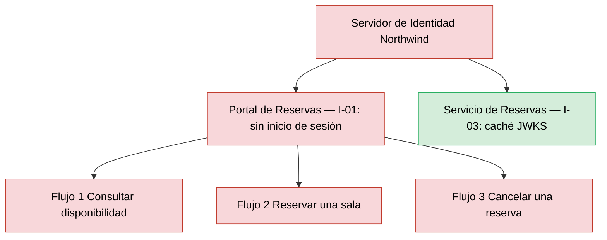
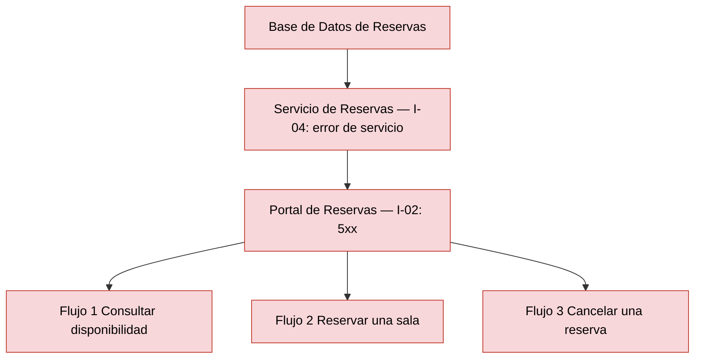
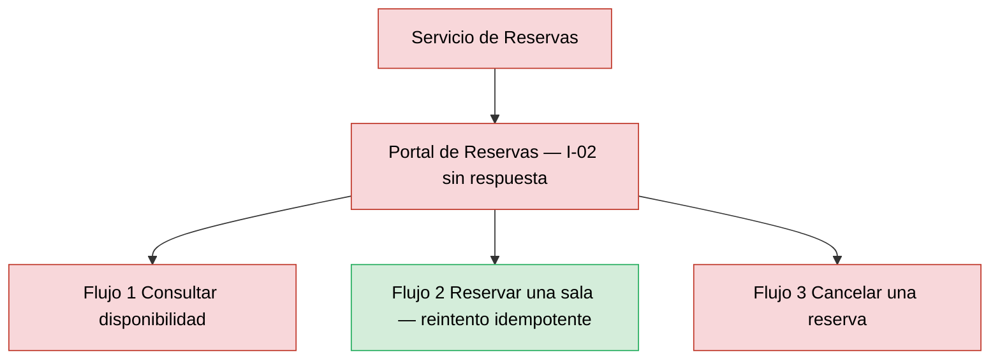

# Análisis de Radio de Impacto — Reservas de Salas Northwind - Autoservicio de reservas de salas de reunión v1.10.5

**Fecha de análisis**: 2026-11-03  
**Fuente de arquitectura**: `ARCHITECTURE.md` v1.10.5 (Status: Released)  
**Analista**: Architecture Analysis Skill

---

## 1. Resumen Ejecutivo <!-- SECTION: Executive Summary -->

Ningún componente supera un abanico total de 3: el máximo es 2, en `Servidor de Identidad Northwind` (consumido por I-01 e I-03) y en `Base de Datos de Reservas` (I-04 directo, `Portal de Reservas` a 2 saltos). La tabla de alto radio de impacto queda vacía y no hay filas B-nn, mapa de calor ni recomendaciones de mampara.

El abanico pequeño no implica contención. Los 4 componentes forman una cadena síncrona sin cola ni cortacircuitos documentados (docs/05 § 7: "No hay integraciones asíncronas"). La falla de `Servidor de Identidad Northwind`, `Servicio de Reservas` o `Base de Datos de Reservas` interrumpe los 3 flujos de usuario de docs/04, nivel S1 por cobertura de flujos.

El cruce con `analysis/SPOF-2026-11-03.md` no produce marca SPOF+Blast: los SPOF críticos C1 (`Base de Datos de Reservas`), C2 (`Servidor de Identidad Northwind`) y C3 (`Portal de Reservas`) tienen abanico de 2 o menos. La única contención documentada es la caché local de claves JWKS de I-03; sin claves, el servicio rechaza toda solicitud (falla cerrada).

Prioridad de remediación: documentar RTO, RPO y MTTR por componente (docs/09 § 11.3 los declara Not documented) y los tiempos de espera de I-02, I-03 e I-04, hoy ausentes del corpus.

---

## 2. Hallazgos <!-- SECTION: Findings -->

### 2.1 Componentes de Alto Radio de Impacto <!-- SECTION: High-Blast Components -->

_Sin hallazgos en esta corrida._

### 2.2 Componentes Aislados <!-- SECTION: Isolated Components -->

| # | Component | Type | Why Isolated |
|---|---|---|---|
| 1 | `Portal de Reservas` | Web Application | Abanico 0: ningún componente lo consume (docs/05 § 7, I-01 e I-02 salen de él). Su falla no se propaga a otros componentes, pero corta los 3 flujos de usuario al ser la única interfaz (SPOF C3); archivos estáticos en el CDN de Plataforma Northwind (ADR-107). |

### 2.3 Rutas de Cascada — Los 3 Peores Escenarios <!-- SECTION: Cascade Paths -->

#### Escenario 1 — Falla de `Servidor de Identidad Northwind` (S1, abanico 2)

Sin el proveedor, I-01 no emite sesiones: la fase 1 falla y ningún flujo arranca. I-03 sigue validando con la caché local de claves JWKS mientras las claves estén cargadas; sin claves, el `Servicio de Reservas` rechaza cada solicitud (deny by default, docs/05 § 7 I-03). La duración de la caché JWKS no está documentada.

#### Escenario 2 — Falla de `Base de Datos de Reservas` (S1, abanico 2)

I-04 es la única ruta de lectura y escritura. Sin conexión, el `Servicio de Reservas` responde error de servicio (docs/05 § 7 I-04) y el `Portal de Reservas` recibe 5xx en las fases 3, 4 y 5. La caché Caffeine de la fase 3 (ADR-109) no tiene comportamiento documentado ante base no disponible; el catálogo de fases declara error 5xx.

#### Escenario 3 — Falla de `Servicio de Reservas` (S1, abanico 1)

Las 3 fases críticas 2 a 5 pasan por el servicio. Con las 2 réplicas en zonas distintas caídas (docs/09 § 11.1), I-02 falla y el `Portal de Reservas` pierde consulta, reserva y cancelación. La reserva con `Idempotency-Key` (ADR-103) permite reintentar sin duplicar al volver el servicio.

### 2.4 MTTR Estimado por Componente <!-- SECTION: MTTR Estimate -->

| # | Component | Failure Type | Estimated MTTR | Source |
|---|---|---|---|---|
| 1 | `Base de Datos de Reservas` | Indisponibilidad o pérdida de datos | [NOT DOCUMENTED] — respaldo diario, PITR de 7 días; RTO y RPO Not documented | docs/09 § 11.3 |
| 2 | `Servicio de Reservas` | Caída de las 2 réplicas | [NOT DOCUMENTED] | docs/09 § 11.1 |
| 3 | `Servidor de Identidad Northwind` | Proveedor no disponible | [NOT DOCUMENTED] | docs/09 § 11 (sin entrada) |
| 4 | `Portal de Reservas` | CDN no disponible o publicación defectuosa | [NOT DOCUMENTED] — método de reversión Not documented | docs/09 § 11.1 |

### 2.5 Recomendaciones de Mampara <!-- SECTION: Bulkhead Recommendations -->

_Sin hallazgos en esta corrida._

## 3. Mapa de Calor <!-- SECTION: Heat Map -->

_Sin hallazgos en esta corrida._

## 4. Top 5 Recomendaciones de Remediación <!-- SECTION: Top Recommendations -->

---

## 5. Veredicto <!-- SECTION: Summary Verdict -->

La topología es lineal y pequeña: ningún componente supera un abanico de 2, `Portal de Reservas` no tiene consumidores y I-03 contiene una caída breve del proveedor con la caché JWKS. El riesgo dominante es la cadena síncrona sin mamparas: `Servidor de Identidad Northwind`, `Servicio de Reservas` y `Base de Datos de Reservas` son S1 porque cada uno corta los 3 flujos. Remediación mínima: documentar RTO, RPO y MTTR en docs/09 § 11.3 y los tiempos de espera de I-02, I-03 e I-04 en docs/05.

---

## 6. Brechas de Documentación <!-- SECTION: Documentation Gaps -->

- [ ] `[NOT DOCUMENTED]` `Base de Datos de Reservas` — RTO, RPO y MTTR (docs/09-operational-considerations.md § 11.3)
- [ ] `[NOT DOCUMENTED]` `Servicio de Reservas` — MTTR y método de reversión del despliegue (docs/09-operational-considerations.md § 11.1)
- [ ] `[NOT DOCUMENTED]` `Servidor de Identidad Northwind` — MTTR y disponibilidad comprometida del proveedor; versión del componente (docs/09-operational-considerations.md § 11 y docs/components/proveedor-de-identidad-northwind.md)
- [ ] `[NOT DOCUMENTED]` `Portal de Reservas` — MTTR y reversión de la publicación en el CDN (docs/09-operational-considerations.md § 11.1)
- [ ] `[NOT DOCUMENTED]` I-02, I-03, I-04 — tiempos de espera, reintentos y cortacircuitos entre consumidor y proveedor (docs/05-integration-points.md § 7 y docs/08-scalability-and-performance.md)
- [ ] `[NOT DOCUMENTED]` I-03 (caché JWKS) — duración de la caché de claves y tolerancia a la caída del proveedor (docs/05-integration-points.md § 7, I-03)
- [ ] `[NOT DOCUMENTED]` Fase 3 (caché Caffeine, ADR-109) — comportamiento de la caché cuando la Base de Datos de Reservas no está disponible (docs/04-data-flow-patterns.md, Clasificación de fallas)

---

**Fuentes citadas**: `ARCHITECTURE.md`, `docs/04-data-flow-patterns.md`, `docs/05-integration-points.md`, `docs/09-operational-considerations.md`, `analysis/SPOF-2026-11-03.md`, `adr/ADR-103`, `adr/ADR-107`, `adr/ADR-109`
