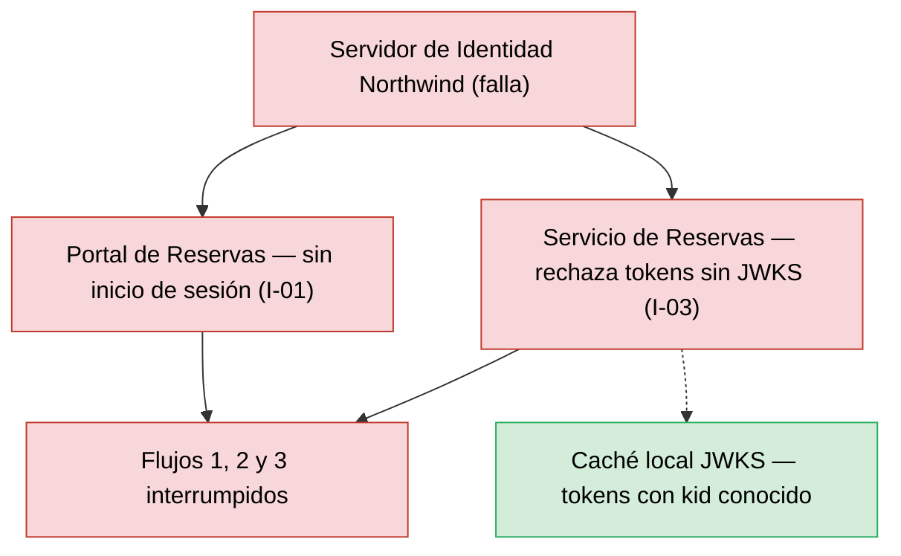
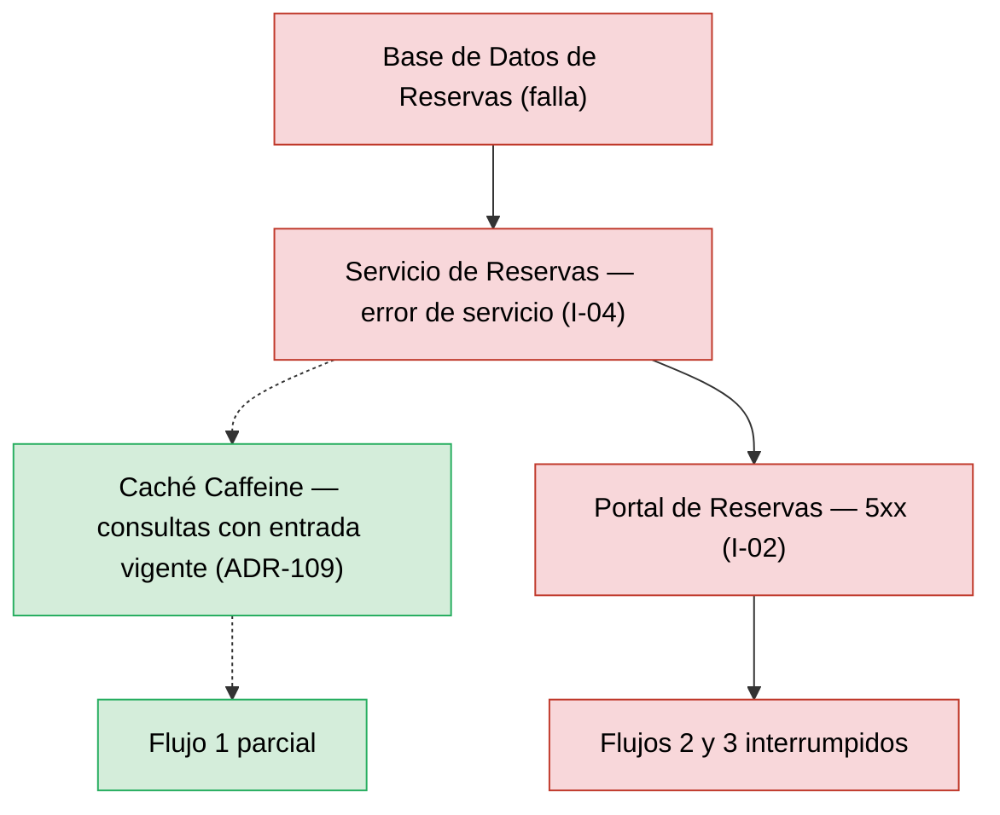
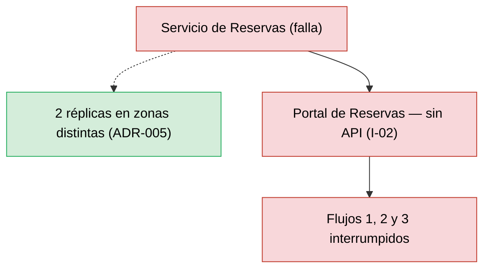

# Análisis de Radio de Impacto — Reservas de Salas Northwind - Autoservicio de reservas de salas de reunión v1.10.5

**Fecha de análisis**: 2026-11-03  
**Fuente de arquitectura**: `ARCHITECTURE.md` v1.10.5 (Status: Released)  
**Analista**: Architecture Analysis Skill

---

## 1. Resumen Ejecutivo <!-- SECTION: Executive Summary -->

Ningún componente supera el umbral de alto radio de impacto: el abanico total máximo es 2 (`Servidor de Identidad Northwind` y `Base de Datos de Reservas`), frente al umbral de > 3. La tabla de Componentes de Alto Radio de Impacto queda sin filas y no hay ids B.

El radio pequeño no equivale a impacto bajo. La topología tiene 4 componentes y 4 integraciones síncronas request-response (I-01 a I-04), sin colas ni integraciones asíncronas (docs/05 § 7). La falla de `Servidor de Identidad Northwind`, `Servicio de Reservas` o `Base de Datos de Reservas` interrumpe los 3 flujos de usuario: severidad S1 con abanico bajo.

La única contención documentada es la caché local de claves JWKS en I-03 y la caché Caffeine de disponibilidad (ADR-109), que solo cubre lecturas del Flujo 1. I-03 falla cerrado por diseño (deny by default) e I-04 responde error de servicio sin timeout ni cortacircuitos documentado. Los cuatro componentes ya figuran como SPOF críticos (C1–C4 del informe SPOF del 2026-11-03).

Prioridad de remediación: documentar RTO y RPO de la `Base de Datos de Reservas` (docs/09 § 11.3) y los timeouts de I-02 e I-04. Sin esos datos, el MTTR de los cuatro componentes es [NOT DOCUMENTED].

---

## 2. Hallazgos <!-- SECTION: Findings -->

### 2.1 Componentes de Alto Radio de Impacto <!-- SECTION: High-Blast Components -->

_Sin hallazgos en esta corrida._

### 2.2 Componentes Aislados <!-- SECTION: Isolated Components -->

| # | Component | Type | Why Isolated |
|---|---|---|---|
| 1 | `Portal de Reservas` | Web Application | Abanico 0: ningún componente consume el portal (docs/05 § 7). Su falla no se propaga a otros componentes, aunque deja sin acceso los 3 flujos de usuario (SPOF C4). |

### 2.3 Rutas de Cascada — Los 3 Peores Escenarios <!-- SECTION: Cascade Paths -->

#### Escenario 1 — Falla de `Servidor de Identidad Northwind` (S1, abanico 2)

El `Portal de Reservas` pierde el inicio de sesión (I-01, Fase 1) y el `Servicio de Reservas` no puede cargar claves JWKS (I-03, Fase 2). I-03 falla cerrado: sin claves, el servicio rechaza toda solicitud (docs/05 § 7, ADR-002). La caché local de claves JWKS contiene la falla para tokens ya emitidos con `kid` conocido; su duración es Not documented. Flujos afectados: 1, 2 y 3.

#### Escenario 2 — Falla de `Base de Datos de Reservas` (S1, abanico 2)

El `Servicio de Reservas` recibe error de conexión en I-04 y responde error de servicio (docs/05 § 7). El `Portal de Reservas` recibe 5xx por I-02. La caché Caffeine sirve consultas del Flujo 1 con entrada vigente (ADR-109); los Flujos 2 y 3 fallan. Respaldo diario con PITR de 7 días; RPO Not documented (docs/09 § 11.3).

#### Escenario 3 — Falla de `Servicio de Reservas` (S1, abanico 1)

El `Portal de Reservas` pierde la API REST de I-02 y los 3 flujos quedan sin respuesta. Hay 2 réplicas en zonas distintas (docs/09 § 11.1, ADR-005), lo que contiene la falla de un pod o de una zona, no la de un despliegue defectuoso. Timeout y reintento del portal hacia I-02: Not documented.

### 2.4 MTTR Estimado por Componente <!-- SECTION: MTTR Estimate -->

| # | Component | Failure Type | Estimated MTTR | Source |
|---|---|---|---|---|
| 1 | `Base de Datos de Reservas` | Indisponibilidad o pérdida de datos | [NOT DOCUMENTED] | docs/09 § 11.3 (RTO y RPO: Not documented) |
| 2 | `Servicio de Reservas` | Caída de réplicas o despliegue defectuoso | [NOT DOCUMENTED] | docs/09 § 11.1 (reversión: Not documented) |
| 3 | `Servidor de Identidad Northwind` | Indisponibilidad del proveedor | [NOT DOCUMENTED] | docs/09 (sin entrada para el proveedor) |
| 4 | `Portal de Reservas` | Publicación defectuosa en el CDN | [NOT DOCUMENTED] | docs/09 § 11.1 (reversión: Not documented) |

### 2.5 Recomendaciones de Mampara <!-- SECTION: Bulkhead Recommendations -->

_Sin hallazgos en esta corrida._

## 3. Mapa de Calor <!-- SECTION: Heat Map -->

_Sin hallazgos en esta corrida._

## 4. Top 5 Recomendaciones de Remediación <!-- SECTION: Top Recommendations -->

---

## 5. Veredicto <!-- SECTION: Summary Verdict -->

La arquitectura mantiene el radio de impacto bajo: 4 componentes, abanico máximo 2, sin ciclos y con una sola base accedida solo por el `Servicio de Reservas` (I-04). El riesgo dominante es la profundidad, no la amplitud: tres componentes interrumpen los 3 flujos por cadenas síncronas sin timeout ni cortacircuitos documentado. El conjunto mínimo es documentar RTO y RPO de la `Base de Datos de Reservas`, los timeouts de I-02 e I-04 y la duración de la caché JWKS de I-03.

---

## 6. Brechas de Documentación <!-- SECTION: Documentation Gaps -->

- [ ] `[NOT DOCUMENTED]` `Base de Datos de Reservas` — RTO, RPO y ubicación del respaldo (docs/09-operational-considerations.md § 11.3)
- [ ] `[NOT DOCUMENTED]` `Servicio de Reservas`, `Portal de Reservas` — Método de despliegue, reversión y frecuencia (base del MTTR) (docs/09-operational-considerations.md § 11.1)
- [ ] `[NOT DOCUMENTED]` `Servidor de Identidad Northwind` — MTTR o RTO del proveedor de identidad (docs/09-operational-considerations.md o docs/components/proveedor-de-identidad-northwind.md)
- [ ] `[NOT DOCUMENTED]` I-02 (`Portal de Reservas` → `Servicio de Reservas`) — Timeout, reintento y presupuesto de latencia del salto (docs/05-integration-points.md § 7 y docs/04-data-flow-patterns.md (Presupuesto de latencia))
- [ ] `[NOT DOCUMENTED]` I-04 (`Servicio de Reservas` → `Base de Datos de Reservas`) — Timeout de conexión, cortacircuitos y presupuesto de latencia (docs/05-integration-points.md § 7 y docs/08-scalability-and-performance.md)
- [ ] `[NOT DOCUMENTED]` I-03 (`Servicio de Reservas` → `Servidor de Identidad Northwind`) — Duración de la caché local de claves JWKS (docs/05-integration-points.md § 7 (I-03))

---

**Fuentes citadas**: `ARCHITECTURE.md`, `docs/04-data-flow-patterns.md`, `docs/05-integration-points.md`, `docs/09-operational-considerations.md`, `adr/ADR-002`, `adr/ADR-005`, `adr/ADR-109`, `analysis/SPOF-2026-11-03.md`
