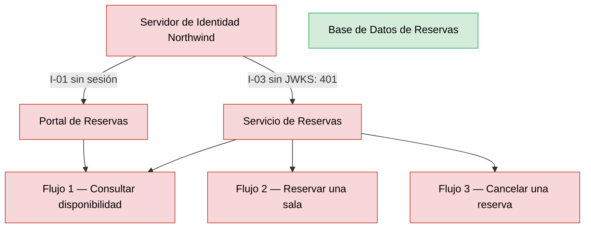
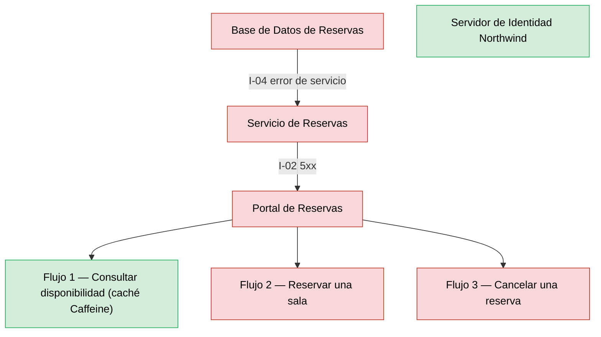
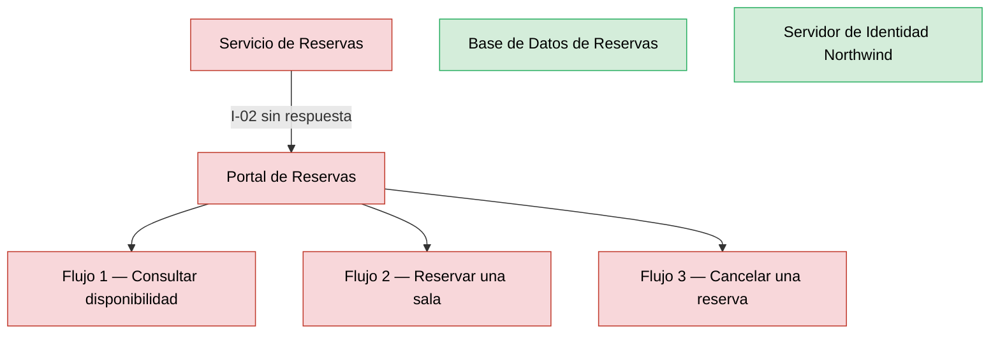

# Análisis de Radio de Impacto — Reservas de Salas Northwind - Autoservicio de reservas de salas de reunión v1.10.5

**Fecha de análisis**: 2026-11-03  
**Fuente de arquitectura**: `ARCHITECTURE.md` v1.10.5 (Status: Released)  
**Analista**: Architecture Analysis Skill

---

## 1. Resumen Ejecutivo <!-- SECTION: Executive Summary -->

Ningún componente supera un abanico total de 3: la topología tiene 4 contenedores y 4 integraciones síncronas (I-01 a I-04), sin integraciones asíncronas (docs/05 § 7). La tabla de Componentes de Alto Radio de Impacto queda vacía y no hay identificadores B.

El radio pequeño no equivale a contención. `Servidor de Identidad Northwind` (abanico 2) y `Base de Datos de Reservas` (abanico 2) interrumpen los 3 flujos de usuario al fallar: I-03 rechaza toda solicitud sin claves JWKS (deny by default) e I-04 responde error de servicio ante una falla de conexión. Ambos califican S1 por cobertura de flujos y coinciden con los SPOF críticos C1 y C2.

Ningún documento del corpus describe timeout, circuit breaker ni reintento con backoff en I-02, I-03 o I-04; la única mitigación documentada es la caché local de claves JWKS (I-03) y la caché Caffeine de disponibilidad (fase 3, ADR-109). RTO y RPO no están documentados (docs/09 § 11.3). La prioridad es documentar esos dos valores y los tiempos de espera de I-03 e I-04.

---

## 2. Hallazgos <!-- SECTION: Findings -->

### 2.1 Componentes de Alto Radio de Impacto <!-- SECTION: High-Blast Components -->

_Sin hallazgos en esta corrida._

### 2.2 Componentes Aislados <!-- SECTION: Isolated Components -->

| # | Component | Type | Why Isolated |
|---|---|---|---|
| 1 | `Portal de Reservas` | Web Application | Ningún componente lo consume (abanico 0, docs/05 § 7); su falla no se propaga a otros contenedores, pero deja sin interfaz los 3 flujos de usuario (SPOF C3). |

### 2.3 Rutas de Cascada — Los 3 Peores Escenarios <!-- SECTION: Cascade Paths -->

#### Escenario 1 — Falla del Servidor de Identidad Northwind

Sin el `Servidor de Identidad Northwind`, el `Portal de Reservas` no inicia sesión (I-01, fase 1) y el `Servicio de Reservas` rechaza cada token sin claves JWKS disponibles (I-03, deny by default). Los flujos 1, 2 y 3 fallan: tier S1, Fail-closed. La caché local de claves JWKS atenúa una caída breve; su vigencia no está documentada.

#### Escenario 2 — Falla de la Base de Datos de Reservas

Ante una falla de conexión por I-04, el `Servicio de Reservas` responde error de servicio (docs/05 § 7). Las fases 3, 4 y 5 dependen de la base; la consulta sobrevive solo con una entrada vigente en la caché Caffeine (ADR-109). Tier S1, Fail-closed: los flujos 2 y 3 fallan por completo.

#### Escenario 3 — Falla del Servicio de Reservas

El `Portal de Reservas` llama al `Servicio de Reservas` por I-02 en los 3 flujos. Corre con al menos 2 réplicas en zonas distintas (docs/09 § 11.1, ADR-005), lo que contiene la falla de una réplica; la caída total del servicio interrumpe los 3 flujos. Tier S1, Fail-closed, abanico 1.

### 2.4 MTTR Estimado por Componente <!-- SECTION: MTTR Estimate -->

| # | Component | Failure Type | Estimated MTTR | Source |
|---|---|---|---|---|
| 1 | `Base de Datos de Reservas` | Pérdida o corrupción de datos; caída de la instancia | [NOT DOCUMENTED] — respaldo diario, retención 30 días, PITR de 7 días; RTO y RPO no documentados | docs/09 § 11.3 |
| 2 | `Servicio de Reservas` | Caída de réplicas | [NOT DOCUMENTED] | docs/09 § 11.1 |
| 3 | `Servidor de Identidad Northwind` | Indisponibilidad de inicio de sesión y JWKS | [NOT DOCUMENTED] | docs/05 § 7 (I-01, I-03) |
| 4 | `Portal de Reservas` | Indisponibilidad del CDN | [NOT DOCUMENTED] | docs/09 § 11.1 |

### 2.5 Recomendaciones de Mampara <!-- SECTION: Bulkhead Recommendations -->

_Sin hallazgos en esta corrida._

## 3. Mapa de Calor <!-- SECTION: Heat Map -->

_Sin hallazgos en esta corrida._

## 4. Top 5 Recomendaciones de Remediación <!-- SECTION: Top Recommendations -->

---

## 5. Veredicto <!-- SECTION: Summary Verdict -->

La arquitectura mantiene el radio de impacto pequeño: 4 contenedores, sin ciclos, la `Base de Datos de Reservas` accesible solo por el `Servicio de Reservas` (I-04) y 2 réplicas del servicio en zonas distintas. El riesgo dominante es la falla cerrada sin mampara en I-03 e I-04: `Servidor de Identidad Northwind` y `Base de Datos de Reservas` detienen los 3 flujos. El mínimo es documentar RTO y RPO, los timeouts de I-03 e I-04 y la vigencia de la caché JWKS.

---

## 6. Brechas de Documentación <!-- SECTION: Documentation Gaps -->

- [ ] `[NOT DOCUMENTED]` `Base de Datos de Reservas` — RTO y RPO (docs/09-operational-considerations.md § 11.3)
- [ ] `[NOT DOCUMENTED]` `Servicio de Reservas`, `Servidor de Identidad Northwind`, `Portal de Reservas` — MTTR o RTO por componente (docs/09-operational-considerations.md § 11.3)
- [ ] `[NOT DOCUMENTED]` I-02, I-03, I-04 — Timeout, circuit breaker o reintento con backoff entre consumidor y proveedor (docs/05-integration-points.md § 7 y docs/08-scalability-and-performance.md)
- [ ] `[NOT DOCUMENTED]` I-03 — caché local de claves JWKS — Vigencia de la caché y comportamiento ante la caída del `Servidor de Identidad Northwind` (docs/05-integration-points.md § 7 (I-03))
- [ ] `[NOT DOCUMENTED]` Alertas de disponibilidad y latencia — Severidad y guardia (docs/09-operational-considerations.md § 11.2)
- [ ] `[NOT DOCUMENTED]` `Base de Datos de Reservas` — Ubicación de los respaldos y número de réplicas (docs/09-operational-considerations.md § 11.3; docs/components/reservas-de-salas-northwind/03-base-de-datos-de-reservas.md)

---

**Fuentes citadas**: `ARCHITECTURE.md`, `docs/04-data-flow-patterns.md`, `docs/05-integration-points.md`, `docs/09-operational-considerations.md`, `adr/ADR-005`, `adr/ADR-109`, `analysis/SPOF-2026-11-03.md`
