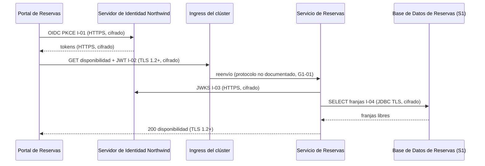
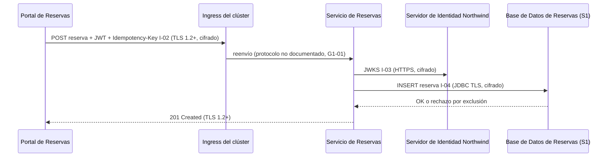
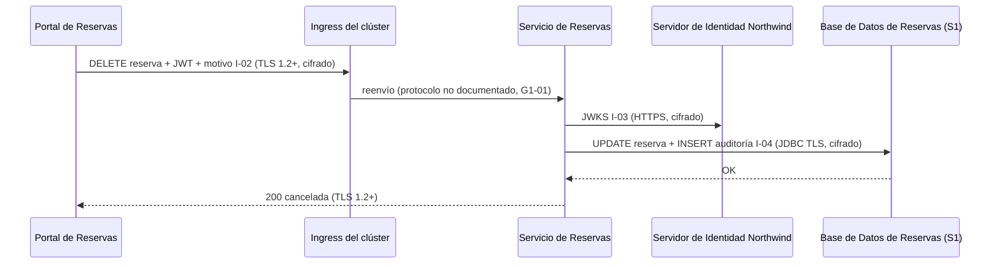

# Análisis de Sensibilidad y Flujo de Datos — Reservas de Salas Northwind - Autoservicio de reservas de salas de reunión v1.10.5

**Fecha de análisis**: 2026-11-02  
**Fuente de arquitectura**: `ARCHITECTURE.md` v1.10.5 (Status: Released)  
**Analista**: Architecture Analysis Skill

---

## 1. Resumen Ejecutivo <!-- SECTION: Executive Summary -->

El hallazgo de mayor severidad es G2-01: la `Base de Datos de Reservas` (PostgreSQL 16) guarda nombre, correo y reservas de cada miembro, y ningún documento declara cifrado en reposo. docs/07 § 9.3 solo dice que Plataforma Northwind gestiona la base. Los respaldos diarios de 30 días heredan el mismo vacío (G2-02).

El inventario tiene 6 destinos de datos: 3 S1 (`Base de Datos de Reservas`, sus respaldos y los tokens OIDC en memoria del `Portal de Reservas`), 1 S2 (logs hacia el colector OpenTelemetry), 1 S3 (canal `NOTIFY disponibilidad`) y 1 Unknown (caché Caffeine del `Servicio de Reservas`). Hay 4 hallazgos: 1 G1, 2 G2, 1 G3 y ningún G4.

El tránsito externo está cubierto: TLS 1.2 o superior hasta el ingress (I-02), HTTPS en I-01 e I-03 y TLS en JDBC (I-04). El tramo ingress → `Servicio de Reservas` no tiene transporte documentado y lleva tokens y datos personales (G1-01). La retención de 24 meses (ADR-106) la exceden los respaldos en hasta 30 días (G3-01), costo aceptado en docs/07 § 9.4.

Prioridad de remediación: documentar o habilitar el cifrado en reposo de la `Base de Datos de Reservas` y de sus respaldos (G2-01, G2-02), y declarar TLS o mTLS entre el ingress y los pods del `Servicio de Reservas` (G1-01).

---

## 2. Inventario de Datos <!-- SECTION: Data Inventory -->

| # | Store / Queue / Cache | Type | Sensitivity Tier | Tags | Contains (examples) | Encryption at Rest | Encryption in Transit | Retention Policy | Source |
|---|---|---|---|---|---|---|---|---|---|
| 1 | `Base de Datos de Reservas` | relational DB (PostgreSQL 16 gestionado) | S1 | — | nombre y correo del miembro, reservas con su dueño, registro de auditoría de cancelaciones (quién, cuándo, motivo) | Not Documented | Documented — TLS en JDBC (I-04) | 24 meses, luego purga programada (ADR-106) | docs/07 § 9.3, § 9.4; docs/09 § 11.4; adr/ADR-106 |
| 2 | Respaldos de la `Base de Datos de Reservas` | backup | S1 | — | copia completa de la base: nombre, correo, reservas, auditoría | Not Documented | Not Documented | 30 días; PITR de 7 días | docs/09 § 11.3; docs/07 § 9.4; adr/ADR-003 |
| 3 | Tokens OIDC en memoria del `Portal de Reservas` | cache (memoria del navegador) | S1 | — | token de acceso JWT RS256, token de refresco, rol `recepcion`, atributo `sede` | None — solo memoria, nunca `localStorage` ni `sessionStorage` (ADR-104) | Documented — HTTPS (I-01, I-02) | token de acceso 5 minutos; token de refresco [NOT DOCUMENTED] | docs/07 § 9.2, § 9.3; adr/ADR-104 |
| 4 | Logs y trazas en el `Colector OpenTelemetry de Plataforma Northwind` | log | S2 | — | `trace_id`, `span_id`, `service.name`; datos personales solo parciales, sin tokens | Not Documented | Not Documented | [NOT DOCUMENTED] | docs/09 § 11.2; docs/07 § 9.5; adr/ADR-004 |
| 5 | Canal `NOTIFY disponibilidad` de la `Base de Datos de Reservas` | message queue (PostgreSQL LISTEN/NOTIFY) | S3 | — | sede y fecha afectadas por una creación o cancelación | Not Documented | Not Documented — conexión `LISTEN` fuera del pool | [NOT DOCUMENTED] | docs/05 § 7 (I-04); adr/ADR-109 |
| 6 | Caché Caffeine en proceso del `Servicio de Reservas` | cache | Unknown | — | disponibilidad por sede y fecha; contenido exacto Not documented | Not Documented | Not Documented | [NOT DOCUMENTED] — invalidación por `NOTIFY` (ADR-109) | docs/05 § 7; adr/ADR-109; Components table (Caffeine 3.2) |

## 3. Mapa de Flujos de Datos Sensibles <!-- SECTION: Sensitive Data Flow Map -->

| # | Flow | Step | From | To | Protocol | Carries Sensitive Data? | Encryption in Transit | Gap |
|---|---|---|---|---|---|---|---|---|
| 1 | Flujo 1 — Consultar disponibilidad | 1 | `Portal de Reservas` | `Servidor de Identidad Northwind` | HTTPS/JSON, OIDC con PKCE (I-01) | Sí — credenciales del miembro y tokens emitidos | Documented — HTTPS | None |
| 2 | Flujo 1 — Consultar disponibilidad | 2 | `Portal de Reservas` | ingress del clúster | HTTPS/JSON (I-02) | Sí — JWT con rol y `sede` | Documented — TLS 1.2 o superior | None |
| 3 | Flujo 1 — Consultar disponibilidad | 3 | ingress del clúster | `Servicio de Reservas` | Not documented (I-02, tramo interno) | Sí — JWT con rol y `sede` | Not Documented | G1 |
| 4 | Flujo 1 — Consultar disponibilidad | 4 | `Servicio de Reservas` | `Servidor de Identidad Northwind` | HTTPS, JWKS (I-03) | No — claves públicas | Documented — HTTPS con verificación del certificado | None |
| 5 | Flujo 1 — Consultar disponibilidad | 5 | `Servicio de Reservas` | `Base de Datos de Reservas` | JDBC/SQL (I-04) | No — sede, fecha y franjas libres | Documented — TLS | None |
| 6 | Flujo 2 — Reservar una sala | 1 | `Portal de Reservas` | ingress del clúster | HTTPS/JSON con `Idempotency-Key` (I-02) | Sí — JWT y datos de la reserva del miembro | Documented — TLS 1.2 o superior | None |
| 7 | Flujo 2 — Reservar una sala | 2 | ingress del clúster | `Servicio de Reservas` | Not documented (I-02, tramo interno) | Sí — JWT y datos de la reserva | Not Documented | G1 |
| 8 | Flujo 2 — Reservar una sala | 3 | `Servicio de Reservas` | `Servidor de Identidad Northwind` | HTTPS, JWKS (I-03) | No — claves públicas | Documented — HTTPS | None |
| 9 | Flujo 2 — Reservar una sala | 4 | `Servicio de Reservas` | `Base de Datos de Reservas` | JDBC/SQL (I-04) | Sí — reserva con identificador del miembro | Documented — TLS | None |
| 10 | Flujo 3 — Cancelar una reserva | 1 | `Portal de Reservas` | ingress del clúster | HTTPS/JSON (I-02) | Sí — JWT con rol `recepcion`, `sede` y motivo | Documented — TLS 1.2 o superior | None |
| 11 | Flujo 3 — Cancelar una reserva | 2 | ingress del clúster | `Servicio de Reservas` | Not documented (I-02, tramo interno) | Sí — JWT y motivo de cancelación | Not Documented | G1 |
| 12 | Flujo 3 — Cancelar una reserva | 3 | `Servicio de Reservas` | `Servidor de Identidad Northwind` | HTTPS, JWKS (I-03) | No — claves públicas | Documented — HTTPS | None |
| 13 | Flujo 3 — Cancelar una reserva | 4 | `Servicio de Reservas` | `Base de Datos de Reservas` | JDBC/SQL (I-04), misma transacción que la auditoría | Sí — cancelación, autor, fecha y motivo | Documented — TLS | None |
| 14 | Telemetría (ADR-004) | 1 | `Servicio de Reservas` | `Colector OpenTelemetry de Plataforma Northwind` | Not documented | Parcial — datos personales incompletos, sin tokens | Not Documented | None — S2, fuera de G1; cifrado en Brechas de Documentación |

## 4. Diagramas de Flujos Sensibles <!-- SECTION: Sensitive Flow Diagrams -->

### Flujo 1 — Consultar disponibilidad

El único tramo sin cifrado documentado es ingress → `Servicio de Reservas` (G1-01). La lectura en la `Base de Datos de Reservas` devuelve franjas libres, sin datos personales.



### Flujo 2 — Reservar una sala

La reserva con el identificador del miembro viaja cifrada salvo en el tramo interno ingress → `Servicio de Reservas` (G1-01) y queda en reposo sin cifrado documentado (G2-01).



### Flujo 3 — Cancelar una reserva

La cancelación y su registro de auditoría se escriben en la misma transacción por JDBC con TLS. Ambos quedan 24 meses en la base y hasta 30 días más en respaldos (G3-01).



## 5. Brechas de Cifrado (G1 + G2) <!-- SECTION: Encryption Gaps -->

| # | Gap | Data Store / Flow | Sensitivity | Protocol / Storage | Missing Control | Source |
|---|---|---|---|---|---|---|
| G1-01 | G1 | I-02, tramo ingress del clúster → `Servicio de Reservas` (Flujos 1, 2 y 3) | S1 | Not documented — TLS 1.2 termina en el ingress | TLS o mTLS declarado entre el ingress y los pods; hoy los JWT y datos personales pueden viajar en claro dentro del clúster | docs/07 § 9.1, § 9.3; docs/05 § 7 (I-02) |
| G2-01 | G2 | `Base de Datos de Reservas` | S1 | PostgreSQL 16 gestionado por Plataforma Northwind; cifrado en reposo Not documented | Cifrado en reposo (volumen, TDE o envolvente con KMS) y registro de acceso a nombre y correo | docs/07 § 9.3 (Datos); adr/ADR-003 |
| G2-02 | G2 | Respaldos de la `Base de Datos de Reservas` | S1 | Respaldo diario de 30 días, PITR de 7 días; ubicación Not documented | Cifrado en reposo de los respaldos y ubicación declarada | docs/09 § 11.3; docs/07 § 9.3 |

## 6. Brechas de Retención (G3) <!-- SECTION: Retention Gaps -->

| # | Data Store | Documented Retention | Retention Limit | Overage | Source |
|---|---|---|---|---|---|
| G3-01 | Respaldos de la `Base de Datos de Reservas` | 24 meses en la base + 30 días de respaldo | 24 meses (ley de protección de datos personales aplicable, ADR-106) | Hasta 30 días; más si la purga se retrasa, porque su calendario no está documentado | docs/07 § 9.4; docs/09 § 11.3, § 11.4; adr/ADR-106 |

## 7. Mapa de Calor de Sensibilidad <!-- SECTION: Heat Map -->

```
SENSITIVITY     │
S1 - RESTRICTED │                                  │ [G1-01] [G2-01] [G2-02] [G3-01]  │                                  
                ├──────────────────────────────────┼──────────────────────────────────┼──────────────────────────────────
MID             │                                  │                                  │                                  
                ├──────────────────────────────────┼──────────────────────────────────┼──────────────────────────────────
S4 - PUBLIC     │                                  │                                  │                                  
                └──────────────────────────────────┴──────────────────────────────────┴──────────────────────────────────
                  FULL                              MID                               NONE                              
                  CONTROL COVERAGE →
```

## 8. Top 5 Recomendaciones de Protección del Dato <!-- SECTION: Recommendations -->

**1. Declarar el cifrado en reposo de la Base de Datos de Reservas (G2-01)**
Confirmar con Plataforma Northwind el cifrado del volumen de PostgreSQL 16 (AES-256 con llaves en KMS) y registrarlo en docs/07 § 9.3. Si no existe, habilitarlo antes del próximo release. Reduce la exposición de nombre y correo ante robo de disco; el costo es la dependencia del KMS de la plataforma.
_Fuente: docs/07 § 9.3; adr/ADR-003_

**2. Cifrar y ubicar los respaldos diarios (G2-02)**
Documentar el cifrado de los respaldos de 30 días y del PITR de 7 días, y su ubicación, en docs/09 § 11.3. Una copia S1 sin ubicación declarada no permite verificar fronteras ni cifrado.
_Fuente: docs/09 § 11.3_

**3. TLS o mTLS entre el ingress y el Servicio de Reservas (G1-01)**
Declarar el transporte del tramo interno de I-02: re-cifrado TLS en el ingress o mTLS de una malla de servicios. Elimina JWT y datos personales en claro dentro del clúster; agrega gestión de certificados por réplica.
_Fuente: docs/07 § 9.1; docs/05 § 7 (I-02)_

**4. Alinear la purga con la expiración de respaldos (G3-01)**
Documentar el calendario de la purga de 24 meses (hoy Not documented en docs/09 § 11.4) y declarar en ADR-106 que el límite efectivo es 24 meses + 30 días. Acota el exceso a un valor verificable.
_Fuente: docs/09 § 11.4; adr/ADR-106_

**5. Registro de acceso a las tablas con datos personales (G2-01)**
Habilitar auditoría de lectura sobre las tablas con nombre y correo (por ejemplo `pgaudit` en PostgreSQL 16) y enviarla al colector de ADR-004. Completa el control S1 de registro de acceso; el costo es volumen de logs.
_Fuente: docs/07 § 9.3; adr/ADR-004_

---

## 9. Veredicto de Protección del Dato <!-- SECTION: Summary Verdict -->

La arquitectura protege bien el tránsito externo (TLS 1.2+ en el ingress, HTTPS en I-01 e I-03, TLS en JDBC), guarda los tokens solo en memoria (ADR-104) y fija una retención de 24 meses con purga (ADR-106). El riesgo dominante es la protección en reposo no documentada de la `Base de Datos de Reservas` y sus respaldos. El mínimo de remediación es documentar o habilitar ese cifrado (G2-01, G2-02) y declarar el transporte ingress → `Servicio de Reservas` (G1-01).

---

## 10. Brechas de Documentación <!-- SECTION: Documentation Gaps -->

- [ ] `[NOT DOCUMENTED]` `Base de Datos de Reservas` — Cifrado en reposo y registro de acceso (docs/07 § 9.3; docs/components/reservas-de-salas-northwind/03-base-de-datos-de-reservas.md)
- [ ] `[NOT DOCUMENTED]` Respaldos de la `Base de Datos de Reservas` — Cifrado en reposo, cifrado en tránsito y ubicación (docs/09 § 11.3)
- [ ] `[NOT DOCUMENTED]` I-02, tramo ingress → `Servicio de Reservas` — Protocolo y cifrado tras la terminación TLS en el ingress (docs/07 § 9.3; docs/05 § 7)
- [ ] `[NOT DOCUMENTED]` Tokens OIDC del `Portal de Reservas` — Vida útil del token de refresco (docs/07 § 9.3; adr/ADR-104)
- [ ] `[NOT DOCUMENTED]` Logs en el `Colector OpenTelemetry de Plataforma Northwind` — Retención, cifrado en tránsito y en reposo, y regla exacta de enmascaramiento de datos personales (docs/09 § 11.2; adr/ADR-004)
- [ ] `[NOT DOCUMENTED]` Canal `NOTIFY disponibilidad` — Cifrado de la conexión `LISTEN` fuera del pool (docs/05 § 7; adr/ADR-109)
- [ ] `[NOT DOCUMENTED]` Caché Caffeine del `Servicio de Reservas` — Clasificación de sensibilidad y contenido exacto (G5) (docs/components/reservas-de-salas-northwind/02-servicio-de-reservas.md § Gestión de Datos; adr/ADR-109)
- [ ] `[NOT DOCUMENTED]` Purga de 24 meses — Calendario de ejecución (docs/09 § 11.4)
- [ ] `[NOT DOCUMENTED]` Clasificación de datos — Tabla de clasificación por almacén (S1–S4) (docs/07 § 9.3)

---

**Fuentes citadas**: `ARCHITECTURE.md`, `docs/04-data-flow-patterns.md`, `docs/05-integration-points.md`, `docs/07-security-architecture.md`, `docs/09-operational-considerations.md`, `adr/ADR-003`, `adr/ADR-004`, `adr/ADR-104`, `adr/ADR-106`, `adr/ADR-109`
