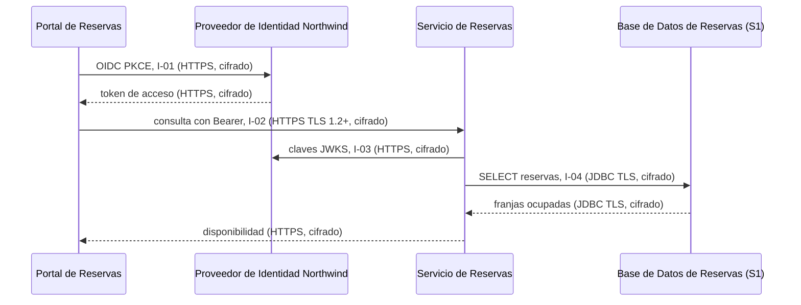
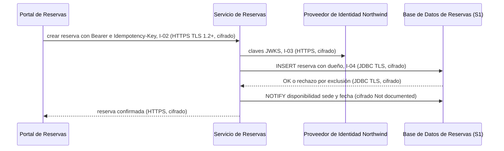
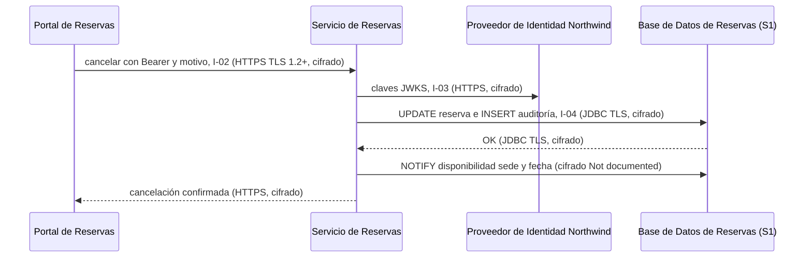

# Análisis de Sensibilidad y Flujo de Datos — Reservas de Salas Northwind - Autoservicio de reservas de salas de reunión v1.10.5

**Fecha de análisis**: 2026-11-02  
**Fuente de arquitectura**: `ARCHITECTURE.md` v1.10.5 (Status: Released)  
**Analista**: Architecture Analysis Skill

---

## 1. Resumen Ejecutivo <!-- SECTION: Executive Summary -->

El hallazgo de mayor severidad es G2-01: la `Base de Datos de Reservas` (PostgreSQL 16) guarda datos S1 —nombre, correo y reservas del miembro, y el registro de auditoría de cancelaciones— y la arquitectura no documenta su cifrado en reposo. docs/07 § 9.3 cita la plataforma gestionada por Plataforma Northwind, sin TDE ni cifrado de volumen.

El inventario cuenta 6 almacenes: 3 S1 (la `Base de Datos de Reservas`, sus respaldos y los tokens OIDC en memoria del `Portal de Reservas`), 1 S3 (el canal NOTIFY `disponibilidad`) y 2 Unknown (la caché Caffeine del `Servicio de Reservas` y los logs OpenTelemetry). Hallazgos: 2 G2 críticos, 1 G3 alto, 0 G1, 0 G4 y 2 G5 registrados en Brechas de Documentación.

El tránsito está cubierto: TLS 1.2 o superior en el ingress (I-02), HTTPS en I-01 e I-03 y JDBC con TLS en I-04. La retención de 24 meses con purga programada (ADR-106) cubre la ley de protección de datos personales, pero los respaldos conservan datos purgados hasta 30 días más (G3-01).

Prioridad de remediación: documentar o activar el cifrado en reposo de la `Base de Datos de Reservas` y de sus respaldos (G2-01, G2-02), con la ubicación de los respaldos.

---

## 2. Inventario de Datos <!-- SECTION: Data Inventory -->

| # | Store / Queue / Cache | Type | Sensitivity Tier | Tags | Contains (examples) | Encryption at Rest | Encryption in Transit | Retention Policy | Source |
|---|---|---|---|---|---|---|---|---|---|
| 1 | `Base de Datos de Reservas` | relational DB (PostgreSQL 16) | S1 | — | nombre y correo del miembro, reservas (sala, franja, dueño), registro de auditoría de cancelaciones (quién, cuándo, motivo) | Not Documented | Documented — JDBC con TLS (I-04) | 24 meses, luego purga programada (ADR-106) | docs/07 § 9.2, § 9.3, § 9.4; docs/09 § 11.4 |
| 2 | Respaldos de la `Base de Datos de Reservas` | backup (ubicación Not documented) | S1 | — | copia diaria de reservas, datos personales y registro de auditoría, incluidos datos ya purgados | Not Documented | Not Documented | 30 días; PITR de 7 días | docs/09 § 11.3; docs/07 § 9.3; adr/ADR-003 |
| 3 | Tokens OIDC en memoria del `Portal de Reservas` | cache (memoria del navegador) | S1 | — | token de acceso JWT RS256 con rol `recepcion` y atributo `sede`, token de refresco | Documented — sin persistencia: solo memoria, nunca `localStorage` ni `sessionStorage` (ADR-104) | Documented — HTTPS (I-01, I-02) | token de acceso 5 minutos; token de refresco [NOT DOCUMENTED] | docs/07 § 9.2, § 9.3; adr/ADR-104 |
| 4 | Caché Caffeine en proceso del `Servicio de Reservas` | cache (Caffeine 3.2, en proceso) | Unknown | — | disponibilidad por sede y fecha; campos exactos Not documented | Not Documented | Not Documented (en proceso, sin transporte) | [NOT DOCUMENTED] | Components table (Caffeine 3.2); docs/05 § 7 (ADR-109) |
| 5 | Canal LISTEN/NOTIFY `disponibilidad` | message queue (canal NOTIFY de PostgreSQL) | S3 | — | sede, fecha | Not Documented | Not Documented — la conexión `LISTEN` va fuera del pool JDBC de I-04 | [NOT DOCUMENTED] | docs/05 § 7 (ADR-109) |
| 6 | Logs, trazas y métricas OpenTelemetry en el colector de Plataforma Northwind | log | Unknown | — | `trace_id`, `span_id`, `service.name`; sin tokens ni datos personales completos | Not Documented | Not Documented | [NOT DOCUMENTED] | docs/09 § 11.2; docs/07 § 9.5; adr/ADR-004 |

## 3. Mapa de Flujos de Datos Sensibles <!-- SECTION: Sensitive Data Flow Map -->

| # | Flow | Step | From | To | Protocol | Carries Sensitive Data? | Encryption in Transit | Gap |
|---|---|---|---|---|---|---|---|---|
| 1 | Flujo 1 — Consultar disponibilidad | 1 | `Portal de Reservas` | `Proveedor de Identidad Northwind` | HTTPS/JSON, OIDC con PKCE (I-01) | Sí — credenciales y token de acceso | Documented (HTTPS) | None |
| 2 | Flujo 1 — Consultar disponibilidad | 2 | `Portal de Reservas` | `Servicio de Reservas` | HTTPS/JSON con Bearer (I-02) | Sí — token de acceso | Documented (TLS 1.2+ en el ingress) | None |
| 3 | Flujo 1 — Consultar disponibilidad | 3 | `Servicio de Reservas` | `Proveedor de Identidad Northwind` | HTTPS, JWKS (I-03) | No — claves públicas | Documented (HTTPS con verificación de certificado) | None |
| 4 | Flujo 1 — Consultar disponibilidad | 4 | `Servicio de Reservas` | Caché Caffeine en proceso | en proceso | Not documented | Not Documented | G5 |
| 5 | Flujo 1 — Consultar disponibilidad | 5 | `Servicio de Reservas` | `Base de Datos de Reservas` | JDBC/SQL (I-04) | Sí — reservas | Documented (TLS) | None |
| 6 | Flujo 1 — Consultar disponibilidad | 6 | `Servicio de Reservas` | Colector de Plataforma Northwind | OpenTelemetry (protocolo Not documented) | Not documented — sin datos personales completos | Not Documented | G5 |
| 7 | Flujo 2 — Reservar una sala | 1 | `Portal de Reservas` | `Servicio de Reservas` | HTTPS/JSON con Bearer e `Idempotency-Key` (I-02) | Sí — token de acceso y datos de la reserva | Documented (TLS 1.2+ en el ingress) | None |
| 8 | Flujo 2 — Reservar una sala | 2 | `Servicio de Reservas` | `Proveedor de Identidad Northwind` | HTTPS, JWKS (I-03) | No — claves públicas | Documented (HTTPS) | None |
| 9 | Flujo 2 — Reservar una sala | 3 | `Servicio de Reservas` | `Base de Datos de Reservas` | JDBC/SQL, escritura de la reserva (I-04) | Sí — reserva con su dueño | Documented (TLS) | None |
| 10 | Flujo 2 — Reservar una sala | 4 | `Servicio de Reservas` | Canal NOTIFY `disponibilidad` | PostgreSQL NOTIFY (ADR-109) | No — sede y fecha | Not Documented | None |
| 11 | Flujo 2 — Reservar una sala | 5 | `Servicio de Reservas` | Colector de Plataforma Northwind | OpenTelemetry (protocolo Not documented) | Not documented — sin datos personales completos | Not Documented | G5 |
| 12 | Flujo 3 — Cancelar una reserva | 1 | `Portal de Reservas` | `Servicio de Reservas` | HTTPS/JSON con Bearer (I-02) | Sí — token de acceso con rol `recepcion` y `sede`, motivo | Documented (TLS 1.2+ en el ingress) | None |
| 13 | Flujo 3 — Cancelar una reserva | 2 | `Servicio de Reservas` | `Proveedor de Identidad Northwind` | HTTPS, JWKS (I-03) | No — claves públicas | Documented (HTTPS) | None |
| 14 | Flujo 3 — Cancelar una reserva | 3 | `Servicio de Reservas` | `Base de Datos de Reservas` | JDBC/SQL, cancelación y registro de auditoría en una transacción (I-04) | Sí — quién, cuándo y motivo | Documented (TLS) | None |
| 15 | Flujo 3 — Cancelar una reserva | 4 | `Servicio de Reservas` | Canal NOTIFY `disponibilidad` | PostgreSQL NOTIFY (ADR-109) | No — sede y fecha | Not Documented | None |
| 16 | Flujo 3 — Cancelar una reserva | 5 | `Servicio de Reservas` | Colector de Plataforma Northwind | OpenTelemetry (protocolo Not documented) | Not documented — sin datos personales completos | Not Documented | G5 |

## 4. Diagramas de Flujos Sensibles <!-- SECTION: Sensitive Flow Diagrams -->

### Flujo 1 — Consultar disponibilidad

Lectura de reservas S1 en la `Base de Datos de Reservas` por I-04. Todos los saltos con datos sensibles van cifrados. La caché Caffeine y la telemetría quedan sin clasificar (G5).



### Flujo 2 — Reservar una sala

Única escritura con `Idempotency-Key` (ADR-103). La reserva S1 viaja cifrada en I-02 e I-04. El cifrado de la conexión `LISTEN`/`NOTIFY` no está documentado; lleva solo sede y fecha (S3).



### Flujo 3 — Cancelar una reserva

La cancelación y el registro de auditoría (quién, cuándo, motivo) se escriben en la misma transacción por I-04 (ADR-106). La autorización usa el rol `recepcion` y el atributo `sede` (ADR-105).



## 5. Brechas de Cifrado (G1 + G2) <!-- SECTION: Encryption Gaps -->

| # | Gap | Data Store / Flow | Sensitivity | Protocol / Storage | Missing Control | Source |
|---|---|---|---|---|---|---|
| G2-01 | G2 | `Base de Datos de Reservas` | S1 | PostgreSQL 16 gestionado por Plataforma Northwind | Cifrado en reposo (TDE, cifrado de volumen o de envoltura): Not documented; docs/07 § 9.3 nombra la plataforma sin mecanismo | docs/07 § 9.3; adr/ADR-003 |
| G2-02 | G2 | Respaldos de la `Base de Datos de Reservas` | S1 | Respaldo diario, 30 días; PITR de 7 días; ubicación Not documented | Cifrado en reposo y ubicación de los respaldos: Not documented | docs/09 § 11.3 |

## 6. Brechas de Retención (G3) <!-- SECTION: Retention Gaps -->

| # | Data Store | Documented Retention | Retention Limit | Overage | Source |
|---|---|---|---|---|---|
| G3-01 | Respaldos de la `Base de Datos de Reservas` | 30 días de respaldo; conservan datos purgados hasta 30 días después de la purga de 24 meses | 24 meses para reservas y registro de auditoría (ADR-106; ley de protección de datos personales, docs/07 § 9.4) | Hasta 30 días; ADR-106 lo registra como costo aceptado | docs/09 § 11.3; docs/07 § 9.4; adr/ADR-106 |

## 7. Mapa de Calor de Sensibilidad <!-- SECTION: Heat Map -->

```
SENSITIVITY     │
S1 - RESTRICTED │                          │ [G2-01] [G2-02] [G3-01]  │                          
                ├──────────────────────────┼──────────────────────────┼──────────────────────────
MID             │                          │                          │                          
                ├──────────────────────────┼──────────────────────────┼──────────────────────────
S4 - PUBLIC     │                          │                          │                          
                └──────────────────────────┴──────────────────────────┴──────────────────────────
                  FULL                      MID                       NONE                      
                  CONTROL COVERAGE →
```

## 8. Top 5 Recomendaciones de Protección del Dato <!-- SECTION: Recommendations -->

**1. Documentar o activar el cifrado en reposo de la Base de Datos de Reservas (G2-01)**
Confirmar con Plataforma Northwind el cifrado de volumen o TDE de PostgreSQL 16 y su gestión de llaves (KMS), y registrarlo en docs/07 § 9.3 y en el descriptor de la `Base de Datos de Reservas`. Si no existe, activarlo con llaves gestionadas por la plataforma. Costo: dependencia de la gestión de llaves de la plataforma. Reduce la divulgación de nombre, correo y reservas desde almacenamiento (T10-I).
_Fuente: docs/07 § 9.3; adr/ADR-003_

**2. Cifrar los respaldos y documentar su ubicación (G2-02)**
Documentar en docs/09 § 11.3 la ubicación de los respaldos diarios y del PITR de 7 días, su cifrado en reposo y el cifrado de la copia. Exigir cifrado con llaves distintas de las del primario. Costo: rotación y custodia de llaves adicionales. Reduce la exposición de datos S1, incluidos los ya purgados, por 30 días.
_Fuente: docs/09 § 11.3_

**3. Acotar la permanencia de datos purgados en respaldos (G3-01)**
Mantener la excepción de 30 días aceptada en ADR-106, pero documentar que la restauración de un respaldo reaplica la purga de 24 meses antes de volver a servicio, y fijar el calendario de la purga en docs/09 § 11.4. Costo: un paso más en la restauración. Reduce el riesgo de reintroducir datos personales vencidos.
_Fuente: adr/ADR-106; docs/09 § 11.3, § 11.4_

---

## 9. Veredicto de Protección del Dato <!-- SECTION: Summary Verdict -->

La arquitectura protege bien el tránsito: TLS 1.2+ en el ingress (I-02), HTTPS en I-01 e I-03, JDBC con TLS en I-04, tokens solo en memoria (ADR-104) y retención de 24 meses con purga y auditoría (ADR-106). El riesgo dominante es el almacenamiento S1 sin cifrado en reposo documentado: la `Base de Datos de Reservas` (G2-01) y sus respaldos (G2-02). El conjunto mínimo de remediación es documentar el cifrado en reposo de ambos, la ubicación de los respaldos y la clasificación de la caché Caffeine y de la telemetría.

---

## 10. Brechas de Documentación <!-- SECTION: Documentation Gaps -->

- [ ] `[NOT DOCUMENTED]` `Base de Datos de Reservas` — Cifrado en reposo (mecanismo y gestión de llaves) (docs/07-security-architecture.md § 9.3; docs/components/reservas-de-salas-northwind/03-base-de-datos-de-reservas.md)
- [ ] `[NOT DOCUMENTED]` `Base de Datos de Reservas` — Registro de acceso (access logging) a los datos personales (docs/07-security-architecture.md § 9.3)
- [ ] `[NOT DOCUMENTED]` Respaldos de la `Base de Datos de Reservas` — Ubicación, cifrado en reposo y cifrado de la copia (docs/09-operational-considerations.md § 11.3)
- [ ] `[NOT DOCUMENTED]` Caché Caffeine en proceso del `Servicio de Reservas` — Clasificación de sensibilidad (G5), campos cacheados y expiración (docs/components/reservas-de-salas-northwind/02-servicio-de-reservas.md § Gestión de Datos)
- [ ] `[NOT DOCUMENTED]` Logs, trazas y métricas OpenTelemetry en el colector de Plataforma Northwind — Clasificación de sensibilidad (G5), qué datos personales parciales llegan, protocolo y cifrado hacia el colector, cifrado en reposo y retención (docs/09-operational-considerations.md § 11.2; docs/07-security-architecture.md § 9.5)
- [ ] `[NOT DOCUMENTED]` Canal LISTEN/NOTIFY `disponibilidad` — Cifrado de la conexión `LISTEN` fuera del pool JDBC y retención (docs/05-integration-points.md § 7 (I-04))
- [ ] `[NOT DOCUMENTED]` Tokens OIDC en memoria del `Portal de Reservas` — Duración del token de refresco (docs/07-security-architecture.md § 9.3)
- [ ] `[NOT DOCUMENTED]` Ingress → `Servicio de Reservas` (I-02) — Cifrado del salto interno después de la terminación TLS en el ingress (docs/07-security-architecture.md § 9.3)
- [ ] `[NOT DOCUMENTED]` Purga de 24 meses — Calendario de la purga programada (docs/09-operational-considerations.md § 11.4)
- [ ] `[NOT DOCUMENTED]` Clasificación de datos — Tabla formal de clasificación por almacén; la sensibilidad se deduce de los activos de docs/07 § 9.2 (docs/07-security-architecture.md § 9.3)

---

**Fuentes citadas**: `ARCHITECTURE.md`, `docs/07-security-architecture.md`, `docs/05-integration-points.md`, `docs/09-operational-considerations.md`, `docs/04-data-flow-patterns.md`, `adr/ADR-003`, `adr/ADR-104`, `adr/ADR-106`, `adr/ADR-109`
