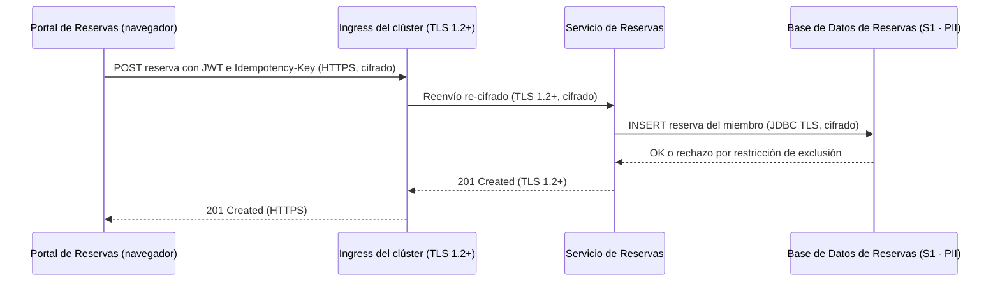
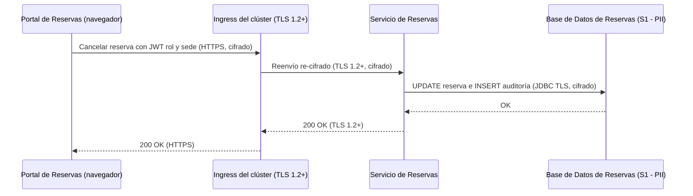
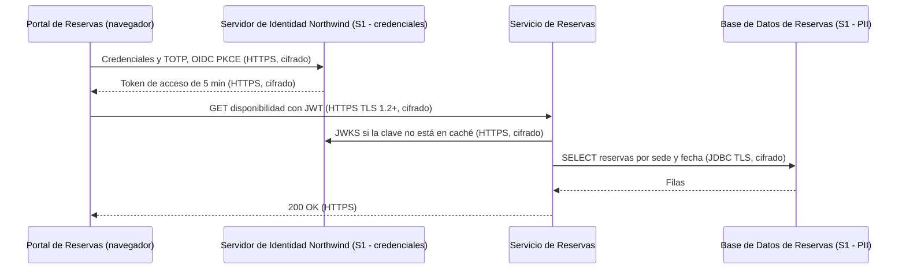

# Análisis de Sensibilidad y Flujo de Datos — Reservas de Salas Northwind - Autoservicio de reservas de salas de reunión v1.10.5

**Fecha de análisis**: 2026-11-03  
**Fuente de arquitectura**: `ARCHITECTURE.md` v1.10.5 (Status: Released)  
**Analista**: Architecture Analysis Skill

---

## 1. Resumen Ejecutivo <!-- SECTION: Executive Summary -->

El hallazgo de mayor severidad es G2-01: la `Base de Datos de Reservas` (PostgreSQL 16) guarda nombre, correo y reservas del miembro (S1) y docs/07 § 9.3 no documenta cifrado en reposo. La misma omisión afecta a sus respaldos diarios (G2-02) y al almacén de credenciales y secretos TOTP del `Servidor de Identidad Northwind` (G2-03).

El inventario cuenta 3 almacenes S1, 2 destinos con sensibilidad Unknown (caché Caffeine y logs hacia el Colector OpenTelemetry de Plataforma Northwind) y 0 almacenes S2. Hay 4 hallazgos: 3 G2 críticos y 1 G3 alto; 0 G1 y 0 G4. Las 4 integraciones (I-01 a I-04) usan HTTPS o JDBC con TLS 1.2 o superior, y ADR-002, ADR-004 y ADR-005 autorizan los cruces de frontera.

La retención de 24 meses (ADR-106) se cumple en la base, pero los respaldos conservan datos purgados hasta 30 días más (G3-01). La prioridad de remediación es documentar o habilitar el cifrado en reposo de la base y de los respaldos, y fijar la ubicación de los respaldos.

---

## 2. Inventario de Datos <!-- SECTION: Data Inventory -->

| # | Store / Queue / Cache | Type | Sensitivity Tier | Tags | Contains (examples) | Encryption at Rest | Encryption in Transit | Retention Policy | Source |
|---|---|---|---|---|---|---|---|---|---|
| 1 | `Base de Datos de Reservas` | relational DB (PostgreSQL 16 gestionado por Plataforma Northwind) | S1 | — | nombre y correo del miembro, reservas con motivo de cancelación, registro de auditoría de cancelaciones | Not Documented | Documented (JDBC con TLS, I-04) | 24 meses, purga programada (ADR-106) | docs/07-security-architecture.md § 9.3, § 9.4; docs/09-operational-considerations.md § 11.4 |
| 2 | Respaldos de la Base de Datos de Reservas | backup (respaldo diario y PITR) | S1 | — | copia completa de la base: nombre, correo, reservas, auditoría; incluye datos ya purgados | Not Documented | Not Documented | 30 días; PITR de 7 días | docs/09-operational-considerations.md § 11.3; docs/07-security-architecture.md § 9.4 |
| 3 | Almacén de cuentas del `Servidor de Identidad Northwind` | Not documented (Keycloak 25) | S1 | — | credenciales de miembros y recepcionistas, secretos TOTP, rol `recepcion` y atributo `sede` | Not Documented | Documented (HTTPS, I-01) | [NOT DOCUMENTED] | docs/07-security-architecture.md § 9.3; docs/05-integration-points.md § 7 (I-01) |
| 4 | Caché Caffeine en proceso del `Servicio de Reservas` | cache | Unknown | — | Not documented (disponibilidad por sede y fecha, invalidada por `NOTIFY disponibilidad`) | Not Documented | Not Documented | [NOT DOCUMENTED] | docs/05-integration-points.md § 7 (I-04, ADR-109) |
| 5 | Logs y trazas en el Colector OpenTelemetry de Plataforma Northwind | log | Unknown | — | `trace_id`, `span_id`, `service.name`; sin tokens ni datos personales completos | Not Documented | Not Documented | [NOT DOCUMENTED] | docs/09-operational-considerations.md § 11.2; docs/07-security-architecture.md § 9.5 |

## 3. Mapa de Flujos de Datos Sensibles <!-- SECTION: Sensitive Data Flow Map -->

| # | Flow | Step | From | To | Protocol | Carries Sensitive Data? | Encryption in Transit | Gap |
|---|---|---|---|---|---|---|---|---|
| 1 | Inicio de sesión (fase de los flujos 1, 2 y 3) | 1 | `Portal de Reservas` (navegador) | `Servidor de Identidad Northwind` | HTTPS/JSON, OIDC con PKCE (I-01) | Sí: credenciales, código TOTP, token con rol `recepcion` y `sede` | Documented (HTTPS) | None |
| 2 | Flujo 1 — Consultar disponibilidad | 1 | `Portal de Reservas` (navegador) | `Servicio de Reservas` (vía ingress) | HTTPS/JSON, TLS 1.2+ terminado y re-cifrado en el ingress (I-02) | Sí: JWT de acceso en `Authorization: Bearer` | Documented (TLS 1.2+) | None |
| 3 | Flujo 1 — Consultar disponibilidad | 2 | `Servicio de Reservas` | `Servidor de Identidad Northwind` (JWKS) | HTTPS/JSON (I-03) | No: claves públicas JWKS | Documented (HTTPS con verificación del certificado) | None |
| 4 | Flujo 1 — Consultar disponibilidad | 3 | `Servicio de Reservas` | `Base de Datos de Reservas` | JDBC/SQL con TLS (I-04) | Sí: lectura de reservas de un almacén S1 | Documented (TLS) | G2-01 |
| 5 | Flujo 2 — Reservar una sala | 1 | `Portal de Reservas` (navegador) | `Servicio de Reservas` (vía ingress) | HTTPS/JSON, TLS 1.2+ con `Idempotency-Key` (I-02) | Sí: JWT de acceso y datos de la reserva | Documented (TLS 1.2+) | None |
| 6 | Flujo 2 — Reservar una sala | 2 | `Servicio de Reservas` | `Base de Datos de Reservas` | JDBC/SQL con TLS (I-04) | Sí: INSERT de la reserva ligada al miembro | Documented (TLS) | G2-01 |
| 7 | Flujo 3 — Cancelar una reserva | 1 | `Portal de Reservas` (navegador) | `Servicio de Reservas` (vía ingress) | HTTPS/JSON, TLS 1.2+ (I-02) | Sí: JWT con rol `recepcion` y `sede`, motivo de cancelación | Documented (TLS 1.2+) | None |
| 8 | Flujo 3 — Cancelar una reserva | 2 | `Servicio de Reservas` | `Base de Datos de Reservas` | JDBC/SQL con TLS (I-04) | Sí: cancelación y registro de auditoría en la misma transacción | Documented (TLS) | G2-01 |
| 9 | Respaldo diario | 1 | `Base de Datos de Reservas` | Respaldos de la Base de Datos de Reservas (ubicación Not documented) | Not documented | Sí: copia completa del almacén S1 | Not Documented | G2-02, G3-01 |

## 4. Diagramas de Flujos Sensibles <!-- SECTION: Sensitive Flow Diagrams -->

### Flujo 2 — Reservar una sala

El JWT y los datos de la reserva viajan cifrados en I-02 e I-04; el almacén de destino no documenta cifrado en reposo (G2-01).



### Flujo 3 — Cancelar una reserva

La cancelación y su registro de auditoría se escriben en la misma transacción sobre I-04 con TLS.



### Inicio de sesión y Flujo 1 — Consultar disponibilidad

Las credenciales y el código TOTP viajan por HTTPS al Servidor de Identidad Northwind (I-01); la consulta lee el almacén S1 por I-04.



## 5. Brechas de Cifrado (G1 + G2) <!-- SECTION: Encryption Gaps -->

| # | Gap | Data Store / Flow | Sensitivity | Protocol / Storage | Missing Control | Source |
|---|---|---|---|---|---|---|
| G2-01 | G2 | `Base de Datos de Reservas` | S1 | PostgreSQL 16 gestionado por Plataforma Northwind | Cifrado en reposo (TDE o cifrado de volumen) y registro de accesos Not documented; docs/07 § 9.3 solo nombra el motor y el respaldo | docs/07-security-architecture.md § 9.3 |
| G2-02 | G2 | Respaldos de la Base de Datos de Reservas | S1 | Respaldo diario y PITR de 7 días; ubicación Not documented | Cifrado en reposo y en tránsito de los respaldos Not documented; ubicación Not documented | docs/09-operational-considerations.md § 11.3 |
| G2-03 | G2 | Almacén de cuentas del `Servidor de Identidad Northwind` | S1 | Keycloak 25; almacén Not documented | Cifrado en reposo de credenciales y secretos TOTP Not documented; retención de cuentas dadas de baja Not documented | docs/07-security-architecture.md § 9.3 |

## 6. Brechas de Retención (G3) <!-- SECTION: Retention Gaps -->

| # | Data Store | Documented Retention | Retention Limit | Overage | Source |
|---|---|---|---|---|---|
| G3-01 | Respaldos de la Base de Datos de Reservas | 30 días de respaldo; datos purgados persisten hasta 24 meses + 30 días | 24 meses (ADR-106, ley de protección de datos personales aplicable) | Hasta 30 días; docs/07 § 9.4 lo registra como costo aceptado de ADR-106 | docs/09-operational-considerations.md § 11.3; docs/07-security-architecture.md § 9.4 |

## 7. Mapa de Calor de Sensibilidad <!-- SECTION: Heat Map -->

```
SENSITIVITY     │
S1 - RESTRICTED │                                  │ [G2-01] [G2-02] [G2-03] [G3-01]  │                                  
                ├──────────────────────────────────┼──────────────────────────────────┼──────────────────────────────────
MID             │                                  │                                  │                                  
                ├──────────────────────────────────┼──────────────────────────────────┼──────────────────────────────────
S4 - PUBLIC     │                                  │                                  │                                  
                └──────────────────────────────────┴──────────────────────────────────┴──────────────────────────────────
                  FULL                              MID                               NONE                              
                  CONTROL COVERAGE →
```

## 8. Top 5 Recomendaciones de Protección del Dato <!-- SECTION: Recommendations -->

**1. Documentar o habilitar el cifrado en reposo de la Base de Datos de Reservas (G2-01)**
Confirmar con Plataforma Northwind el cifrado del volumen de PostgreSQL 16 con llaves gestionadas y anotarlo en docs/07 § 9.3 y en el descriptor de la `Base de Datos de Reservas`. Habilitar `pgaudit` o el registro de accesos de la plataforma. Costo: la gestión de llaves queda en la plataforma. Reduce la exposición de nombre y correo ante acceso al almacenamiento.
_Fuente: docs/07-security-architecture.md § 9.3_

**2. Documentar la protección del almacén de cuentas del Servidor de Identidad Northwind (G2-03)**
Registrar en el descriptor del `Servidor de Identidad Northwind` el almacén de Keycloak 25, el cifrado en reposo de credenciales y secretos TOTP y la retención de cuentas desactivadas. Costo: depende del equipo dueño del proveedor. Reduce el riesgo de robo masivo de credenciales y segundos factores.
_Fuente: docs/07-security-architecture.md § 9.3_

**3. Cifrar los respaldos y fijar su ubicación (G2-02)**
Documentar en docs/09 § 11.3 la ubicación de los respaldos diarios y del PITR de 7 días, su cifrado en reposo y el transporte cifrado hacia el destino. Costo: llaves y almacenamiento del destino de respaldo. Reduce la exposición de una copia completa del almacén S1.
_Fuente: docs/09-operational-considerations.md § 11.3_

**4. Alinear la retención de los respaldos con el límite de 24 meses (G3-01)**
Registrar en ADR-106 que los 30 días de respaldo son la extensión máxima aceptada, o reducir la retención de respaldos y documentar el calendario de la purga, hoy Not documented en docs/09 § 11.4. Costo: menor ventana de recuperación. Reduce el tiempo en que datos purgados siguen disponibles.
_Fuente: docs/09-operational-considerations.md § 11.3, § 11.4_

---

## 9. Veredicto de Protección del Dato <!-- SECTION: Summary Verdict -->

La arquitectura cifra todo el tránsito de datos S1 con TLS 1.2 o superior en I-01 a I-04, limita el acceso a la `Base de Datos de Reservas` al `Servicio de Reservas`, mantiene tokens solo en memoria (ADR-104) y documenta una retención de 24 meses con purga (ADR-106). El riesgo dominante es el cifrado en reposo sin documentar en los 3 almacenes S1 (G2-01, G2-02, G2-03). El conjunto mínimo de remediación es documentar el cifrado en reposo de la base y de sus respaldos, la ubicación de los respaldos y la protección del almacén de cuentas de Keycloak 25.

---

## 10. Brechas de Documentación <!-- SECTION: Documentation Gaps -->

- [ ] `[NOT DOCUMENTED]` `Base de Datos de Reservas` — Cifrado en reposo y registro de accesos (docs/07-security-architecture.md § 9.3 y docs/components/reservas-de-salas-northwind/03-base-de-datos-de-reservas.md (sección de seguridad))
- [ ] `[NOT DOCUMENTED]` Respaldos de la Base de Datos de Reservas — Ubicación, cifrado en reposo y cifrado en tránsito hacia el destino (docs/09-operational-considerations.md § 11.3)
- [ ] `[NOT DOCUMENTED]` Almacén de cuentas del `Servidor de Identidad Northwind` — Tipo de almacén, cifrado en reposo de credenciales y secretos TOTP, retención de cuentas desactivadas (docs/components/proveedor-de-identidad-northwind.md)
- [ ] `[NOT DOCUMENTED]` Caché Caffeine en proceso del `Servicio de Reservas` — Clasificación de sensibilidad y contenido de las entradas (docs/components/reservas-de-salas-northwind/02-servicio-de-reservas.md (Gestión de Datos))
- [ ] `[NOT DOCUMENTED]` Logs y trazas en el Colector OpenTelemetry de Plataforma Northwind — Clasificación de sensibilidad, retención, cifrado en tránsito y en reposo; alcance de "datos personales completos" (docs/09-operational-considerations.md § 11.2)
- [ ] `[NOT DOCUMENTED]` Clasificación de datos — Tabla de clasificación de datos por almacén (S1–S4) (docs/07-security-architecture.md)
- [ ] `[NOT DOCUMENTED]` Purga de 24 meses — Calendario de la purga programada (docs/09-operational-considerations.md § 11.4)

---

**Fuentes citadas**: `ARCHITECTURE.md`, `docs/04-data-flow-patterns.md`, `docs/05-integration-points.md`, `docs/06-technology-stack.md`, `docs/07-security-architecture.md`, `docs/09-operational-considerations.md`
