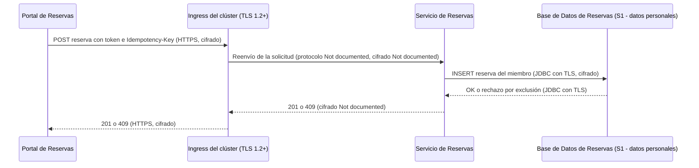
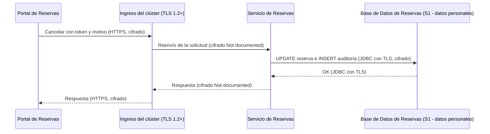
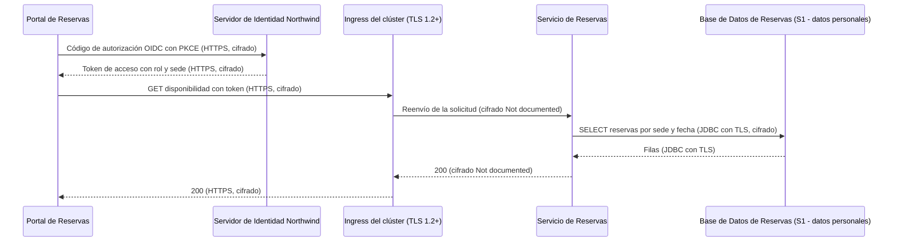

# Análisis de Sensibilidad y Flujo de Datos — Reservas de Salas Northwind - Autoservicio de reservas de salas de reunión v1.10.5

**Fecha de análisis**: 2026-11-03  
**Fuente de arquitectura**: `ARCHITECTURE.md` v1.10.5 (Status: Released)  
**Analista**: Architecture Analysis Skill

---

## 1. Resumen Ejecutivo <!-- SECTION: Executive Summary -->

El hallazgo de mayor severidad es G2-01: la `Base de Datos de Reservas` (PostgreSQL 16) guarda datos personales S1 (nombre, correo y reservas del miembro, registro de auditoría de cancelaciones) y docs/07 § 9.3 no documenta cifrado en reposo. G2-02 repite la brecha en los respaldos diarios, cuya ubicación tampoco está documentada.

El inventario cubre 7 destinos de datos: 2 S1, 1 S2, 1 S3 y 3 Unknown. Hay 4 hallazgos: 3 CRITICAL (G1-01, G2-01, G2-02) y 1 HIGH (G3-01). No hay fugas G4: el cruce hacia el `Servidor de Identidad Northwind` (I-01) lo autoriza ADR-002. Los 3 destinos Unknown quedan como brechas G5 en Brechas de Documentación.

G1-01 marca el tramo ingress → `Servicio de Reservas` de I-02: TLS 1.2 está documentado solo hasta el ingress y el tramo dentro del clúster lleva el token y los datos de la reserva sin cifrado documentado. G3-01 registra que los respaldos conservan datos purgados hasta 30 días más allá del límite de 24 meses de ADR-106.

La prioridad de remediación es documentar o habilitar el cifrado en reposo de PostgreSQL 16 y de sus respaldos (G2-01, G2-02) y fijar TLS o mTLS en el tramo interno de I-02 (G1-01).

---

## 2. Inventario de Datos <!-- SECTION: Data Inventory -->

| # | Store / Queue / Cache | Type | Sensitivity Tier | Tags | Contains (examples) | Encryption at Rest | Encryption in Transit | Retention Policy | Source |
|---|---|---|---|---|---|---|---|---|---|
| 1 | `Base de Datos de Reservas` | relational DB (PostgreSQL 16) | S1 | — | nombre y correo del miembro, reservas con cancelación y motivo, registro de auditoría de cancelaciones | Not Documented | Documented (JDBC con TLS, I-04) | 24 meses, luego purga programada (ADR-106) | docs/07-security-architecture.md § 9.3, § 9.4; docs/09-operational-considerations.md § 11.4 |
| 2 | Respaldos de la `Base de Datos de Reservas` | object store (respaldo diario y PITR) | S1 | — | copia completa de la base: nombre, correo, reservas, auditoría, incluidos datos ya purgados | Not Documented | Not Documented | 30 días; PITR de 7 días | docs/09-operational-considerations.md § 11.3; docs/07-security-architecture.md § 9.4 |
| 3 | Memoria del navegador del `Portal de Reservas` | cache (memoria de la SPA) | S2 | — | token de acceso de 5 minutos con rol `recepcion` y atributo `sede`, token de refresco | Not Documented | Documented (HTTPS, I-01 e I-02) | token de acceso de 5 minutos; nunca en `localStorage` ni `sessionStorage` (ADR-104) | docs/07-security-architecture.md § 9.2, § 9.3 |
| 4 | Caché Caffeine de disponibilidad del `Servicio de Reservas` | cache (en proceso, Caffeine 3.2) | Unknown | — | Not documented | Not Documented | Not Documented | [NOT DOCUMENTED] | docs/05-integration-points.md § 7 (ADR-109) |
| 5 | Canal `NOTIFY` `disponibilidad` de PostgreSQL | message queue (LISTEN/NOTIFY) | S3 | — | sede, fecha | Not Documented | Not Documented | [NOT DOCUMENTED] | docs/05-integration-points.md § 7 (ADR-109) |
| 6 | Colector OpenTelemetry de Plataforma Northwind (logs, trazas, métricas) | log | Unknown | — | `trace_id`, `span_id`, `service.name`; sin tokens ni datos personales completos | Not Documented | Not Documented | [NOT DOCUMENTED] | docs/09-operational-considerations.md § 11.2; docs/07-security-architecture.md § 9.5 |
| 7 | Almacén de cuentas del `Servidor de Identidad Northwind` | relational DB (Keycloak 25, motor Not documented) | Unknown | — | cuentas de miembro activas, rol `recepcion`, atributo `sede` | Not Documented | Documented (HTTPS, I-01) | [NOT DOCUMENTED] | docs/07-security-architecture.md § 9.3 |

## 3. Mapa de Flujos de Datos Sensibles <!-- SECTION: Sensitive Data Flow Map -->

| # | Flow | Step | From | To | Protocol | Carries Sensitive Data? | Encryption in Transit | Gap |
|---|---|---|---|---|---|---|---|---|
| 1 | Flujo 1 — Consultar disponibilidad | 1 | `Portal de Reservas` | `Servidor de Identidad Northwind` | HTTPS (OIDC con PKCE, I-01) | Sí: credenciales y token con rol y sede | Documented (HTTPS) | None |
| 2 | Flujo 1 — Consultar disponibilidad | 2 | `Portal de Reservas` | Ingress del clúster | HTTPS, TLS 1.2+ (I-02) | Sí: token de acceso en `Authorization` | Documented (TLS 1.2+) | None |
| 3 | Flujo 1 — Consultar disponibilidad | 3 | Ingress del clúster | `Servicio de Reservas` | Not documented (tramo interno de I-02) | Sí: token de acceso | Not Documented | G1 (G1-01) |
| 4 | Flujo 1 — Consultar disponibilidad | 4 | `Servicio de Reservas` | `Base de Datos de Reservas` | JDBC con TLS (I-04) | Sí: lectura de reservas (S1) | Documented (TLS) | None |
| 5 | Flujo 2 — Reservar una sala | 1 | `Portal de Reservas` | Ingress del clúster | HTTPS, TLS 1.2+ (I-02) | Sí: token de acceso, datos de la reserva, `Idempotency-Key` | Documented (TLS 1.2+) | None |
| 6 | Flujo 2 — Reservar una sala | 2 | Ingress del clúster | `Servicio de Reservas` | Not documented (tramo interno de I-02) | Sí: token de acceso y datos de la reserva | Not Documented | G1 (G1-01) |
| 7 | Flujo 2 — Reservar una sala | 3 | `Servicio de Reservas` | `Base de Datos de Reservas` | JDBC con TLS (I-04) | Sí: escritura de la reserva del miembro (S1) | Documented (TLS) | G2 (G2-01) en el destino |
| 8 | Flujo 3 — Cancelar una reserva | 1 | `Portal de Reservas` | Ingress del clúster | HTTPS, TLS 1.2+ (I-02) | Sí: token con rol `recepcion` y `sede`, motivo de cancelación | Documented (TLS 1.2+) | None |
| 9 | Flujo 3 — Cancelar una reserva | 2 | Ingress del clúster | `Servicio de Reservas` | Not documented (tramo interno de I-02) | Sí: token y motivo de cancelación | Not Documented | G1 (G1-01) |
| 10 | Flujo 3 — Cancelar una reserva | 3 | `Servicio de Reservas` | `Base de Datos de Reservas` | JDBC con TLS (I-04) | Sí: cancelación y registro de auditoría (quién, cuándo, motivo) | Documented (TLS) | G2 (G2-01) en el destino |

## 4. Diagramas de Flujos Sensibles <!-- SECTION: Sensitive Flow Diagrams -->

### Flujo 2 — Reservar una sala

La reserva del miembro viaja cifrada hasta el ingress y por JDBC con TLS hasta la `Base de Datos de Reservas`. El tramo ingress → `Servicio de Reservas` no documenta cifrado (G1-01).



### Flujo 3 — Cancelar una reserva

La cancelación escribe la reserva y el registro de auditoría en la misma transacción. El token lleva el rol `recepcion` y el atributo `sede` por el mismo tramo sin cifrado documentado (G1-01).



### Flujo 1 — Consultar disponibilidad

El inicio de sesión (I-01) lleva credenciales por HTTPS al `Servidor de Identidad Northwind`. La consulta lee reservas S1 por JDBC con TLS.



## 5. Brechas de Cifrado (G1 + G2) <!-- SECTION: Encryption Gaps -->

| # | Gap | Data Store / Flow | Sensitivity | Protocol / Storage | Missing Control | Source |
|---|---|---|---|---|---|---|
| G1-01 | G1 | Tramo ingress → `Servicio de Reservas` de I-02 (Flujos 1, 2 y 3) | S1 | Not documented: TLS 1.2+ documentado solo hasta el ingress | TLS o mTLS documentado entre el ingress y los pods del `Servicio de Reservas` | docs/07-security-architecture.md § 9.1, § 9.3; docs/05-integration-points.md § 7 (I-02) |
| G2-01 | G2 | `Base de Datos de Reservas` | S1 | PostgreSQL 16 gestionado por Plataforma Northwind; cifrado en reposo Not documented | Cifrado en reposo (TDE o cifrado de volumen) y gestión de llaves | docs/07-security-architecture.md § 9.3 (Datos) |
| G2-02 | G2 | Respaldos de la `Base de Datos de Reservas` | S1 | Respaldo diario, 30 días, PITR de 7 días; ubicación y cifrado Not documented | Cifrado en reposo de los respaldos y ubicación documentada | docs/09-operational-considerations.md § 11.3 |

## 6. Brechas de Retención (G3) <!-- SECTION: Retention Gaps -->

| # | Data Store | Documented Retention | Retention Limit | Overage | Source |
|---|---|---|---|---|---|
| G3-01 | Respaldos de la `Base de Datos de Reservas` | 24 meses en la base más hasta 30 días en respaldos | 24 meses (ADR-106, ley de protección de datos personales aplicable) | Hasta 30 días; costo aceptado en docs/07 § 9.4 | docs/07-security-architecture.md § 9.4; docs/09-operational-considerations.md § 11.3 |

## 7. Mapa de Calor de Sensibilidad <!-- SECTION: Heat Map -->

```
SENSITIVITY     │
S1 - RESTRICTED │                                  │ [G1-01] [G2-01] [G2-02] [G3-01]  │                                  
                ├──────────────────────────────────┼──────────────────────────────────┼──────────────────────────────────
MID             │                                  │                                  │                                  
                ├──────────────────────────────────┼──────────────────────────────────┼──────────────────────────────────
S4 - PUBLIC     │                                  │                                  │                                  
                └──────────────────────────────────┴──────────────────────────────────┴──────────────────────────────────
                  FULL                              MID                               NONE                              
                  CONTROL COVERAGE →
```

## 8. Top 5 Recomendaciones de Protección del Dato <!-- SECTION: Recommendations -->

**1. Documentar o habilitar el cifrado en reposo de PostgreSQL 16 (G2-01)**
Confirmar con Plataforma Northwind el cifrado de volumen o TDE de la `Base de Datos de Reservas` y el servicio de llaves que lo respalda; registrarlo en docs/07 § 9.3. Si no existe, habilitar cifrado de volumen con llaves gestionadas. Costo: dependencia del servicio de llaves de la plataforma. Reduce la exposición de nombre, correo y auditoría ante acceso al almacenamiento (T8-T).
_Fuente: docs/07-security-architecture.md § 9.3_

**2. Cifrar los respaldos y documentar su ubicación (G2-02)**
Documentar en docs/09 § 11.3 la ubicación de los respaldos diarios y del PITR, y exigir cifrado en reposo con llaves separadas de la base. Costo: gestión de llaves para la restauración. Reduce la divulgación de datos personales desde los respaldos (T10-I).
_Fuente: docs/09-operational-considerations.md § 11.3_

**3. Fijar TLS o mTLS en el tramo ingress → Servicio de Reservas (G1-01)**
Re-cifrar en el ingress hacia los pods del `Servicio de Reservas` con TLS 1.2+ o mTLS de malla, y declararlo en docs/07 § 9.3 junto a I-02. Costo: gestión de certificados internos y algo de latencia por salto. Reduce la lectura del token y de los datos de la reserva dentro del clúster (T2-I).
_Fuente: docs/07-security-architecture.md § 9.3; docs/05-integration-points.md § 7_

**4. Alinear la retención de respaldos con el límite de 24 meses (G3-01)**
Registrar en ADR-106 que la ventana de 30 días de respaldos cumple la ley aplicable, o purgar los respaldos que contengan registros vencidos. Documentar el calendario de la purga en docs/09 § 11.4. Costo: restauraciones más cortas si se recorta la ventana. Reduce la conservación de datos personales más allá del plazo.
_Fuente: docs/07-security-architecture.md § 9.4; adr/ADR-106_

---

## 9. Veredicto de Protección del Dato <!-- SECTION: Summary Verdict -->

La arquitectura protege bien las credenciales: tokens solo en memoria con vida de 5 minutos (ADR-104), un solo dueño de los datos (ADR-003), TLS en I-04 y logs sin tokens ni datos personales completos. El riesgo dominante es la falta de controles documentados sobre los datos personales S1 en reposo, en la base y en sus respaldos. El conjunto mínimo de remediación es G2-01, G2-02 y G1-01, más una tabla de clasificación de datos en docs/07.

---

## 10. Brechas de Documentación <!-- SECTION: Documentation Gaps -->

- [ ] `[NOT DOCUMENTED]` `Base de Datos de Reservas` — Cifrado en reposo y gestión de llaves (docs/07-security-architecture.md § 9.3; docs/components/reservas-de-salas-northwind/03-base-de-datos-de-reservas.md)
- [ ] `[NOT DOCUMENTED]` Respaldos de la `Base de Datos de Reservas` — Ubicación, cifrado en reposo y en tránsito; RTO y RPO (docs/09-operational-considerations.md § 11.3)
- [ ] `[NOT DOCUMENTED]` Tramo ingress → `Servicio de Reservas` (I-02) — Protocolo y cifrado dentro del clúster (docs/07-security-architecture.md § 9.3)
- [ ] `[NOT DOCUMENTED]` Caché Caffeine de disponibilidad del `Servicio de Reservas` — Contenido, clasificación (G5) y vida de las entradas (docs/components/reservas-de-salas-northwind/02-servicio-de-reservas.md § Gestión de Datos)
- [ ] `[NOT DOCUMENTED]` Canal `NOTIFY` `disponibilidad` — Cifrado en tránsito de la conexión `LISTEN` fuera del pool (docs/05-integration-points.md § 7 (I-04))
- [ ] `[NOT DOCUMENTED]` Colector OpenTelemetry de Plataforma Northwind — Clasificación (G5), regla de enmascarado de datos personales parciales, cifrado en tránsito y retención (docs/09-operational-considerations.md § 11.2)
- [ ] `[NOT DOCUMENTED]` Almacén de cuentas del `Servidor de Identidad Northwind` — Clasificación (G5), cifrado en reposo y retención de cuentas dadas de baja (docs/components/proveedor-de-identidad-northwind.md)
- [ ] `[NOT DOCUMENTED]` Memoria del navegador del `Portal de Reservas` — Vida del token de refresco (docs/07-security-architecture.md § 9.3)
- [ ] `[NOT DOCUMENTED]` Purga de 24 meses — Calendario de la purga (docs/09-operational-considerations.md § 11.4)
- [ ] `[NOT DOCUMENTED]` Clasificación de datos — Tabla de clasificación por almacén y registro de acceso a lecturas de datos personales (docs/07-security-architecture.md § 9.3)

---

**Fuentes citadas**: `ARCHITECTURE.md`, `docs/04-data-flow-patterns.md`, `docs/05-integration-points.md`, `docs/07-security-architecture.md`, `docs/09-operational-considerations.md`, `adr/ADR-003`, `adr/ADR-104`, `adr/ADR-106`, `adr/ADR-109`
