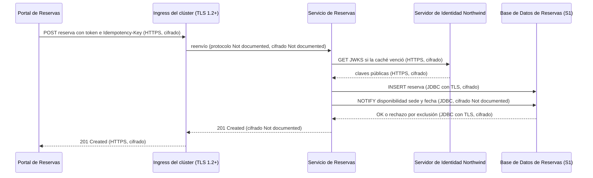
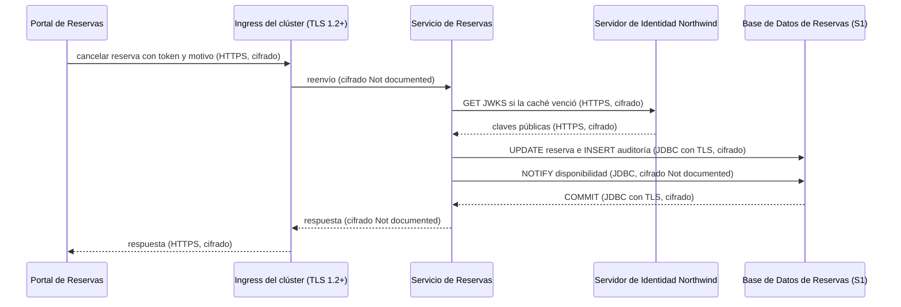
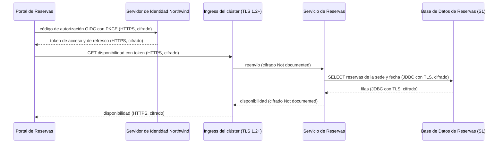

# Análisis de Sensibilidad y Flujo de Datos — Reservas de Salas Northwind - Autoservicio de reservas de salas de reunión v1.10.5

**Fecha de análisis**: 2026-11-03  
**Fuente de arquitectura**: `ARCHITECTURE.md` v1.10.5 (Status: Released)  
**Analista**: Architecture Analysis Skill

---

## 1. Resumen Ejecutivo <!-- SECTION: Executive Summary -->

El hallazgo de mayor severidad es G2-01: la `Base de Datos de Reservas` (PostgreSQL 16) guarda datos personales del miembro (nombre, correo, reservas) y el registro de auditoría de cancelaciones, y ningún documento declara cifrado en reposo. docs/07 § 9.3 solo dice que Plataforma Northwind gestiona la base. G2-02 repite la brecha en los respaldos diarios de 30 días, cuya ubicación tampoco está documentada.

El inventario tiene 8 destinos de datos: 4 S1, 1 S2, 2 S3 y 1 Unknown (la telemetría hacia el `Colector OpenTelemetry de Plataforma Northwind`). Hay 4 hallazgos: 1 G1, 2 G2, 1 G3 y ningún G4. El cifrado en tránsito está documentado hasta el ingress (TLS 1.2+) y en I-04 (JDBC con TLS); el tramo ingress → `Servicio de Reservas` de I-02 no lo está (G1-01).

La retención de 24 meses con purga programada (ADR-106) es el control mejor documentado. Los respaldos la exceden hasta 30 días (G3-01), costo que ADR-106 y docs/07 § 9.4 aceptan de forma explícita. La primera prioridad es documentar o activar el cifrado en reposo de la base y de sus respaldos, junto con el registro de accesos a los datos S1.

---

## 2. Inventario de Datos <!-- SECTION: Data Inventory -->

| # | Store / Queue / Cache | Type | Sensitivity Tier | Tags | Contains (examples) | Encryption at Rest | Encryption in Transit | Retention Policy | Source |
|---|---|---|---|---|---|---|---|---|---|
| 1 | `Base de Datos de Reservas` | relational DB (PostgreSQL 16) | S1 | — | reservas del miembro (dueño, sala, franja), motivo de cancelación; nombre y correo del miembro como activo (columnas Not documented) | Not Documented | Documented (JDBC con TLS, I-04) | 24 meses, luego purga programada (ADR-106) | docs/07 § 9.2, § 9.3; docs/09 § 11.4 |
| 2 | Registro de auditoría de cancelaciones (en `Base de Datos de Reservas`) | relational DB (tabla) | S1 | — | quién cancela, cuándo, motivo en las cancelaciones de recepción | Not Documented | Documented (JDBC con TLS, I-04) | 24 meses (ADR-106) | docs/07 § 9.4; docs/09 § 11.4 |
| 3 | Respaldos de la `Base de Datos de Reservas` | backup (ubicación Not documented) | S1 | — | copia diaria de reservas y auditoría, incluidos datos ya purgados | Not Documented | Not Documented | 30 días; PITR de 7 días | docs/09 § 11.3; docs/07 § 9.3, § 9.4 |
| 4 | Almacén de cuentas del `Servidor de Identidad Northwind` | Not documented | S1 | — | cuentas de miembros y recepcionistas, rol `recepcion`, atributo `sede` | Not Documented | Documented (HTTPS, I-01 e I-03) | [NOT DOCUMENTED] | docs/07 § 9.3; docs/05 § 7 |
| 5 | Tokens OIDC en memoria del `Portal de Reservas` | cache (memoria del navegador) | S2 | — | token de acceso con rol `recepcion` y atributo `sede`, token de refresco | Not Documented | Documented (HTTPS, I-01 e I-02) | token de acceso 5 minutos; token de refresco [NOT DOCUMENTED] | docs/07 § 9.2, § 9.3; adr/ADR-104 |
| 6 | Caché Caffeine de disponibilidad (en proceso, `Servicio de Reservas`) | cache | S3 | — | disponibilidad de salas por sede y fecha | Not Documented | Not Documented (en proceso, sin tránsito de red) | [NOT DOCUMENTED] (invalidación por `NOTIFY`, ADR-109) | docs/05 § 7 (I-04); adr/ADR-109; Components table (Caffeine 3.2) |
| 7 | Canal `NOTIFY` `disponibilidad` (PostgreSQL LISTEN/NOTIFY) | message queue | S3 | — | sede, fecha | Not Documented | Not Documented (conexión `LISTEN` fuera del pool; TLS documentado para I-04) | [NOT DOCUMENTED] | docs/05 § 7 (I-04); adr/ADR-109 |
| 8 | Telemetría hacia el `Colector OpenTelemetry de Plataforma Northwind` | log | Unknown | — | `trace_id`, `span_id`, `service.name`; "sin tokens ni datos personales completos" | Not Documented | Not Documented | [NOT DOCUMENTED] | docs/09 § 11.2; docs/07 § 9.5; adr/ADR-004 |

## 3. Mapa de Flujos de Datos Sensibles <!-- SECTION: Sensitive Data Flow Map -->

| # | Flow | Step | From | To | Protocol | Carries Sensitive Data? | Encryption in Transit | Gap |
|---|---|---|---|---|---|---|---|---|
| 1 | Flujo 1 — Consultar disponibilidad | 1 | `Portal de Reservas` | `Servidor de Identidad Northwind` | HTTPS/JSON, OIDC con PKCE (I-01) | Sí — credenciales y tokens (S1/S2) | Documented (HTTPS) | None |
| 2 | Flujo 1 — Consultar disponibilidad | 2 | `Portal de Reservas` | `Servicio de Reservas` | HTTPS/JSON con `Authorization: Bearer` (I-02) | Sí — token de acceso (S2) | Documented hasta el ingress (TLS 1.2+); ingress → pod Not documented | None |
| 3 | Flujo 1 — Consultar disponibilidad | 3 | `Servicio de Reservas` | `Servidor de Identidad Northwind` | HTTPS, JWKS público (I-03) | No — claves públicas | Documented (HTTPS con verificación del certificado) | None |
| 4 | Flujo 1 — Consultar disponibilidad | 4 | `Servicio de Reservas` | `Base de Datos de Reservas` | JDBC/SQL (I-04) | Not documented — columnas leídas para la disponibilidad | Documented (TLS) | None |
| 5 | Flujo 2 — Reservar una sala | 1 | `Portal de Reservas` | `Servicio de Reservas` | HTTPS/JSON con token e `Idempotency-Key` (I-02) | Sí — reserva del miembro e identidad del token (S1) | Documented hasta el ingress (TLS 1.2+); ingress → pod Not documented | G1 |
| 6 | Flujo 2 — Reservar una sala | 2 | `Servicio de Reservas` | `Servidor de Identidad Northwind` | HTTPS, JWKS público (I-03) | No — claves públicas | Documented (HTTPS) | None |
| 7 | Flujo 2 — Reservar una sala | 3 | `Servicio de Reservas` | `Base de Datos de Reservas` | JDBC/SQL, INSERT de la reserva (I-04) | Sí — reserva con su dueño (S1) | Documented (TLS) | G2 |
| 8 | Flujo 2 — Reservar una sala | 4 | `Servicio de Reservas` | `Base de Datos de Reservas` | `NOTIFY` en el canal `disponibilidad` (ADR-109) | No — sede y fecha (S3) | Not documented para la conexión `LISTEN` | None |
| 9 | Flujo 3 — Cancelar una reserva | 1 | `Portal de Reservas` | `Servicio de Reservas` | HTTPS/JSON con token (I-02) | Sí — identidad, rol `recepcion`, `sede` y motivo (S1) | Documented hasta el ingress (TLS 1.2+); ingress → pod Not documented | G1 |
| 10 | Flujo 3 — Cancelar una reserva | 2 | `Servicio de Reservas` | `Servidor de Identidad Northwind` | HTTPS, JWKS público (I-03) | No — claves públicas | Documented (HTTPS) | None |
| 11 | Flujo 3 — Cancelar una reserva | 3 | `Servicio de Reservas` | `Base de Datos de Reservas` | JDBC/SQL, cancelación y registro de auditoría en una transacción (I-04) | Sí — quién, cuándo y motivo (S1) | Documented (TLS) | G2 |
| 12 | Flujo 3 — Cancelar una reserva | 4 | `Servicio de Reservas` | `Base de Datos de Reservas` | `NOTIFY` en el canal `disponibilidad` (ADR-109) | No — sede y fecha (S3) | Not documented para la conexión `LISTEN` | None |

## 4. Diagramas de Flujos Sensibles <!-- SECTION: Sensitive Flow Diagrams -->

### Flujo 2 — Reservar una sala

La reserva del miembro viaja cifrada hasta el ingress y por JDBC con TLS (I-04). El tramo ingress → `Servicio de Reservas` no declara cifrado (G1-01) y la escritura llega a un almacén sin cifrado en reposo documentado (G2-01).



### Flujo 3 — Cancelar una reserva

La cancelación lleva la identidad, el rol `recepcion`, la `sede` y el motivo. El `Servicio de Reservas` escribe la cancelación y el registro de auditoría en la misma transacción por I-04 con TLS.



### Flujo 1 — Consultar disponibilidad

El inicio de sesión intercambia credenciales y tokens con el `Servidor de Identidad Northwind` por HTTPS (I-01). La consulta lee la `Base de Datos de Reservas` (S1); las columnas leídas no están documentadas.



## 5. Brechas de Cifrado (G1 + G2) <!-- SECTION: Encryption Gaps -->

| # | Gap | Data Store / Flow | Sensitivity | Protocol / Storage | Missing Control | Source |
|---|---|---|---|---|---|---|
| G1-01 | G1 | I-02, tramo ingress → `Servicio de Reservas` (Flujos 2 y 3) | S1 | TLS 1.2+ termina en el ingress; protocolo del tramo interno Not documented | cifrado en tránsito del ingress al pod (re-cifrado TLS o mTLS) no documentado | docs/07 § 9.1, § 9.3; docs/05 § 7 (I-02) |
| G2-01 | G2 | `Base de Datos de Reservas` (reservas y registro de auditoría de cancelaciones) | S1 | PostgreSQL 16 gestionado por Plataforma Northwind | cifrado en reposo (TDE o cifrado de volumen) y registro de accesos no documentados | docs/07 § 9.3; adr/ADR-003 |
| G2-02 | G2 | Respaldos de la `Base de Datos de Reservas` | S1 | respaldo diario, 30 días, PITR de 7 días; ubicación Not documented | cifrado en reposo y ubicación de los respaldos no documentados | docs/09 § 11.3; docs/07 § 9.3 |

## 6. Brechas de Retención (G3) <!-- SECTION: Retention Gaps -->

| # | Data Store | Documented Retention | Retention Limit | Overage | Source |
|---|---|---|---|---|---|
| G3-01 | Respaldos de la `Base de Datos de Reservas` | 30 días de respaldo después de la purga de 24 meses | 24 meses para reservas y auditoría (ADR-106, ley de protección de datos personales) | hasta 30 días; costo aceptado en ADR-106 y docs/07 § 9.4 | docs/09 § 11.3, § 11.4; docs/07 § 9.4; adr/ADR-106 |

## 7. Mapa de Calor de Sensibilidad <!-- SECTION: Heat Map -->

```
SENSITIVITY     │
S1 - RESTRICTED │                                  │ [G1-01] [G2-01] [G2-02] [G3-01]  │                                  
                ├──────────────────────────────────┼──────────────────────────────────┼──────────────────────────────────
MID             │                                  │                                  │                                  
                ├──────────────────────────────────┼──────────────────────────────────┼──────────────────────────────────
S4 - PUBLIC     │                                  │                                  │                                  
                └──────────────────────────────────┴──────────────────────────────────┴──────────────────────────────────
                  FULL                              MID                               NONE                              
                  CONTROL COVERAGE →
```

## 8. Top 5 Recomendaciones de Protección del Dato <!-- SECTION: Recommendations -->

**1. Documentar o activar el cifrado en reposo de la Base de Datos de Reservas (G2-01)**
Confirmar con Plataforma Northwind el cifrado de volumen o TDE de la instancia PostgreSQL 16 y registrarlo en docs/07 § 9.3 y en el descriptor de la `Base de Datos de Reservas`. Activar `pgaudit` o el registro de accesos equivalente para las tablas de reservas y auditoría. Costo: overhead de I/O y volumen de logs. Reduce la exposición de PII en disco (T12-I).
_Fuente: docs/07 § 9.3; adr/ADR-003_

**2. Cifrar y ubicar los respaldos de la base (G2-02)**
Documentar la ubicación de los respaldos diarios y su cifrado con una llave gestionada por KMS de la plataforma, distinta de la llave de la instancia. Registrar el acceso a la restauración PITR. Costo: gestión de llaves. Reduce la exposición de datos personales durante 30 días por copia.
_Fuente: docs/09 § 11.3_

**3. Cifrar el tramo ingress → Servicio de Reservas (G1-01)**
Re-cifrar con TLS del ingress al pod o activar mTLS de la malla del clúster de Plataforma Northwind, y documentarlo en docs/07 § 9.3 junto a I-02. Costo: certificados por servicio y algunos milisegundos por solicitud. Elimina PII en claro dentro del clúster (T8-I).
_Fuente: docs/07 § 9.1, § 9.3; docs/05 § 7_

**4. Alinear la retención de respaldos con la purga de 24 meses (G3-01)**
Mantener la aceptación de ADR-106 y documentar el calendario de la purga, hoy Not documented en docs/09 § 11.4, para acotar la retención real a 24 meses más 30 días. Alternativa: purgar también en restauraciones PITR antes de exponer datos. Reduce el riesgo de conservar datos personales fuera del plazo legal.
_Fuente: docs/09 § 11.3, § 11.4; adr/ADR-106_

---

## 9. Veredicto de Protección del Dato <!-- SECTION: Summary Verdict -->

La arquitectura documenta bien la minimización en el navegador (tokens solo en memoria, ADR-104), un solo dueño de los datos, TLS en I-01, I-03 e I-04 y una retención de 24 meses con purga y auditoría (ADR-106). El riesgo dominante es la falta de evidencia de protección en reposo: la `Base de Datos de Reservas` y sus respaldos guardan datos S1 sin cifrado en reposo ni registro de accesos documentados (G2-01, G2-02). El mínimo de remediación es documentar el cifrado en reposo de la base y los respaldos, cifrar el tramo ingress → `Servicio de Reservas` (G1-01) y clasificar la telemetría.

---

## 10. Brechas de Documentación <!-- SECTION: Documentation Gaps -->

- [ ] `[NOT DOCUMENTED]` `Base de Datos de Reservas` — cifrado en reposo y registro de accesos a datos S1 (docs/07-security-architecture.md § 9.3; docs/components/reservas-de-salas-northwind/03-base-de-datos-de-reservas.md)
- [ ] `[NOT DOCUMENTED]` `Base de Datos de Reservas` — columnas que guardan nombre y correo del miembro (docs/components/reservas-de-salas-northwind/03-base-de-datos-de-reservas.md § Gestión de Datos)
- [ ] `[NOT DOCUMENTED]` Respaldos de la `Base de Datos de Reservas` — ubicación, cifrado en reposo y en tránsito (docs/09-operational-considerations.md § 11.3)
- [ ] `[NOT DOCUMENTED]` I-02, tramo ingress → `Servicio de Reservas` — protocolo y cifrado en tránsito después de terminar TLS en el ingress (docs/07-security-architecture.md § 9.3; docs/05-integration-points.md § 7)
- [ ] `[NOT DOCUMENTED]` Almacén de cuentas del `Servidor de Identidad Northwind` — tipo de almacén, cifrado en reposo y retención de cuentas (docs/components/proveedor-de-identidad-northwind.md)
- [ ] `[NOT DOCUMENTED]` Telemetría hacia el `Colector OpenTelemetry de Plataforma Northwind` — clasificación (qué datos personales parciales contiene), cifrado en tránsito y en reposo, retención (docs/09-operational-considerations.md § 11.2; docs/07-security-architecture.md § 9.5)
- [ ] `[NOT DOCUMENTED]` Tokens OIDC en memoria del `Portal de Reservas` — vigencia del token de refresco (docs/07-security-architecture.md § 9.3; adr/ADR-104)
- [ ] `[NOT DOCUMENTED]` Caché Caffeine de disponibilidad — contenido exacto y TTL o tamaño máximo (docs/components/reservas-de-salas-northwind/02-servicio-de-reservas.md § Gestión de Datos)
- [ ] `[NOT DOCUMENTED]` Canal `NOTIFY` `disponibilidad` — TLS de la conexión `LISTEN` fuera del pool (docs/05-integration-points.md § 7 (I-04))
- [ ] `[NOT DOCUMENTED]` Purga de 24 meses — calendario de la purga programada (docs/09-operational-considerations.md § 11.4)
- [ ] `[NOT DOCUMENTED]` Flujo 1 — Consultar disponibilidad — si la lectura de disponibilidad devuelve datos del miembro (docs/04-data-flow-patterns.md § Flujo 1)

---

**Fuentes citadas**: `ARCHITECTURE.md`, `docs/07-security-architecture.md`, `docs/05-integration-points.md`, `docs/09-operational-considerations.md`, `docs/04-data-flow-patterns.md`, `adr/ADR-003`, `adr/ADR-004`, `adr/ADR-104`, `adr/ADR-106`, `adr/ADR-109`
