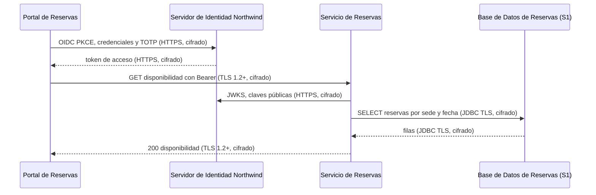
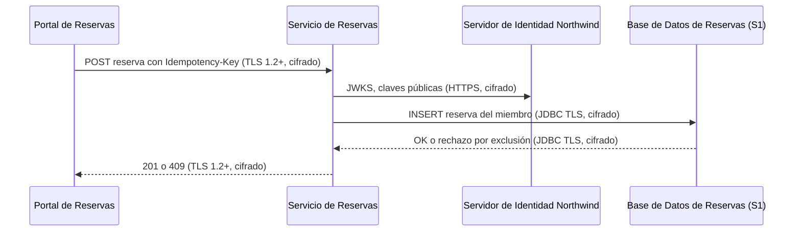
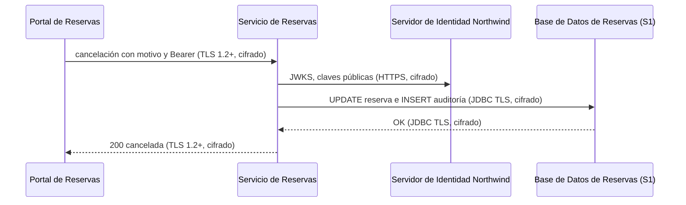

# Análisis de Sensibilidad y Flujo de Datos — Reservas de Salas Northwind - Autoservicio de reservas de salas de reunión v1.10.5

**Fecha de análisis**: 2026-11-03  
**Fuente de arquitectura**: `ARCHITECTURE.md` v1.10.5 (Status: Released)  
**Analista**: Architecture Analysis Skill

---

## 1. Resumen Ejecutivo <!-- SECTION: Executive Summary -->

La brecha de mayor severidad es G2-01: la `Base de Datos de Reservas` (PostgreSQL 16) guarda nombre, correo y reservas del miembro (S1) y docs/07 § 9.3 no documenta cifrado en reposo. G2-02 repite la brecha en los respaldos diarios y G2-03 en el almacén de cuentas del `Servidor de Identidad Northwind` (Keycloak 25), que registra TDR-005.

El inventario cuenta 6 almacenes: 3 S1, 1 S2 y 2 S3. El tránsito está cubierto: I-01 e I-03 usan HTTPS, I-02 usa TLS 1.2 o superior con re-cifrado en el ingress, e I-04 usa JDBC con TLS. No hay brechas G1 ni G4: el único cruce externo con datos S1, I-01, lo autoriza ADR-002.

Hay 4 hallazgos: 3 críticos (G2) y 1 alto (G3-01). Los respaldos conservan datos purgados hasta 30 días más allá del límite de 24 meses de ADR-106. La prioridad es documentar o activar el cifrado en reposo de la `Base de Datos de Reservas` y de sus respaldos con Plataforma Northwind.

---

## 2. Inventario de Datos <!-- SECTION: Data Inventory -->

| # | Store / Queue / Cache | Type | Sensitivity Tier | Tags | Contains (examples) | Encryption at Rest | Encryption in Transit | Retention Policy | Source |
|---|---|---|---|---|---|---|---|---|---|
| 1 | `Base de Datos de Reservas` | relational DB (PostgreSQL 16 gestionado por Plataforma Northwind) | S1 | — | nombre y correo del miembro, reservas con cancelación y motivo, registro de auditoría de cancelaciones | Not Documented | Documented (JDBC con TLS, I-04) | 24 meses, luego purga programada (ADR-106) | docs/07 § 9.3, docs/09 § 11.4, docs/components/reservas-de-salas-northwind/02-servicio-de-reservas.md § Propiedad de datos |
| 2 | Respaldos de la `Base de Datos de Reservas` | object store (respaldo diario y PITR) | S1 | — | copia de nombre, correo, reservas y auditoría, incluidos datos ya purgados | Not Documented | Not Documented | 30 días; PITR de 7 días | docs/09 § 11.3, docs/07 § 9.4, docs/06 § 8.3 |
| 3 | Almacén de cuentas del `Servidor de Identidad Northwind` | relational DB (almacén de Keycloak 25; tecnología Not documented) | S1 | — | credenciales, secreto TOTP, rol `recepcion` y atributo `sede` de miembros y recepcionistas | Not Documented | Documented (HTTPS en I-01) | [NOT DOCUMENTED] | docs/10 § 13.2 (TDR-005), docs/07 § 9.3 |
| 4 | `Colector OpenTelemetry de Plataforma Northwind` | log | S2 | — | `trace_id`, `span_id`, `service.name`; sin tokens ni datos personales completos | Not Documented | Not Documented | [NOT DOCUMENTED] | docs/09 § 11.2, docs/07 § 9.5 (ADR-004) |
| 5 | Caché Caffeine del `Servicio de Reservas` | cache (en proceso) | S3 | — | disponibilidad de salas por sede y fecha | Not Documented | Not Documented | [NOT DOCUMENTED]; invalidación por `NOTIFY` (ADR-109) | docs/05 § 7 (I-04), adr/ADR-109 |
| 6 | Canal `disponibilidad` (`LISTEN`/`NOTIFY` de PostgreSQL) | message queue | S3 | — | sede y fecha del cambio | Not Documented | Documented (conexión JDBC con TLS, I-04) | [NOT DOCUMENTED] | docs/05 § 7 (I-04), adr/ADR-109 |

## 3. Mapa de Flujos de Datos Sensibles <!-- SECTION: Sensitive Data Flow Map -->

| # | Flow | Step | From | To | Protocol | Carries Sensitive Data? | Encryption in Transit | Gap |
|---|---|---|---|---|---|---|---|---|
| 1 | Flujo 1 — Consultar disponibilidad | 1 | `Portal de Reservas` | `Servidor de Identidad Northwind` | HTTPS/JSON, OIDC con PKCE (I-01) | Sí: credenciales, TOTP, token de acceso | Documented (HTTPS; versión TLS Not documented) | None |
| 2 | Flujo 1 — Consultar disponibilidad | 2 | `Portal de Reservas` | `Servicio de Reservas` | HTTPS/JSON, TLS 1.2+ re-cifrado en el ingress (I-02) | Sí: token de acceso con rol y `sede` | Documented | None |
| 3 | Flujo 1 — Consultar disponibilidad | 3 | `Servicio de Reservas` | `Servidor de Identidad Northwind` | HTTPS/JSON, JWKS (I-03) | No: claves públicas | Documented | None |
| 4 | Flujo 1 — Consultar disponibilidad | 4 | `Servicio de Reservas` | `Base de Datos de Reservas` | JDBC/SQL con TLS (I-04) | Sí: lectura de reservas por sede y fecha | Documented | None |
| 5 | Flujo 2 — Reservar una sala | 1 | `Portal de Reservas` | `Servicio de Reservas` | HTTPS/JSON, TLS 1.2+ (I-02), `Idempotency-Key` | Sí: token de acceso y datos de la reserva | Documented | None |
| 6 | Flujo 2 — Reservar una sala | 2 | `Servicio de Reservas` | `Servidor de Identidad Northwind` | HTTPS/JSON, JWKS (I-03) | No: claves públicas | Documented | None |
| 7 | Flujo 2 — Reservar una sala | 3 | `Servicio de Reservas` | `Base de Datos de Reservas` | JDBC/SQL con TLS (I-04) | Sí: reserva ligada al miembro | Documented | G2 (destino sin cifrado en reposo documentado, G2-01) |
| 8 | Flujo 3 — Cancelar una reserva | 1 | `Portal de Reservas` | `Servicio de Reservas` | HTTPS/JSON, TLS 1.2+ (I-02) | Sí: token con rol `recepcion` y `sede`, motivo de cancelación | Documented | None |
| 9 | Flujo 3 — Cancelar una reserva | 2 | `Servicio de Reservas` | `Servidor de Identidad Northwind` | HTTPS/JSON, JWKS (I-03) | No: claves públicas | Documented | None |
| 10 | Flujo 3 — Cancelar una reserva | 3 | `Servicio de Reservas` | `Base de Datos de Reservas` | JDBC/SQL con TLS (I-04) | Sí: cancelación y registro de auditoría (quién, cuándo, motivo) | Documented | G2 (destino sin cifrado en reposo documentado, G2-01) |

## 4. Diagramas de Flujos Sensibles <!-- SECTION: Sensitive Flow Diagrams -->

### Flujo 1 — Consultar disponibilidad

El `Portal de Reservas` obtiene el token por I-01 y consulta por I-02. El `Servicio de Reservas` valida el token por I-03 y lee la `Base de Datos de Reservas` por I-04. Todos los saltos van cifrados.



### Flujo 2 — Reservar una sala

La escritura llega cifrada a la `Base de Datos de Reservas`; el almacén no documenta cifrado en reposo (G2-01).



### Flujo 3 — Cancelar una reserva

La cancelación y su registro de auditoría se escriben en la misma transacción por I-04, cifrada en tránsito; el destino no documenta cifrado en reposo (G2-01).



## 5. Brechas de Cifrado (G1 + G2) <!-- SECTION: Encryption Gaps -->

| # | Gap | Data Store / Flow | Sensitivity | Protocol / Storage | Missing Control | Source |
|---|---|---|---|---|---|---|
| G2-01 | G2 | `Base de Datos de Reservas` | S1 | PostgreSQL 16 gestionado por Plataforma Northwind | Cifrado en reposo (TDE o cifrado de volumen) no documentado para nombre, correo, reservas y auditoría | docs/07 § 9.3, adr/ADR-003 |
| G2-02 | G2 | Respaldos de la `Base de Datos de Reservas` | S1 | Respaldo diario de 30 días y PITR de 7 días; ubicación Not documented | Cifrado en reposo de los respaldos y su ubicación no documentados | docs/09 § 11.3, docs/07 § 9.3 |
| G2-03 | G2 | Almacén de cuentas del `Servidor de Identidad Northwind` | S1 | Almacén de Keycloak 25; motor Not documented | Cifrado en reposo de credenciales y secretos TOTP no documentado; TDR-005 lo registra | docs/10 § 13.2 (TDR-005) |

## 6. Brechas de Retención (G3) <!-- SECTION: Retention Gaps -->

| # | Data Store | Documented Retention | Retention Limit | Overage | Source |
|---|---|---|---|---|---|
| G3-01 | Respaldos de la `Base de Datos de Reservas` | 30 días tras la purga de 24 meses (respaldo diario) | 24 meses para reservas y auditoría (ADR-106, ley de protección de datos personales aplicable) | Hasta 30 días | docs/09 § 11.3, docs/07 § 9.4, adr/ADR-106 |

## 7. Mapa de Calor de Sensibilidad <!-- SECTION: Heat Map -->

```
SENSITIVITY     │
S1 - RESTRICTED │                                  │ [G2-01] [G2-02] [G2-03] [G3-01]  │                                  
                ├──────────────────────────────────┼──────────────────────────────────┼──────────────────────────────────
MID             │                                  │                                  │                                  
                ├──────────────────────────────────┼──────────────────────────────────┼──────────────────────────────────
S4 - PUBLIC     │                                  │                                  │                                  
                └──────────────────────────────────┴──────────────────────────────────┴──────────────────────────────────
                  FULL                              MID                               NONE                              
                  CONTROL COVERAGE →
```

## 8. Top 5 Recomendaciones de Protección del Dato <!-- SECTION: Recommendations -->

**1. Documentar o activar el cifrado en reposo de la Base de Datos de Reservas (G2-01)**
Confirmar con Plataforma Northwind el cifrado de volumen o TDE del PostgreSQL 16 gestionado, con llaves en un KMS, y registrarlo en docs/07 § 9.3 y en el descriptor del componente. Costo aceptado: dependencia del KMS de la plataforma. Reduce la exposición de nombre, correo y auditoría ante robo de discos (T9-I).
_Fuente: docs/07 § 9.3_

**2. Cerrar TDR-005 con cifrado en reposo del almacén de Keycloak (G2-03)**
Documentar el motor del almacén de cuentas del `Servidor de Identidad Northwind` y su cifrado de volumen; confirmar el hash de contraseñas de Keycloak 25 y el cifrado de los secretos TOTP. Reduce el riesgo de robo masivo de credenciales y segundo factor.
_Fuente: docs/10 § 13.2 (TDR-005)_

**3. Cifrar los respaldos y documentar su ubicación (G2-02)**
Exigir respaldos cifrados con llave gestionada en KMS y registrar ubicación, cifrado y RTO/RPO en docs/09 § 11.3. Costo aceptado: la restauración depende de la disponibilidad de la llave. Reduce la exposición de 30 días de copias con datos personales.
_Fuente: docs/09 § 11.3_

**4. Alinear la retención de respaldos con el límite de 24 meses (G3-01)**
Opción A: aceptar el exceso de 30 días en un ADR que cite la ley aplicable y lo declare en el aviso de privacidad. Opción B: purgar con antelación de 30 días, a los 23 meses. Documentar el calendario de la purga en docs/09 § 11.4.
_Fuente: adr/ADR-106, docs/09 § 11.3_

---

## 9. Veredicto de Protección del Dato <!-- SECTION: Summary Verdict -->

La arquitectura cifra todos los saltos con datos S1: HTTPS en I-01, TLS 1.2 o superior con re-cifrado en I-02 y JDBC con TLS en I-04. También limita el acceso a la `Base de Datos de Reservas` a un único dueño y fija retención de 24 meses con purga (ADR-106). El riesgo dominante es el reposo: ni la base, ni sus respaldos, ni el almacén de cuentas del `Servidor de Identidad Northwind` documentan cifrado. El mínimo es cerrar G2-01, G2-02 y G2-03, y decidir en un ADR el exceso de 30 días de G3-01.

---

## 10. Brechas de Documentación <!-- SECTION: Documentation Gaps -->

- [ ] `[NOT DOCUMENTED]` `Base de Datos de Reservas` — Cifrado en reposo y registro de acceso (docs/07-security-architecture.md § 9.3 y docs/components/reservas-de-salas-northwind/03-base-de-datos-de-reservas.md)
- [ ] `[NOT DOCUMENTED]` Respaldos de la `Base de Datos de Reservas` — Cifrado en reposo, cifrado en tránsito, ubicación, RTO y RPO (docs/09-operational-considerations.md § 11.3)
- [ ] `[NOT DOCUMENTED]` Almacén de cuentas del `Servidor de Identidad Northwind` — Motor del almacén, cifrado en reposo y política de retención de cuentas dadas de baja (docs/components/proveedor-de-identidad-northwind.md y docs/07-security-architecture.md § 9.3 (TDR-005))
- [ ] `[NOT DOCUMENTED]` `Colector OpenTelemetry de Plataforma Northwind` — Cifrado en tránsito y en reposo de la telemetría y retención de logs (docs/09-operational-considerations.md § 11.2)
- [ ] `[NOT DOCUMENTED]` Caché Caffeine del `Servicio de Reservas` — Tiempo de vida de las entradas (docs/components/reservas-de-salas-northwind/02-servicio-de-reservas.md § Gestión de Datos)
- [ ] `[NOT DOCUMENTED]` Canal `disponibilidad` (`LISTEN`/`NOTIFY`) — Retención o durabilidad de las notificaciones (adr/ADR-109 y docs/05-integration-points.md § 7)
- [ ] `[NOT DOCUMENTED]` Purga de 24 meses — Calendario de la purga (docs/09-operational-considerations.md § 11.4)
- [ ] `[NOT DOCUMENTED]` I-01 e I-03 — Versión mínima de TLS hacia el `Servidor de Identidad Northwind` (docs/07-security-architecture.md § 9.3)

---

**Fuentes citadas**: `ARCHITECTURE.md`, `docs/04-data-flow-patterns.md`, `docs/05-integration-points.md`, `docs/06-technology-stack.md`, `docs/07-security-architecture.md`, `docs/09-operational-considerations.md`, `docs/10-risks-and-technical-debt.md`, `docs/components/reservas-de-salas-northwind/02-servicio-de-reservas.md`, `adr/ADR-002-oidc-keycloak-identity.md`, `adr/ADR-003-postgresql-relational-store.md`, `adr/ADR-106-retencion-de-24-meses-purga-de-datos-y.md`, `adr/ADR-109-invalidacion-de-la-cache-con-listen-notify.md`
