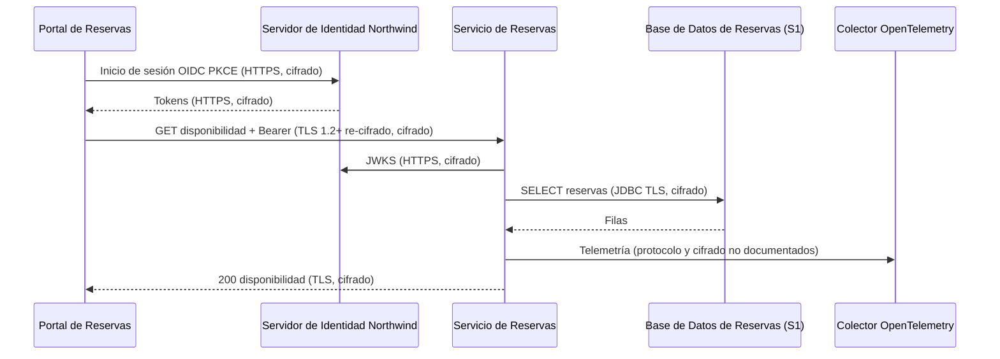
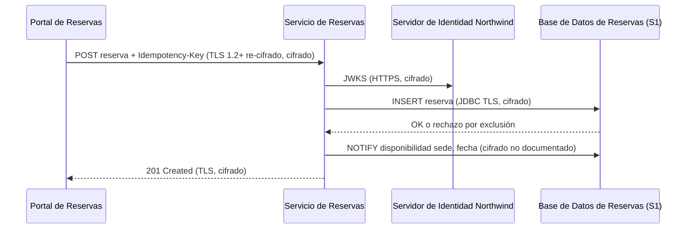
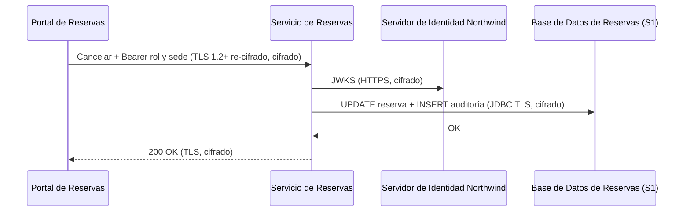

# Análisis de Sensibilidad y Flujo de Datos — Reservas de Salas Northwind - Autoservicio de reservas de salas de reunión v1.10.5

**Fecha de análisis**: 2026-11-03  
**Fuente de arquitectura**: `ARCHITECTURE.md` v1.10.5 (Status: Released)  
**Analista**: Architecture Analysis Skill

---

## 1. Resumen Ejecutivo <!-- SECTION: Executive Summary -->

El hallazgo de mayor severidad es G2-01: la `Base de Datos de Reservas` (PostgreSQL 16) guarda datos S1 (nombre, correo y reservas del miembro, registro de auditoría de cancelaciones) y la documentación no declara cifrado en reposo. docs/07 § 9.3 solo dice que Plataforma Northwind gestiona el motor.

El tránsito está cubierto: I-01 e I-03 usan HTTPS, I-02 termina TLS 1.2+ en el ingress y vuelve a cifrar hacia los pods, e I-04 usa JDBC con TLS. No hay brechas G1 ni G4: cada cruce de frontera con datos S1 tiene una decisión (ADR-001, ADR-002, ADR-003, ADR-005).

Recuento: 2 brechas G2 (CRITICAL), 1 brecha G3 (HIGH), 0 G1, 0 G4. Tres almacenes sin clasificación declarada (caché Caffeine, colector OpenTelemetry) o con contenido de baja sensibilidad (canal `disponibilidad`) quedan en el inventario; los dos primeros figuran como G5 en el mapa de flujos.

Prioridad de remediación: documentar el cifrado en reposo y la ubicación de los respaldos de la `Base de Datos de Reservas`, y acotar los 30 días en que los respaldos conservan PII ya purgada más allá de los 24 meses de ADR-106.

---

## 2. Inventario de Datos <!-- SECTION: Data Inventory -->

| # | Store / Queue / Cache | Type | Sensitivity Tier | Tags | Contains (examples) | Encryption at Rest | Encryption in Transit | Retention Policy | Source |
|---|---|---|---|---|---|---|---|---|---|
| 1 | `Base de Datos de Reservas` | relational DB (PostgreSQL 16) | S1 | — | nombre y correo del miembro, reservas, registro de auditoría de cancelaciones (quién, cuándo, motivo) | Not Documented | Documented (JDBC con TLS, I-04) | 24 meses, luego purga programada (ADR-106) | docs/07 § 9.2, § 9.3, § 9.4; docs/09 § 11.4 |
| 2 | Respaldos de la Base de Datos de Reservas | object store (respaldo gestionado) | S1 | — | copia diaria de reservas, PII del miembro y auditoría, incluidos datos ya purgados | Not Documented | Not Documented | 30 días; PITR de 7 días | docs/09 § 11.3; docs/07 § 9.3, § 9.4 |
| 3 | Caché Caffeine de disponibilidad en el `Servicio de Reservas` | cache (en proceso) | Unknown | — | disponibilidad por sede y fecha; contenido de las entradas Not documented | Not Documented | Not Documented | [NOT DOCUMENTED] | docs/05 § 7 (I-04, ADR-109); payload Components (Caffeine 3.2) |
| 4 | Canal `disponibilidad` (PostgreSQL LISTEN/NOTIFY) | message queue (canal de notificación) | S3 | — | sede, fecha | Not Documented | Not Documented | [NOT DOCUMENTED] | docs/05 § 7 (I-04, ADR-109) |
| 5 | Colector OpenTelemetry de Plataforma Northwind | log | Unknown | — | `trace_id`, `span_id`, `service.name`; logs sin tokens ni datos personales completos | Not Documented | Not Documented | [NOT DOCUMENTED] | docs/09 § 11.2; docs/07 § 9.5 (ADR-004) |

## 3. Mapa de Flujos de Datos Sensibles <!-- SECTION: Sensitive Data Flow Map -->

| # | Flow | Step | From | To | Protocol | Carries Sensitive Data? | Encryption in Transit | Gap |
|---|---|---|---|---|---|---|---|---|
| 1 | Flujo 1 — Consultar disponibilidad | 1 | `Portal de Reservas` (navegador) | `Servidor de Identidad Northwind` | HTTPS (I-01, OIDC con PKCE) | Sí — credenciales del miembro y tokens | Documented | None |
| 2 | Flujo 1 — Consultar disponibilidad | 2 | `Portal de Reservas` (navegador) | `Servicio de Reservas` | HTTPS, TLS 1.2+ al ingress y re-cifrado a los pods (I-02) | Sí — token de acceso con `sede` y rol | Documented | None |
| 3 | Flujo 1 — Consultar disponibilidad | 3 | `Servicio de Reservas` | `Servidor de Identidad Northwind` | HTTPS (I-03, JWKS) | No — claves públicas | Documented | None |
| 4 | Flujo 1 — Consultar disponibilidad | 4 | `Servicio de Reservas` | `Base de Datos de Reservas` | JDBC con TLS (I-04) | Sí — lectura de reservas | Documented | None |
| 5 | Flujo 1 — Consultar disponibilidad | 5 | `Servicio de Reservas` | Colector OpenTelemetry de Plataforma Northwind | Not documented (OpenTelemetry, ADR-004) | Not documented — logs sin datos personales completos | Not Documented | G5 |
| 6 | Flujo 2 — Reservar una sala | 1 | `Portal de Reservas` (navegador) | `Servicio de Reservas` | HTTPS, TLS 1.2+ al ingress y re-cifrado a los pods (I-02) | Sí — token de acceso, datos de la reserva, `Idempotency-Key` | Documented | None |
| 7 | Flujo 2 — Reservar una sala | 2 | `Servicio de Reservas` | `Servidor de Identidad Northwind` | HTTPS (I-03, JWKS) | No — claves públicas | Documented | None |
| 8 | Flujo 2 — Reservar una sala | 3 | `Servicio de Reservas` | `Base de Datos de Reservas` | JDBC con TLS (I-04) | Sí — INSERT de la reserva ligada al miembro | Documented | None |
| 9 | Flujo 2 — Reservar una sala | 4 | `Servicio de Reservas` | Canal `disponibilidad` (NOTIFY) | PostgreSQL NOTIFY; TLS de la conexión LISTEN Not documented | No — sede y fecha | Not Documented | None |
| 10 | Flujo 2 — Reservar una sala | 5 | `Servicio de Reservas` | Colector OpenTelemetry de Plataforma Northwind | Not documented (OpenTelemetry, ADR-004) | Not documented — logs sin datos personales completos | Not Documented | G5 |
| 11 | Flujo 3 — Cancelar una reserva | 1 | `Portal de Reservas` (navegador) | `Servicio de Reservas` | HTTPS, TLS 1.2+ al ingress y re-cifrado a los pods (I-02) | Sí — token con rol `recepcion` y `sede`, motivo | Documented | None |
| 12 | Flujo 3 — Cancelar una reserva | 2 | `Servicio de Reservas` | `Servidor de Identidad Northwind` | HTTPS (I-03, JWKS) | No — claves públicas | Documented | None |
| 13 | Flujo 3 — Cancelar una reserva | 3 | `Servicio de Reservas` | `Base de Datos de Reservas` | JDBC con TLS (I-04) | Sí — cancelación y registro de auditoría (quién, cuándo, motivo) | Documented | None |
| 14 | Flujo 3 — Cancelar una reserva | 4 | `Servicio de Reservas` | Canal `disponibilidad` (NOTIFY) | PostgreSQL NOTIFY; TLS de la conexión LISTEN Not documented | No — sede y fecha | Not Documented | None |
| 15 | Flujo 3 — Cancelar una reserva | 5 | `Servicio de Reservas` | Colector OpenTelemetry de Plataforma Northwind | Not documented (OpenTelemetry, ADR-004) | Not documented — logs sin datos personales completos | Not Documented | G5 |

## 4. Diagramas de Flujos Sensibles <!-- SECTION: Sensitive Flow Diagrams -->

### Flujo 1 — Consultar disponibilidad

El token viaja cifrado en I-01 e I-02; la lectura de reservas viaja por JDBC con TLS (I-04). El envío de telemetría no documenta protocolo ni cifrado.



### Flujo 2 — Reservar una sala

La reserva ligada al miembro viaja cifrada en I-02 e I-04. El NOTIFY lleva solo sede y fecha.



### Flujo 3 — Cancelar una reserva

La cancelación y su registro de auditoría se escriben en la misma transacción sobre JDBC con TLS (I-04).



## 5. Brechas de Cifrado (G1 + G2) <!-- SECTION: Encryption Gaps -->

| # | Gap | Data Store / Flow | Sensitivity | Protocol / Storage | Missing Control | Source |
|---|---|---|---|---|---|---|
| G2-01 | G2 | `Base de Datos de Reservas` | S1 | PostgreSQL 16 gestionado por Plataforma Northwind | Cifrado en reposo (TDE o cifrado de volumen con llaves gestionadas) no documentado para nombre, correo, reservas y auditoría | docs/07 § 9.3 Datos; ADR-003 |
| G2-02 | G2 | Respaldos de la Base de Datos de Reservas | S1 | Respaldo diario, 30 días, PITR de 7 días; ubicación Not documented | Cifrado en reposo y ubicación de los respaldos no documentados | docs/09 § 11.3; docs/07 § 9.3 |

## 6. Brechas de Retención (G3) <!-- SECTION: Retention Gaps -->

| # | Data Store | Documented Retention | Retention Limit | Overage | Source |
|---|---|---|---|---|---|
| G3-01 | Respaldos de la Base de Datos de Reservas | 30 días por respaldo; conservan datos ya purgados | 24 meses para reservas y auditoría (ADR-106; ley de protección de datos personales aplicable) | Hasta 30 días de PII después de la purga de 24 meses; costo aceptado en docs/07 § 9.4 | docs/07 § 9.4; docs/09 § 11.3; ADR-106; ADR-003 |

## 7. Mapa de Calor de Sensibilidad <!-- SECTION: Heat Map -->

```
SENSITIVITY     │
S1 - RESTRICTED │                          │ [G2-01] [G2-02] [G3-01]  │                          
                ├──────────────────────────┼──────────────────────────┼──────────────────────────
MID             │                          │                          │                          
                ├──────────────────────────┼──────────────────────────┼──────────────────────────
S4 - PUBLIC     │                          │                          │                          
                └──────────────────────────┴──────────────────────────┴──────────────────────────
                  FULL                      MID                       NONE                      
                  CONTROL COVERAGE →
```

## 8. Top 5 Recomendaciones de Protección del Dato <!-- SECTION: Recommendations -->

**1. Documentar el cifrado en reposo de la Base de Datos de Reservas (G2-01)**
Confirmar con Plataforma Northwind el cifrado de volumen o TDE de PostgreSQL 16 y quién gestiona las llaves, y registrarlo en docs/07 § 9.3 y en el descriptor del componente. Si no existe, activarlo en la instancia gestionada. Costo: dependencia del KMS de la plataforma. Reduce la exposición de nombre, correo y auditoría ante acceso al almacenamiento (STRIDE T9-T).
_Fuente: docs/07 § 9.3; ADR-003_

**2. Documentar ubicación y cifrado de los respaldos (G2-02)**
Registrar en docs/09 § 11.3 la ubicación de los respaldos diarios y su cifrado en reposo, junto con el control de acceso a la restauración. Costo: coordinación con el equipo de plataforma. Reduce la exposición de PII purgada desde copias (STRIDE T11-I).
_Fuente: docs/09 § 11.3_

**3. Acotar la PII retenida en respaldos tras la purga (G3-01)**
Mantener la excepción de 30 días como decisión explícita en ADR-106 con base legal, o reducir la retención de respaldos y documentar el calendario de la purga (hoy Not documented en docs/09 § 11.4). Costo: menor ventana de recuperación. Reduce el exceso de retención sobre el límite de 24 meses.
_Fuente: docs/07 § 9.4; docs/09 § 11.3, § 11.4; ADR-106_

---

## 9. Veredicto de Protección del Dato <!-- SECTION: Summary Verdict -->

La arquitectura cifra todos los tramos con datos S1 (I-01, I-02 re-cifrado a los pods, I-04 con TLS), concentra la PII en un solo dueño (`Servicio de Reservas` sobre la `Base de Datos de Reservas`) y declara retención de 24 meses con purga y auditoría (ADR-106). El riesgo dominante es la protección en reposo: ni la base ni sus respaldos documentan cifrado, y los respaldos retienen PII purgada hasta 30 días. El conjunto mínimo de remediación es G2-01, G2-02 y G3-01, más la clasificación de la caché Caffeine y del destino de telemetría.

---

## 10. Brechas de Documentación <!-- SECTION: Documentation Gaps -->

- [ ] `[NOT DOCUMENTED]` `Base de Datos de Reservas` — Cifrado en reposo y gestión de llaves (docs/07-security-architecture.md § 9.3; docs/components/reservas-de-salas-northwind/03-base-de-datos-de-reservas.md)
- [ ] `[NOT DOCUMENTED]` Respaldos de la Base de Datos de Reservas — Ubicación, cifrado en reposo y cifrado en tránsito (docs/09-operational-considerations.md § 11.3)
- [ ] `[NOT DOCUMENTED]` Purga de 24 meses — Calendario de la purga programada (docs/09-operational-considerations.md § 11.4)
- [ ] `[NOT DOCUMENTED]` Caché Caffeine de disponibilidad en el `Servicio de Reservas` — Clasificación de sensibilidad, contenido de las entradas y expiración (docs/components/reservas-de-salas-northwind/02-servicio-de-reservas.md § Gestión de Datos)
- [ ] `[NOT DOCUMENTED]` Canal `disponibilidad` (LISTEN/NOTIFY) — TLS de la conexión LISTEN fuera del pool (docs/05-integration-points.md § 7 (I-04))
- [ ] `[NOT DOCUMENTED]` Colector OpenTelemetry de Plataforma Northwind — Clasificación de logs y trazas, protocolo y cifrado del envío, cifrado en reposo y retención (docs/09-operational-considerations.md § 11.2; docs/07-security-architecture.md § 9.5)
- [ ] `[NOT DOCUMENTED]` `Servidor de Identidad Northwind` — Almacén de cuentas de miembro (nombre, correo, credenciales): clasificación, cifrado en reposo y retención (docs/components/proveedor-de-identidad-northwind.md)

---

**Fuentes citadas**: `ARCHITECTURE.md`, `docs/04-data-flow-patterns.md`, `docs/05-integration-points.md`, `docs/07-security-architecture.md`, `docs/09-operational-considerations.md`, `adr/ADR-003`, `adr/ADR-004`, `adr/ADR-106`, `adr/ADR-109`
