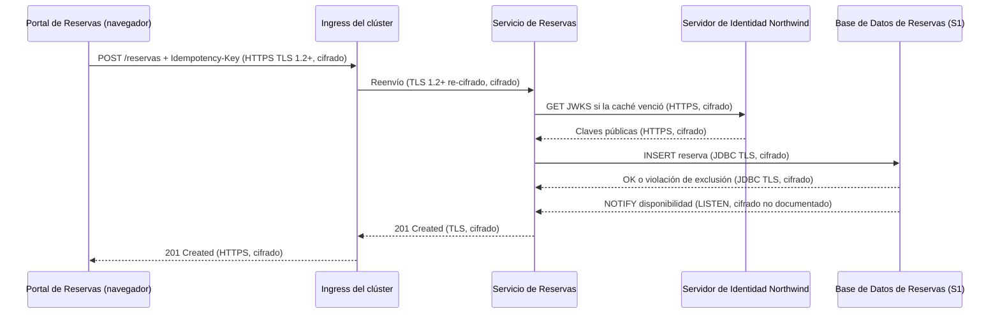
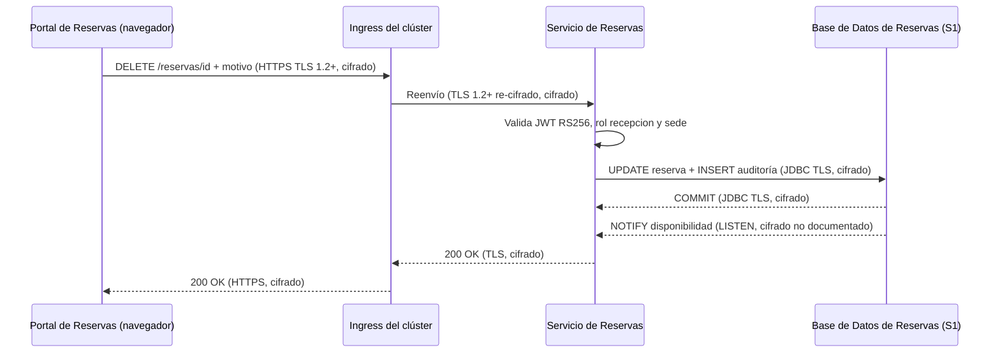
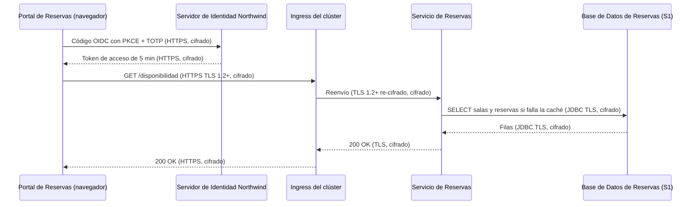

# Análisis de Sensibilidad y Flujo de Datos — Reservas de Salas Northwind - Autoservicio de reservas de salas de reunión v1.10.5

**Fecha de análisis**: 2026-11-03  
**Fuente de arquitectura**: `ARCHITECTURE.md` v1.10.5 (Status: Released)  
**Analista**: Architecture Analysis Skill

---

## 1. Resumen Ejecutivo <!-- SECTION: Executive Summary -->

El hallazgo de mayor severidad es G2-01: la `Base de Datos de Reservas` (PostgreSQL 16) guarda nombre, correo y reservas de los miembros (S1) y la documentación no declara cifrado en reposo ni registro de accesos. G2-02 repite la brecha en los respaldos diarios, cuya ubicación tampoco está documentada.

El inventario cuenta 7 destinos de datos: 3 S1 (`Base de Datos de Reservas`, sus respaldos y el almacén de identidades del `Servidor de Identidad Northwind`), 2 S3, 1 S4 y 1 sin clasificar (colector OpenTelemetry). Hay 3 hallazgos: 0 G1, 2 G2, 1 G3 y 0 G4. Todos los saltos que llevan datos S1 viajan cifrados: HTTPS en I-01 e I-03, TLS 1.2+ re-cifrado en I-02 y JDBC con TLS en I-04.

G3-01: los respaldos conservan datos purgados hasta 30 días más allá del límite de 24 meses de ADR-106. ADR-003 acepta ese costo, pero ninguna decisión lo valida frente a la ley de protección de datos personales.

La prioridad de remediación es documentar y activar el cifrado en reposo con llaves gestionadas en la base y en los respaldos, y fijar la ubicación y la zona de confianza de los respaldos.

---

## 2. Inventario de Datos <!-- SECTION: Data Inventory -->

| # | Store / Queue / Cache | Type | Sensitivity Tier | Tags | Contains (examples) | Encryption at Rest | Encryption in Transit | Retention Policy | Source |
|---|---|---|---|---|---|---|---|---|---|
| 1 | `Base de Datos de Reservas` | relational DB (PostgreSQL 16 gestionado por Plataforma Northwind) | S1 | — | nombre y correo del miembro, reservas (sala, sede, franja), registro de auditoría de cancelaciones (quién, cuándo, motivo) | Not Documented | Documented (JDBC con TLS, I-04) | 24 meses, luego purga programada (ADR-106) | docs/07-security-architecture.md § 9.3, § 9.4; docs/09-operational-considerations.md § 11.4 |
| 2 | Respaldos de la Base de Datos de Reservas | object store (respaldo diario y PITR) | S1 | — | copia de reservas, datos personales y auditoría, incluidos datos ya purgados | Not Documented | Not Documented | 30 días; PITR de 7 días | docs/09-operational-considerations.md § 11.3; docs/07-security-architecture.md § 9.4 |
| 3 | Almacén de identidades del `Servidor de Identidad Northwind` | almacén de identidades (Keycloak 25, sistema externo) | S1 | — | cuentas de miembros y recepcionistas, credenciales y secretos TOTP, rol `recepcion` y atributo `sede` | Not Documented | Documented (HTTPS, I-01 e I-03) | [NOT DOCUMENTED] | docs/07-security-architecture.md § 9.3; docs/05-integration-points.md § 7 |
| 4 | Caché Caffeine en proceso del `Servicio de Reservas` | cache (en memoria del proceso, Caffeine 3.2) | S3 | — | disponibilidad de salas por sede y fecha | Not Documented | Not Documented (en proceso, sin red) | [NOT DOCUMENTED] | adr/ADR-108; adr/ADR-109; docs/05-integration-points.md § 7 (I-04) |
| 5 | Canal `disponibilidad` de PostgreSQL LISTEN/NOTIFY | message queue (PostgreSQL LISTEN/NOTIFY) | S3 | — | sede, fecha | Not Documented | Not Documented (conexión LISTEN fuera del pool) | [NOT DOCUMENTED] | docs/05-integration-points.md § 7 (I-04); adr/ADR-109 |
| 6 | Colector OpenTelemetry de Plataforma Northwind | log (trazas, métricas y logs JSON) | Unknown | — | `trace_id`, `span_id`, `service.name`, nivel; sin tokens ni datos personales completos | Not Documented | Not Documented | [NOT DOCUMENTED] | docs/09-operational-considerations.md § 11.2; docs/07-security-architecture.md § 9.5; adr/ADR-004 |
| 7 | CDN de Plataforma Northwind (archivos del `Portal de Reservas`) | object store (CDN) | S4 | — | HTML, JS y CSS estáticos de la SPA | Not Documented | Not Documented | [NOT DOCUMENTED] | docs/09-operational-considerations.md § 11.1; adr/ADR-107 |

## 3. Mapa de Flujos de Datos Sensibles <!-- SECTION: Sensitive Data Flow Map -->

| # | Flow | Step | From | To | Protocol | Carries Sensitive Data? | Encryption in Transit | Gap |
|---|---|---|---|---|---|---|---|---|
| 1 | Flujo 1 — Consultar disponibilidad | 1 | `Portal de Reservas` (navegador) | `Servidor de Identidad Northwind` | HTTPS (OIDC con PKCE, I-01) | Sí: credenciales, TOTP y tokens (S1) | Documented (HTTPS; versión TLS no documentada) | None |
| 2 | Flujo 1 — Consultar disponibilidad | 2 | `Portal de Reservas` (navegador) | `Servicio de Reservas` (vía ingress) | HTTPS, TLS 1.2+ re-cifrado en el ingress (I-02) | Sí: token de acceso con rol y `sede` (S2) | Documented | None |
| 3 | Flujo 1 — Consultar disponibilidad | 3 | `Servicio de Reservas` | `Servidor de Identidad Northwind` (JWKS) | HTTPS (I-03) | No: claves públicas | Documented | None |
| 4 | Flujo 1 — Consultar disponibilidad | 4 | `Servicio de Reservas` | `Base de Datos de Reservas` | JDBC con TLS (I-04) | Sí: reservas del miembro (S1) | Documented | None |
| 5 | Flujo 2 — Reservar una sala | 1 | `Portal de Reservas` (navegador) | `Servicio de Reservas` (vía ingress) | HTTPS, TLS 1.2+ re-cifrado (I-02) | Sí: token y datos de la reserva con `Idempotency-Key` (S1) | Documented | None |
| 6 | Flujo 2 — Reservar una sala | 2 | `Servicio de Reservas` | `Servidor de Identidad Northwind` (JWKS) | HTTPS (I-03), claves en caché local | No: claves públicas | Documented | None |
| 7 | Flujo 2 — Reservar una sala | 3 | `Servicio de Reservas` | `Base de Datos de Reservas` | JDBC con TLS (I-04) | Sí: INSERT de la reserva del miembro (S1) | Documented | None |
| 8 | Flujo 2 — Reservar una sala | 4 | `Base de Datos de Reservas` | `Servicio de Reservas` (réplicas, LISTEN) | PostgreSQL NOTIFY `disponibilidad` | No: sede y fecha (S3) | Not Documented | None |
| 9 | Flujo 3 — Cancelar una reserva | 1 | `Portal de Reservas` (navegador) | `Servicio de Reservas` (vía ingress) | HTTPS, TLS 1.2+ re-cifrado (I-02) | Sí: token con rol `recepcion` y `sede`, motivo de cancelación (S1) | Documented | None |
| 10 | Flujo 3 — Cancelar una reserva | 2 | `Servicio de Reservas` | `Servidor de Identidad Northwind` (JWKS) | HTTPS (I-03) | No: claves públicas | Documented | None |
| 11 | Flujo 3 — Cancelar una reserva | 3 | `Servicio de Reservas` | `Base de Datos de Reservas` | JDBC con TLS (I-04) | Sí: cancelación y registro de auditoría en la misma transacción (S1) | Documented | None |
| 12 | Flujo 3 — Cancelar una reserva | 4 | `Base de Datos de Reservas` | `Servicio de Reservas` (réplicas, LISTEN) | PostgreSQL NOTIFY `disponibilidad` | No: sede y fecha (S3) | Not Documented | None |
| 13 | Telemetría (ADR-004) | 1 | `Servicio de Reservas` | Colector OpenTelemetry de Plataforma Northwind | Not documented | Not documented: logs sin tokens ni datos personales completos | Not Documented | G5 |

## 4. Diagramas de Flujos Sensibles <!-- SECTION: Sensitive Flow Diagrams -->

### Flujo 2 — Reservar una sala

Única escritura de datos S1 nuevos. Los 3 saltos con datos de la reserva viajan cifrados: TLS 1.2+ en I-02 y JDBC con TLS en I-04.



### Flujo 3 — Cancelar una reserva

La cancelación y su registro de auditoría se escriben en la misma transacción; el motivo de recepción es dato S1.



### Flujo 1 — Consultar disponibilidad

Incluye el inicio de sesión (fase 1): credenciales y TOTP viajan al Servidor de Identidad Northwind por HTTPS en I-01.



## 5. Brechas de Cifrado (G1 + G2) <!-- SECTION: Encryption Gaps -->

| # | Gap | Data Store / Flow | Sensitivity | Protocol / Storage | Missing Control | Source |
|---|---|---|---|---|---|---|
| G2-01 | G2 | `Base de Datos de Reservas` | S1 | PostgreSQL 16 gestionado por Plataforma Northwind, destino de I-04 | Cifrado en reposo (volumen o envoltura con llaves gestionadas) y registro de accesos no documentados para nombre, correo, reservas y auditoría | docs/07-security-architecture.md § 9.3 (Datos) |
| G2-02 | G2 | Respaldos de la Base de Datos de Reservas | S1 | Respaldo diario de 30 días y PITR de 7 días; ubicación Not documented | Cifrado en reposo, cifrado en tránsito hacia el destino y ubicación del respaldo no documentados | docs/09-operational-considerations.md § 11.3 |

## 6. Brechas de Retención (G3) <!-- SECTION: Retention Gaps -->

| # | Data Store | Documented Retention | Retention Limit | Overage | Source |
|---|---|---|---|---|---|
| G3-01 | Respaldos de la Base de Datos de Reservas | 30 días de respaldo diario sobre datos ya purgados a los 24 meses | 24 meses para reservas y auditoría (ADR-106, ley de protección de datos personales aplicable) | Hasta 30 días después de la purga; ADR-003 lo acepta como costo sin validación legal documentada | docs/07-security-architecture.md § 9.4; docs/09-operational-considerations.md § 11.3 |

## 7. Mapa de Calor de Sensibilidad <!-- SECTION: Heat Map -->

```
SENSITIVITY     │
S1 - RESTRICTED │                          │ [G2-01] [G2-02] [G3-01]  │                          
                ├──────────────────────────┼──────────────────────────┼──────────────────────────
MID             │                          │                          │                          
                ├──────────────────────────┼──────────────────────────┼──────────────────────────
S4 - PUBLIC     │                          │                          │                          
                └──────────────────────────┴──────────────────────────┴──────────────────────────
                  FULL                      MID                       NONE                      
                  CONTROL COVERAGE →
```

## 8. Top 5 Recomendaciones de Protección del Dato <!-- SECTION: Recommendations -->

**1. Documentar y activar el cifrado en reposo y el registro de accesos de la Base de Datos de Reservas (G2-01)**
Confirmar con Plataforma Northwind el cifrado de volumen de PostgreSQL 16 con llaves en el KMS de la plataforma y declararlo en docs/07 § 9.3. Activar `pgaudit` para lecturas y escrituras fuera del usuario del `Servicio de Reservas`. Costo: volumen de logs de auditoría y dependencia del KMS. Reduce la fuga de nombre y correo desde discos (STRIDE T15-I) y el acceso de DBA sin rastro (T14-R).
_Fuente: docs/07-security-architecture.md § 9.3_

**2. Cifrar los respaldos y fijar su ubicación y zona de confianza (G2-02)**
Documentar en docs/09 § 11.3 la ubicación del respaldo, su cifrado con una llave distinta a la de la base y el transporte TLS hacia el destino. Restringir la restauración a un rol de operación con registro. Costo: gestión de una segunda llave. Reduce la exposición de 30 días de datos S1 en una ubicación hoy no documentada.
_Fuente: docs/09-operational-considerations.md § 11.3_

**3. Resolver los 30 días de datos purgados que sobreviven en los respaldos (G3-01)**
Opción A: registrar en ADR-106 la validación legal del exceso de 30 días frente a la ley de protección de datos personales. Opción B: borrado criptográfico, con llave por periodo de respaldo destruida al vencer los 24 meses. Costo de B: rotación de llaves y restauraciones más complejas. Cierra la brecha entre la purga y la retención efectiva.
_Fuente: docs/07-security-architecture.md § 9.4_

---

## 9. Veredicto de Protección del Dato <!-- SECTION: Summary Verdict -->

La arquitectura cifra todos los saltos con datos S1: TLS 1.2+ re-cifrado en I-02, HTTPS en I-01 e I-03 y JDBC con TLS en I-04. También concentra el acceso a las tablas en el `Servicio de Reservas` y fija 24 meses de retención con purga (ADR-106). El riesgo dominante está en reposo: la `Base de Datos de Reservas` y sus respaldos no documentan cifrado, registro de accesos ni ubicación (G2-01, G2-02). Los respaldos además prolongan 30 días la retención (G3-01). El mínimo de remediación es documentar el cifrado en reposo con KMS en ambos almacenes y fijar la ubicación de los respaldos.

---

## 10. Brechas de Documentación <!-- SECTION: Documentation Gaps -->

- [ ] `[NOT DOCUMENTED]` `Base de Datos de Reservas` — Cifrado en reposo y registro de accesos (auditoría de lecturas) (docs/07-security-architecture.md § 9.3; docs/components/reservas-de-salas-northwind/03-base-de-datos-de-reservas.md)
- [ ] `[NOT DOCUMENTED]` Respaldos de la Base de Datos de Reservas — Ubicación, zona de confianza, cifrado en reposo y en tránsito; sin la zona, G4 no es evaluable (docs/09-operational-considerations.md § 11.3)
- [ ] `[NOT DOCUMENTED]` Purga de 24 meses — Calendario de la purga programada (docs/09-operational-considerations.md § 11.4)
- [ ] `[NOT DOCUMENTED]` Colector OpenTelemetry de Plataforma Northwind — Clasificación de la telemetría, protocolo y cifrado del envío, cifrado en reposo y retención (docs/07-security-architecture.md § 9.5; docs/09-operational-considerations.md § 11.2)
- [ ] `[NOT DOCUMENTED]` Almacén de identidades del `Servidor de Identidad Northwind` — Cifrado en reposo de credenciales y secretos TOTP, y retención de cuentas desactivadas (docs/components/proveedor-de-identidad-northwind.md)
- [ ] `[NOT DOCUMENTED]` I-01 e I-03 — Versión mínima de TLS de los endpoints HTTPS del `Servidor de Identidad Northwind` (docs/05-integration-points.md § 7)
- [ ] `[NOT DOCUMENTED]` Caché Caffeine en proceso del `Servicio de Reservas` — Campos almacenados, TTL y retención (docs/components/reservas-de-salas-northwind/02-servicio-de-reservas.md § Gestión de Datos)
- [ ] `[NOT DOCUMENTED]` Canal `disponibilidad` de PostgreSQL LISTEN/NOTIFY — TLS de la conexión LISTEN fuera del pool (docs/05-integration-points.md § 7 (I-04))
- [ ] `[NOT DOCUMENTED]` CDN de Plataforma Northwind (archivos del `Portal de Reservas`) — HTTPS hacia el navegador, cifrado en reposo y retención de versiones publicadas (docs/09-operational-considerations.md § 11.1)
- [ ] `[NOT DOCUMENTED]` Clasificación de datos — Tabla de clasificación por almacén; la sensibilidad sale de la lista de activos y datos personales (docs/07-security-architecture.md § 9.3)

---

**Fuentes citadas**: `ARCHITECTURE.md`, `docs/07-security-architecture.md`, `docs/05-integration-points.md`, `docs/09-operational-considerations.md`, `docs/04-data-flow-patterns.md`, `adr/ADR-003`, `adr/ADR-004`, `adr/ADR-106`, `adr/ADR-107`, `adr/ADR-108`, `adr/ADR-109`
