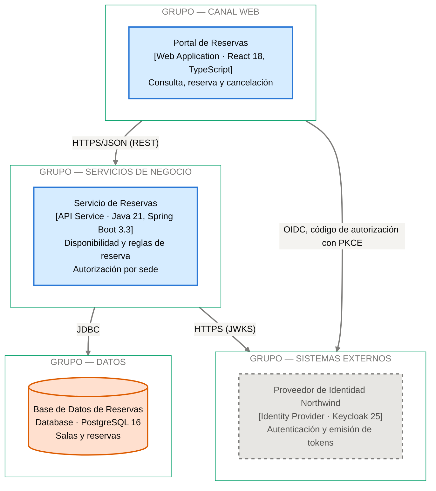
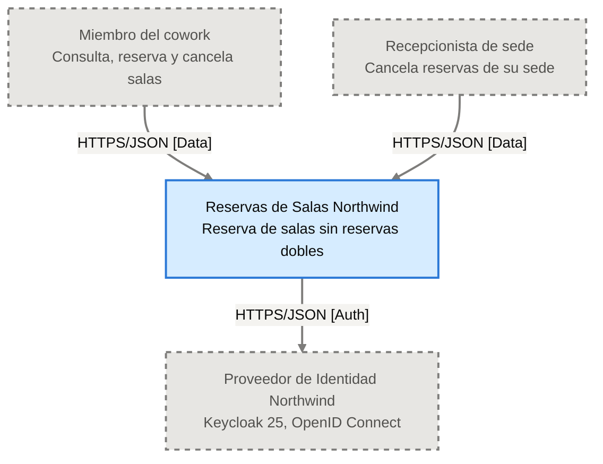
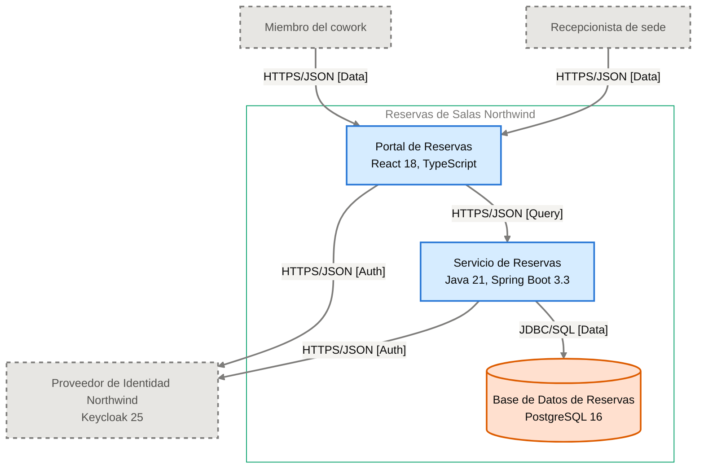
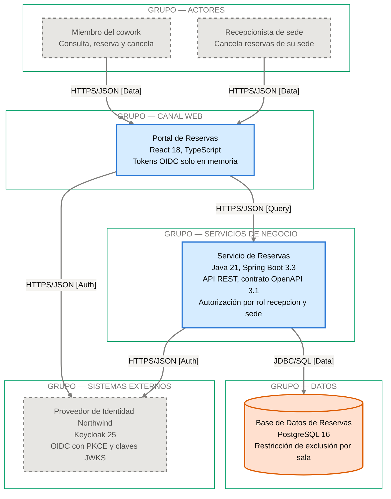

<!-- ARCHITECTURE_TYPE: MICROSERVICES -->

# Capas de Arquitectura

<!-- EXPLORER_HEADER
key_concepts: microservicios, SPA, base de datos por servicio, capa de canal, capa de servicios de negocio, capa de datos, sistemas externos, OIDC PKCE, JWKS
technologies: React 18, TypeScript, Spring Boot 3.3, Java 21, PostgreSQL 16, Keycloak 25, OpenTelemetry, Kubernetes
scope: Modelo de capas, catálogo de servicios y patrones de comunicación; no describe cada componente en detalle
related_adrs: ADR-001, ADR-002, ADR-003, ADR-004, ADR-005, ADR-101
-->

> Reservas de Salas Northwind sigue un patrón de microservicios mínimo: una SPA, un microservicio y su base de datos propia, más el Proveedor de Identidad Northwind como sistema externo. Cada componente se describe en su propio archivo de `docs/components/`.

## 4. Capas de Arquitectura <!-- SECTION: Architecture Layers -->

**Tipo de arquitectura**: MICROSERVICES.

**Patrón**: SPA + un microservicio dueño de su base de datos, según [ADR-101](../adr/ADR-101-patron-de-arquitectura-spa-un-microservicio-dueno-de.md). Tres contenedores en tres capas internas; ningún otro servicio accede a la base.

### 4.1 Modelo de Capas <!-- SECTION: Layer Model -->

| Layer | Function | Containers | External systems |
|---|---|---|---|
| **L1 — Canal web** | Interfaz de consulta, reserva y cancelación para miembros y recepción | `Portal de Reservas` | — |
| **L2 — Servicios de negocio** | Reglas de reserva, disponibilidad y autorización por sede | `Servicio de Reservas` | — |
| **L3 — Datos** | Persistencia de salas y reservas, con integridad ante superposición | `Base de Datos de Reservas` | — |
| **L4 — Sistemas externos** | Autenticación de miembros y recepcionistas, emisión y validación de tokens | — | `Proveedor de Identidad Northwind` |

**Actores**:

- **Miembro del cowork**: usa el Portal de Reservas para consultar, reservar y cancelar.
- **Recepcionista de sede**: usa el Portal de Reservas para cancelar reservas de su sede.

### 4.2 Componentes por Capa <!-- SECTION: Layer Components -->

| Componente de la plantilla | Estado en esta arquitectura |
|---|---|
| API Gateway | No existe. El Portal de Reservas llama al Servicio de Reservas directamente por HTTPS/JSON (HLD). |
| Service Mesh | No existe. Hay una sola llamada de servicio a servicio: Servicio de Reservas → Proveedor de Identidad Northwind. |
| Microservicios | Uno: [Servicio de Reservas](components/reservas-de-salas-northwind/02-servicio-de-reservas.md). |
| Almacenes de datos | Uno: [Base de Datos de Reservas](components/reservas-de-salas-northwind/03-base-de-datos-de-reservas.md), propiedad exclusiva del Servicio de Reservas (ADR-003). |
| Event Bus | No existe. Toda la comunicación es síncrona. |
| Infraestructura de soporte | Clúster Kubernetes de Plataforma Northwind (ADR-005) y colector OpenTelemetry de Plataforma Northwind (ADR-004). |

#### Canal web <!-- LABEL: Channel Layer -->

- **Contenedor**: [Portal de Reservas](components/reservas-de-salas-northwind/01-portal-de-reservas.md).
- **Tecnología**: SPA en React 18 con TypeScript, servida como archivos estáticos (PO Spec §7, norma de Plataforma Northwind).
- **Autenticación**: flujo de código de autorización con PKCE contra el Proveedor de Identidad Northwind (ADR-002).
- **Restricción**: prohibido guardar tokens en `localStorage` (PO Spec §7, Seguridad de la Información).

#### Servicios de negocio <!-- LABEL: Service Layer -->

- **Contenedor**: [Servicio de Reservas](components/reservas-de-salas-northwind/02-servicio-de-reservas.md).
- **Tecnología**: Java 21 con Spring Boot 3.3, desplegado en el clúster Kubernetes de Plataforma Northwind (ADR-005).
- **Contrato**: API REST sobre HTTPS con cuerpos JSON y contrato OpenAPI 3.1 (ADR-001).
- **Tokens**: valida los tokens del Proveedor de Identidad Northwind con sus claves JWKS por HTTPS.

#### Datos <!-- LABEL: Data Layer -->

- **Contenedor**: [Base de Datos de Reservas](components/reservas-de-salas-northwind/03-base-de-datos-de-reservas.md).
- **Tecnología**: PostgreSQL 16 gestionado por Plataforma Northwind (ADR-003).
- **Acceso**: solo el Servicio de Reservas, por JDBC; el esquema se versiona con migraciones (ADR-003).

#### Sistemas externos <!-- LABEL: External Systems -->

- **Sistema**: Proveedor de Identidad Northwind (Keycloak 25, OpenID Connect).
- **Aporta**: autenticación de miembros y recepcionistas; el rol `recepcion` y el atributo `sede` viajan en el token (PO Spec §7).

### 4.3 Catálogo de Servicios <!-- SECTION: Service Catalog -->

| Service Name | Bounded Context | Primary Technology | Data Store | Team Owner |
|---|---|---|---|---|
| Servicio de Reservas | Reservas de salas: disponibilidad, creación y cancelación | Java 21, Spring Boot 3.3 | Base de Datos de Reservas (PostgreSQL 16) | Not documented <!-- TODO: Add source reference --> |

### 4.4 Patrones de Comunicación <!-- SECTION: Communication Patterns -->

| Origen | Destino | Protocolo | Modo | Fuente |
|---|---|---|---|---|
| Portal de Reservas | Proveedor de Identidad Northwind | OIDC, código de autorización con PKCE | Síncrono | HLD; ADR-002 |
| Portal de Reservas | Servicio de Reservas | HTTPS/JSON (REST) | Síncrono | HLD; ADR-001 |
| Servicio de Reservas | Proveedor de Identidad Northwind | HTTPS (JWKS) | Síncrono | HLD; ADR-002 |
| Servicio de Reservas | Base de Datos de Reservas | JDBC | Síncrono | HLD; ADR-003 |

**Comunicación asíncrona**: no existe; ningún caso de uso la requiere.

**Observabilidad**: trazas, métricas y logs con OpenTelemetry y propagación W3C Trace Context desde el navegador (ADR-004).

### 4.5 Requisitos No Funcionales de las Capas <!-- SECTION: Layer NFRs -->

| Requisito | Valor | Fuente |
|---|---|---|
| Disponibilidad | 99,5 % mensual | PO Spec §7, Restricciones Operativas |
| Soporte | Lunes a viernes, 08:00–19:00 | PO Spec §7, Restricciones Operativas |
| Ventana de mantenimiento | Domingos 02:00–04:00 | PO Spec §7, Restricciones Operativas |
| Réplicas del Servicio de Reservas | Al menos 2, en zonas distintas | ADR-005 |
| Tiempo hasta la confirmación | p95 ≤ 2 s | PO Spec §8 |

## Diagramas de Arquitectura <!-- SECTION: Architecture Diagrams -->

#### Diagram: Logical View

**Legend:**

- **Bandas**: los cuatro grupos funcionales del § 4.1, en orden de llamada de arriba abajo.
- **Arista entre bandas**: llamada síncrona en tiempo de ejecución, con su protocolo.
- **`unit`**: contenedor dentro del alcance.
- **`store`**: almacén de datos dentro del alcance (cilindro).
- **`ext`**: sistema externo fuera del alcance (borde discontinuo).
- **`zone`**: banda de agrupación, sin relleno.

#### Diagram: C4 Level 1 — System Context

#### Diagram: C4 Level 2 — Container

#### Diagram: Detailed View

