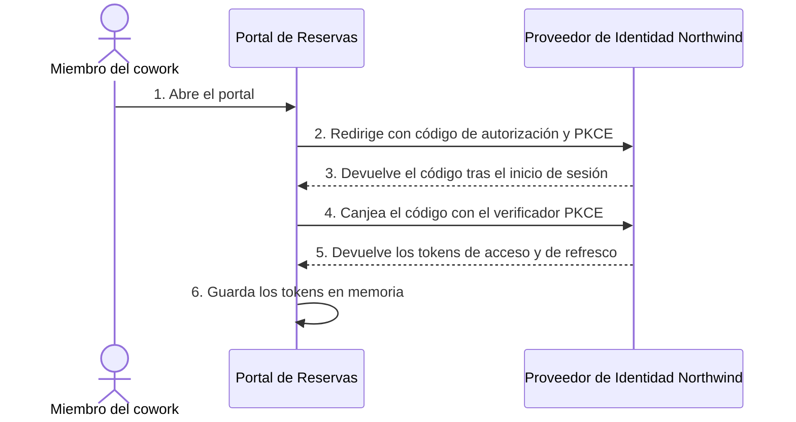
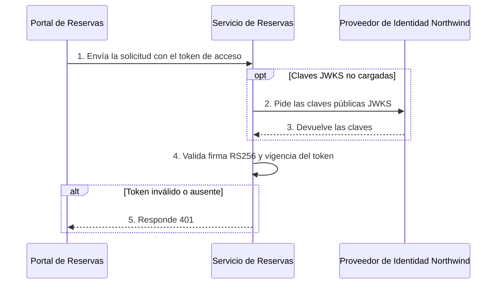
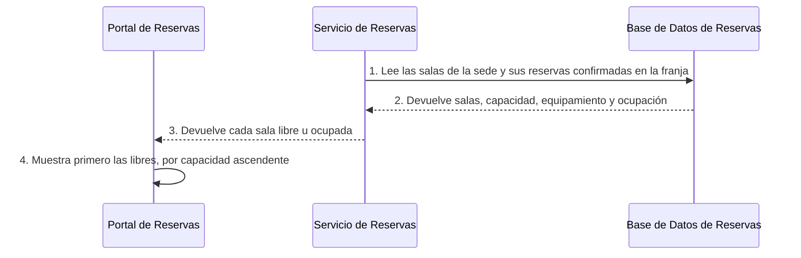
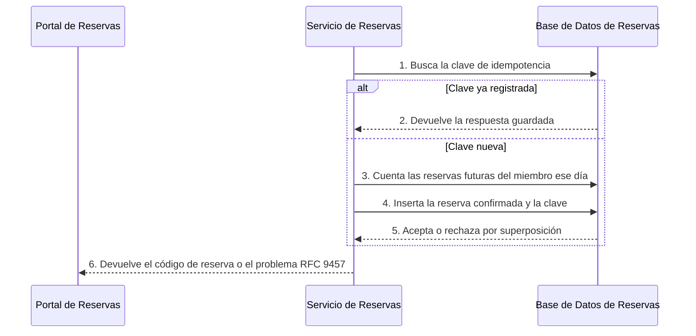
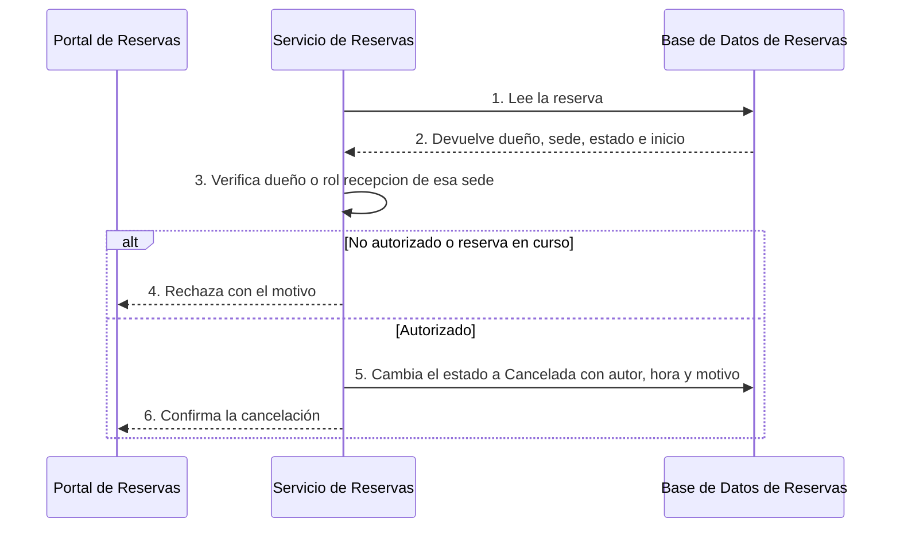
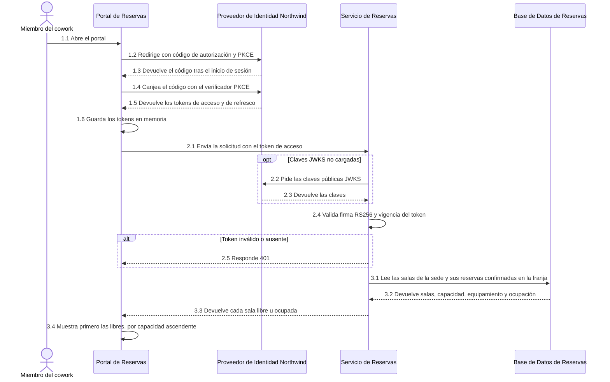
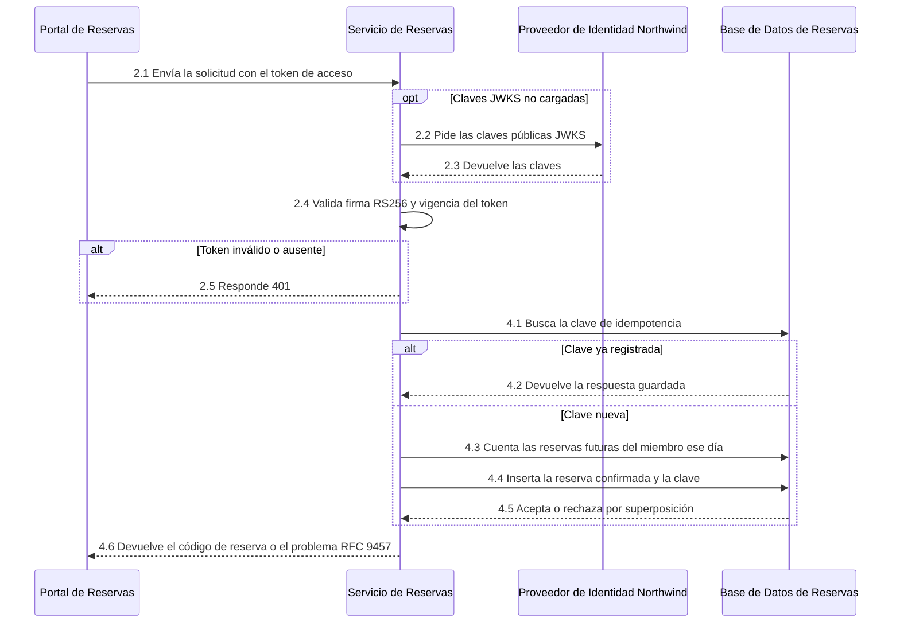
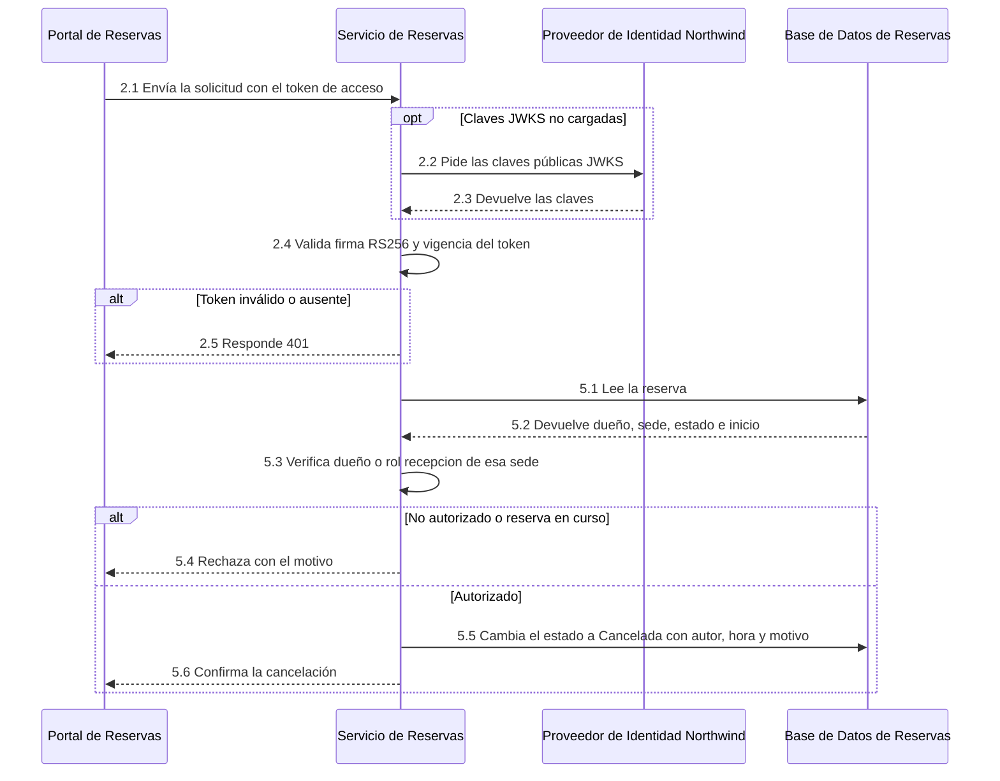

# Patrones de Flujo de Datos

<!-- EXPLORER_HEADER
key_concepts: Inicio de sesión, Validación del token, Consulta de disponibilidad, Creación de reserva, Cancelación de reserva, CU1, CU2, CU3, idempotencia, restricción de exclusión, presupuesto de latencia, clasificación de fallas
technologies: OIDC, PKCE, JWT, JWKS, OpenAPI 3.1, PostgreSQL 16, Keycloak 25, OpenTelemetry
components: portal-de-reservas, servicio-de-reservas, base-de-datos-de-reservas, proveedor-de-identidad-northwind
scope: Fases y flujos síncronos de consulta, reserva y cancelación; no cubre retención ni purga de datos
related_adrs: ADR-001, ADR-002, ADR-003, ADR-004, ADR-101, ADR-102, ADR-103, ADR-105
-->

> Todos los flujos son síncronos sobre REST: el Portal de Reservas llama al Servicio de Reservas, que valida el token y lee o escribe la Base de Datos de Reservas. Las metas de latencia vienen de la PO Spec §8. No hay flujos asíncronos ni event bus ([ADR-101](../adr/ADR-101-patron-de-arquitectura-spa-un-microservicio-dueno-de.md)).

## 6. Patrones de Flujo de Datos <!-- SECTION: Data Flow Patterns -->

**Modo**: Catálogo de Fases — 3 casos de uso comparten la validación del token y la Base de Datos de Reservas.

### Inventario de Flujos <!-- SECTION: Flow Inventory -->

| Flow | Trigger | Use Case | Latency Target |
|---|---|---|---|
| 1. Consultar disponibilidad | El miembro abre "Salas" o cambia sede, fecha o franja | CU1 | ≤ 1 s p95 |
| 2. Reservar una sala | El miembro pulsa "Reservar" y confirma | CU2 | ≤ 2 s p95 |
| 3. Cancelar una reserva | El miembro o el recepcionista pulsa "Cancelar" y confirma | CU3 | ≤ 2 s p95 |

### Catálogo de Fases <!-- SECTION: Phase Catalog -->

| # | Phase | On critical path? | Owner | Failure mode |
|---|---|---|---|---|
| 1 | Inicio de sesión | no | Portal de Reservas → Proveedor de Identidad Northwind | Proveedor no disponible: sin sesión no hay operación |
| 2 | Validación del token | yes | Portal de Reservas → Servicio de Reservas → Proveedor de Identidad Northwind | Token ausente, inválido o vencido: 401 |
| 3 | Consulta de disponibilidad | yes | Servicio de Reservas → Base de Datos de Reservas | Base no disponible: error 5xx |
| 4 | Creación de reserva | yes | Servicio de Reservas → Base de Datos de Reservas | Superposición o límite diario: rechazo de negocio |
| 5 | Cancelación de reserva | yes | Servicio de Reservas → Base de Datos de Reservas | No autorizado o reserva en curso: rechazo de negocio |

#### Fase 1 — Inicio de sesión

**Purpose**: Obtener los tokens del miembro o del recepcionista con OIDC y PKCE.
**Hops**: Portal de Reservas → Proveedor de Identidad Northwind.
**Latency budget (p95)**: Not documented <!-- TODO: Add source reference -->.
**Side effects**: tokens en memoria del navegador, nunca en `localStorage` ni `sessionStorage`; token de acceso de 5 minutos con renovación silenciosa ([ADR-002](../adr/ADR-002-oidc-keycloak-identity.md)).

#### Fase 2 — Validación del token

**Purpose**: Aceptar solo solicitudes con un JWT válido del Proveedor de Identidad Northwind.
**Hops**: Portal de Reservas → Servicio de Reservas → Proveedor de Identidad Northwind.
**Latency budget (p95)**: Not documented <!-- TODO: Add source reference -->.
**Side effects**: ninguno (solo lectura); deny by default, 401 sin token válido ([ADR-002](../adr/ADR-002-oidc-keycloak-identity.md)).

#### Fase 3 — Consulta de disponibilidad

**Purpose**: Devolver cada sala de la sede con su estado libre u ocupada en la franja pedida.
**Hops**: Servicio de Reservas → Base de Datos de Reservas.
**Latency budget (p95)**: Not documented <!-- TODO: Add source reference -->; el flujo completo, ≤ 1 s.
**Side effects**: ninguno (solo lectura).

#### Fase 4 — Creación de reserva

**Purpose**: Registrar una reserva "Confirmada" sin superposición, una sola vez por clave de idempotencia.
**Hops**: Servicio de Reservas → Base de Datos de Reservas.
**Latency budget (p95)**: Not documented <!-- TODO: Add source reference -->; el flujo completo, ≤ 2 s.
**Side effects**: reserva "Confirmada" con código `RS-` y clave de idempotencia con su respuesta, guardada 24 horas ([ADR-001](../adr/ADR-001-rest-openapi-apis.md); [ADR-103](../adr/ADR-103-idempotencia-de-la-creacion-de-reservas-con-clave.md)). La restricción de exclusión rechaza la superposición ([ADR-102](../adr/ADR-102-impedir-reservas-dobles-con-restriccion-de-exclusion-en.md)).

#### Fase 5 — Cancelación de reserva

**Purpose**: Pasar una reserva futura a "Cancelada" si quien cancela es su dueño o recepción de la sede.
**Hops**: Servicio de Reservas → Base de Datos de Reservas.
**Latency budget (p95)**: Not documented <!-- TODO: Add source reference -->; el flujo completo, ≤ 2 s.
**Side effects**: estado "Cancelada" con autor, hora y, para recepción, motivo de hasta 120 caracteres (PO Spec CU3). Autorización por rol `recepcion` y atributo `sede` ([ADR-105](../adr/ADR-105-autorizacion-por-rol-recepcion-y-atributo-sede-del.md)).

### Resolución de Casos de Uso <!-- SECTION: Use Case Resolutions -->

| Phase | CU1 — Consultar disponibilidad | CU2 — Reservar una sala | CU3 — Cancelar una reserva |
|---|---|---|---|
| 1 — Inicio de sesión | ✓ | reused (sesión de CU1) | reused (sesión vigente) |
| 2 — Validación del token | ✓ | ✓ | ✓ |
| 3 — Consulta de disponibilidad | ✓ | reused (resultado de CU1) | n/a |
| 4 — Creación de reserva | n/a | ✓ | n/a |
| 5 — Cancelación de reserva | n/a | n/a | ✓ |

#### Flujo 1 — Consultar disponibilidad

**Use case**: CU1.
**Phases**: 1 → 2 → 3 (síncrono).
**Delta**: solo lectura; con ninguna sala libre, el portal muestra las 3 franjas de 30 minutos más cercanas con una sala libre.
**Governed by**: [ADR-001](../adr/ADR-001-rest-openapi-apis.md), [ADR-002](../adr/ADR-002-oidc-keycloak-identity.md).

→ Secuencia completa: [Secuencias Extremo a Extremo](#secuencias-extremo-a-extremo).

#### Flujo 2 — Reservar una sala

**Use case**: CU2.
**Phases**: 2 → 4 (síncrono).
**Delta**: única escritura con clave de idempotencia; la superposición la rechaza la Base de Datos de Reservas, no el código.
**Governed by**: [ADR-001](../adr/ADR-001-rest-openapi-apis.md), [ADR-003](../adr/ADR-003-postgresql-relational-store.md).

→ Secuencia completa: [Secuencias Extremo a Extremo](#secuencias-extremo-a-extremo).

#### Flujo 3 — Cancelar una reserva

**Use case**: CU3.
**Phases**: 2 → 5 (síncrono).
**Delta**: la autorización depende del dueño o del rol `recepcion` con el atributo `sede` del token.
**Governed by**: [ADR-002](../adr/ADR-002-oidc-keycloak-identity.md).

→ Secuencia completa: [Secuencias Extremo a Extremo](#secuencias-extremo-a-extremo).

### Aspectos Transversales de los Flujos <!-- SECTION: Cross-cutting flow concerns -->

#### Idempotencia <!-- SECTION: Idempotency -->

| Field | Value |
|---|---|
| Key carrier | Portal de Reservas genera la clave en el navegador por cada confirmación y la envía en la cabecera `Idempotency-Key` |
| Dedup gate position | Fase 4, paso 1, antes de insertar la reserva |
| Store and operation | Base de Datos de Reservas: clave y respuesta de la creación; tabla Not documented <!-- TODO: Add source reference --> |
| TTL | 24 horas ([ADR-001](../adr/ADR-001-rest-openapi-apis.md)) |
| Governing ADR | [ADR-001](../adr/ADR-001-rest-openapi-apis.md); [ADR-103](../adr/ADR-103-idempotencia-de-la-creacion-de-reservas-con-clave.md) |

**Motivo**: un doble clic o un reintento por pérdida de red devuelve la reserva ya creada, sin crear una segunda (PO Spec CU2).

#### Presupuesto de latencia <!-- SECTION: Latency budget breakdown -->

| Hop | Budget |
|---|---|
| CDN → navegador (primera carga) | ≤ 2,5 s LCP p75 en 4G (PO Spec §8) |
| Portal de Reservas → Servicio de Reservas | Not documented <!-- TODO: Add source reference --> |
| Servicio de Reservas → Base de Datos de Reservas | Not documented <!-- TODO: Add source reference --> |
| Servicio de Reservas → Proveedor de Identidad Northwind (JWKS) | Fuera del camino crítico salvo carga de claves |
| **Total p95** | **≤ 1 s consulta; ≤ 2 s reserva y cancelación (PO Spec §8)** |

#### Clasificación de fallas <!-- SECTION: Failure classification -->

| Phase | Failure | Recovery |
|---|---|---|
| 1 — Inicio de sesión | Proveedor de Identidad Northwind no disponible | Error visible; el usuario reintenta el inicio de sesión |
| 2 — Validación del token | Token ausente, inválido o vencido | 401; el Portal de Reservas renueva el token o repite el inicio de sesión ([ADR-002](../adr/ADR-002-oidc-keycloak-identity.md)) |
| 3 — Consulta de disponibilidad | Base de Datos de Reservas no disponible | Error RFC 9457 visible; el miembro repite la consulta |
| 4 — Creación de reserva | Sala ocupada por otra reserva | Rechazo "sala ocupada"; el portal vuelve a la consulta con la misma franja |
| 4 — Creación de reserva | Límite de 3 reservas futuras por día | Rechazo "límite diario" |
| 4 — Creación de reserva | Pérdida de red o doble clic | Reintento con la misma `Idempotency-Key`; devuelve la reserva ya creada |
| 5 — Cancelación de reserva | Quien cancela no es dueño ni recepción de la sede | Rechazo "no autorizado"; el estado sigue "Confirmada" |
| 5 — Cancelación de reserva | Reserva ya iniciada | Rechazo "reserva en curso" |

### Secuencias Extremo a Extremo <!-- SECTION: End-to-End Wire Sequences -->

<!-- DERIVED: flow-compose.js — each sequence below is the concatenation of the Phase Catalog panels its flow declares, steps relabelled N.M (phase N, step M). Do not hand-edit: change the panel or the flow's Phases line and re-run. -->

#### Flujo 1 — Consultar disponibilidad (secuencia completa)

*Derivada de las fases 1 → 2 → 3 del Catálogo de Fases.*

#### Flujo 2 — Reservar una sala (secuencia completa)

*Derivada de las fases 2 → 4 del Catálogo de Fases.*

#### Flujo 3 — Cancelar una reserva (secuencia completa)

*Derivada de las fases 2 → 5 del Catálogo de Fases.*

