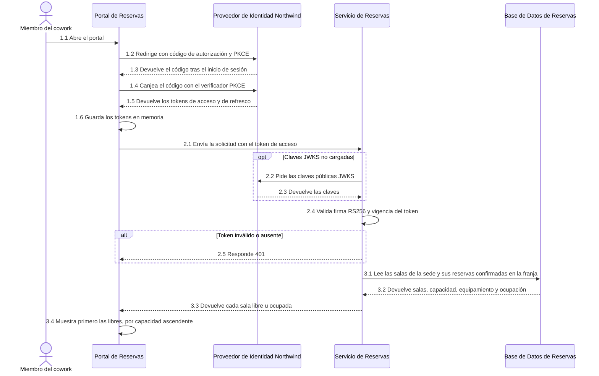
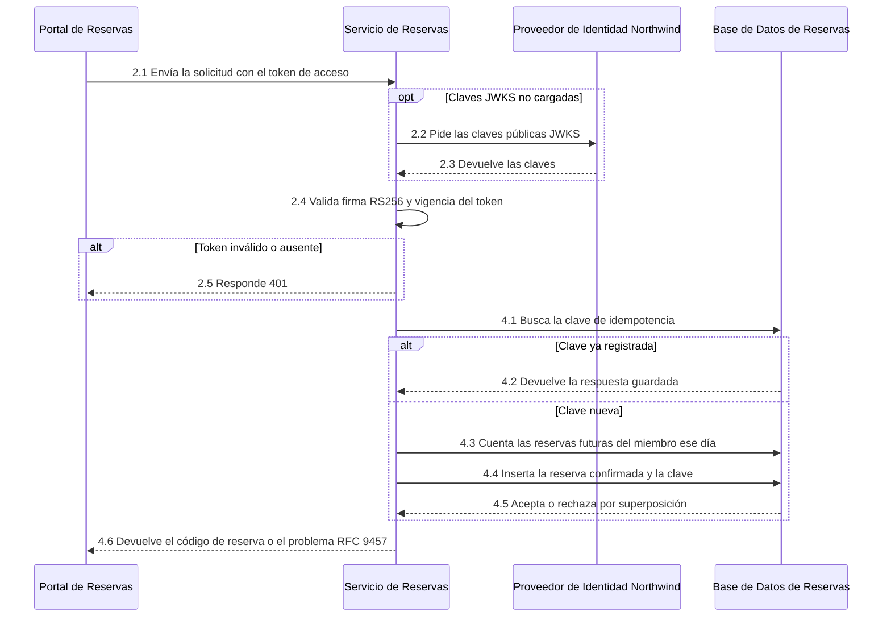
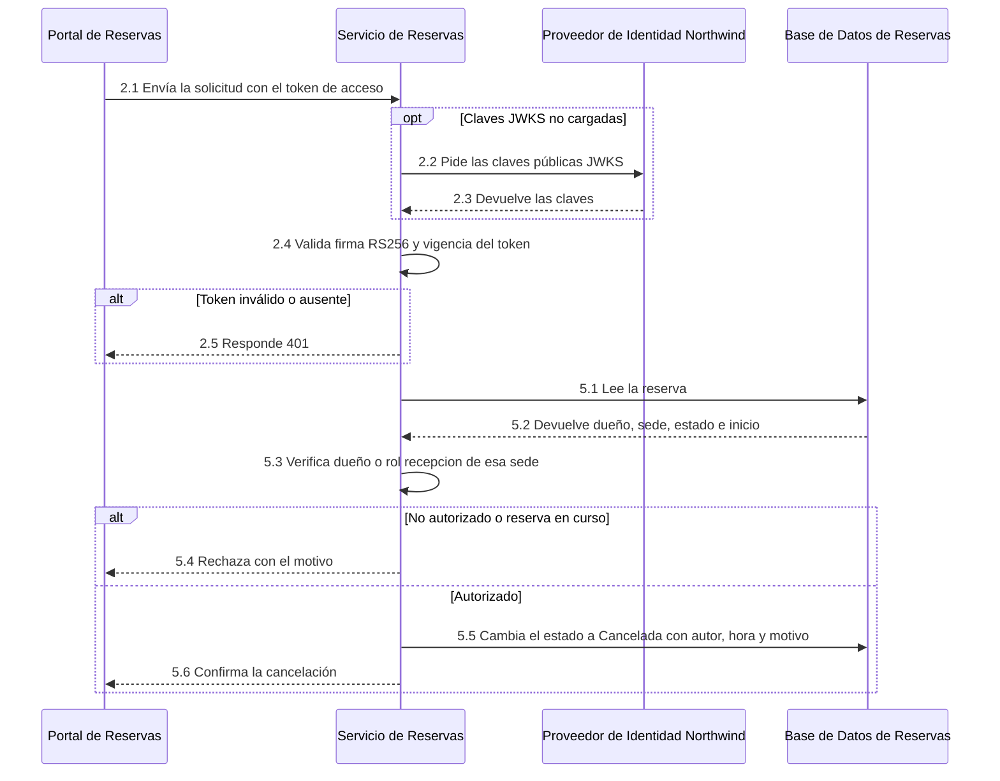
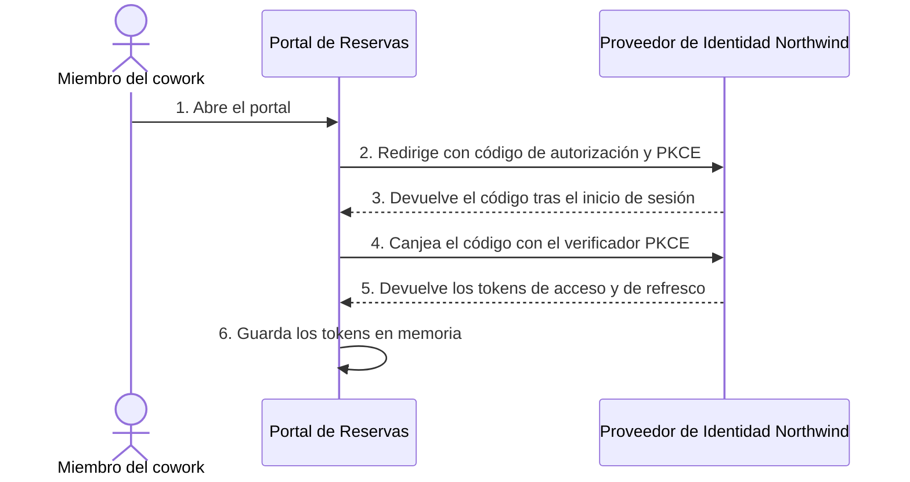
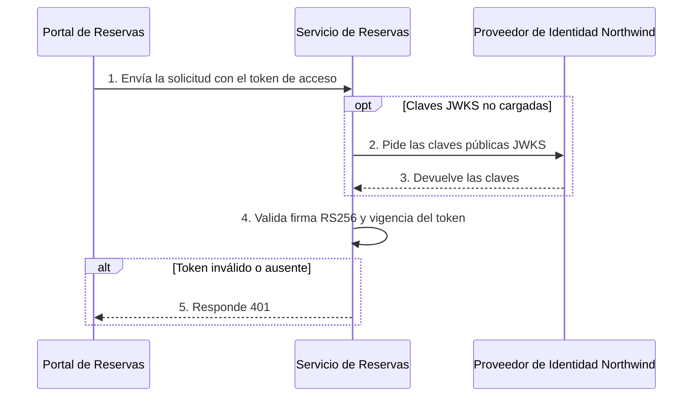
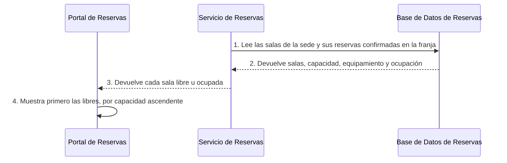
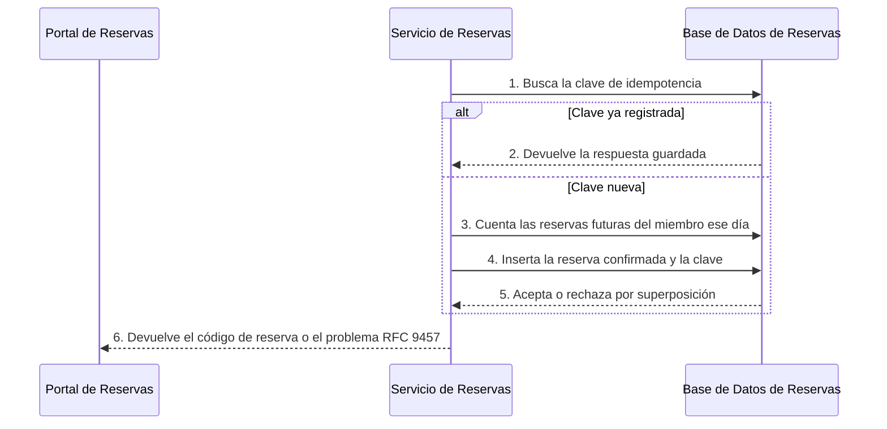
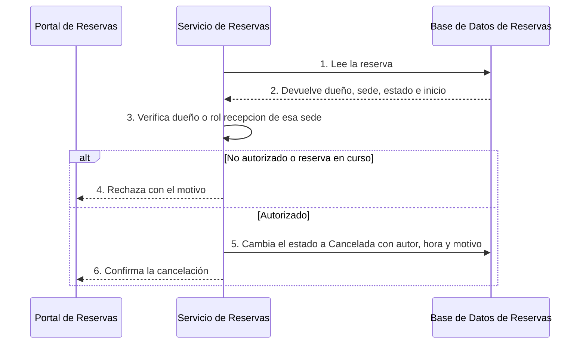

# Vista de Ejecución del Sistema — Reservas de Salas Northwind - Autoservicio de reservas de salas de reunión

<!-- managed by sa-skills:architecture-dev-handoff — do not edit manually -->
<!-- TEMPLATE_VERSION: 4.3.1 -->
| Field | Value |
|-------|-------|
| Versión | 4.3.1 |
| Responsable | Equipo de Arquitectura Northwind |
| Estado | draft |
| Versión de la arquitectura | 1.0.0 |
| Generado | 2026-10-18 |
| Proyecto | Reservas de Salas Northwind - Autoservicio de reservas de salas de reunión |

### Índice rápido por rol <!-- SECTION: Role Quick Index -->

| Audience | Read first in this document |
|----------|-----------------------------|
| **Arquitecto** | Alcance → Flujos → Descomposición del Presupuesto → Justificación de Aristas → Camino de Retorno |
| **Dev** | Flujos (los flujos donde aparece su componente) → Justificación de Aristas (aristas que tocan su componente) |
| **Ops / SRE** | Descomposición del Presupuesto → Postura de Fallo de un Vistazo → Camino de Retorno |

El orden de lectura de los cuatro documentos del handoff está en `handoffs/README.md`.

La Vista de Ejecución del Sistema es el **guion gráfico de todo el sistema**: la vista compartida que recibe cada equipo de servicio junto a su Especificación de Componente. Nombra cada arista, su justificación y el ADR que la decidió, y obliga a descomponer el presupuesto por salto para que ningún equipo asuma que posee el SLO de extremo a extremo.

---

## 1. Alcance <!-- SECTION: Scope -->

**Dentro del alcance**

- Portal de Reservas
- Servicio de Reservas
- Base de Datos de Reservas

**Fuera del alcance** (se nombra de forma explícita para que la ausencia no sea ambigua)

No hay componentes fuera de alcance documentados.

---

## 2. Flujos <!-- SECTION: Flows -->

Cada flujo de extremo a extremo indica disparador, ruta, enlace al diagrama de secuencia, presupuesto global y postura de fallo. Los componentes de la ruta usan el nombre canónico del H1 del archivo del componente.

### F-01 — Consultar disponibilidad

- **Disparador:** El miembro abre "Salas" o cambia sede, fecha o franja
- **Ruta:** Portal de Reservas → Proveedor de Identidad Northwind → Portal de Reservas → Servicio de Reservas → Proveedor de Identidad Northwind → Servicio de Reservas → Base de Datos de Reservas
- **Fases:** 1 (Inicio de sesión) → 2 (Validación del token) → 3 (Consulta de disponibilidad)
- **Secuencia:** [../docs/04-data-flow-patterns.md#flujo-1--consultar-disponibilidad](../docs/04-data-flow-patterns.md#flujo-1--consultar-disponibilidad)
- **Presupuesto global:** ≤ 1 s p95
- **Regido por:** ADR-001, ADR-002
- **Postura de fallo:** fase 1: Proveedor no disponible: sin sesión no hay operación · fase 2: Token ausente, inválido o vencido: 401 · fase 3: Base no disponible: error 5xx
- **Delta:** solo lectura; con ninguna sala libre, el portal muestra las 3 franjas de 30 minutos más cercanas con una sala libre.

### F-02 — Reservar una sala

- **Disparador:** El miembro pulsa "Reservar" y confirma
- **Ruta:** Portal de Reservas → Servicio de Reservas → Proveedor de Identidad Northwind → Servicio de Reservas → Base de Datos de Reservas
- **Fases:** 2 (Validación del token) → 4 (Creación de reserva)
- **Secuencia:** [../docs/04-data-flow-patterns.md#flujo-2--reservar-una-sala](../docs/04-data-flow-patterns.md#flujo-2--reservar-una-sala)
- **Presupuesto global:** ≤ 2 s p95
- **Regido por:** ADR-001, ADR-003
- **Postura de fallo:** fase 2: Token ausente, inválido o vencido: 401 · fase 4: Superposición o límite diario: rechazo de negocio
- **Delta:** única escritura con clave de idempotencia; la superposición la rechaza la Base de Datos de Reservas, no el código.

### F-03 — Cancelar una reserva

- **Disparador:** El miembro o el recepcionista pulsa "Cancelar" y confirma
- **Ruta:** Portal de Reservas → Servicio de Reservas → Proveedor de Identidad Northwind → Servicio de Reservas → Base de Datos de Reservas
- **Fases:** 2 (Validación del token) → 5 (Cancelación de reserva)
- **Secuencia:** [../docs/04-data-flow-patterns.md#flujo-3--cancelar-una-reserva](../docs/04-data-flow-patterns.md#flujo-3--cancelar-una-reserva)
- **Presupuesto global:** ≤ 2 s p95
- **Regido por:** ADR-002
- **Postura de fallo:** fase 2: Token ausente, inválido o vencido: 401 · fase 5: No autorizado o reserva en curso: rechazo de negocio
- **Delta:** la autorización depende del dueño o del rol recepcion con el atributo sede del token.

---

## 3. Catálogo de Fases <!-- SECTION: Phase Catalog -->

Cada fase que ejecutan los flujos anteriores, dibujada una sola vez. Un paso `4.2` en cualquier imagen principal es el paso 2 de la Fase 4 aquí.
`Used by` es el índice inverso: los flujos a los que llega un cambio en esa fase.

### Phase 1 — Inicio de sesión
- Used by: F-01

### Phase 2 — Validación del token
- Used by: F-01, F-02, F-03

### Phase 3 — Consulta de disponibilidad
- Used by: F-01

### Phase 4 — Creación de reserva
- Used by: F-02

### Phase 5 — Cancelación de reserva
- Used by: F-03

---

## 4. Descomposición del Presupuesto <!-- SECTION: Budget Decomposition -->

Cada número global se asigna a números por salto. Las asignaciones deben sumar dentro de la restricción global de cada flujo. El margen no asignado se declara de forma explícita.

No existe `analysis/LATENCY_BUDGET-*.md`; las filas reproducen los objetivos declarados en `docs/04-data-flow-patterns.md` § Presupuesto de latencia. La tabla no nombra casos de uso, así que se repite en cada flujo.

### F-01 — Consultar disponibilidad

| Hop | Component | p99 allocation | Error budget | Notes |
|----:|-----------|---------------:|-------------:|-------|
| 1 | CDN → navegador (primera carga) | ≤ 2,5 s LCP p75 en 4G (PO Spec §8) | — | objetivo documentado — sin análisis de presupuesto de latencia |
| 2 | Portal de Reservas → Servicio de Reservas | Not documented | — | objetivo documentado — sin análisis de presupuesto de latencia |
| 3 | Servicio de Reservas → Base de Datos de Reservas | Not documented | — | objetivo documentado — sin análisis de presupuesto de latencia |
| 4 | Servicio de Reservas → Proveedor de Identidad Northwind (JWKS) | Fuera del camino crítico salvo carga de claves | — | objetivo documentado — sin análisis de presupuesto de latencia |
|   | **Sum** | **≤ 1 s consulta (PO Spec §8)** | — | vs global ≤ 1 s p95 |

### F-02 — Reservar una sala

| Hop | Component | p99 allocation | Error budget | Notes |
|----:|-----------|---------------:|-------------:|-------|
| 1 | CDN → navegador (primera carga) | ≤ 2,5 s LCP p75 en 4G (PO Spec §8) | — | objetivo documentado — sin análisis de presupuesto de latencia |
| 2 | Portal de Reservas → Servicio de Reservas | Not documented | — | objetivo documentado — sin análisis de presupuesto de latencia |
| 3 | Servicio de Reservas → Base de Datos de Reservas | Not documented | — | objetivo documentado — sin análisis de presupuesto de latencia |
| 4 | Servicio de Reservas → Proveedor de Identidad Northwind (JWKS) | Fuera del camino crítico salvo carga de claves | — | objetivo documentado — sin análisis de presupuesto de latencia |
|   | **Sum** | **≤ 2 s reserva y cancelación (PO Spec §8)** | — | vs global ≤ 2 s p95 |

### F-03 — Cancelar una reserva

| Hop | Component | p99 allocation | Error budget | Notes |
|----:|-----------|---------------:|-------------:|-------|
| 1 | CDN → navegador (primera carga) | ≤ 2,5 s LCP p75 en 4G (PO Spec §8) | — | objetivo documentado — sin análisis de presupuesto de latencia |
| 2 | Portal de Reservas → Servicio de Reservas | Not documented | — | objetivo documentado — sin análisis de presupuesto de latencia |
| 3 | Servicio de Reservas → Base de Datos de Reservas | Not documented | — | objetivo documentado — sin análisis de presupuesto de latencia |
| 4 | Servicio de Reservas → Proveedor de Identidad Northwind (JWKS) | Fuera del camino crítico salvo carga de claves | — | objetivo documentado — sin análisis de presupuesto de latencia |
|   | **Sum** | **≤ 2 s reserva y cancelación (PO Spec §8)** | — | vs global ≤ 2 s p95 |

[NOT DOCUMENTED — run /sa-analysis:architecture-analysis latency-budget]

---

## 5. Justificación de Aristas <!-- SECTION: Edge Rationale -->

Cada arista del diagrama lleva una línea y un enlace al ADR. Sin aristas sin explicar: si una arista carece de justificación, el diseño no está listo para el handoff.

| Edge | Style | Rationale (one line) | Decision |
|------|-------|----------------------|---------:|
| Portal de Reservas → Proveedor de Identidad Northwind | sync | Autenticación del usuario (I-01) | [ADR-002](../adr/ADR-002-oidc-keycloak-identity.md) |
| Portal de Reservas → Servicio de Reservas | sync | Consulta, reserva y cancelación (I-02) | ADR-103, [ADR-001](../adr/ADR-001-rest-openapi-apis.md) |
| Servicio de Reservas → Proveedor de Identidad Northwind | sync | Validación de tokens (I-03) | [ADR-002](../adr/ADR-002-oidc-keycloak-identity.md) |
| Servicio de Reservas → Base de Datos de Reservas | sync | Persistencia de reservas (I-04) | ADR-102, [ADR-003](../adr/ADR-003-postgresql-relational-store.md) |

---

## 6. Postura de Fallo de un Vistazo <!-- SECTION: Failure Posture at a Glance -->

Resumen entre flujos del comportamiento en cascada y la postura de bulkhead. Fuente: `analysis/BLAST_RADIUS-*.md`.

No se encontró análisis de Blast Radius — ejecute /sa-analysis:architecture-analysis blast-radius para poblar esta sección.

---

## 7. Camino de Retorno <!-- SECTION: Return Path -->

La analogía del guion gráfico es de un solo sentido; el software no. El equipo más cercano a la ejecución suele ver lo que el arquitecto no vio. Esta sección nombra cómo cuestionar la vista de ejecución después del handoff.

- **Desafío de Interfaz** — un supuesto de un Contrato de Interfaz es incorrecto o inimplementable. Se plantea antes de implementar. La resolución actualiza el Contrato de Interfaz y, si cambia el estilo de interacción, produce un ADR nuevo.
- **Desafío de Presupuesto** — una asignación no es alcanzable. La resolución vuelve a descomponer el flujo; la restricción global solo se renegocia con su responsable.
- **Excepción de Estándares** — una regla global no encaja. Se registra como desviación con fecha y vencimiento en [`CROSS_CUTTING_STANDARDS.md § Deviations`](CROSS_CUTTING_STANDARDS.md#deviations). Nunca como una salida local silenciosa.
- **Hallazgo** — cualquier otro descubrimiento durante la construcción que invalide la vista de ejecución. Se registra contra el flujo y se prioriza en la siguiente revisión de arquitectura.

Todo lo anterior tiene un responsable nombrado y un registro de decisión. Los hilos de Slack no son un camino de retorno.

---

*Generado por `sa-skills:architecture-dev-handoff` el 2026-10-18*
*Fuente: /home/runner/work/northwind-reservas/northwind-reservas/ARCHITECTURE.md*
