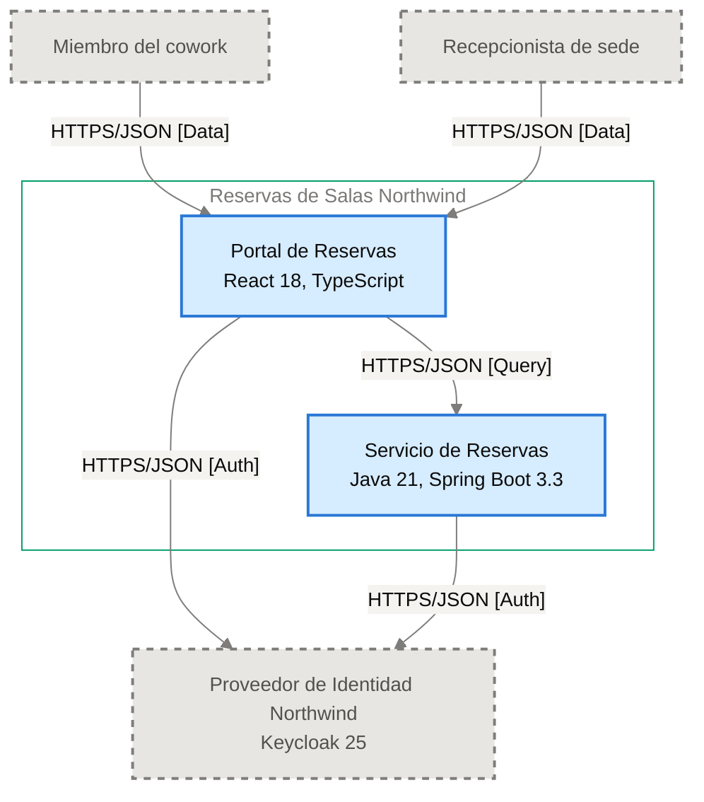

# Especificación de Componente — Portal de Reservas

<!-- managed by sa-skills:architecture-dev-handoff — do not edit manually -->
<!-- TEMPLATE_VERSION: 4.3.1 -->
| Field | Value |
|-------|-------|
| Componente | Portal de Reservas |
| Número de componente | 5.1 |
| Equipo | [NOT DOCUMENTED — add **Owner:** field to docs/components/reservas-de-salas-northwind/01-portal-de-reservas.md] |
| Versión de la Especificación de Componente | 4.3.1 |
| Versión de la Vista de Ejecución | 4.3.1 |
| Versión de los Estándares | 4.3.1 |
| Versión de la arquitectura | 1.1.1 |
| Versión del componente | 1.0.1 |
| Generado | 2026-10-19 |
| Documento fuente del componente | [../docs/components/reservas-de-salas-northwind/01-portal-de-reservas.md](../docs/components/reservas-de-salas-northwind/01-portal-de-reservas.md) |

### Índice rápido por rol <!-- SECTION: Role Quick Index -->

| Audience | Read first in this document |
|----------|-----------------------------|
| **Dev** | § 1 Responsabilidad → § 2 Posición → § 3 Contratos propios → § 4 Invariantes → § 7 Restricciones → § 8 Deliberadamente sin especificar |
| **QA** | § 3 Contratos propios → § 4 Invariantes → § 5 Presupuestos → § 9 Aceptación |
| **Ops / SRE** | § 5 Presupuestos → § 7 Restricciones → § 10 Activos |

El orden de lectura del kit completo está en `../README.md`.

Este es el **panel para este equipo**. Especifica solo intención y restricción. La estructura interna, la elección de persistencia dentro de los límites propios, el idioma de programación, la organización de módulos y la estrategia de pruebas quedan deliberadamente sin especificar: el equipo es dueño de esas decisiones.

Se lee junto con [`../SYSTEM_RUNTIME_VIEW.md`](../SYSTEM_RUNTIME_VIEW.md) (historia del sistema completo), [`../CROSS_CUTTING_STANDARDS.md`](../CROSS_CUTTING_STANDARDS.md) (reglas globales) y cada Interface Contract enlazado (continuidad con los servicios adyacentes).

---

## 1. Responsabilidad <!-- SECTION: Responsibility -->

Portal de Reservas es la aplicación web (React 18, TypeScript; archivos estáticos) por la que miembros y recepcionistas consultan la disponibilidad de salas por sede, fecha y franja, reservan una sala libre con código de reserva, listan y cancelan reservas futuras, y autentican con el Proveedor de Identidad Northwind; el recepcionista cancela cualquier reserva de su sede. NO es responsable de persistir datos (los tokens viven solo en memoria del navegador y la disponibilidad y las reservas son del Servicio de Reservas) ni de gestionar credenciales (a cargo del Proveedor de Identidad Northwind).

---

## 2. Posición <!-- SECTION: Position -->

**Aparece en los flujos:** F-01 fase 1 (Inicio de sesión), F-01 fase 2 (Validación del token), F-02 fase 2 (Validación del token), F-03 fase 2 (Validación del token)

**Interfaces ascendentes** (entrantes):

No hay interfaces entrantes documentadas.

**Interfaces descendentes** (salientes):

- [portal-de-reservas→proveedor-de-identidad-northwind](../interfaces/portal-de-reservas→proveedor-de-identidad-northwind.md) — I-01
- [portal-de-reservas→servicio-de-reservas](../interfaces/portal-de-reservas→servicio-de-reservas.md) — I-02

**Interfaces sin Interface Contract**:

Ninguna.

**Panel** — este componente y sus vecinos en el diagrama de contenedores, recortado de `docs/03` (generado, nunca se edita a mano):

Cut of `docs/03-architecture-layers.md` § Diagram: C4 Level 2 — Container — Portal de Reservas and its neighbours (generated, never hand-edited).

---

## 3. Contratos propios <!-- SECTION: Contracts Owned -->

Contratos que este componente publica. Los esquemas viven en los archivos de activos enlazados; esta tabla solo lista títulos, versiones y consumidores.

| Contract | Version | Consumers | Asset |
|----------|--------:|-----------|-------|
| — | — | — | Este componente no publica contratos. |

---

## 4. Invariantes <!-- SECTION: Invariants -->

Condiciones que se cumplen en todo momento, sin importar la implementación. Cada invariante es verificable: QA cubre cada una con una prueba.

- **INV-01** Los tokens OIDC viven solo en la memoria del navegador; el portal nunca los guarda en `localStorage` ni en `sessionStorage` ([ADR-002](../../adr/ADR-002-oidc-keycloak-identity.md), [ADR-104](../../adr/ADR-104-manejo-de-tokens-oidc-en-la-spa-sin.md)).
- **INV-02** El portal autentica al usuario con el flujo de código de autorización con PKCE contra el Proveedor de Identidad Northwind ([ADR-002](../../adr/ADR-002-oidc-keycloak-identity.md)).
- **INV-03** El portal no es dueño de ningún dato persistente.
- **INV-04** Cada llamada HTTP al Servicio de Reservas propaga el encabezado W3C Trace Context `traceparent` ([ADR-004](../../adr/ADR-004-opentelemetry-observability.md)).
- **INV-05** Los logs del portal son JSON estructurado y nunca incluyen tokens ni datos personales completos ([ADR-004](../../adr/ADR-004-opentelemetry-observability.md)).
- **INV-06** Toda reserva confirmada muestra al usuario su código de reserva.
- **INV-07** El recepcionista cancela cualquier reserva de su sede; el miembro cancela solo sus reservas futuras.
- **INV-08** Toda comunicación del portal con el Servicio de Reservas usa REST sobre HTTPS con cuerpos JSON ([ADR-001](../../adr/ADR-001-rest-openapi-apis.md)).

---

## 5. Presupuestos (de la descomposición) <!-- SECTION: Budgets -->

Tomados textualmente de [`../SYSTEM_RUNTIME_VIEW.md § Budget Decomposition`](../SYSTEM_RUNTIME_VIEW.md#budget-decomposition), filas que referencian este componente. No se repite el SLO global; solo la asignación de este componente.

| Aspect | Allocation | Source |
|--------|-----------:|--------|
| Latencia p99 | [NOT DOCUMENTED — run /sa-analysis:architecture-analysis latency-budget] | Portal de Reservas → Servicio de Reservas, [SYSTEM_RUNTIME_VIEW.md § Budget Decomposition](../SYSTEM_RUNTIME_VIEW.md#budget-decomposition) |
| Error budget | [NOT DOCUMENTED — run /sa-analysis:architecture-analysis latency-budget] | [SYSTEM_RUNTIME_VIEW.md § Budget Decomposition](../SYSTEM_RUNTIME_VIEW.md#budget-decomposition) |
| Throughput (pico) | [NOT DOCUMENTED — run /sa-analysis:architecture-analysis latency-budget] | [SYSTEM_RUNTIME_VIEW.md § Budget Decomposition](../SYSTEM_RUNTIME_VIEW.md#budget-decomposition) |
| Throughput (sostenido) | [NOT DOCUMENTED — run /sa-analysis:architecture-analysis latency-budget] | [SYSTEM_RUNTIME_VIEW.md § Budget Decomposition](../SYSTEM_RUNTIME_VIEW.md#budget-decomposition) |
| Techo de costo | [NOT DOCUMENTED — run /sa-analysis:architecture-analysis latency-budget] | [SYSTEM_RUNTIME_VIEW.md § Budget Decomposition](../SYSTEM_RUNTIME_VIEW.md#budget-decomposition) |

Si falta el análisis de Latency Budget, las filas muestran `[NOT DOCUMENTED — run /sa-analysis:architecture-analysis latency-budget]` y la brecha se repite en § 11.

---

## 6. Propiedad de datos <!-- SECTION: Data Ownership -->

Propiedad exclusiva. No existe propiedad mutable compartida en ninguna parte del sistema.

**Es dueño de (fuente autoritativa):**

- Ningún dato persistente; los tokens viven solo en memoria del navegador ([ADR-104](../../adr/ADR-104-manejo-de-tokens-oidc-en-la-spa-sin.md)).

**Lee (vía contrato, no es dueño):**

- Disponibilidad y reservas del Servicio de Reservas, vía [portal-de-reservas→servicio-de-reservas](../interfaces/portal-de-reservas→servicio-de-reservas.md) — I-02

**No debe acceder a:**

Sin prohibiciones explícitas.

---

## 7. Restricciones <!-- SECTION: Constraints -->

Cada restricción tiene una razón (regla de Cross-Cutting Standards, ADR o invariante). Una restricción sin razón es deriva en espera: se cita una o se elimina la fila.

**Obligatorias:**

- React 18 y TypeScript, desplegado como archivos estáticos — per `docs/components/reservas-de-salas-northwind/01-portal-de-reservas.md`
- API síncrona REST sobre HTTPS con cuerpos JSON hacia el Servicio de Reservas — per [ADR-001](../../adr/ADR-001-rest-openapi-apis.md)
- Autenticación OIDC con código de autorización y PKCE; tokens solo en memoria — per [ADR-002](../../adr/ADR-002-oidc-keycloak-identity.md)
- Trazas, métricas y logs con OpenTelemetry hacia el colector de Plataforma Northwind, con `traceparent` en cada llamada — per [ADR-004](../../adr/ADR-004-opentelemetry-observability.md)
- Tokens OIDC solo en memoria; el token de acceso dura 5 minutos y se renueva en silencio — per [ADR-104](../../adr/ADR-104-manejo-de-tokens-oidc-en-la-spa-sin.md)

**Prohibidas:**

- Guardar tokens en `localStorage` o `sessionStorage` — per [ADR-002](../../adr/ADR-002-oidc-keycloak-identity.md), [ADR-104](../../adr/ADR-104-manejo-de-tokens-oidc-en-la-spa-sin.md)
- Incluir tokens o datos personales completos en los logs — per [ADR-004](../../adr/ADR-004-opentelemetry-observability.md)

---

## 8. Deliberadamente sin especificar <!-- SECTION: Deliberately Unspecified -->

El equipo es dueño de las siguientes decisiones:

- Estructura interna (organización de módulos, límites de paquetes)
- Elección de persistencia dentro del límite propio
- Idioma de programación y subconjunto del framework
- Estrategia de pruebas (división unitarias/integración, herramientas)
- Caché local, pooling en proceso

Sobre-especificar aquí reemplazaría el criterio por la prescripción. Si se encuentra especificando alguno de los puntos anteriores, escale: pertenece a Cross-Cutting Standards (si es institucional) o a un ADR (si es del proyecto), no a una Especificación de Componente.

---

## 9. Aceptación <!-- SECTION: Acceptance -->

- [ ] Contratos de § 3 publicados y verificados por los consumidores
- [ ] Presupuestos de § 5 demostrados bajo carga
- [ ] Invariantes de § 4 cubiertas por pruebas
- [ ] Semántica de fallo de las interfaces ejercitada (inyección de fallos según el Interface Contract)
- [ ] Conformidad con Cross-Cutting Standards verificada; toda desviación registrada según [`../CROSS_CUTTING_STANDARDS.md § Deviations`](../CROSS_CUTTING_STANDARDS.md#deviations)

---

## 10. Activos <!-- SECTION: Assets -->

Activos entregables generados junto con esta Especificación de Componente.

| Asset | File | Description |
|-------|------|-------------|
| Descriptor C4 del componente | [c4-descriptor.md](assets/01-portal-de-reservas/c4-descriptor.md) | Resumen operativo de una página para SRE e infraestructura |

Los activos viven en `handoffs/assets/01-portal-de-reservas/`.

---

## 11. Preguntas abiertas <!-- SECTION: Open Questions -->

Brechas detectadas durante la generación de la Especificación de Componente: valores que no están en la documentación de arquitectura ni en los artefactos de origen (Runtime View, Cross-Cutting Standards, Interface Contracts).

| Section | What is missing | Where to fix it | What it blocks |
|---------|-----------------|-----------------|----------------|
| § Role Quick Index | Equipo dueño (campo **Owner:** ausente) | `docs/components/reservas-de-salas-northwind/01-portal-de-reservas.md`, campo Team Owner | Asignar responsabilidad y contacto del equipo |
| § Position | ID del diagrama del panel | Registro de diagramas, `docs/03-architecture-layers.md` | Referenciar el diagrama de forma estable |
| § Budgets | Latencia p99 asignada | `/sa-analysis:architecture-analysis latency-budget` | Verificar el presupuesto de latencia bajo carga |
| § Budgets | Error budget | `/sa-analysis:architecture-analysis latency-budget` | Definir el umbral de errores aceptable |
| § Budgets | Throughput pico | `/sa-analysis:architecture-analysis latency-budget` | Dimensionar y probar carga pico |
| § Budgets | Throughput sostenido | `/sa-analysis:architecture-analysis latency-budget` | Dimensionar capacidad sostenida |
| § Budgets | Techo de costo | `/sa-analysis:architecture-analysis latency-budget` | Validar el costo por unidad |
| Assets — c4-descriptor.md | Responsable | agregar `**Owner:**` a docs/components/reservas-de-salas-northwind/01-portal-de-reservas.md | escalamiento y propiedad en la CMDB |
| Assets — c4-descriptor.md | Capacidad | docs/components/reservas-de-salas-northwind/01-portal-de-reservas.md § Capacity <!-- LABEL: Capacity --> | dimensionamiento y planificación de capacidad |
| Assets — c4-descriptor.md | Host · IP · SO · Dominio | docs/09-operational-considerations.md | registro en la CMDB y reglas de red |
| Assets — security.md | Data Sensitivity | analysis/DATA-SENSITIVITY-*.md — run /sa-analysis:architecture-analysis data-sensitivity | se desconoce la clasificación de los datos que maneja el componente |

---

*Generado por `sa-skills:architecture-dev-handoff` el 2026-10-19*
*Fuente: /home/runner/work/northwind-reservas/northwind-reservas/ARCHITECTURE.md*
