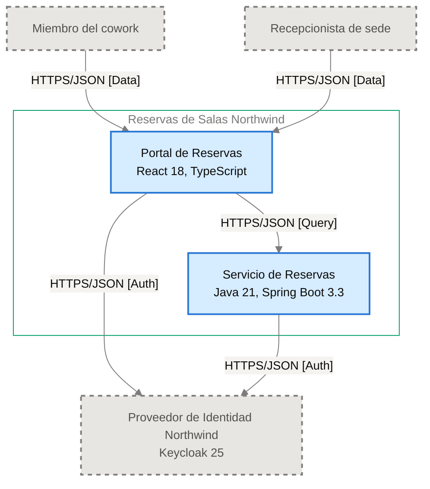

# Especificación de Componente — Portal de Reservas

<!-- managed by sa-skills:architecture-dev-handoff — do not edit manually -->
<!-- TEMPLATE_VERSION: 4.3.1 -->
| Field | Value |
|-------|-------|
| Componente | Portal de Reservas |
| Número de componente | 5.1 |
| Equipo | [NOT DOCUMENTED — add **Owner:** field to docs/components/reservas-de-salas-northwind/01-portal-de-reservas.md] |
| Versión de la Especificación de Componente | 4.3.1 |
| Versión de la Vista de Ejecución | 4.3.1 |
| Versión de los Estándares | 4.3.1 |
| Versión de la arquitectura | 1.1.0 |
| Versión del componente | 1.0.1 |
| Generado | 2026-10-19 |
| Documento fuente del componente | [../../docs/components/reservas-de-salas-northwind/01-portal-de-reservas.md](../../docs/components/reservas-de-salas-northwind/01-portal-de-reservas.md) |

### Índice rápido por rol <!-- SECTION: Role Quick Index -->

| Audience | Read first in this document |
|----------|-----------------------------|
| **Dev** | § 1 Responsabilidad → § 2 Posición → § 3 Contratos propios → § 4 Invariantes → § 7 Restricciones → § 8 Deliberadamente sin especificar |
| **QA** | § 3 Contratos propios → § 4 Invariantes → § 5 Presupuestos → § 9 Aceptación |
| **Ops / SRE** | § 5 Presupuestos → § 7 Restricciones → § 10 Activos |

El orden de lectura de los cuatro documentos del kit está en `../README.md`.

Este documento es el **panel de este equipo**. Especifica solo intención y restricción. La estructura interna, la elección de persistencia dentro de los límites propios, el idioma de código, la disposición de módulos y la estrategia de pruebas quedan deliberadamente sin especificar: son del equipo.

Se lee junto con [`../SYSTEM_RUNTIME_VIEW.md`](../SYSTEM_RUNTIME_VIEW.md) (historia del sistema completo), [`../CROSS_CUTTING_STANDARDS.md`](../CROSS_CUTTING_STANDARDS.md) (reglas globales) y cada Interface Contract enlazado (continuidad con los servicios adyacentes).

---

## 1. Responsabilidad <!-- SECTION: Responsibility -->

Portal de Reservas es la SPA (React 18, TypeScript, archivos estáticos) donde miembros y recepcionistas consultan disponibilidad de salas, reservan y cancelan; autentica al usuario con el Proveedor de Identidad Northwind mediante código de autorización con PKCE. [NOT DOCUMENTED — add a not-accountable clause to docs/components/reservas-de-salas-northwind/01-portal-de-reservas.md]

---

## 2. Posición <!-- SECTION: Position -->

**Aparece en los flujos:** F-01 phase 1 (Inicio de sesión), F-01 phase 2 (Validación del token), F-02 phase 2 (Validación del token), F-03 phase 2 (Validación del token)

**Interfaces entrantes** (upstream):

No hay interfaces entrantes documentadas.

**Interfaces salientes** (downstream):

- [portal-de-reservas→proveedor-de-identidad-northwind](../interfaces/portal-de-reservas→proveedor-de-identidad-northwind.md) — I-01
- [portal-de-reservas→servicio-de-reservas](../interfaces/portal-de-reservas→servicio-de-reservas.md) — I-02

**Interfaces sin Interface Contract**:

Ninguna.

**Panel** — recorte de `docs/03-architecture-layers.md` § Diagram: C4 Level 2 — Container — Portal de Reservas y sus vecinos (generado, nunca se edita a mano):

---

## 3. Contratos propios <!-- SECTION: Contracts Owned -->

Contratos que este componente publica. Los esquemas viven en los activos enlazados: esta tabla lista solo títulos, versiones y consumidores.

| Contract | Version | Consumers | Asset |
|----------|--------:|-----------|-------|
| — | — | — | Sin contratos propios. |

---

## 4. Invariantes <!-- SECTION: Invariants -->

Condiciones que se cumplen en todo momento, sin importar la implementación. Cada invariante es verificable: QA cubre cada una con una prueba.

- **INV-01** El portal muestra la disponibilidad de salas por sede, fecha y franja, con capacidad y equipamiento, leída del Servicio de Reservas.
- **INV-02** Al reservar una sala libre, el portal muestra la confirmación con el código de reserva.
- **INV-03** El portal lista las reservas futuras del miembro autenticado y permite cancelarlas.
- **INV-04** El portal permite al recepcionista cancelar cualquier reserva de su sede.
- **INV-05** El portal autentica al usuario con el Proveedor de Identidad Northwind mediante código de autorización con PKCE ([ADR-002](../../adr/ADR-002-oidc-keycloak-identity.md)).
- **INV-06** Los tokens OIDC viven solo en la memoria del navegador; el portal nunca los escribe en `localStorage` ni en `sessionStorage` ([ADR-104](../../adr/ADR-104-manejo-de-tokens-oidc-en-la-spa-sin.md)).
- **INV-07** El portal propaga W3C Trace Context (`traceparent`) en cada llamada al Servicio de Reservas ([ADR-004](../../adr/ADR-004-opentelemetry-observability.md)).
- **INV-08** El portal no persiste ningún dato propio.
- **INV-09** Los logs del portal son JSON estructurado y nunca incluyen tokens ni datos personales completos — per [ADR-004](../../adr/ADR-004-opentelemetry-observability.md).

---

## 5. Presupuestos (de la descomposición) <!-- SECTION: Budgets -->

Tomados textualmente de [`../SYSTEM_RUNTIME_VIEW.md § Budget Decomposition`](../SYSTEM_RUNTIME_VIEW.md#budget-decomposition), filas que referencian este componente. No se repite el SLO global: solo la asignación de este componente.

| Aspect | Allocation | Source |
|--------|-----------:|--------|
| Latencia p99 | [NOT DOCUMENTED — run /sa-analysis:architecture-analysis latency-budget] | [`SYSTEM_RUNTIME_VIEW.md`](../SYSTEM_RUNTIME_VIEW.md#budget-decomposition) — Portal de Reservas → Servicio de Reservas |
| Error budget | [NOT DOCUMENTED — run /sa-analysis:architecture-analysis latency-budget] | [`SYSTEM_RUNTIME_VIEW.md`](../SYSTEM_RUNTIME_VIEW.md#budget-decomposition) |
| Throughput (pico) | [NOT DOCUMENTED — run /sa-analysis:architecture-analysis latency-budget] | [`SYSTEM_RUNTIME_VIEW.md`](../SYSTEM_RUNTIME_VIEW.md#budget-decomposition) |
| Throughput (sostenido) | [NOT DOCUMENTED — run /sa-analysis:architecture-analysis latency-budget] | [`SYSTEM_RUNTIME_VIEW.md`](../SYSTEM_RUNTIME_VIEW.md#budget-decomposition) |
| Techo de costo | [NOT DOCUMENTED — run /sa-analysis:architecture-analysis latency-budget] | [`SYSTEM_RUNTIME_VIEW.md`](../SYSTEM_RUNTIME_VIEW.md#budget-decomposition) |

Métrica de experiencia documentada: tiempo desde "Confirmar" hasta ver el código de reserva, meta p95 ≤ 2 s (PO Spec §8).

---

## 6. Propiedad de datos <!-- SECTION: Data Ownership -->

Propiedad exclusiva. No existe propiedad mutable compartida en el sistema.

**Es dueño de (fuente autoritativa):**

- Ningún dato persistente; los tokens viven solo en memoria del navegador ([ADR-104](../../adr/ADR-104-manejo-de-tokens-oidc-en-la-spa-sin.md)).

**Lee (vía contrato, no es dueño):**

- Disponibilidad y reservas del Servicio de Reservas vía [portal-de-reservas→servicio-de-reservas](../interfaces/portal-de-reservas→servicio-de-reservas.md) — I-02.

**No debe acceder a:**

Sin prohibiciones explícitas.

---

## 7. Restricciones <!-- SECTION: Constraints -->

Cada restricción tiene una razón (regla de Cross-Cutting Standards, ADR o invariante). Una restricción sin razón es deriva en espera: se cita una o se elimina la fila.

**Obligatorias:**

- React 18 y TypeScript — per `docs/components/reservas-de-salas-northwind/01-portal-de-reservas.md` § Technology
- Despliegue como archivos estáticos — per `docs/components/reservas-de-salas-northwind/01-portal-de-reservas.md`
- API síncrona hacia el Servicio de Reservas: REST sobre HTTPS con JSON — per [ADR-001](../../adr/ADR-001-rest-openapi-apis.md)
- Autenticación con código de autorización y PKCE contra el Proveedor de Identidad Northwind — per [ADR-002](../../adr/ADR-002-oidc-keycloak-identity.md)
- Trazas, métricas y logs con OpenTelemetry hacia el colector de Plataforma Northwind, con `traceparent` en cada llamada HTTP — per [ADR-004](../../adr/ADR-004-opentelemetry-observability.md)
- Tokens OIDC solo en memoria — per [ADR-104](../../adr/ADR-104-manejo-de-tokens-oidc-en-la-spa-sin.md) · INV-06

**Prohibidas:**

- Guardar tokens en `localStorage` o `sessionStorage` — per [ADR-002](../../adr/ADR-002-oidc-keycloak-identity.md), [ADR-104](../../adr/ADR-104-manejo-de-tokens-oidc-en-la-spa-sin.md) · INV-06
- Incluir tokens o datos personales completos en logs — per [ADR-004](../../adr/ADR-004-opentelemetry-observability.md) · INV-09

---

## 8. Deliberadamente sin especificar <!-- SECTION: Deliberately Unspecified -->

El equipo es dueño de las siguientes decisiones:

- Estructura interna (disposición de módulos, límites de paquetes)
- Elección de persistencia dentro del límite propio
- Idioma de código y subconjunto de framework
- Estrategia de pruebas (reparto unitarias/integración, herramientas)
- Caché local, pooling en proceso

Sobre-especificar aquí reemplazaría el criterio por la prescripción. Si te encuentras especificando alguna de estas decisiones, escala: pertenece a Cross-Cutting Standards (si es de toda la institución) o a un ADR (si es de todo el proyecto), no a una Especificación de Componente.

---

## 9. Aceptación <!-- SECTION: Acceptance -->

- [ ] Los contratos del § 3 están publicados y verificados por los consumidores
- [ ] Los presupuestos del § 5 se demuestran bajo carga
- [ ] Las invariantes del § 4 están cubiertas por pruebas
- [ ] La semántica de fallo de las interfaces se ejerce (inyección de fallos según el Interface Contract)
- [ ] Se verificó la conformidad con Cross-Cutting Standards; toda desviación se registra según [`../CROSS_CUTTING_STANDARDS.md § Deviations`](../CROSS_CUTTING_STANDARDS.md#deviations)

---

## 10. Activos <!-- SECTION: Assets -->

Activos entregables generados junto a esta Especificación de Componente.

| Asset | File | Description |
|-------|------|-------------|
| Descriptor C4 del componente | [c4-descriptor.md](assets/01-portal-de-reservas/c4-descriptor.md) | Resumen operativo para SRE/infraestructura |

Los activos viven en `handoffs/assets/01-portal-de-reservas/`.

---

## 11. Preguntas abiertas <!-- SECTION: Open Questions -->

Vacíos detectados al generar la Especificación de Componente: valores ausentes en la documentación de arquitectura o en los artefactos previos (Runtime View, Cross-Cutting Standards, Interface Contracts).

| Section | What is missing | Where to fix it | What it blocks |
|---------|-----------------|-----------------|----------------|
| § Responsibility | Cláusula de lo que el componente NO es responsable | `docs/components/reservas-de-salas-northwind/01-portal-de-reservas.md` (agregar límites fuera de alcance) | Delimitar el alcance del equipo |
| § Position | ID del diagrama C4 L2 | Registro de diagramas (`docs/03-architecture-layers.md`) | Trazabilidad del panel |
| § Budgets | Latencia p99, error budget, throughput y techo de costo | `/sa-analysis:architecture-analysis latency-budget` | Pruebas de carga y aceptación del § 5 |
| Assets — c4-descriptor.md | Responsable | agregar `**Owner:**` a docs/components/reservas-de-salas-northwind/01-portal-de-reservas.md | escalamiento y propiedad en la CMDB |
| Assets — c4-descriptor.md | Capacidad | docs/components/reservas-de-salas-northwind/01-portal-de-reservas.md § Capacity <!-- LABEL: Capacity --> | dimensionamiento y planificación de capacidad |
| Assets — c4-descriptor.md | Host · IP · SO · Dominio | docs/09-operational-considerations.md | registro en la CMDB y reglas de red |
| Assets — security.md | Data Sensitivity | analysis/DATA-SENSITIVITY-*.md — run /sa-analysis:architecture-analysis data-sensitivity | se desconoce la clasificación de los datos que maneja el componente |

---

*Generado por `sa-skills:architecture-dev-handoff` el 2026-10-19*
*Fuente: /home/runner/work/northwind-reservas/northwind-reservas/ARCHITECTURE.md*
