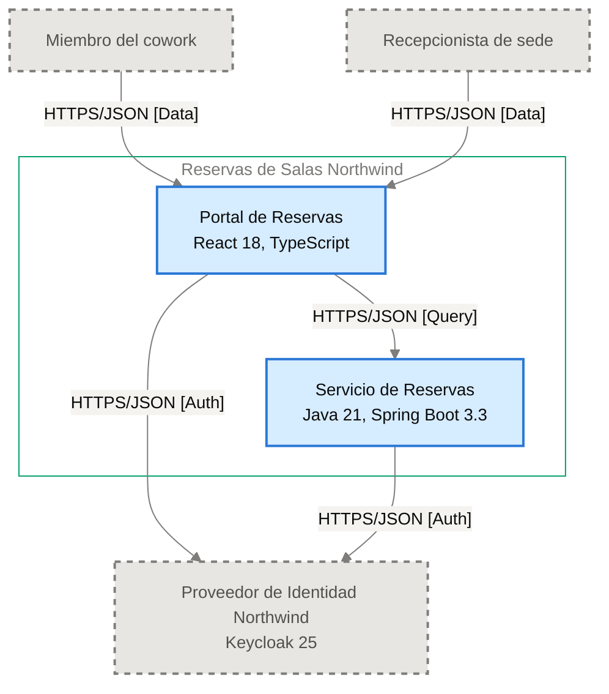

# Especificación de Componente — Portal de Reservas

<!-- managed by sa-skills:architecture-dev-handoff — do not edit manually -->
<!-- TEMPLATE_VERSION: 4.3.1 -->
| Field | Value |
|-------|-------|
| Componente | Portal de Reservas |
| Número de componente | 5.1 |
| Equipo | [NOT DOCUMENTED — add **Owner:** field to docs/components/reservas-de-salas-northwind/01-portal-de-reservas.md] |
| Versión de la Especificación de Componente | 4.3.1 |
| Versión de la Vista de Ejecución | 4.3.1 |
| Versión de los Estándares | 4.3.1 |
| Versión de la arquitectura | 1.0.0 |
| Versión del componente | 1.0.0 |
| Generado | 2026-10-18 |
| Documento fuente del componente | [../../docs/components/reservas-de-salas-northwind/01-portal-de-reservas.md](../../docs/components/reservas-de-salas-northwind/01-portal-de-reservas.md) |

### Índice rápido por rol <!-- SECTION: Role Quick Index -->

| Audience | Read first in this document |
|----------|-----------------------------|
| **Dev** | § 1 Responsabilidad → § 2 Posición → § 3 Contratos propios → § 4 Invariantes → § 7 Restricciones → § 8 Deliberadamente sin especificar |
| **QA** | § 3 Contratos propios → § 4 Invariantes → § 5 Presupuestos → § 9 Aceptación |
| **Ops / SRE** | § 5 Presupuestos → § 7 Restricciones → § 10 Activos |

El orden de lectura de los cuatro documentos del kit está en `../README.md`.

Este documento es el **panel para este equipo**. Especifica solo intención y restricción. La estructura interna, la elección de persistencia dentro de los límites propios, el idioma de código, la disposición de módulos y la estrategia de pruebas quedan deliberadamente sin especificar: las decide el equipo.

Se lee junto con [`../SYSTEM_RUNTIME_VIEW.md`](../SYSTEM_RUNTIME_VIEW.md) (historia del sistema completo), [`../CROSS_CUTTING_STANDARDS.md`](../CROSS_CUTTING_STANDARDS.md) (reglas globales) y cada Interface Contract enlazado (continuidad con los servicios adyacentes).

---

## 1. Responsabilidad <!-- SECTION: Responsibility -->

Portal de Reservas es la SPA (React 18, TypeScript, servida como archivos estáticos) con la que miembros y recepcionistas consultan la disponibilidad de salas, reservan y cancelan. Autentica al usuario con el Proveedor de Identidad Northwind y llama al Servicio de Reservas. [NOT DOCUMENTED — add a not-accountable clause to docs/components/reservas-de-salas-northwind/01-portal-de-reservas.md]

---

## 2. Posición <!-- SECTION: Position -->

**Aparece en los flujos:** F-01 fase 1 (Inicio de sesión), F-01 fase 2 (Validación del token), F-02 fase 2 (Validación del token), F-03 fase 2 (Validación del token)

**Interfaces ascendentes** (entrantes):

No hay interfaces entrantes documentadas.

**Interfaces descendentes** (salientes):

- [portal-de-reservas→servicio-de-reservas](../interfaces/portal-de-reservas→servicio-de-reservas.md) — I-02

**Interfaces sin Interface Contract**:

- I-01 — saliente hacia Proveedor de Identidad Northwind · HTTPS/JSON [Auth] — sin Interface Contract; pendiente, falla cerrado

**Panel** — este componente y sus vecinos en el diagrama de contenedores, recortado de `docs/03` (generado, nunca se edita a mano):

Recorte de `docs/03-architecture-layers.md` § Diagram: C4 Level 2 — Container — Portal de Reservas y sus vecinos (generado, nunca se edita a mano):

---

## 3. Contratos propios <!-- SECTION: Contracts Owned -->

Contratos que este componente publica. Los esquemas viven en los activos enlazados: esta tabla lista solo títulos, versiones y consumidores.

| Contract | Version | Consumers | Asset |
|----------|--------:|-----------|-------|
| — | — | — | Sin contratos propios. |

---

## 4. Invariantes <!-- SECTION: Invariants -->

Condiciones que se cumplen en todo momento, sin importar la implementación. Cada invariante es verificable: QA cubre cada una con una prueba.

- **INV-01** El portal muestra la disponibilidad de salas por sede, fecha y franja, con capacidad y equipamiento.
- **INV-02** El portal envía la reserva de una sala libre y muestra la confirmación con el código de reserva.
- **INV-03** El portal lista las reservas futuras del miembro y permite cancelarlas.
- **INV-04** El portal permite al recepcionista cancelar cualquier reserva de su sede.
- **INV-05** El portal autentica al usuario con el Proveedor de Identidad Northwind mediante código de autorización con PKCE — per [ADR-002](../../adr/ADR-002-oidc-keycloak-identity.md).
- **INV-06** Los tokens viven solo en memoria; nunca se guardan en `localStorage` ni `sessionStorage` — per [ADR-002](../../adr/ADR-002-oidc-keycloak-identity.md).
- **INV-07** Cada llamada al Servicio de Reservas propaga W3C Trace Context (`traceparent`) — per [ADR-004](../../adr/ADR-004-opentelemetry-observability.md).
- **INV-08** Los logs del portal son JSON estructurado y nunca incluyen tokens ni datos personales completos — per [ADR-004](../../adr/ADR-004-opentelemetry-observability.md).

---

## 5. Presupuestos (de la descomposición) <!-- SECTION: Budgets -->

Tomados textualmente de las filas de [`../SYSTEM_RUNTIME_VIEW.md § Budget Decomposition`](../SYSTEM_RUNTIME_VIEW.md#budget-decomposition) que referencian este componente. No se repite el SLO global: solo la asignación de este componente.

| Aspect | Allocation | Source |
|--------|-----------:|--------|
| Latencia p99 | [NOT DOCUMENTED — run /sa-analysis:architecture-analysis latency-budget] | [NOT DOCUMENTED — hop Portal de Reservas → Servicio de Reservas sin presupuesto] |
| Error budget | [NOT DOCUMENTED — run /sa-analysis:architecture-analysis latency-budget] | [NOT DOCUMENTED — sin fuente] |
| Throughput (pico) | [NOT DOCUMENTED — run /sa-analysis:architecture-analysis latency-budget] | [NOT DOCUMENTED — sin fuente] |
| Throughput (sostenido) | [NOT DOCUMENTED — run /sa-analysis:architecture-analysis latency-budget] | [NOT DOCUMENTED — sin fuente] |
| Techo de costo | [NOT DOCUMENTED — run /sa-analysis:architecture-analysis latency-budget] | [NOT DOCUMENTED — sin fuente] |

Meta de experiencia documentada (no es una asignación de presupuesto): tiempo desde "Confirmar" hasta ver el código de reserva, p95 ≤ 2 s (PO Spec §8).

---

## 6. Propiedad de datos <!-- SECTION: Data Ownership -->

Propiedad exclusiva. No existe propiedad mutable compartida en el sistema.

**Es dueño de (fuente autoritativa):**

- [NOT DOCUMENTED — the descriptor has no data-ownership section — add one, or leave the Component Specification § 6 to state it]

**Lee (vía contrato, sin ser dueño):**

- Disponibilidad y reservas, vía [portal-de-reservas→servicio-de-reservas](../interfaces/portal-de-reservas→servicio-de-reservas.md) (I-02).

**No debe acceder a:**

Sin prohibiciones explícitas.

---

## 7. Restricciones <!-- SECTION: Constraints -->

Cada restricción tiene una razón (regla de Cross-Cutting Standards, ADR o invariante). Una restricción sin razón es deriva en espera: se cita una o se elimina la fila.

**Obligatorias:**

- React 18 y TypeScript, desplegado como archivos estáticos — per [documento del componente](../../docs/components/reservas-de-salas-northwind/01-portal-de-reservas.md).
- API síncrona hacia el Servicio de Reservas: REST sobre HTTPS con cuerpos JSON y contrato OpenAPI 3.1 — per [ADR-001](../../adr/ADR-001-rest-openapi-apis.md).
- Inicio de sesión con OIDC, código de autorización con PKCE, contra el Proveedor de Identidad Northwind — per [ADR-002](../../adr/ADR-002-oidc-keycloak-identity.md).
- Trazas, métricas y logs con OpenTelemetry hacia el colector de Plataforma Northwind — per [ADR-004](../../adr/ADR-004-opentelemetry-observability.md).

**Prohibidas:**

- Guardar tokens en `localStorage` o `sessionStorage` — per [ADR-002](../../adr/ADR-002-oidc-keycloak-identity.md).
- Incluir tokens o datos personales completos en los logs — per [ADR-004](../../adr/ADR-004-opentelemetry-observability.md).

---

## 8. Deliberadamente sin especificar <!-- SECTION: Deliberately Unspecified -->

El equipo decide lo siguiente:

- Estructura interna (disposición de módulos, límites de paquetes)
- Elección de persistencia dentro del límite propio
- Idioma de código y subconjunto de framework
- Estrategia de pruebas (reparto unitarias/integración, herramientas)
- Caché local, pooling en proceso

Sobre-especificar aquí sustituiría el criterio por la prescripción. Si te encuentras especificando alguno de los puntos anteriores, escala: pertenece a Cross-Cutting Standards (si aplica a toda la institución) o a un ADR (si aplica a todo el proyecto), no a una Especificación de Componente.

---

## 9. Aceptación <!-- SECTION: Acceptance -->

- [ ] Los contratos del § 3 están publicados y verificados por los consumidores
- [ ] Los presupuestos del § 5 se demuestran bajo carga
- [ ] Los invariantes del § 4 están cubiertos por pruebas
- [ ] La semántica de fallo de las interfaces se ejercita (inyección de fallos según el Interface Contract)
- [ ] Se verificó la conformidad con Cross-Cutting Standards; toda desviación se registra según [`../CROSS_CUTTING_STANDARDS.md § Deviations`](../CROSS_CUTTING_STANDARDS.md#deviations)

---

## 10. Activos <!-- SECTION: Assets -->

Activos entregables generados junto con esta Especificación de Componente.

| Asset | File | Description |
|-------|------|-------------|
| C4 Component Descriptor | [c4-descriptor.md](assets/01-portal-de-reservas/c4-descriptor.md) | Ficha operativa para SRE/infraestructura |

Los activos viven en `handoffs/assets/01-portal-de-reservas/`.

---

## 11. Preguntas abiertas <!-- SECTION: Open Questions -->

Brechas detectadas al generar la Especificación de Componente: valores ausentes en la documentación de arquitectura o en los artefactos de origen (Runtime View, Cross-Cutting Standards, Interface Contracts).

| Section | What is missing | Where to fix it | What it blocks |
|---------|-----------------|-----------------|----------------|
| Metadata | Equipo propietario del componente | `docs/components/reservas-de-salas-northwind/01-portal-de-reservas.md`, campo **Owner:** | Asignar responsabilidad del equipo |
| Responsibility | Cláusula de lo que el componente no es responsable | `docs/components/reservas-de-salas-northwind/01-portal-de-reservas.md`, sección Responsabilidades | Acotar el alcance del componente |
| Position | ID del diagrama del panel | Registro de diagramas de `docs/03-architecture-layers.md` | Referenciar el diagrama de forma estable |
| Budgets | Latencia p99 del hop Portal de Reservas → Servicio de Reservas | `/sa-analysis:architecture-analysis latency-budget` | Demostrar el presupuesto bajo carga |
| Budgets | Error budget | `/sa-analysis:architecture-analysis latency-budget` | Definir criterios de aceptación de errores |
| Budgets | Throughput (pico) | `/sa-analysis:architecture-analysis latency-budget` | Dimensionar réplicas |
| Budgets | Throughput (sostenido) | `/sa-analysis:architecture-analysis latency-budget` | Dimensionar réplicas |
| Budgets | Techo de costo | `/sa-analysis:architecture-analysis latency-budget` | Validar el costo operativo |
| Data Ownership | Entidades de las que el componente es dueño | `docs/components/reservas-de-salas-northwind/01-portal-de-reservas.md`, nueva sección de propiedad de datos | Declarar la propiedad de datos del § 6 |
| Assets — c4-descriptor.md | Responsable | agregar `**Owner:**` a docs/components/reservas-de-salas-northwind/01-portal-de-reservas.md | escalamiento y propiedad en la CMDB |
| Assets — c4-descriptor.md | Capacidad | docs/components/reservas-de-salas-northwind/01-portal-de-reservas.md § Capacity <!-- LABEL: Capacity --> | dimensionamiento y planificación de capacidad |
| Assets — c4-descriptor.md | Host · IP · SO · Dominio | docs/09-operational-considerations.md | registro en la CMDB y reglas de red |
| Assets — security.md | Authentication I-01 | authentication of I-01: state it in docs/07-security-architecture.md | la interfaz falla cerrada: no se abre sin su autenticación |
| Assets — security.md | Authentication I-02 | authentication of I-02: state it in docs/07-security-architecture.md | la interfaz falla cerrada: no se abre sin su autenticación |
| Assets — security.md | STRIDE | analysis/STRIDE-*.md — run /sa-analysis:architecture-analysis stride | se desconocen las amenazas que la construcción debe mitigar |
| Assets — security.md | Data Sensitivity | analysis/DATA-SENSITIVITY-*.md — run /sa-analysis:architecture-analysis data-sensitivity | se desconoce la clasificación de los datos que maneja el componente |

---

*Generated by `sa-skills:architecture-dev-handoff` on 2026-10-18*
*Source: /home/runner/work/northwind-reservas/northwind-reservas/ARCHITECTURE.md*
