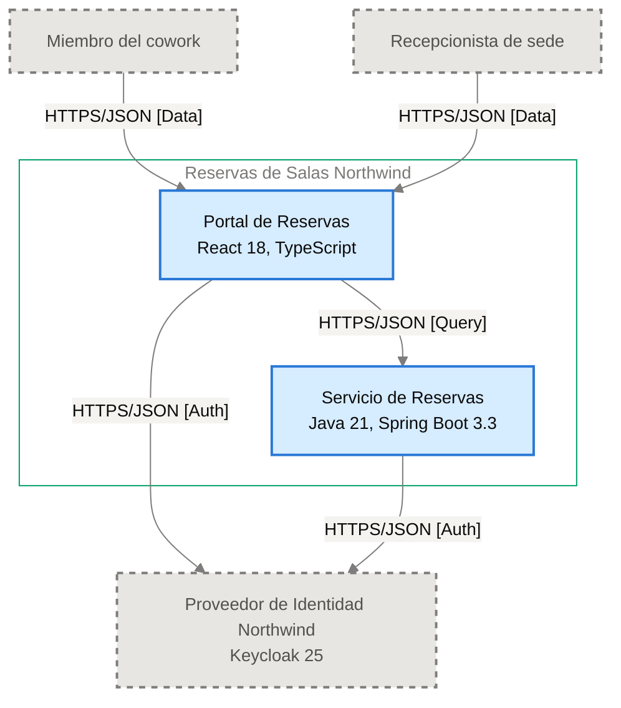

# Especificación de Componente — Portal de Reservas

<!-- managed by sa-skills:architecture-dev-handoff — do not edit manually -->
<!-- TEMPLATE_VERSION: 4.3.1 -->
| Field | Value |
|-------|-------|
| Componente | Portal de Reservas |
| Número de componente | 5.1 |
| Equipo | [NOT DOCUMENTED — add **Owner:** field to docs/components/reservas-de-salas-northwind/01-portal-de-reservas.md] |
| Versión de la Especificación de Componente | 4.3.1 |
| Versión de la Vista de Ejecución | 4.3.1 |
| Versión de los Estándares | 4.3.1 |
| Versión de la arquitectura | 1.10.1 |
| Versión del componente | 1.0.1 |
| Generado | 2026-10-20 |
| Documento fuente del componente | [../../docs/components/reservas-de-salas-northwind/01-portal-de-reservas.md](../../docs/components/reservas-de-salas-northwind/01-portal-de-reservas.md) |

### Índice rápido por rol <!-- SECTION: Role Quick Index -->

| Audience | Read first in this document |
|----------|-----------------------------|
| **Dev** | § 1 Responsabilidad → § 2 Posición → § 3 Contratos propios → § 4 Invariantes → § 7 Restricciones → § 8 Deliberadamente no especificado |
| **QA** | § 3 Contratos propios → § 4 Invariantes → § 5 Presupuestos → § 9 Aceptación |
| **Ops / SRE** | § 5 Presupuestos → § 7 Restricciones → § 10 Activos |

El orden de lectura de los cuatro documentos del kit está en `../README.md`.

Este documento es el **panel para este equipo**. Especifica solo intención y restricción. La estructura interna, la persistencia dentro de los límites propios, el idioma de código, la disposición de módulos y la estrategia de pruebas quedan deliberadamente sin especificar: las decide el equipo.

Se lee junto con [`../SYSTEM_RUNTIME_VIEW.md`](../SYSTEM_RUNTIME_VIEW.md) (historia del sistema completo), [`../CROSS_CUTTING_STANDARDS.md`](../CROSS_CUTTING_STANDARDS.md) (reglas globales) y cada Interface Contract enlazado (continuidad con los servicios adyacentes).

---

## 1. Responsabilidad <!-- SECTION: Responsibility -->

Portal de Reservas es la SPA (React 18, TypeScript) donde miembros y recepcionistas consultan la disponibilidad de salas por sede, fecha y franja, reservan una sala libre con su código de reserva, listan y cancelan reservas futuras, y se autentican con el Proveedor de Identidad Northwind. El recepcionista cancela cualquier reserva de su sede. NO es responsable de persistir datos: no es dueño de ningún dato persistente, y la disponibilidad y las reservas pertenecen al Servicio de Reservas. [NOT DOCUMENTED — add a not-accountable clause to docs/components/reservas-de-salas-northwind/01-portal-de-reservas.md]

---

## 2. Posición <!-- SECTION: Position -->

**Aparece en los flujos:** F-01 phase 1 (Inicio de sesión), F-01 phase 2 (Validación del token), F-02 phase 2 (Validación del token), F-03 phase 2 (Validación del token)

**Interfaces ascendentes** (entrantes):

No hay interfaces entrantes documentadas.

**Interfaces descendentes** (salientes):

- [portal-de-reservas→servicio-de-reservas](../interfaces/portal-de-reservas→servicio-de-reservas.md) — I-02

**Interfaces sin Interface Contract**:

- I-01 — saliente, hacia Proveedor de Identidad Northwind · HTTPS/JSON [Auth] — sin Interface Contract; pendiente, falla cerrado

<!--
Each interface link names the docs/05 id it carries:
- [<upstream>→<downstream>](../interfaces/<upstream>→<downstream>.md) — I-nn
Each interface without a contract (its other end is no component of the architecture), from the payload's list:
- I-nn — inbound from <caller> · <protocol> — no Interface Contract; pending, it fails closed
Every I-nn of the component's security obligations appears here: kit-check fails `interface-missing` otherwise.
-->

**Panel** — este componente y sus vecinos en el diagrama de contenedores, recortado de `docs/03` (generado, nunca editado a mano):

Cut of `docs/03-architecture-layers.md` § Diagram: C4 Level 2 — Container — Portal de Reservas and its neighbours (generated, never hand-edited):

---

## 3. Contratos propios <!-- SECTION: Contracts Owned -->

Contratos que este componente publica. Los esquemas viven en los archivos de activos enlazados; esta tabla lista solo títulos, versiones y consumidores.

| Contract | Version | Consumers | Asset |
|----------|--------:|-----------|-------|
| — | — | — | No hay contratos propios. |

---

## 4. Invariantes <!-- SECTION: Invariants -->

Condiciones que se cumplen siempre, sin importar la implementación. Cada invariante es verificable; QA cubre cada una con una prueba.

- **INV-01** El portal muestra la disponibilidad de salas por sede, fecha y franja, con capacidad y equipamiento.
- **INV-02** El portal envía la reserva de una sala libre y muestra la confirmación con el código de reserva.
- **INV-03** El portal lista las reservas futuras del miembro y permite cancelarlas.
- **INV-04** El portal permite al recepcionista cancelar cualquier reserva de su sede.
- **INV-05** El portal autentica al usuario con el Proveedor de Identidad Northwind mediante el flujo de código de autorización con PKCE — per [ADR-002](../../adr/ADR-002-oidc-keycloak-identity.md).
- **INV-06** Los tokens OIDC viven solo en la memoria del navegador; el portal nunca los guarda en `localStorage` ni en `sessionStorage` — per [ADR-002](../../adr/ADR-002-oidc-keycloak-identity.md), [ADR-104](../../adr/ADR-104-manejo-de-tokens-oidc-en-la-spa-sin.md).
- **INV-07** Cada llamada al Servicio de Reservas propaga W3C Trace Context (`traceparent`) — per [ADR-004](../../adr/ADR-004-opentelemetry-observability.md).
- **INV-08** El portal emite trazas, métricas y logs con OpenTelemetry hacia el colector de Plataforma Northwind; los logs nunca incluyen tokens — per [ADR-004](../../adr/ADR-004-opentelemetry-observability.md).
- **INV-09** El portal no persiste ningún dato de negocio; solo lee disponibilidad y reservas del Servicio de Reservas (I-02).
- **INV-10** El portal no permite elegir una franja anterior a la hora actual de la sede, calculada en `America/Bogota` y no con la zona del navegador — per [ADR-110](../../adr/ADR-110-hora-local-de-sede-con-zona-unica-america-bogota.md).
- **INV-11** En el listado de reservas, el portal muestra en cada reserva cancelada la fecha de cancelación (`cancelledAt`) y, cuando existe, el motivo (`cancellationReason`); ambos datos vienen en `Booking` del Servicio de Reservas (I-02).

---

## 5. Presupuestos (de la descomposición) <!-- SECTION: Budgets -->

Tomados textualmente de [`../SYSTEM_RUNTIME_VIEW.md § Budget Decomposition`](../SYSTEM_RUNTIME_VIEW.md#budget-decomposition), filas que referencian este componente. No se repite el SLO global; solo la asignación de este componente.

| Aspect | Allocation | Source |
|--------|-----------:|--------|
| Latencia p99 | [NOT DOCUMENTED — run /sa-analysis:architecture-analysis latency-budget] | [`SYSTEM_RUNTIME_VIEW.md`](../SYSTEM_RUNTIME_VIEW.md#budget-decomposition) — Portal de Reservas → Servicio de Reservas |
| Error budget | [NOT DOCUMENTED — run /sa-analysis:architecture-analysis latency-budget] | [`SYSTEM_RUNTIME_VIEW.md`](../SYSTEM_RUNTIME_VIEW.md#budget-decomposition) |
| Throughput (pico) | [NOT DOCUMENTED — run /sa-analysis:architecture-analysis latency-budget] | [`SYSTEM_RUNTIME_VIEW.md`](../SYSTEM_RUNTIME_VIEW.md#budget-decomposition) |
| Throughput (sostenido) | [NOT DOCUMENTED — run /sa-analysis:architecture-analysis latency-budget] | [`SYSTEM_RUNTIME_VIEW.md`](../SYSTEM_RUNTIME_VIEW.md#budget-decomposition) |
| Techo de costo | [NOT DOCUMENTED — run /sa-analysis:architecture-analysis latency-budget] | [`SYSTEM_RUNTIME_VIEW.md`](../SYSTEM_RUNTIME_VIEW.md#budget-decomposition) |

Meta de experiencia documentada: tiempo desde "Confirmar" hasta ver el código de reserva, p95 ≤ 2 s (PO Spec §8).

---

## 6. Propiedad de datos <!-- SECTION: Data Ownership -->

Propiedad exclusiva. No existe propiedad mutable compartida en el sistema.

**Es dueño de (fuente autoritativa):**

- Ningún dato persistente; los tokens viven solo en memoria del navegador ([ADR-104](../../adr/ADR-104-manejo-de-tokens-oidc-en-la-spa-sin.md)).

**Lee (vía contrato, no es dueño):**

- Disponibilidad y reservas del Servicio de Reservas, vía [portal-de-reservas→servicio-de-reservas](../interfaces/portal-de-reservas→servicio-de-reservas.md) — I-02.

**No debe acceder a:**

- `localStorage` y `sessionStorage` del navegador para guardar tokens — per [ADR-002](../../adr/ADR-002-oidc-keycloak-identity.md), [ADR-104](../../adr/ADR-104-manejo-de-tokens-oidc-en-la-spa-sin.md).

---

## 7. Restricciones <!-- SECTION: Constraints -->

Cada restricción tiene una razón (regla de Cross-Cutting Standards, ADR o invariante). Una restricción sin razón es deriva en espera: se cita una o se elimina la fila.

**Obligatorio:**

- React 18, TypeScript, desplegado como archivos estáticos — per [documento del componente](../../docs/components/reservas-de-salas-northwind/01-portal-de-reservas.md)
- Publicación como archivos estáticos desde el CDN de Plataforma Northwind, fuera del clúster Kubernetes y sin réplicas propias — per [ADR-107](../../adr/ADR-107-publicacion-del-portal-de-reservas-como-archivos-estaticos.md) (estado: Accepted)
- Arquitectura de SPA más un único microservicio (Servicio de Reservas); el portal no pasa por API Gateway, service mesh ni event bus — per [ADR-101](../../adr/ADR-101-patron-de-arquitectura-spa-un-microservicio-dueno-de.md) (estado: Accepted)
- APIs síncronas REST sobre HTTPS con cuerpos JSON y contrato OpenAPI 3.1 hacia el Servicio de Reservas — per [ADR-001](../../adr/ADR-001-rest-openapi-apis.md)
- Autenticación OIDC con código de autorización y PKCE contra el Proveedor de Identidad Northwind — per [ADR-002](../../adr/ADR-002-oidc-keycloak-identity.md)
- Observabilidad con OpenTelemetry y propagación `traceparent` — per [ADR-004](../../adr/ADR-004-opentelemetry-observability.md)
- Tokens solo en memoria; el token de acceso dura 5 minutos y se renueva en silencio — per [ADR-104](../../adr/ADR-104-manejo-de-tokens-oidc-en-la-spa-sin.md) (estado: Accepted)
- Franjas de reserva en hora local de la sede, con la zona única `America/Bogota` para las sedes Centro, Norte y Puerto; "ahora" se calcula en esa zona — per [ADR-110](../../adr/ADR-110-hora-local-de-sede-con-zona-unica-america-bogota.md) (estado: Accepted)

**Prohibido:**

- Guardar tokens en `localStorage` o `sessionStorage` — per [ADR-002](../../adr/ADR-002-oidc-keycloak-identity.md), [ADR-104](../../adr/ADR-104-manejo-de-tokens-oidc-en-la-spa-sin.md)

---

## 8. Deliberadamente no especificado <!-- SECTION: Deliberately Unspecified -->

El equipo es dueño de las siguientes decisiones:

- Estructura interna (disposición de módulos, límites de paquetes)
- Elección de persistencia dentro del límite propio
- Idioma de código y subconjunto de framework
- Estrategia de pruebas (división unitarias vs integración, herramientas)
- Caché local, pooling en proceso

Sobreespecificar aquí reemplazaría el criterio por la prescripción. Si se encuentra especificando alguno de los puntos anteriores, escale: pertenece a Cross-Cutting Standards (si es institucional) o a un ADR (si es del proyecto), no a una Especificación de Componente.

---

## 9. Aceptación <!-- SECTION: Acceptance -->

- [ ] Contratos del § 3 publicados y verificados por los consumidores
- [ ] Presupuestos del § 5 demostrados bajo carga
- [ ] Invariantes del § 4 cubiertos por pruebas
- [ ] Semántica de fallo de las interfaces ejercitada (inyección de fallos según el Interface Contract)
- [ ] Conformidad con Cross-Cutting Standards verificada; toda desviación registrada según [`../CROSS_CUTTING_STANDARDS.md § Deviations`](../CROSS_CUTTING_STANDARDS.md#deviations)

---

## 10. Activos <!-- SECTION: Assets -->

Activos entregables generados junto con esta Especificación de Componente.

| Asset | File | Description |
|-------|------|-------------|
| C4 Component Descriptor | [c4-descriptor.md](assets/01-portal-de-reservas/c4-descriptor.md) | Ficha operativa de una página para SRE e infraestructura |

Los activos viven en `handoffs/assets/01-portal-de-reservas/`.

---

## 11. Preguntas abiertas <!-- SECTION: Open Questions -->

Brechas detectadas al generar la Especificación de Componente: valores ausentes en la documentación de arquitectura o en los artefactos previos (Runtime View, Cross-Cutting Standards, Interface Contracts).

| Section | What is missing | Where to fix it | What it blocks |
|---------|-----------------|-----------------|----------------|
| § Responsibility | Cláusula explícita de lo que el componente no hace | `docs/components/reservas-de-salas-northwind/01-portal-de-reservas.md` § Responsabilidades | Límite de alcance del portal |
| § Position | ID del diagrama C4 L2 sin asignar | Registro de diagramas (`docs/03-architecture-layers.md`) | Trazabilidad del panel |
| § Budgets | Latencia p99 | `/sa-analysis:architecture-analysis latency-budget` | Pruebas de carga del hop Portal → Servicio |
| § Budgets | Error budget | `/sa-analysis:architecture-analysis latency-budget` | Criterio de aceptación de fiabilidad |
| § Budgets | Throughput (pico) | `/sa-analysis:architecture-analysis latency-budget` | Dimensionamiento y prueba de carga |
| § Budgets | Throughput (sostenido) | `/sa-analysis:architecture-analysis latency-budget` | Dimensionamiento y prueba de carga |
| § Budgets | Techo de costo | `/sa-analysis:architecture-analysis latency-budget` | Control de costo de operación |
| Assets — c4-descriptor.md | Responsable | agregar `**Owner:**` a docs/components/reservas-de-salas-northwind/01-portal-de-reservas.md | escalamiento y propiedad en la CMDB |
| Assets — c4-descriptor.md | Capacidad | docs/components/reservas-de-salas-northwind/01-portal-de-reservas.md § Capacity <!-- LABEL: Capacity --> | dimensionamiento y planificación de capacidad |
| Assets — c4-descriptor.md | Host · IP · SO · Dominio | docs/09-operational-considerations.md | registro en la CMDB y reglas de red |
| Assets — security.md | Data Sensitivity | analysis/DATA-SENSITIVITY-*.md — run /sa-analysis:architecture-analysis data-sensitivity | se desconoce la clasificación de los datos que maneja el componente |

---

*Generated by `sa-skills:architecture-dev-handoff` on 2026-10-28*
*Source: /home/runner/work/northwind-reservas/northwind-reservas/ARCHITECTURE.md*
