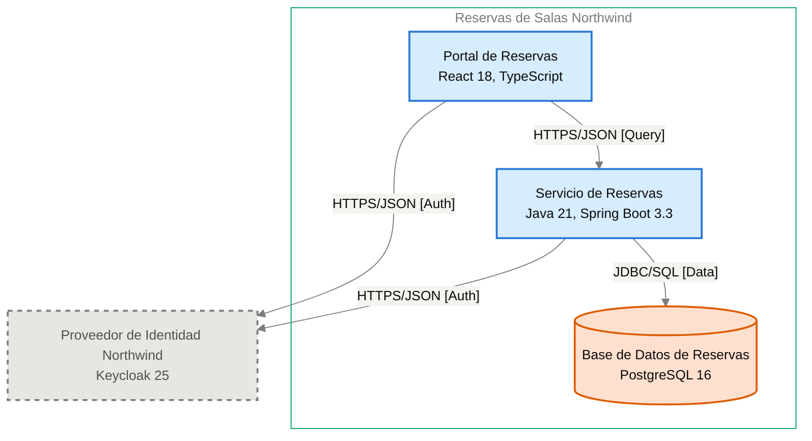

# Especificación de Componente — Servicio de Reservas

<!-- managed by sa-skills:architecture-dev-handoff — do not edit manually -->
<!-- TEMPLATE_VERSION: 4.3.1 -->
| Field | Value |
|-------|-------|
| Componente | Servicio de Reservas |
| Número de componente | 5.2 |
| Equipo | [NOT DOCUMENTED — add **Owner:** field to docs/components/reservas-de-salas-northwind/02-servicio-de-reservas.md] |
| Versión de la Especificación de Componente | 4.3.1 |
| Versión de la Vista de Ejecución | 4.3.1 |
| Versión de los Estándares | 4.3.1 |
| Versión de la arquitectura | 1.1.1 |
| Versión del componente | 1.1.1 |
| Generado | 2026-10-19 |
| Documento fuente del componente | [../docs/components/reservas-de-salas-northwind/02-servicio-de-reservas.md](../docs/components/reservas-de-salas-northwind/02-servicio-de-reservas.md) |

### Índice rápido por rol <!-- SECTION: Role Quick Index -->

| Audience | Read first in this document |
|----------|-----------------------------|
| **Dev** | § 1 Responsabilidad → § 2 Posición → § 3 Contratos propios → § 4 Invariantes → § 7 Restricciones → § 8 Deliberadamente no especificado |
| **QA** | § 3 Contratos propios → § 4 Invariantes → § 5 Presupuestos → § 9 Aceptación |
| **Ops / SRE** | § 5 Presupuestos → § 7 Restricciones → § 10 Activos |

El orden de lectura de los cuatro documentos del kit está en `../README.md`.

Este es el **panel para este equipo**. Especifica solo intención y restricción. La estructura interna, la elección de persistencia dentro de los límites propios, el idioma de código, la disposición de módulos y la estrategia de pruebas quedan deliberadamente sin especificar: son del equipo.

Se lee junto con [`../SYSTEM_RUNTIME_VIEW.md`](../SYSTEM_RUNTIME_VIEW.md) (historia del sistema completo), [`../CROSS_CUTTING_STANDARDS.md`](../CROSS_CUTTING_STANDARDS.md) (reglas globales) y cada Interface Contract enlazado (continuidad con los servicios vecinos).

---

## 1. Responsabilidad <!-- SECTION: Responsibility -->

El Servicio de Reservas es el único microservicio del sistema. Expone la API REST `/v1` de disponibilidad, reserva y cancelación de las 42 salas de las 3 sedes, aplica sus reglas de reserva, valida los tokens del Proveedor de Identidad Northwind con sus claves JWKS y es dueño exclusivo de los datos en la Base de Datos de Reservas (ADR-003). NO es responsable de la interfaz de usuario (a cargo de Portal de Reservas), de emitir tokens ni autenticar miembros (a cargo de Proveedor de Identidad Northwind), ni de hacer cumplir la no superposición de reservas (la restricción de exclusión de la Base de Datos de Reservas la rechaza; el servicio no la coordina, ADR-102).

---

## 2. Posición <!-- SECTION: Position -->

**Aparece en los flujos:** F-01 hop 2 (Validación del token), F-01 hop 3 (Consulta de disponibilidad), F-02 hop 2 (Validación del token), F-02 hop 4 (Creación de reserva), F-03 hop 2 (Validación del token), F-03 hop 5 (Cancelación de reserva)

**Interfaces de entrada** (inbound):

- [portal-de-reservas→servicio-de-reservas](../interfaces/portal-de-reservas→servicio-de-reservas.md) — I-02

**Interfaces de salida** (outbound):

- [servicio-de-reservas→proveedor-de-identidad-northwind](../interfaces/servicio-de-reservas→proveedor-de-identidad-northwind.md) — I-03
- [servicio-de-reservas→base-de-datos-de-reservas](../interfaces/servicio-de-reservas→base-de-datos-de-reservas.md) — I-04

**Interfaces sin Interface Contract**:

Ninguna.

**Panel** — este componente y sus vecinos en el diagrama de contenedores, recortado de `docs/03` (generado, nunca editado a mano):

---

## 3. Contratos propios <!-- SECTION: Contracts Owned -->

Contratos que este componente publica. Los esquemas viven en los archivos de activos enlazados; esta tabla lista solo títulos, versiones y consumidores.

| Contract | Version | Consumers | Asset |
|----------|--------:|-----------|-------|
| API REST de disponibilidad, reserva y cancelación (`/v1`; `getAvailability`, `createBooking`, `listBookings`, `cancelBooking`) | 1.0.0 | Portal de Reservas | [openapi.yaml](assets/02-servicio-de-reservas/openapi.yaml) |

---

## 4. Invariantes <!-- SECTION: Invariants -->

Condiciones que se cumplen en todo momento, sin importar la implementación. Cada invariante es verificable: QA cubre cada una con una prueba.

- **INV-01** El servicio calcula la disponibilidad por sede, fecha y franja; cuando no hay salas libres devuelve hasta 3 `suggestedSlots` de la misma duración, día y sede, nunca en el pasado.
- **INV-02** Ninguna reserva confirmada se superpone con otra para la misma sala; la Base de Datos de Reservas rechaza el conflicto y el servicio responde `ROOM_OCCUPIED` (409), según [ADR-102](../../adr/ADR-102-impedir-reservas-dobles-con-restriccion-de-exclusion-en.md).
- **INV-03** Un miembro no tiene más de 3 reservas futuras por día; la cuarta recibe `DAILY_LIMIT_REACHED` (409).
- **INV-04** Toda franja es múltiplo de 30 minutos, dura 8 horas o menos y no está en el pasado; en otro caso la respuesta es `VALIDATION_FAILED` (400).
- **INV-05** Toda solicitud valida el JWT (RS256) con las claves JWKS del Proveedor de Identidad Northwind; sin token válido la respuesta es `UNAUTHENTICATED` (401), según [ADR-002](../../adr/ADR-002-oidc-keycloak-identity.md).
- **INV-06** Una misma `Idempotency-Key` repetida dentro de 24 horas devuelve la respuesta guardada y no crea una segunda reserva, según [ADR-103](../../adr/ADR-103-idempotencia-de-la-creacion-de-reservas-con-clave.md).
- **INV-07** Solo el dueño de la reserva, o un token con rol `recepcion` cuyo atributo `sede` coincide con la sede de la sala, cancela; en otro caso `FORBIDDEN` (403) y la reserva sigue `confirmed`, según [ADR-105](../../adr/ADR-105-autorizacion-por-rol-recepcion-y-atributo-sede-del.md).
- **INV-08** La cancelación por el rol `recepcion` exige `reason` de 10 a 120 caracteres; su ausencia produce `VALIDATION_FAILED` (400).
- **INV-09** Cada cancelación escribe su registro de auditoría en la misma transacción, según [ADR-106](../../adr/ADR-106-retencion-de-24-meses-purga-de-datos-y.md).
- **INV-10** Todo error responde con RFC 9457 (`application/problem+json`) y un campo `code` estable, según [ADR-001](../../adr/ADR-001-rest-openapi-apis.md).
- **INV-11** Los logs son JSON estructurado con `trace_id` y `span_id` y nunca incluyen tokens ni datos personales completos, según [ADR-004](../../adr/ADR-004-opentelemetry-observability.md).

---

## 5. Presupuestos (de la descomposición) <!-- SECTION: Budgets -->

Tomados textualmente de [`../SYSTEM_RUNTIME_VIEW.md § Budget Decomposition`](../SYSTEM_RUNTIME_VIEW.md#budget-decomposition) en las filas que referencian este componente. No se repite el SLO global; solo la asignación de este componente.

| Aspect | Allocation | Source |
|--------|-----------:|--------|
| Latencia p99 | [NOT DOCUMENTED — run /sa-analysis:architecture-analysis latency-budget] | [SYSTEM_RUNTIME_VIEW.md](../SYSTEM_RUNTIME_VIEW.md#budget-decomposition) |
| Error budget | [NOT DOCUMENTED — run /sa-analysis:architecture-analysis latency-budget] | [SYSTEM_RUNTIME_VIEW.md](../SYSTEM_RUNTIME_VIEW.md#budget-decomposition) |
| Throughput (pico) | [NOT DOCUMENTED — run /sa-analysis:architecture-analysis latency-budget] | [SYSTEM_RUNTIME_VIEW.md](../SYSTEM_RUNTIME_VIEW.md#budget-decomposition) |
| Throughput (sostenido) | [NOT DOCUMENTED — run /sa-analysis:architecture-analysis latency-budget] | [SYSTEM_RUNTIME_VIEW.md](../SYSTEM_RUNTIME_VIEW.md#budget-decomposition) |
| Techo de costo | [NOT DOCUMENTED — run /sa-analysis:architecture-analysis latency-budget] | [SYSTEM_RUNTIME_VIEW.md](../SYSTEM_RUNTIME_VIEW.md#budget-decomposition) |

Referencia documentada en `docs/04-data-flow-patterns.md`: la meta de negocio de tiempo de confirmación de reservas es p95 ≤ 2 s (PO Spec §8); los saltos Portal de Reservas → Servicio de Reservas y Servicio de Reservas → Base de Datos de Reservas no tienen presupuesto. La consulta JWKS queda fuera del camino crítico salvo carga de claves.

---

## 6. Propiedad de datos <!-- SECTION: Data Ownership -->

Propiedad exclusiva. No existe propiedad mutable compartida en el sistema.

**Es dueño de (fuente autoritativa):**

- Salas
- Reservas, con su cancelación y motivo
- Registro de auditoría de cancelaciones ([ADR-106](../../adr/ADR-106-retencion-de-24-meses-purga-de-datos-y.md))
- Claves de idempotencia con su respuesta durante 24 horas ([ADR-103](../../adr/ADR-103-idempotencia-de-la-creacion-de-reservas-con-clave.md))

Todo se guarda en la Base de Datos de Reservas (ADR-003).

**Lee (vía contrato, no es dueño):**

- Claves públicas JWKS del Proveedor de Identidad Northwind, vía [servicio-de-reservas→proveedor-de-identidad-northwind](../interfaces/servicio-de-reservas→proveedor-de-identidad-northwind.md) (I-03)
- `sub`, rol `recepcion` y atributo `sede` del JWT validado (ADR-002, ADR-105)

**No debe acceder a:**

Sin prohibiciones explícitas.

---

## 7. Restricciones <!-- SECTION: Constraints -->

Cada restricción tiene una razón (regla de Cross-Cutting Standards, ADR o invariante). Una restricción sin razón es deriva en espera: se cita una o se elimina la fila.

**Obligatorio:**

- Java 21 y Spring Boot 3.3 — según la tecnología documentada en el documento fuente del componente
- API REST sobre HTTPS con cuerpos JSON, contrato OpenAPI 3.1 escrito antes que el código, versión mayor en la ruta (`/v1`) — per [ADR-001](../../adr/ADR-001-rest-openapi-apis.md)
- Validación del JWT (RS256) con JWKS del Proveedor de Identidad Northwind en cada solicitud — per [ADR-002](../../adr/ADR-002-oidc-keycloak-identity.md)
- PostgreSQL 16 con acceso JDBC y TLS; esquema versionado con migraciones Flyway; integridad de negocio declarada en la base — per [ADR-003](../../adr/ADR-003-postgresql-relational-store.md)
- Trazas, métricas y logs con OpenTelemetry; W3C Trace Context; métricas RED por operación — per [ADR-004](../../adr/ADR-004-opentelemetry-observability.md)
- Contenedor en el clúster Kubernetes de Plataforma Northwind, al menos 2 réplicas en zonas distintas, solicitudes y límites de CPU y memoria, sondas de vida y disponibilidad — per [ADR-005](../../adr/ADR-005-kubernetes-container-runtime.md)
- Restricción de exclusión en la base contra reservas dobles — per [ADR-102](../../adr/ADR-102-impedir-reservas-dobles-con-restriccion-de-exclusion-en.md)
- Cabecera `Idempotency-Key` obligatoria en la creación, con respuesta guardada 24 horas — per [ADR-103](../../adr/ADR-103-idempotencia-de-la-creacion-de-reservas-con-clave.md)
- Autorización de cancelación por dueño o rol `recepcion` con atributo `sede` — per [ADR-105](../../adr/ADR-105-autorizacion-por-rol-recepcion-y-atributo-sede-del.md)
- Retención de 24 meses de reservas y auditoría, con purga programada — per [ADR-106](../../adr/ADR-106-retencion-de-24-meses-purga-de-datos-y.md)

**Prohibido:**

- Que otro servicio lea o escriba directamente las tablas de la Base de Datos de Reservas — per [ADR-003](../../adr/ADR-003-postgresql-relational-store.md)
- Incluir tokens o datos personales completos en los logs — per [ADR-004](../../adr/ADR-004-opentelemetry-observability.md)

---

## 8. Deliberadamente no especificado <!-- SECTION: Deliberately Unspecified -->

El equipo es dueño de las siguientes decisiones:

- Estructura interna (disposición de módulos, límites de paquetes)
- Elección de persistencia dentro del límite propio
- Idioma de código y subconjunto del framework
- Estrategia de pruebas (reparto unitarias vs integración, herramientas)
- Caché local, pools en proceso

La sobre-especificación aquí reemplazaría el criterio por la prescripción. Si te encuentras especificando alguno de los puntos anteriores, escala: pertenece a Cross-Cutting Standards (si es institucional) o a un ADR (si es del proyecto), no a una Especificación de Componente.

---

## 9. Aceptación <!-- SECTION: Acceptance -->

- [ ] Contratos de § 3 publicados y verificados por los consumidores
- [ ] Presupuestos de § 5 demostrados bajo carga
- [ ] Invariantes de § 4 cubiertos por pruebas
- [ ] Semántica de fallo de las interfaces ejercitada (inyección de fallos según cada Interface Contract)
- [ ] Conformidad con Cross-Cutting Standards verificada; cualquier desviación registrada según [`../CROSS_CUTTING_STANDARDS.md § Deviations`](../CROSS_CUTTING_STANDARDS.md#deviations)

---

## 10. Activos <!-- SECTION: Assets -->

Activos entregables generados junto con esta Especificación de Componente.

| Asset | File | Description |
|-------|------|-------------|
| OpenAPI Spec | [openapi.yaml](assets/02-servicio-de-reservas/openapi.yaml) | Contrato de API REST |
| C4 Component Descriptor | [c4-descriptor.md](assets/02-servicio-de-reservas/c4-descriptor.md) | Resumen operativo para SRE e infraestructura |

Los activos viven en `handoffs/assets/02-servicio-de-reservas/`.

---

## 11. Preguntas abiertas <!-- SECTION: Open Questions -->

Brechas detectadas al generar la Especificación de Componente: valores ausentes en la documentación de arquitectura o en los artefactos previos (Runtime View, Cross-Cutting Standards, Interface Contracts).

**Un registro, no un ensayo.** Una fila por brecha: qué falta, dónde se corrige y qué bloquea.

| Section | What is missing | Where to fix it | What it blocks |
|---------|-----------------|-----------------|----------------|
| § Metadata | Equipo propietario del componente | `docs/components/reservas-de-salas-northwind/02-servicio-de-reservas.md` (campo **Owner:**) | Asignar responsabilidad del equipo |
| § Position | ID del diagrama del panel | Registro de diagramas de `docs/03-architecture-layers.md` | Referenciar el diagrama de forma estable |
| § Budgets | Latencia p99 y error budget del componente | `/sa-analysis:architecture-analysis latency-budget` | Pruebas de carga de § 9 |
| § Budgets | Throughput (pico y sostenido) y techo de costo | `/sa-analysis:architecture-analysis latency-budget` | Dimensionar réplicas y demostrar presupuestos |
| Assets — openapi.yaml | Host del servicio (URL base) | docs/components/reservas-de-salas-northwind/02-servicio-de-reservas.md | La URL base documentada es /v1, pero el host no está documentado; el servidor queda como /. |
| Assets — openapi.yaml | Obligatoriedad de los parámetros de consulta de CU1 (site, date, start, end) | docs/components/reservas-de-salas-northwind/02-servicio-de-reservas.md | El documento no dice si son obligatorios; quedan sin required. |
| Assets — openapi.yaml | Campos RFC 9457 adicionales a code en Problem y su obligatoriedad | docs/components/reservas-de-salas-northwind/02-servicio-de-reservas.md | El esquema de error solo modela code; no se fijan type, title, status ni detail. |
| Assets — openapi.yaml | Obligatoriedad de los campos de AvailabilityResponse y RoomAvailability | docs/components/reservas-de-salas-northwind/02-servicio-de-reservas.md | Los esquemas de disponibilidad no declaran campos obligatorios. |
| Assets — openapi.yaml | Licencia de la API | docs/components/reservas-de-salas-northwind/02-servicio-de-reservas.md | Comentario TODO en info; solo aplica si la organización exige licencia. |
| Assets — c4-descriptor.md | Responsable | agregar `**Owner:**` a docs/components/reservas-de-salas-northwind/02-servicio-de-reservas.md | escalamiento y propiedad en la CMDB |
| Assets — c4-descriptor.md | Host · IP · SO · Dominio | docs/09-operational-considerations.md | registro en la CMDB y reglas de red |
| Assets — security.md | Data Sensitivity | analysis/DATA-SENSITIVITY-*.md — run /sa-analysis:architecture-analysis data-sensitivity | se desconoce la clasificación de los datos que maneja el componente |

---

*Generated by `sa-skills:architecture-dev-handoff` on 2026-10-19*
*Source: /home/runner/work/northwind-reservas/northwind-reservas/ARCHITECTURE.md*
