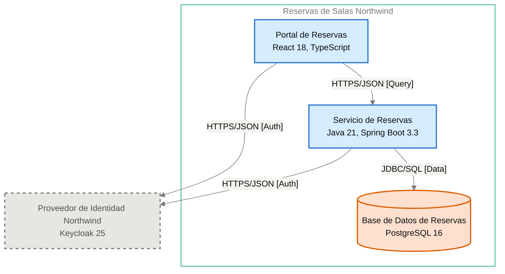

# Especificación de Componente — Servicio de Reservas

<!-- managed by sa-skills:architecture-dev-handoff — do not edit manually -->
<!-- TEMPLATE_VERSION: 4.3.1 -->
| Field | Value |
|-------|-------|
| Componente | Servicio de Reservas |
| Número de componente | 5.2 |
| Equipo | [NOT DOCUMENTED — add **Owner:** field to docs/components/reservas-de-salas-northwind/02-servicio-de-reservas.md] |
| Versión de la Especificación de Componente | 4.3.1 |
| Versión de la Vista de Ejecución | 4.3.1 |
| Versión de los Estándares | 4.3.1 |
| Versión de la arquitectura | 1.1.0 |
| Versión del componente | 1.1.0 |
| Generado | 2026-10-19 |
| Documento fuente del componente | [../../docs/components/reservas-de-salas-northwind/02-servicio-de-reservas.md](../../docs/components/reservas-de-salas-northwind/02-servicio-de-reservas.md) |

### Índice rápido por rol <!-- SECTION: Role Quick Index -->

| Audience | Read first in this document |
|----------|-----------------------------|
| **Dev** | § 1 Responsabilidad → § 2 Posición → § 3 Contratos propios → § 4 Invariantes → § 7 Restricciones → § 8 Deliberadamente sin especificar |
| **QA** | § 3 Contratos propios → § 4 Invariantes → § 5 Presupuestos → § 9 Aceptación |
| **Ops / SRE** | § 5 Presupuestos → § 7 Restricciones → § 10 Activos |

El orden de lectura de los cuatro documentos del kit está en `../README.md`.

Este es el **panel para este equipo**. Especifica solo intención y restricción. La estructura interna, la elección de persistencia dentro de los límites propios, el idioma de programación, la organización de módulos y la estrategia de pruebas quedan deliberadamente sin especificar: son del equipo.

Léase junto con [`../SYSTEM_RUNTIME_VIEW.md`](../SYSTEM_RUNTIME_VIEW.md) (historia del sistema completo), [`../CROSS_CUTTING_STANDARDS.md`](../CROSS_CUTTING_STANDARDS.md) (reglas globales) y cada Interface Contract enlazado (continuidad con los servicios adyacentes).

---

## 1. Responsabilidad <!-- SECTION: Responsibility -->

El Servicio de Reservas es el único microservicio del sistema. Expone la API REST de disponibilidad, reserva y cancelación de las 42 salas de las 3 sedes, aplica sus reglas, valida los tokens del Proveedor de Identidad Northwind con sus claves JWKS y es dueño exclusivo de la Base de Datos de Reservas (ADR-003). [NOT DOCUMENTED — add a not-accountable clause to docs/components/reservas-de-salas-northwind/02-servicio-de-reservas.md]

---

## 2. Posición <!-- SECTION: Position -->

**Aparece en los flujos:** F-01 hop 2, F-01 hop 3, F-02 hop 2, F-02 hop 4, F-03 hop 2, F-03 hop 5

**Interfaces entrantes** (inbound):

- [portal-de-reservas→servicio-de-reservas](../interfaces/portal-de-reservas→servicio-de-reservas.md) — I-02

**Interfaces salientes** (outbound):

- [servicio-de-reservas→proveedor-de-identidad-northwind](../interfaces/servicio-de-reservas→proveedor-de-identidad-northwind.md) — I-03
- [servicio-de-reservas→base-de-datos-de-reservas](../interfaces/servicio-de-reservas→base-de-datos-de-reservas.md) — I-04

**Interfaces sin Interface Contract**:

Ninguna.

**Panel** — este componente y sus vecinos en el diagrama de contenedores, recortado de `docs/03` (generado, nunca se edita a mano):

Cut of C4 Level 2 — Container — Servicio de Reservas and its neighbours (generated, never hand-edited):

---

## 3. Contratos propios <!-- SECTION: Contracts Owned -->

Contratos que este componente publica. Los esquemas viven en los activos enlazados; esta tabla lista solo títulos, versiones y consumidores.

| Contract | Version | Consumers | Asset |
|----------|--------:|-----------|-------|
| API REST de disponibilidad, reserva y cancelación (`getAvailability`, `createBooking`, `listBookings`, `cancelBooking`) | 1.0.0 | Portal de Reservas | [openapi.yaml](assets/02-servicio-de-reservas/openapi.yaml) |

---

## 4. Invariantes <!-- SECTION: Invariants -->

Condiciones que se cumplen siempre, sin importar la implementación. Cada invariante es verificable: QA cubre cada una con una prueba.

- **INV-01** El servicio calcula la disponibilidad de salas por sede (`centro`, `norte`, `puerto`), fecha y franja.
- **INV-02** Toda franja es múltiplo de 30 minutos, dura 8 horas o menos y no está en el pasado; en otro caso responde `VALIDATION_FAILED` (400).
- **INV-03** Nunca existen dos reservas confirmadas superpuestas para la misma sala; la Base de Datos de Reservas rechaza la segunda y el servicio responde `ROOM_OCCUPIED` (409), según [ADR-102](../../adr/ADR-102-impedir-reservas-dobles-con-restriccion-de-exclusion-en.md).
- **INV-04** Un miembro no supera 3 reservas futuras por día; la cuarta responde `DAILY_LIMIT_REACHED` (409).
- **INV-05** La misma `Idempotency-Key` en 24 horas devuelve la respuesta guardada y no crea una segunda reserva, según [ADR-103](../../adr/ADR-103-idempotencia-de-la-creacion-de-reservas-con-clave.md).
- **INV-06** Solo el dueño de la reserva, o un token con rol `recepcion` cuyo atributo `sede` coincide con la sede de la sala, cancela; en otro caso responde `FORBIDDEN` (403) y la reserva sigue `confirmed`, según [ADR-105](../../adr/ADR-105-autorizacion-por-rol-recepcion-y-atributo-sede-del.md).
- **INV-07** La cancelación por el rol `recepcion` exige `reason` de 120 caracteres o menos; sin motivo responde `VALIDATION_FAILED` (400).
- **INV-08** Toda cancelación escribe su registro de auditoría en la misma transacción, según [ADR-106](../../adr/ADR-106-retencion-de-24-meses-purga-de-datos-y.md).
- **INV-09** Cada solicitud se valida con el JWT (RS256) y las claves JWKS del Proveedor de Identidad Northwind; sin token válido responde `UNAUTHENTICATED` (401), según [ADR-002](../../adr/ADR-002-oidc-keycloak-identity.md).
- **INV-10** Todo error usa RFC 9457 (`application/problem+json`) con el campo `code` estable, según [ADR-001](../../adr/ADR-001-rest-openapi-apis.md).
- **INV-11** Los logs no incluyen tokens ni datos personales completos, según [ADR-004](../../adr/ADR-004-opentelemetry-observability.md).
- **INV-12** Ningún otro servicio lee ni escribe las tablas del servicio, según [ADR-003](../../adr/ADR-003-postgresql-relational-store.md).

---

## 5. Presupuestos (de la descomposición) <!-- SECTION: Budgets -->

Tomados de [`../SYSTEM_RUNTIME_VIEW.md § Budget Decomposition`](../SYSTEM_RUNTIME_VIEW.md#budget-decomposition), filas que referencian este componente. Solo se restituye la asignación de este componente, no el SLO global.

| Aspect | Allocation | Source |
|--------|-----------:|--------|
| Latencia p99 | [NOT DOCUMENTED — run /sa-analysis:architecture-analysis latency-budget] | [NOT DOCUMENTED — run /sa-analysis:architecture-analysis latency-budget] |
| Error budget | [NOT DOCUMENTED — run /sa-analysis:architecture-analysis latency-budget] | [NOT DOCUMENTED — run /sa-analysis:architecture-analysis latency-budget] |
| Throughput (pico) | [NOT DOCUMENTED — run /sa-analysis:architecture-analysis latency-budget] | [NOT DOCUMENTED — run /sa-analysis:architecture-analysis latency-budget] |
| Throughput (sostenido) | [NOT DOCUMENTED — run /sa-analysis:architecture-analysis latency-budget] | [NOT DOCUMENTED — run /sa-analysis:architecture-analysis latency-budget] |
| Techo de costo | [NOT DOCUMENTED — run /sa-analysis:architecture-analysis latency-budget] | [NOT DOCUMENTED — run /sa-analysis:architecture-analysis latency-budget] |

Presupuestos de salto documentados: Portal de Reservas → Servicio de Reservas y Servicio de Reservas → Base de Datos de Reservas sin valor documentado; Servicio de Reservas → Proveedor de Identidad Northwind (JWKS) fuera del camino crítico salvo carga de claves. Meta de negocio: tiempo de confirmación de reservas, p95 ≤ 2 s (PO Spec §8).

---

## 6. Propiedad de datos <!-- SECTION: Data Ownership -->

Propiedad exclusiva. Ninguna propiedad mutable compartida en el sistema.

**Es dueño de (fuente autoritativa):**

- Salas
- Reservas, con su cancelación y motivo
- Registro de auditoría de cancelaciones ([ADR-106](../../adr/ADR-106-retencion-de-24-meses-purga-de-datos-y.md))
- Claves de idempotencia con su respuesta durante 24 horas ([ADR-103](../../adr/ADR-103-idempotencia-de-la-creacion-de-reservas-con-clave.md))

Todo se guarda en la Base de Datos de Reservas (ADR-003).

**Lee (vía contrato, no es dueño):**

- Claves públicas JWKS del Proveedor de Identidad Northwind, vía [servicio-de-reservas→proveedor-de-identidad-northwind](../interfaces/servicio-de-reservas→proveedor-de-identidad-northwind.md) (I-03).
- `sub`, rol `recepcion` y atributo `sede` del JWT validado (ADR-002, ADR-105).

**No debe acceder a:**

- Sin prohibiciones explícitas de acceso a almacenes de otros componentes.
- No coordina en código la superposición de reservas: la garantiza la base de datos — según [ADR-102](../../adr/ADR-102-impedir-reservas-dobles-con-restriccion-de-exclusion-en.md).

---

## 7. Restricciones <!-- SECTION: Constraints -->

Cada restricción tiene una razón (regla de Cross-Cutting Standards, ADR o invariante). Una restricción sin razón es deriva en espera: se cita una o se elimina la fila.

**Obligatorio:**

- Java 21, Spring Boot 3.3, contenedor Docker — según la tecnología declarada en el documento fuente del componente.
- REST sobre HTTPS con cuerpos JSON; contrato OpenAPI 3.1 escrito antes que el código; versión mayor en la ruta (`/v1`) — según [ADR-001](../../adr/ADR-001-rest-openapi-apis.md).
- Validación del JWT del Proveedor de Identidad Northwind en `Authorization: Bearer` con claves JWKS — según [ADR-002](../../adr/ADR-002-oidc-keycloak-identity.md).
- PostgreSQL 16 vía JDBC con TLS; esquema versionado con migraciones Flyway; integridad declarada en la base — según [ADR-003](../../adr/ADR-003-postgresql-relational-store.md).
- Trazas, métricas y logs con OpenTelemetry; W3C Trace Context; logs JSON estructurados; métricas RED por operación — según [ADR-004](../../adr/ADR-004-opentelemetry-observability.md).
- Despliegue en el clúster Kubernetes de Plataforma Northwind con al menos 2 réplicas en zonas distintas, solicitudes y límites de CPU y memoria, y sondas de vida y disponibilidad — según [ADR-005](../../adr/ADR-005-kubernetes-container-runtime.md).

**Prohibido:**

- Acceso de otro servicio a las tablas del servicio — según [ADR-003](../../adr/ADR-003-postgresql-relational-store.md).
- Tokens y datos personales completos en los logs — según [ADR-004](../../adr/ADR-004-opentelemetry-observability.md).

---

## 8. Deliberadamente sin especificar <!-- SECTION: Deliberately Unspecified -->

El equipo es dueño de las siguientes decisiones:

- Estructura interna (organización de módulos, límites de paquetes)
- Elección de persistencia dentro del límite propio
- Idioma de programación y subconjunto de framework
- Estrategia de pruebas (reparto unitarias e integración, herramientas)
- Caché local, pooling en proceso

Sobreespecificar aquí reemplazaría el criterio por la prescripción. Si necesitas especificar una de las anteriores, escala: pertenece a Cross-Cutting Standards (si es de toda la institución) o a un ADR (si es de todo el proyecto), no a una Especificación de Componente.

---

## 9. Aceptación <!-- SECTION: Acceptance -->

- [ ] Contratos del § 3 publicados y verificados por los consumidores
- [ ] Presupuestos del § 5 demostrados bajo carga
- [ ] Invariantes del § 4 cubiertos por pruebas
- [ ] Semántica de fallo de las interfaces ejercitada (inyección de fallos según cada Interface Contract)
- [ ] Conformidad con Cross-Cutting Standards verificada; toda desviación registrada según [`../CROSS_CUTTING_STANDARDS.md § Deviations`](../CROSS_CUTTING_STANDARDS.md#deviations)

---

## 10. Activos <!-- SECTION: Assets -->

Activos entregables generados junto con esta Especificación de Componente.

| Asset | File | Description |
|-------|------|-------------|
| Especificación OpenAPI | [openapi.yaml](assets/02-servicio-de-reservas/openapi.yaml) | Contrato de la API REST |
| Descriptor de componente C4 | [c4-descriptor.md](assets/02-servicio-de-reservas/c4-descriptor.md) | Ficha operativa para SRE e infraestructura |

Los activos viven en `handoffs/assets/02-servicio-de-reservas/`.

---

## 11. Preguntas abiertas <!-- SECTION: Open Questions -->

Vacíos detectados al generar la Especificación de Componente: valores ausentes en la documentación de arquitectura o en los artefactos de origen.

| Section | What is missing | Where to fix it | What it blocks |
|---------|-----------------|-----------------|----------------|
| Metadata | Equipo propietario (`Owner`) | `docs/components/reservas-de-salas-northwind/02-servicio-de-reservas.md` (campo **Owner:**) | Asignar responsabilidad del equipo |
| Responsibility | Cláusula "no es responsable de" | `docs/components/reservas-de-salas-northwind/02-servicio-de-reservas.md` § Propósito | Delimitar el alcance del servicio |
| Position | ID del diagrama del panel | Registro de diagramas de `docs/03-architecture-layers.md` | Referenciar el diagrama de forma estable |
| Budgets | Latencia p99 | `/sa-analysis:architecture-analysis latency-budget` | Pruebas de carga del § 9 |
| Budgets | Error budget | `/sa-analysis:architecture-analysis latency-budget` | Pruebas de carga del § 9 |
| Budgets | Throughput (pico) | `/sa-analysis:architecture-analysis latency-budget` | Dimensionar réplicas y pruebas de carga |
| Budgets | Throughput (sostenido) | `/sa-analysis:architecture-analysis latency-budget` | Dimensionar réplicas y pruebas de carga |
| Budgets | Techo de costo | `/sa-analysis:architecture-analysis latency-budget` | Validar costo operativo |
| Assets — c4-descriptor.md | Responsable | agregar `**Owner:**` a docs/components/reservas-de-salas-northwind/02-servicio-de-reservas.md | escalamiento y propiedad en la CMDB |
| Assets — c4-descriptor.md | Host · IP · SO · Dominio | docs/09-operational-considerations.md | registro en la CMDB y reglas de red |
| Assets — security.md | Data Sensitivity | analysis/DATA-SENSITIVITY-*.md — run /sa-analysis:architecture-analysis data-sensitivity | se desconoce la clasificación de los datos que maneja el componente |
| Assets — openapi.yaml | Host del servicio (URL base) | docs/components/reservas-de-salas-northwind/02-servicio-de-reservas.md | El documento da /v1 pero no el host; servers[0].url es /. |
| Assets — openapi.yaml | Obligatoriedad de los parámetros de CU1 (site, date, start, end) | docs/components/reservas-de-salas-northwind/02-servicio-de-reservas.md | Los cuatro parámetros de getAvailability no llevan required. |
| Assets — openapi.yaml | Tipo del campo Booking.site | docs/components/reservas-de-salas-northwind/02-servicio-de-reservas.md | Booking.site no tiene type; solo se documenta el enum centro/norte/puerto del parámetro de CU1. |
| Assets — openapi.yaml | Campos del problema RFC 9457 además de code | docs/components/reservas-de-salas-northwind/02-servicio-de-reservas.md | El esquema Problem solo declara code. |
| Assets — openapi.yaml | Licencia de la API | docs/components/reservas-de-salas-northwind/02-servicio-de-reservas.md | Opcional; info.license no se incluye. |

---

*Generated by `sa-skills:architecture-dev-handoff` on 2026-10-19*
*Source: /home/runner/work/northwind-reservas/northwind-reservas/ARCHITECTURE.md*
