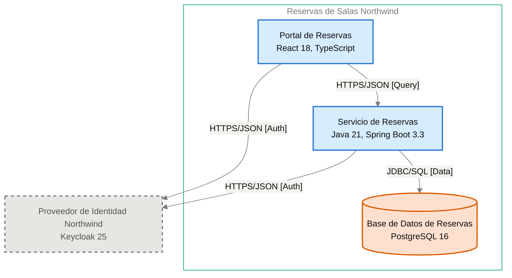

# Especificación de Componente — Servicio de Reservas

<!-- managed by sa-skills:architecture-dev-handoff — do not edit manually -->
<!-- TEMPLATE_VERSION: 4.3.1 -->
| Field | Value |
|-------|-------|
| Componente | Servicio de Reservas |
| Número de componente | 5.2 |
| Equipo | [NOT DOCUMENTED — add **Owner:** field to docs/components/reservas-de-salas-northwind/02-servicio-de-reservas.md] |
| Versión de la Especificación de Componente | 4.3.1 |
| Versión de la Vista de Ejecución | 4.3.1 |
| Versión de los Estándares | 4.3.1 |
| Versión de la arquitectura | 1.0.0 |
| Versión del componente | 1.1.0 |
| Generado | 2026-10-18 |
| Documento fuente del componente | [../../docs/components/reservas-de-salas-northwind/02-servicio-de-reservas.md](../../docs/components/reservas-de-salas-northwind/02-servicio-de-reservas.md) |

### Índice rápido por rol <!-- SECTION: Role Quick Index -->

| Audience | Read first in this document |
|----------|-----------------------------|
| **Dev** | § 1 Responsabilidad → § 2 Posición → § 3 Contratos propios → § 4 Invariantes → § 7 Restricciones → § 8 Deliberadamente sin especificar |
| **QA** | § 3 Contratos propios → § 4 Invariantes → § 5 Presupuestos → § 9 Aceptación |
| **Ops / SRE** | § 5 Presupuestos → § 7 Restricciones → § 10 Activos |

El orden de lectura de los cuatro documentos del kit está en `../README.md`.

Este es el **panel para este equipo**. Especifica solo intención y restricción. La estructura interna, la persistencia dentro de los límites propios, el idioma del lenguaje, la organización de módulos y la estrategia de pruebas quedan deliberadamente sin especificar: son decisión del equipo.

Se lee junto con [`../SYSTEM_RUNTIME_VIEW.md`](../SYSTEM_RUNTIME_VIEW.md) (visión del sistema completo), [`../CROSS_CUTTING_STANDARDS.md`](../CROSS_CUTTING_STANDARDS.md) (reglas globales) y cada Interface Contract enlazado (continuidad con los servicios adyacentes).

---

## 1. Responsabilidad <!-- SECTION: Responsibility -->

Servicio de Reservas es responsable de calcular la disponibilidad de las 42 salas de las 3 sedes por sede, fecha y franja; de crear reservas confirmadas sin superposición para la misma sala; de cancelarlas (las propias del miembro, o cualquiera de su sede para el rol `recepcion`); y de validar los tokens del Proveedor de Identidad Northwind con sus claves JWKS. Es la única puerta a la Base de Datos de Reservas ([ADR-003](../../adr/ADR-003-postgresql-relational-store.md)). NO es responsable de emitir ni autenticar identidades (el Proveedor de Identidad Northwind es la única fuente de autenticación, [ADR-002](../../adr/ADR-002-oidc-keycloak-identity.md)) ni de coordinar la superposición de reservas (la rechaza la base de datos, [ADR-102](../../adr/ADR-102-impedir-reservas-dobles-con-restriccion-de-exclusion-en.md)).

---

## 2. Posición <!-- SECTION: Position -->

**Aparece en los flujos:** F-01 hop 2, F-01 hop 3, F-02 hop 2, F-02 hop 4, F-03 hop 2, F-03 hop 5

**Interfaces entrantes**:

- [portal-de-reservas→servicio-de-reservas](../interfaces/portal-de-reservas→servicio-de-reservas.md) — I-02

**Interfaces salientes**:

- [servicio-de-reservas→proveedor-de-identidad-northwind](../interfaces/servicio-de-reservas→proveedor-de-identidad-northwind.md) — I-03
- [servicio-de-reservas→base-de-datos-de-reservas](../interfaces/servicio-de-reservas→base-de-datos-de-reservas.md) — I-04

**Interfaces sin Interface Contract**:

Ninguna.

**Panel** — este componente y sus vecinos en el diagrama de contenedores, recortado de `docs/03` (generado, nunca se edita a mano):

Cut of `docs/03-architecture-layers.md` § Diagram: C4 Level 2 — Container — Servicio de Reservas and its neighbours (generated, never hand-edited):

---

## 3. Contratos propios <!-- SECTION: Contracts Owned -->

Contratos que este componente publica. Los esquemas viven en los activos enlazados: esta tabla lista solo títulos, versiones y consumidores.

| Contract | Version | Consumers | Asset |
|----------|--------:|-----------|-------|
| API REST de disponibilidad, reserva y cancelación (`/v1`, OpenAPI 3.1) | 1.0.0 | Portal de Reservas | [openapi.yaml](assets/02-servicio-de-reservas/openapi.yaml) |

---

## 4. Invariantes <!-- SECTION: Invariants -->

Condiciones que se cumplen siempre, sin importar la implementación. Cada invariante es verificable: QA cubre cada una con una prueba.

- **INV-01** El servicio valida en cada solicitud el token JWT (RS256) con las claves JWKS del Proveedor de Identidad Northwind; sin token válido responde 401 `UNAUTHENTICATED` ([ADR-002](../../adr/ADR-002-oidc-keycloak-identity.md)).
- **INV-02** La disponibilidad se calcula por sede, fecha y franja; las franjas son múltiplos de 30 minutos, de 8 horas o menos y no están en el pasado; si no, responde 400 `VALIDATION_FAILED`.
- **INV-03** Nunca coexisten dos reservas confirmadas superpuestas para la misma sala; la superposición responde 409 `ROOM_OCCUPIED` ([ADR-102](../../adr/ADR-102-impedir-reservas-dobles-con-restriccion-de-exclusion-en.md)).
- **INV-04** Un miembro no tiene más de 3 reservas futuras el mismo día; la cuarta responde 409 `DAILY_LIMIT_REACHED`.
- **INV-05** La creación de reservas exige `Idempotency-Key`; la misma clave dentro de 24 horas devuelve la respuesta guardada y no inserta una segunda reserva ([ADR-103](../../adr/ADR-103-idempotencia-de-la-creacion-de-reservas-con-clave.md)).
- **INV-06** Solo el dueño de la reserva, o un token con rol `recepcion` cuyo atributo `sede` coincide con la sede de la sala, cancela una reserva; en otro caso responde 403 `FORBIDDEN` y la reserva sigue `confirmed` ([ADR-105](../../adr/ADR-105-autorizacion-por-rol-recepcion-y-atributo-sede-del.md)).
- **INV-07** La cancelación por el rol `recepcion` exige `reason` de 120 caracteres o menos; sin él responde 400 `VALIDATION_FAILED` (ADR-105).
- **INV-08** Cada cancelación escribe su registro de auditoría en la misma transacción ([ADR-106](../../adr/ADR-106-retencion-de-24-meses-purga-de-datos-y.md)).
- **INV-09** Todo error responde RFC 9457 (`application/problem+json`) con el campo `code` estable ([ADR-001](../../adr/ADR-001-rest-openapi-apis.md)).
- **INV-10** Ningún otro servicio lee ni escribe las tablas de la Base de Datos de Reservas; solo este servicio accede a ellas ([ADR-003](../../adr/ADR-003-postgresql-relational-store.md)).
- **INV-11** Los logs son JSON estructurado y nunca incluyen tokens ni datos personales completos ([ADR-004](../../adr/ADR-004-opentelemetry-observability.md)).
- **INV-12** El servicio corre con al menos 2 réplicas en zonas distintas ([ADR-005](../../adr/ADR-005-kubernetes-container-runtime.md)).

---

## 5. Presupuestos (de la descomposición) <!-- SECTION: Budgets -->

Tomados de [`../SYSTEM_RUNTIME_VIEW.md § Budget Decomposition`](../SYSTEM_RUNTIME_VIEW.md#budget-decomposition) en las filas que referencian este componente. No se repite el SLO global: solo la asignación de este componente.

| Aspect | Allocation | Source |
|--------|-----------:|--------|
| Latencia p99 | [NOT DOCUMENTED — run /sa-analysis:architecture-analysis latency-budget] | [`SYSTEM_RUNTIME_VIEW.md`](../SYSTEM_RUNTIME_VIEW.md) |
| Error budget | [NOT DOCUMENTED — run /sa-analysis:architecture-analysis latency-budget] | [`SYSTEM_RUNTIME_VIEW.md`](../SYSTEM_RUNTIME_VIEW.md) |
| Throughput (pico) | [NOT DOCUMENTED — run /sa-analysis:architecture-analysis latency-budget] | [`SYSTEM_RUNTIME_VIEW.md`](../SYSTEM_RUNTIME_VIEW.md) |
| Throughput (sostenido) | [NOT DOCUMENTED — run /sa-analysis:architecture-analysis latency-budget] | [`SYSTEM_RUNTIME_VIEW.md`](../SYSTEM_RUNTIME_VIEW.md) |
| Techo de costo | [NOT DOCUMENTED — run /sa-analysis:architecture-analysis latency-budget] | [`SYSTEM_RUNTIME_VIEW.md`](../SYSTEM_RUNTIME_VIEW.md) |

Meta de negocio documentada: tiempo de confirmación de reservas p95 ≤ 2 s (PO Spec §8). El salto Servicio de Reservas → Proveedor de Identidad Northwind (JWKS) queda fuera del camino crítico salvo la carga de claves.

---

## 6. Propiedad de datos <!-- SECTION: Data Ownership -->

Propiedad exclusiva. No hay propiedad mutable compartida en el sistema.

**Es dueño de (fuente autoritativa):**

- Salas.
- Reservas, con su cancelación y motivo.
- Registro de auditoría de cancelaciones ([ADR-106](../../adr/ADR-106-retencion-de-24-meses-purga-de-datos-y.md)).
- Claves de idempotencia con su respuesta, durante 24 horas ([ADR-103](../../adr/ADR-103-idempotencia-de-la-creacion-de-reservas-con-clave.md)).

Todo se guarda en la Base de Datos de Reservas ([ADR-003](../../adr/ADR-003-postgresql-relational-store.md)).

**Lee (vía contrato, no es dueño):**

- Claves públicas JWKS del Proveedor de Identidad Northwind, vía [servicio-de-reservas→proveedor-de-identidad-northwind](../interfaces/servicio-de-reservas→proveedor-de-identidad-northwind.md) (I-03).
- `sub`, rol `recepcion` y atributo `sede` del JWT validado ([ADR-002](../../adr/ADR-002-oidc-keycloak-identity.md), [ADR-105](../../adr/ADR-105-autorizacion-por-rol-recepcion-y-atributo-sede-del.md)).

**No debe acceder a:**

Sin prohibiciones explícitas.

---

## 7. Restricciones <!-- SECTION: Constraints -->

Cada restricción tiene un motivo (regla de Cross-Cutting Standards, ADR o invariante). Una restricción sin motivo es deriva en espera: se cita uno o se elimina la fila.

**Obligatorio:**

- Java 21 y Spring Boot 3.3, desplegado como contenedor Docker — per `docs/components/reservas-de-salas-northwind/02-servicio-de-reservas.md`.
- API REST sobre HTTPS con cuerpos JSON, contrato OpenAPI 3.1 escrito antes que el código, versión mayor en la ruta (`/v1`) — per [ADR-001](../../adr/ADR-001-rest-openapi-apis.md).
- Autenticación con JWT del Proveedor de Identidad Northwind validado con JWKS — per [ADR-002](../../adr/ADR-002-oidc-keycloak-identity.md).
- PostgreSQL 16 vía JDBC con TLS, esquema versionado con migraciones Flyway, integridad declarada en la base — per [ADR-003](../../adr/ADR-003-postgresql-relational-store.md).
- OpenTelemetry (trazas, métricas RED y logs) con W3C Trace Context hacia el colector de Plataforma Northwind — per [ADR-004](../../adr/ADR-004-opentelemetry-observability.md).
- Clúster Kubernetes de Plataforma Northwind, al menos 2 réplicas en zonas distintas, solicitudes y límites de CPU y memoria, sondas de vida y de disponibilidad — per [ADR-005](../../adr/ADR-005-kubernetes-container-runtime.md).
- Restricción de exclusión de PostgreSQL contra reservas dobles — per [ADR-102](../../adr/ADR-102-impedir-reservas-dobles-con-restriccion-de-exclusion-en.md).
- Clave de idempotencia `Idempotency-Key` en la creación, guardada 24 horas — per [ADR-103](../../adr/ADR-103-idempotencia-de-la-creacion-de-reservas-con-clave.md).
- Autorización por rol `recepcion` y atributo `sede` — per [ADR-105](../../adr/ADR-105-autorizacion-por-rol-recepcion-y-atributo-sede-del.md).
- Retención de 24 meses con auditoría de cancelaciones en la misma transacción — per [ADR-106](../../adr/ADR-106-retencion-de-24-meses-purga-de-datos-y.md).

**Prohibido:**

- Tokens y datos personales completos en los logs — per [ADR-004](../../adr/ADR-004-opentelemetry-observability.md).
- Acceso de otro servicio a las tablas de la Base de Datos de Reservas — per [ADR-003](../../adr/ADR-003-postgresql-relational-store.md).

---

## 8. Deliberadamente sin especificar <!-- SECTION: Deliberately Unspecified -->

El equipo es dueño de las siguientes decisiones:

- Estructura interna (organización de módulos, límites de paquetes)
- Elección de persistencia dentro del límite propio
- Idioma del lenguaje y subconjunto del framework
- Estrategia de pruebas (reparto unitarias vs integración, herramientas)
- Caché local, pooling en proceso

Sobre-especificar aquí reemplazaría el criterio por la prescripción. Si te encuentras especificando alguno de los puntos anteriores, escala: pertenece a Cross-Cutting Standards (si es institucional) o a un ADR (si es del proyecto), no a una Especificación de Componente.

---

## 9. Aceptación <!-- SECTION: Acceptance -->

- [ ] Contratos del § 3 publicados y verificados por los consumidores
- [ ] Presupuestos del § 5 demostrados bajo carga
- [ ] Invariantes del § 4 cubiertas por pruebas
- [ ] Semántica de fallo de las interfaces ejercitada (inyección de fallos según el Interface Contract)
- [ ] Conformidad con Cross-Cutting Standards verificada; toda desviación registrada según [`../CROSS_CUTTING_STANDARDS.md § Deviations`](../CROSS_CUTTING_STANDARDS.md#deviations)

---

## 10. Activos <!-- SECTION: Assets -->

Activos entregables generados junto a esta Especificación de Componente.

| Asset | File | Description |
|-------|------|-------------|
| OpenAPI Spec | [openapi.yaml](assets/02-servicio-de-reservas/openapi.yaml) | Contrato de API REST |
| C4 Component Descriptor | [c4-descriptor.md](assets/02-servicio-de-reservas/c4-descriptor.md) | Resumen operativo para SRE/infraestructura |

Los activos viven en `handoffs/assets/02-servicio-de-reservas/`.

---

## 11. Preguntas abiertas <!-- SECTION: Open Questions -->

Vacíos detectados al generar la Especificación de Componente: valores ausentes de la documentación de arquitectura o de los artefactos de origen (Runtime View, Cross-Cutting Standards, Interface Contracts).

| Section | What is missing | Where to fix it | What it blocks |
|---------|-----------------|-----------------|----------------|
| § Role Quick Index | Equipo dueño del componente (Metadatos) | `docs/components/reservas-de-salas-northwind/02-servicio-de-reservas.md` § campo **Owner:** | Asignar responsabilidad del equipo |
| § Position | ID del diagrama del Panel | Registro de diagramas de `docs/03-architecture-layers.md` | Referenciar el diagrama del Panel |
| § Budgets | Latencia p99 | `/sa-analysis:architecture-analysis latency-budget` | Pruebas de carga del § 5 |
| § Budgets | Error budget | `/sa-analysis:architecture-analysis latency-budget` | Pruebas de carga del § 5 |
| § Budgets | Throughput (pico) | `/sa-analysis:architecture-analysis latency-budget` | Dimensionar réplicas y pruebas de carga |
| § Budgets | Throughput (sostenido) | `/sa-analysis:architecture-analysis latency-budget` | Dimensionar réplicas y pruebas de carga |
| § Budgets | Techo de costo | `/sa-analysis:architecture-analysis latency-budget` | Validar el costo del componente |
| Assets — c4-descriptor.md | Responsable | agregar `**Owner:**` a docs/components/reservas-de-salas-northwind/02-servicio-de-reservas.md | escalamiento y propiedad en la CMDB |
| Assets — c4-descriptor.md | Host · IP · SO · Dominio | docs/09-operational-considerations.md | registro en la CMDB y reglas de red |
| Assets — security.md | Data Sensitivity | analysis/DATA-SENSITIVITY-*.md — run /sa-analysis:architecture-analysis data-sensitivity | se desconoce la clasificación de los datos que maneja el componente |
| Assets — openapi.yaml | Host del servidor (URL base) | docs/components/reservas-de-salas-northwind/02-servicio-de-reservas.md | Solo `/v1` está documentado; el equipo no puede fijar el host. |
| Assets — openapi.yaml | Obligatoriedad de los parámetros site, date, start y end de GET /v1/availability | docs/components/reservas-de-salas-northwind/02-servicio-de-reservas.md | Los parámetros quedan sin `required`. |

---

*Generated by `sa-skills:architecture-dev-handoff` on 2026-10-18*
*Source: /home/shadowx4fox/Project/Personal/northwind-reservas/ARCHITECTURE.md*
