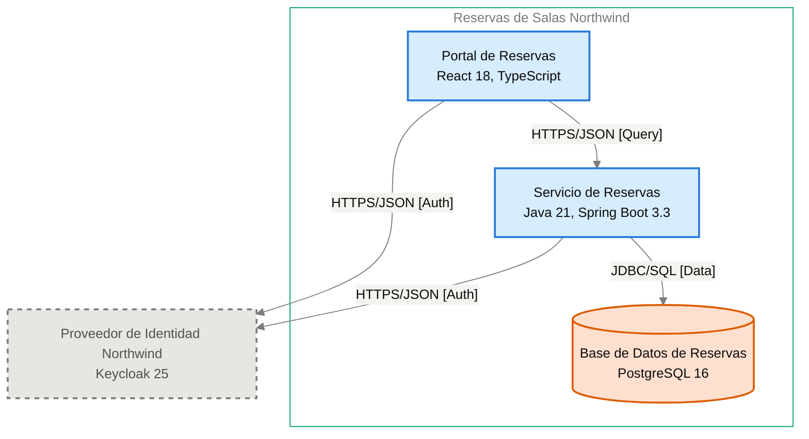

# Especificación de Componente — Servicio de Reservas

<!-- managed by sa-skills:architecture-dev-handoff — do not edit manually -->
<!-- TEMPLATE_VERSION: 4.3.1 -->
| Field | Value |
|-------|-------|
| Componente | Servicio de Reservas |
| Número de componente | 5.2 |
| Equipo | [NOT DOCUMENTED — add **Owner:** field to docs/components/reservas-de-salas-northwind/02-servicio-de-reservas.md] |
| Versión de la Especificación de Componente | 4.3.1 |
| Versión de la Vista de Ejecución | 4.3.1 |
| Versión de los Estándares | 4.3.1 |
| Versión de la arquitectura | 1.0.0 |
| Versión del componente | 1.0.0 |
| Generado | 2026-10-18 |
| Documento fuente del componente | [../docs/components/reservas-de-salas-northwind/02-servicio-de-reservas.md](../docs/components/reservas-de-salas-northwind/02-servicio-de-reservas.md) |

### Índice rápido por rol <!-- SECTION: Role Quick Index -->

| Audience | Read first in this document |
|----------|-----------------------------|
| **Dev** | § 1 Responsabilidad → § 2 Posición → § 3 Contratos propios → § 4 Invariantes → § 7 Restricciones → § 8 Deliberadamente sin especificar |
| **QA** | § 3 Contratos propios → § 4 Invariantes → § 5 Presupuestos → § 9 Aceptación |
| **Ops / SRE** | § 5 Presupuestos → § 7 Restricciones → § 10 Activos |

El orden de lectura de los cuatro documentos del kit está en `../README.md`.

Este es el **panel para este equipo**. Especifica solo intención y restricción. La estructura interna, la
persistencia dentro de los límites propios, el idioma del lenguaje, la organización de módulos y la
estrategia de pruebas quedan deliberadamente sin especificar: son del equipo.

Se lee junto con [`../SYSTEM_RUNTIME_VIEW.md`](../SYSTEM_RUNTIME_VIEW.md) (historia del sistema completo),
[`../CROSS_CUTTING_STANDARDS.md`](../CROSS_CUTTING_STANDARDS.md) (reglas globales) y cada Interface Contract
enlazado (continuidad con los servicios adyacentes).

---

## 1. Responsabilidad <!-- SECTION: Responsibility -->

Servicio de Reservas expone la API REST de disponibilidad, reserva y cancelación de las 42 salas de las 3 sedes, aplica sus reglas y es la única puerta a los datos de la Base de Datos de Reservas (ADR-003). Calcula la disponibilidad por sede, fecha y franja; crea reservas confirmadas sin superposición; cancela reservas (las propias del miembro, o cualquiera de su sede para el rol `recepcion`); valida los tokens con las claves JWKS. NO es responsable de autenticar usuarios (lo hace el Proveedor de Identidad Northwind, ADR-002), de la interfaz de usuario (la sirve el Portal de Reservas) ni de coordinar la integridad contra reservas dobles (la garantiza la restricción de exclusión de la Base de Datos de Reservas, ADR-102).

---

## 2. Posición <!-- SECTION: Position -->

**Aparece en los flujos:** F-01 hop 2, F-01 hop 3, F-02 hop 2, F-02 hop 4, F-03 hop 2, F-03 hop 5

**Interfaces de entrada** (inbound):

- [portal-de-reservas→servicio-de-reservas](../interfaces/portal-de-reservas→servicio-de-reservas.md) — I-02

**Interfaces de salida** (outbound):

- [servicio-de-reservas→base-de-datos-de-reservas](../interfaces/servicio-de-reservas→base-de-datos-de-reservas.md) — I-04

**Interfaces sin Interface Contract**:

- I-03 — saliente hacia Proveedor de Identidad Northwind · HTTPS/JSON [Auth] — sin Interface Contract; pendiente, falla cerrado

**Panel** — este componente y sus vecinos en el diagrama de contenedores, recortado de `docs/03` (generado, nunca se edita a mano):

Cut of `docs/03-architecture-layers.md` § Diagram: C4 Level 2 — Container — Servicio de Reservas and its neighbours (generated, never hand-edited):

---

## 3. Contratos propios <!-- SECTION: Contracts Owned -->

Contratos que este componente publica. Los esquemas viven en los activos enlazados; esta tabla lista solo títulos, versiones y consumidores.

| Contract | Version | Consumers | Asset |
|----------|--------:|-----------|-------|
| API REST de disponibilidad, reserva y cancelación (OpenAPI 3.1, I-02) | [NOT DOCUMENTED — add the contract version to docs/components/reservas-de-salas-northwind/02-servicio-de-reservas.md] | Portal de Reservas | [openapi.yaml](assets/02-servicio-de-reservas/openapi.yaml) |

---

## 4. Invariantes <!-- SECTION: Invariants -->

Condiciones que se cumplen en todo momento, sin importar la implementación.
Cada invariante es un enunciado verificable: QA cubre cada una con una prueba.

- **INV-01** El servicio calcula la disponibilidad de salas por sede, fecha y franja.
- **INV-02** Nunca existen dos reservas confirmadas superpuestas para la misma sala; la Base de Datos de Reservas rechaza la superposición con una restricción de exclusión ([ADR-102](../../adr/ADR-102-impedir-reservas-dobles-con-restriccion-de-exclusion-en.md)).
- **INV-03** Un miembro cancela solo sus propias reservas; el rol `recepcion` cancela cualquiera de su sede.
- **INV-04** El servicio valida el token JWT (RS256) con las claves JWKS en cada solicitud; sin token válido responde 401 ([ADR-002](../../adr/ADR-002-oidc-keycloak-identity.md)).
- **INV-05** La creación de reservas acepta la cabecera `Idempotency-Key` ([ADR-103](../../adr/ADR-103-idempotencia-de-la-creacion-de-reservas-con-clave.md)).
- **INV-06** Los errores siguen RFC 9457 (`application/problem+json`) con un campo `code` estable ([ADR-001](../../adr/ADR-001-rest-openapi-apis.md)).
- **INV-07** Ningún otro servicio lee ni escribe las tablas de la Base de Datos de Reservas ([ADR-003](../../adr/ADR-003-postgresql-relational-store.md)).
- **INV-08** Los logs nunca incluyen tokens ni datos personales completos ([ADR-004](../../adr/ADR-004-opentelemetry-observability.md)).
- **INV-09** El servicio corre con al menos 2 réplicas en zonas distintas ([ADR-005](../../adr/ADR-005-kubernetes-container-runtime.md)).

---

## 5. Presupuestos (de la descomposición) <!-- SECTION: Budgets -->

Tomados de [`../SYSTEM_RUNTIME_VIEW.md § Budget Decomposition`](../SYSTEM_RUNTIME_VIEW.md#budget-decomposition)
en las filas que referencian este componente. No se repite el SLO global; solo la asignación de este componente.

| Aspect | Allocation | Source |
|--------|-----------:|--------|
| Latencia p99 | [NOT DOCUMENTED — run /sa-analysis:architecture-analysis latency-budget] | [SYSTEM_RUNTIME_VIEW.md § Budget Decomposition](../SYSTEM_RUNTIME_VIEW.md#budget-decomposition) |
| Error budget | [NOT DOCUMENTED — run /sa-analysis:architecture-analysis latency-budget] | [SYSTEM_RUNTIME_VIEW.md § Budget Decomposition](../SYSTEM_RUNTIME_VIEW.md#budget-decomposition) |
| Throughput (pico) | [NOT DOCUMENTED — run /sa-analysis:architecture-analysis latency-budget] | [SYSTEM_RUNTIME_VIEW.md § Budget Decomposition](../SYSTEM_RUNTIME_VIEW.md#budget-decomposition) |
| Throughput (sostenido) | [NOT DOCUMENTED — run /sa-analysis:architecture-analysis latency-budget] | [SYSTEM_RUNTIME_VIEW.md § Budget Decomposition](../SYSTEM_RUNTIME_VIEW.md#budget-decomposition) |
| Techo de costo | [NOT DOCUMENTED — run /sa-analysis:architecture-analysis latency-budget] | [SYSTEM_RUNTIME_VIEW.md § Budget Decomposition](../SYSTEM_RUNTIME_VIEW.md#budget-decomposition) |

Meta de negocio documentada: tiempo de confirmación de reservas p95 ≤ 2 s (PO Spec §8).

---

## 6. Propiedad de datos <!-- SECTION: Data Ownership -->

Propiedad exclusiva. No hay propiedad mutable compartida en ninguna parte del sistema.

**Es dueño de (fuente autoritativa):**

- Salas y reservas, almacenadas en la Base de Datos de Reservas ([ADR-003](../../adr/ADR-003-postgresql-relational-store.md)).

**Lee (vía contrato, no es dueño):**

- Claves públicas JWKS del Proveedor de Identidad Northwind, vía I-03 (sin Interface Contract; ver § 2).

**No debe acceder a:**

Sin prohibiciones explícitas.

---

## 7. Restricciones <!-- SECTION: Constraints -->

Cada restricción tiene una razón (regla de Cross-Cutting Standards, ADR o invariante).
Una restricción sin razón es deriva en espera: se cita una o se elimina la fila.

**Obligatorias:**

- Java 21 y Spring Boot 3.3, desplegado como contenedor Docker — per la tecnología del documento fuente del componente.
- API REST sobre HTTPS con cuerpos JSON y contrato OpenAPI 3.1 escrito antes que el código; versión mayor en la ruta (`/v1/…`) — per [ADR-001](../../adr/ADR-001-rest-openapi-apis.md).
- Autenticación con token JWT del Proveedor de Identidad Northwind, validado con JWKS — per [ADR-002](../../adr/ADR-002-oidc-keycloak-identity.md).
- PostgreSQL 16 por JDBC, esquema propio con migraciones Flyway y restricciones de integridad declaradas en la base — per [ADR-003](../../adr/ADR-003-postgresql-relational-store.md).
- Trazas, métricas y logs con OpenTelemetry, W3C Trace Context y métricas RED por operación — per [ADR-004](../../adr/ADR-004-opentelemetry-observability.md).
- Clúster Kubernetes de Plataforma Northwind con al menos 2 réplicas en zonas distintas, solicitudes y límites de CPU y memoria, y sondas de vida y disponibilidad — per [ADR-005](../../adr/ADR-005-kubernetes-container-runtime.md).
- Restricción de exclusión de PostgreSQL contra reservas dobles (ADR en estado Proposed) — per [ADR-102](../../adr/ADR-102-impedir-reservas-dobles-con-restriccion-de-exclusion-en.md).

**Prohibidas:**

- Registrar tokens o datos personales completos en los logs — per [ADR-004](../../adr/ADR-004-opentelemetry-observability.md).
- Que otro servicio lea o escriba directamente las tablas de la Base de Datos de Reservas — per [ADR-003](../../adr/ADR-003-postgresql-relational-store.md).
- Coordinar en el código del servicio la integridad contra superposición — per [ADR-102](../../adr/ADR-102-impedir-reservas-dobles-con-restriccion-de-exclusion-en.md).

---

## 8. Deliberadamente sin especificar <!-- SECTION: Deliberately Unspecified -->

El equipo es dueño de las siguientes decisiones:

- Estructura interna (organización de módulos, límites de paquetes)
- Elección de persistencia dentro del límite propio
- Idioma del lenguaje y subconjunto del framework
- Estrategia de pruebas (reparto unitarias vs integración, herramientas)
- Caché local, pooling en proceso

Sobreespecificar aquí reemplazaría el criterio por prescripción. Si te encuentras especificando
alguno de los puntos anteriores, escala: pertenece a Cross-Cutting Standards (si es de toda la
institución) o a un ADR (si es de todo el proyecto), no a una Especificación de Componente.

---

## 9. Aceptación <!-- SECTION: Acceptance -->

- [ ] Contratos del § 3 publicados y verificados por los consumidores
- [ ] Presupuestos del § 5 demostrados bajo carga
- [ ] Invariantes del § 4 cubiertas por pruebas
- [ ] Semántica de fallo de las interfaces ejercitada (inyección de fallos según el Interface Contract)
- [ ] Conformidad con Cross-Cutting Standards verificada; toda desviación registrada según [`../CROSS_CUTTING_STANDARDS.md § Deviations`](../CROSS_CUTTING_STANDARDS.md#deviations)

---

## 10. Activos <!-- SECTION: Assets -->

Activos entregables generados junto con esta Especificación de Componente.

| Asset | File | Description |
|-------|------|-------------|
| OpenAPI Spec | [openapi.yaml](assets/02-servicio-de-reservas/openapi.yaml) | Contrato de API REST |
| C4 Component Descriptor | [c4-descriptor.md](assets/02-servicio-de-reservas/c4-descriptor.md) | Resumen operativo para SRE e infraestructura |

Los activos viven en `handoffs/assets/02-servicio-de-reservas/`.

---

## 11. Preguntas abiertas <!-- SECTION: Open Questions -->

Vacíos detectados al generar la Especificación de Componente: valores ausentes de la documentación de arquitectura o de los artefactos previos (Runtime View, Cross-Cutting Standards, Interface Contracts).

| Section | What is missing | Where to fix it | What it blocks |
|---------|-----------------|-----------------|----------------|
| § Position | ID del diagrama del Panel, asignado por el registro de diagramas | `docs/03-architecture-layers.md` § Diagram: C4 Level 2 — Container | Referenciar el diagrama de forma estable |
| § Contracts Owned | Versión del contrato de la API REST | `docs/components/reservas-de-salas-northwind/02-servicio-de-reservas.md` § Especificación de API | Versionado y verificación de consumidores |
| § Budgets | Asignación de latencia p99 | `/sa-analysis:architecture-analysis latency-budget` | Prueba de carga del presupuesto |
| § Budgets | Error budget | `/sa-analysis:architecture-analysis latency-budget` | Criterio de aceptación de disponibilidad |
| § Budgets | Throughput (pico) | `/sa-analysis:architecture-analysis latency-budget` | Dimensionado de réplicas |
| § Budgets | Throughput (sostenido) | `/sa-analysis:architecture-analysis latency-budget` | Dimensionado de réplicas |
| § Budgets | Techo de costo | `/sa-analysis:architecture-analysis latency-budget` | Revisión de costo del despliegue |
| Assets — openapi.yaml | Método y ruta de Consultar disponibilidad (CU1) | docs/components/reservas-de-salas-northwind/02-servicio-de-reservas.md § Especificación de API | No se puede definir la operación. `paths` queda vacío. |
| Assets — openapi.yaml | Método y ruta de Crear reserva (CU2) | docs/components/reservas-de-salas-northwind/02-servicio-de-reservas.md § Especificación de API | No se puede definir la operación. Falta también el cuerpo y la cabecera `Idempotency-Key` (ADR-103). |
| Assets — openapi.yaml | Método y ruta de Cancelar reserva (CU3) | docs/components/reservas-de-salas-northwind/02-servicio-de-reservas.md § Especificación de API | No se puede definir la operación. |
| Assets — openapi.yaml | Esquemas de solicitud y respuesta | docs/05-integration-points.md (bloque I-02) y el archivo del componente | `components.schemas` queda vacío. |
| Assets — openapi.yaml | URL base del servidor | docs/components/reservas-de-salas-northwind/02-servicio-de-reservas.md | Se omite `servers`. |
| Assets — openapi.yaml | Versión de la API | docs/components/reservas-de-salas-northwind/02-servicio-de-reservas.md | `info.version` es `NOT-DOCUMENTED`. |
| Assets — c4-descriptor.md | Responsable | agregar `**Owner:**` a docs/components/reservas-de-salas-northwind/02-servicio-de-reservas.md | escalamiento y propiedad en la CMDB |
| Assets — c4-descriptor.md | Host · IP · SO · Dominio | docs/09-operational-considerations.md | registro en la CMDB y reglas de red |
| Assets — security.md | Authentication I-02 | authentication of I-02: state it in docs/07-security-architecture.md | la interfaz falla cerrada: no se abre sin su autenticación |
| Assets — security.md | Authentication I-03 | authentication of I-03: state it in docs/07-security-architecture.md | la interfaz falla cerrada: no se abre sin su autenticación |
| Assets — security.md | Authentication I-04 | authentication of I-04: state it in docs/07-security-architecture.md | la interfaz falla cerrada: no se abre sin su autenticación |
| Assets — security.md | STRIDE | analysis/STRIDE-*.md — run /sa-analysis:architecture-analysis stride | se desconocen las amenazas que la construcción debe mitigar |
| Assets — security.md | Data Sensitivity | analysis/DATA-SENSITIVITY-*.md — run /sa-analysis:architecture-analysis data-sensitivity | se desconoce la clasificación de los datos que maneja el componente |

---

*Generated by `sa-skills:architecture-dev-handoff` on 2026-10-18*
*Source: /home/runner/work/northwind-reservas/northwind-reservas/ARCHITECTURE.md*
