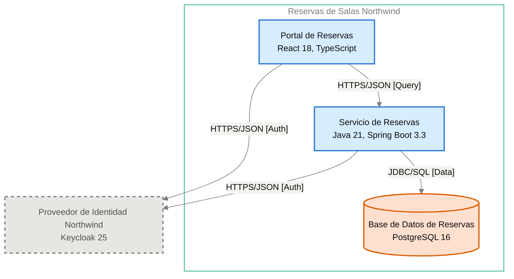

# Especificación de Componente — Servicio de Reservas

<!-- managed by sa-skills:architecture-dev-handoff — do not edit manually -->
<!-- TEMPLATE_VERSION: 4.3.1 -->
| Field | Value |
|-------|-------|
| Componente | Servicio de Reservas |
| Número de componente | 5.2 |
| Equipo | [NOT DOCUMENTED — add **Owner:** field to docs/components/reservas-de-salas-northwind/02-servicio-de-reservas.md] |
| Versión de la Especificación de Componente | 4.3.1 |
| Versión de la Vista de Ejecución | 4.3.1 |
| Versión de los Estándares | 4.3.1 |
| Versión de la arquitectura | 1.2.0 |
| Versión del componente | 1.1.1 |
| Generado | 2026-10-19 |
| Documento fuente del componente | [docs/components/reservas-de-salas-northwind/02-servicio-de-reservas.md](../../docs/components/reservas-de-salas-northwind/02-servicio-de-reservas.md) |

### Índice rápido por rol <!-- SECTION: Role Quick Index -->

| Audience | Read first in this document |
|----------|-----------------------------|
| **Dev** | § 1 Responsabilidad → § 2 Posición → § 3 Contratos propios → § 4 Invariantes → § 7 Restricciones → § 8 Deliberadamente no especificado |
| **QA** | § 3 Contratos propios → § 4 Invariantes → § 5 Presupuestos → § 9 Aceptación |
| **Ops / SRE** | § 5 Presupuestos → § 7 Restricciones → § 10 Assets |

El orden de lectura de los cuatro documentos del kit está en `../README.md`.

Este documento es el **panel para este equipo**. Especifica solo intención y restricción. Estructura interna, elección de persistencia dentro de los límites propios, idioma del lenguaje, organización de módulos y estrategia de pruebas quedan deliberadamente sin especificar: son decisión del equipo.

Se lee junto con [`../SYSTEM_RUNTIME_VIEW.md`](../SYSTEM_RUNTIME_VIEW.md) (relato del sistema completo), [`../CROSS_CUTTING_STANDARDS.md`](../CROSS_CUTTING_STANDARDS.md) (reglas globales) y cada Interface Contract enlazado (continuidad con los servicios adyacentes).

---

## 1. Responsabilidad <!-- SECTION: Responsibility -->

Servicio de Reservas es responsable de calcular la disponibilidad de las 42 salas de las 3 sedes por sede, fecha y franja; de crear reservas confirmadas sin superposición para la misma sala; de cancelar reservas (las propias del miembro, o cualquiera de su sede para el rol `recepcion`); y de validar los tokens del Proveedor de Identidad Northwind con sus claves JWKS. Es dueño exclusivo de la Base de Datos de Reservas (ADR-003). [NOT DOCUMENTED — add a not-accountable clause to docs/components/reservas-de-salas-northwind/02-servicio-de-reservas.md]

---

## 2. Posición <!-- SECTION: Position -->

**Aparece en los flujos:** F-01 hop 2 (Validación del token), F-01 hop 3 (Consulta de disponibilidad), F-02 hop 2 (Validación del token), F-02 hop 4 (Creación de reserva), F-03 hop 2 (Validación del token), F-03 hop 5 (Cancelación de reserva).

**Interfaces entrantes** (upstream):

- [portal-de-reservas→servicio-de-reservas](../interfaces/portal-de-reservas→servicio-de-reservas.md) — I-02

**Interfaces salientes** (downstream):

- [servicio-de-reservas→base-de-datos-de-reservas](../interfaces/servicio-de-reservas→base-de-datos-de-reservas.md) — I-04

**Interfaces sin Interface Contract**:

- I-03 — saliente hacia Proveedor de Identidad Northwind · HTTPS/JSON [Auth] — sin Interface Contract; pendiente, falla cerrada

**Panel** — este componente y sus vecinos en el diagrama de contenedores, recortado de `docs/03` (generado, nunca se edita a mano):

Cut of `docs/03-architecture-layers.md` § Diagram: C4 Level 2 — Container — Servicio de Reservas and its neighbours (generated, never hand-edited):

---

## 3. Contratos propios <!-- SECTION: Contracts Owned -->

Contratos que este componente publica. Los esquemas viven en los assets enlazados; esta tabla lista solo títulos, versiones y consumidores.

| Contract | Version | Consumers | Asset |
|----------|--------:|-----------|-------|
| API REST de disponibilidad, reserva y cancelación (OpenAPI 3.1, ruta `/v1`) | 1.0.0 | Portal de Reservas | [openapi.yaml](assets/02-servicio-de-reservas/openapi.yaml) |

---

## 4. Invariantes <!-- SECTION: Invariants -->

Condiciones que se cumplen en todo momento, sin importar la implementación. Cada invariante es verificable; QA cubre cada una con una prueba.

- **INV-01** El servicio calcula la disponibilidad por sede (`centro`, `norte`, `puerto`), fecha y franja; las franjas son múltiplos de 30 minutos, de 8 horas o menos y nunca en el pasado.
- **INV-02** Cuando no hay salas libres, `AvailabilityResponse` devuelve hasta 3 `suggestedSlots` de la misma duración, día y sede, las más próximas a la pedida; ante igual distancia, la posterior.
- **INV-03** Nunca coexisten dos reservas confirmadas superpuestas para la misma sala; la Base de Datos de Reservas rechaza la superposición con una restricción de exclusión y el servicio responde `ROOM_OCCUPIED` (409), per [ADR-102](../../adr/ADR-102-impedir-reservas-dobles-con-restriccion-de-exclusion-en.md).
- **INV-04** Un miembro no tiene más de 3 reservas futuras en un mismo día; la cuarta responde `DAILY_LIMIT_REACHED` (409).
- **INV-05** `POST /v1/bookings` exige la cabecera `Idempotency-Key` (UUID v4); la misma clave en 24 horas devuelve la respuesta guardada y no crea otra reserva, per [ADR-103](../../adr/ADR-103-idempotencia-de-la-creacion-de-reservas-con-clave.md).
- **INV-06** Solo el dueño de la reserva, o un token con rol `recepcion` cuyo atributo `sede` coincide con la sede de la sala, cancela una reserva; en otro caso responde `FORBIDDEN` (403) y la reserva sigue `confirmed`, per [ADR-105](../../adr/ADR-105-autorizacion-por-rol-recepcion-y-atributo-sede-del.md).
- **INV-07** La cancelación por el rol `recepcion` exige `reason` de 10 a 120 caracteres; si falta o excede el rango responde `VALIDATION_FAILED` (400).
- **INV-08** Toda cancelación escribe su registro de auditoría en la misma transacción, per [ADR-106](../../adr/ADR-106-retencion-de-24-meses-purga-de-datos-y.md).
- **INV-09** Reservas y registro de auditoría se conservan 24 meses; una purga programada los elimina, per ADR-106.
- **INV-10** Cada solicitud valida el JWT (RS256) con las claves JWKS del Proveedor de Identidad Northwind; token ausente, inválido o expirado responde `UNAUTHENTICATED` (401), per [ADR-002](../../adr/ADR-002-oidc-keycloak-identity.md).
- **INV-11** Todo error usa RFC 9457 (`application/problem+json`) con un campo `code` estable, per [ADR-001](../../adr/ADR-001-rest-openapi-apis.md).
- **INV-12** Ningún otro servicio lee ni escribe las tablas del servicio, per [ADR-003](../../adr/ADR-003-postgresql-relational-store.md).
- **INV-13** Los logs no incluyen tokens ni datos personales completos, per [ADR-004](../../adr/ADR-004-opentelemetry-observability.md).

---

## 5. Presupuestos (de la descomposición) <!-- SECTION: Budgets -->

Tomados de [`../SYSTEM_RUNTIME_VIEW.md § Budget Decomposition`](../SYSTEM_RUNTIME_VIEW.md#budget-decomposition), filas que referencian este componente. No se repite el SLO global; solo la asignación de este componente.

| Aspect | Allocation | Source |
|--------|-----------:|--------|
| Latencia p99 | [NOT DOCUMENTED — run /sa-analysis:architecture-analysis latency-budget] | [SYSTEM_RUNTIME_VIEW.md § Budget Decomposition](../SYSTEM_RUNTIME_VIEW.md#budget-decomposition) |
| Error budget | [NOT DOCUMENTED — run /sa-analysis:architecture-analysis latency-budget] | [SYSTEM_RUNTIME_VIEW.md § Budget Decomposition](../SYSTEM_RUNTIME_VIEW.md#budget-decomposition) |
| Throughput (pico) | [NOT DOCUMENTED — run /sa-analysis:architecture-analysis latency-budget] | [SYSTEM_RUNTIME_VIEW.md § Budget Decomposition](../SYSTEM_RUNTIME_VIEW.md#budget-decomposition) |
| Throughput (sostenido) | [NOT DOCUMENTED — run /sa-analysis:architecture-analysis latency-budget] | [SYSTEM_RUNTIME_VIEW.md § Budget Decomposition](../SYSTEM_RUNTIME_VIEW.md#budget-decomposition) |
| Techo de costo | [NOT DOCUMENTED — run /sa-analysis:architecture-analysis latency-budget] | [SYSTEM_RUNTIME_VIEW.md § Budget Decomposition](../SYSTEM_RUNTIME_VIEW.md#budget-decomposition) |

Los presupuestos por salto Portal de Reservas → Servicio de Reservas y Servicio de Reservas → Base de Datos de Reservas no están documentados. El salto hacia el Proveedor de Identidad Northwind (JWKS) queda fuera del camino crítico salvo en la carga de claves.

---

## 6. Propiedad de datos <!-- SECTION: Data Ownership -->

Propiedad exclusiva. No existe propiedad mutable compartida en el sistema.

**Es dueño de (fuente autoritativa):**

- Salas
- Reservas, con su cancelación y motivo
- Registro de auditoría de cancelaciones
- Claves de idempotencia con su respuesta, durante 24 horas

Todo se guarda en la Base de Datos de Reservas (ADR-003).

**Lee (vía contrato, no es dueño):**

- Claves públicas JWKS del Proveedor de Identidad Northwind, vía I-03 (sin Interface Contract, ver § 2).
- `sub`, rol `recepcion` y atributo `sede` del JWT validado, per ADR-002 y ADR-105.

**No debe acceder a:**

Sin prohibiciones explícitas.

---

## 7. Restricciones <!-- SECTION: Constraints -->

Cada restricción tiene una razón (regla de Cross-Cutting Standards, ADR o invariante). Una restricción sin razón se vuelve deriva; se cita una o se elimina la fila.

**Obligatorio:**

- Java 21 y Spring Boot 3.3 — per [docs/components/reservas-de-salas-northwind/02-servicio-de-reservas.md](../../docs/components/reservas-de-salas-northwind/02-servicio-de-reservas.md)
- API REST sobre HTTPS con cuerpos JSON y contrato OpenAPI 3.1 escrito antes que el código; versión mayor en la ruta (`/v1`) — per [ADR-001](../../adr/ADR-001-rest-openapi-apis.md)
- Autenticación con JWT del Proveedor de Identidad Northwind, validado en cada solicitud con JWKS — per [ADR-002](../../adr/ADR-002-oidc-keycloak-identity.md)
- PostgreSQL 16 vía JDBC con TLS; esquema versionado con migraciones Flyway; integridad (no superposición) declarada en la base — per [ADR-003](../../adr/ADR-003-postgresql-relational-store.md) y [ADR-102](../../adr/ADR-102-impedir-reservas-dobles-con-restriccion-de-exclusion-en.md)
- Trazas, métricas RED y logs JSON con OpenTelemetry; contexto W3C Trace Context — per [ADR-004](../../adr/ADR-004-opentelemetry-observability.md)
- Contenedor Docker en el clúster Kubernetes de Plataforma Northwind, con al menos 2 réplicas en zonas distintas, solicitudes y límites de CPU y memoria, y sondas de vida y de disponibilidad — per [ADR-005](../../adr/ADR-005-kubernetes-container-runtime.md)

**Prohibido:**

- Acceso de otro servicio a las tablas del servicio — per [ADR-003](../../adr/ADR-003-postgresql-relational-store.md)
- Tokens o datos personales completos en los logs — per [ADR-004](../../adr/ADR-004-opentelemetry-observability.md)

---

## 8. Deliberadamente no especificado <!-- SECTION: Deliberately Unspecified -->

El equipo es dueño de las siguientes decisiones:

- Estructura interna (organización de módulos, límites de paquetes)
- Elección de persistencia dentro del límite propio
- Idioma del lenguaje y subconjunto del framework
- Estrategia de pruebas (reparto unitarias vs integración, herramientas)
- Caché local, pooling en proceso

Sobreespecificar aquí reemplazaría el criterio por la prescripción. Si te encuentras especificando alguno de los puntos anteriores, escala: pertenece a Cross-Cutting Standards (si es institucional) o a un ADR (si es del proyecto), no a una Especificación de Componente.

---

## 9. Aceptación <!-- SECTION: Acceptance -->

- [ ] Contratos del § 3 publicados y verificados por los consumidores
- [ ] Presupuestos del § 5 demostrados bajo carga
- [ ] Invariantes del § 4 cubiertas por pruebas
- [ ] Semántica de fallo de las interfaces ejercitada (inyección de fallos según cada Interface Contract)
- [ ] Conformidad con Cross-Cutting Standards verificada; toda desviación registrada según [`../CROSS_CUTTING_STANDARDS.md § Deviations`](../CROSS_CUTTING_STANDARDS.md#deviations)

---

## 10. Assets <!-- SECTION: Assets -->

Assets entregables generados junto a esta Especificación de Componente.

| Asset | File | Description |
|-------|------|-------------|
| OpenAPI Spec | [openapi.yaml](assets/02-servicio-de-reservas/openapi.yaml) | Contrato de API REST |
| C4 Component Descriptor | [c4-descriptor.md](assets/02-servicio-de-reservas/c4-descriptor.md) | Ficha operativa para SRE e infraestructura |

Los assets viven en `handoffs/assets/02-servicio-de-reservas/`.

---

## 11. Preguntas abiertas <!-- SECTION: Open Questions -->

Vacíos detectados al generar la Especificación de Componente: valores ausentes en la documentación de arquitectura o en los artefactos de origen (Runtime View, Cross-Cutting Standards, Interface Contracts).

| Section | What is missing | Where to fix it | What it blocks |
|---------|-----------------|-----------------|----------------|
| Metadata | Equipo dueño del componente | `docs/components/reservas-de-salas-northwind/02-servicio-de-reservas.md` (campo **Owner:**) | Asignar responsabilidad del servicio |
| Responsibility | Cláusula de lo que el componente no es responsable | `docs/components/reservas-de-salas-northwind/02-servicio-de-reservas.md` | Acotar el alcance del servicio |
| Position | ID del diagrama del Panel | Registro de diagramas (`docs/03-architecture-layers.md`) | Referenciar el diagrama de forma estable |
| Budgets | Asignación de latencia p99 | `/sa-analysis:architecture-analysis latency-budget` | Pruebas de carga del § 9 |
| Budgets | Error budget | `/sa-analysis:architecture-analysis latency-budget` | Pruebas de carga del § 9 |
| Budgets | Throughput (pico) | `/sa-analysis:architecture-analysis latency-budget` | Dimensionar réplicas |
| Budgets | Throughput (sostenido) | `/sa-analysis:architecture-analysis latency-budget` | Dimensionar réplicas |
| Budgets | Techo de costo | `/sa-analysis:architecture-analysis latency-budget` | Validar el costo del servicio |
| Assets — openapi.yaml | Host del servidor (URL base) | docs/components/reservas-de-salas-northwind/02-servicio-de-reservas.md | Solo se documenta la ruta base `/v1`. `servers` queda vacío y las rutas llevan `/v1`. El equipo no puede configurar los clientes sin el host. |
| Assets — openapi.yaml | Obligatoriedad de los parámetros de consulta site, date, start y end (getAvailability) | docs/components/reservas-de-salas-northwind/02-servicio-de-reservas.md | El contrato no marca esos parámetros como requeridos. El equipo debe confirmar si lo son. |
| Assets — openapi.yaml | Estructura de `equipment` en RoomAvailability | docs/components/reservas-de-salas-northwind/02-servicio-de-reservas.md | El contrato lo modela como lista de valores del enum (`screen`, `videoconference`, `whiteboard`). La documentación no dice si es lista o valor único. |
| Assets — openapi.yaml | Tipo del campo `site` en Booking | docs/components/reservas-de-salas-northwind/02-servicio-de-reservas.md | La documentación nombra el campo pero no su tipo. Solo los parámetros de CU1 enumeran `centro`, `norte` y `puerto`. El campo queda sin `type`. |
| Assets — c4-descriptor.md | Responsable | agregar `**Owner:**` a docs/components/reservas-de-salas-northwind/02-servicio-de-reservas.md | escalamiento y propiedad en la CMDB |
| Assets — c4-descriptor.md | Host · IP · SO · Dominio | docs/09-operational-considerations.md | registro en la CMDB y reglas de red |
| Assets — security.md | Data Sensitivity | analysis/DATA-SENSITIVITY-*.md — run /sa-analysis:architecture-analysis data-sensitivity | se desconoce la clasificación de los datos que maneja el componente |

---

*Generado por `sa-skills:architecture-dev-handoff` el 2026-10-19*
*Fuente: ARCHITECTURE.md*
