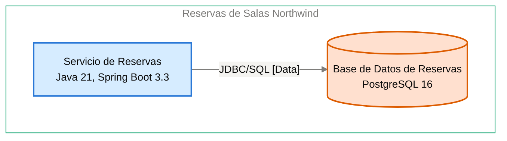

# Especificación de Componente — Base de Datos de Reservas

<!-- managed by sa-skills:architecture-dev-handoff — do not edit manually -->
<!-- TEMPLATE_VERSION: 4.3.1 -->
| Field | Value |
|-------|-------|
| Componente | Base de Datos de Reservas |
| Número de componente | 5.3 |
| Equipo | [NOT DOCUMENTED — add **Owner:** field to docs/components/reservas-de-salas-northwind/03-base-de-datos-de-reservas.md] |
| Versión de la Especificación de Componente | 4.3.1 |
| Versión de la Vista de Ejecución | 4.3.1 |
| Versión de los Estándares | 4.3.1 |
| Versión de la arquitectura | 1.6.0 |
| Versión del componente | 1.0.1 |
| Generado | 2026-10-20 |
| Documento fuente del componente | [../docs/components/03-base-de-datos-de-reservas.md](../docs/components/reservas-de-salas-northwind/03-base-de-datos-de-reservas.md) |

### Índice rápido por rol <!-- SECTION: Role Quick Index -->

| Audience | Read first in this document |
|----------|-----------------------------|
| **Dev** | § 1 Responsabilidad → § 2 Posición → § 3 Contratos propios → § 4 Invariantes → § 7 Restricciones → § 8 Deliberadamente no especificado |
| **QA** | § 3 Contratos propios → § 4 Invariantes → § 5 Presupuestos → § 9 Aceptación |
| **Ops / SRE** | § 5 Presupuestos → § 7 Restricciones → § 10 Activos |

El orden de lectura de los cuatro documentos del kit está en `../README.md`.

Este es el **panel para este equipo**. Especifica solo intención y restricción. La estructura interna, la elección de persistencia dentro de los límites propios, el idioma del lenguaje, la organización de módulos y la estrategia de pruebas quedan deliberadamente sin especificar: son decisiones del equipo.

Léase junto con [`../SYSTEM_RUNTIME_VIEW.md`](../SYSTEM_RUNTIME_VIEW.md) (historia del sistema completo), [`../CROSS_CUTTING_STANDARDS.md`](../CROSS_CUTTING_STANDARDS.md) (reglas globales) y cada Interface Contract enlazado (continuidad con los servicios adyacentes).

---

## 1. Responsabilidad <!-- SECTION: Responsibility -->

Base de Datos de Reservas es la fuente de verdad de las 42 salas de las 3 sedes (con capacidad y equipamiento) y de las reservas con su estado, incluidas las cancelaciones. Rechaza por construcción toda reserva confirmada superpuesta con otra de la misma sala mediante una restricción de exclusión ([ADR-102](../../adr/ADR-102-impedir-reservas-dobles-con-restriccion-de-exclusion-en.md)). NO es responsable de coordinar la integridad ante superposición desde la aplicación: la garantiza el motor, no el Servicio de Reservas. NO es responsable de dar acceso a otros servicios: solo el Servicio de Reservas lee y escribe sus tablas ([ADR-003](../../adr/ADR-003-postgresql-relational-store.md)).

---

## 2. Posición <!-- SECTION: Position -->

**Aparece en los flujos:** F-01 phase 3 (Consulta de disponibilidad), F-02 phase 4 (Creación de reserva), F-03 phase 5 (Cancelación de reserva)

**Interfaces entrantes**:

- [servicio-de-reservas→base-de-datos-de-reservas](../interfaces/servicio-de-reservas→base-de-datos-de-reservas.md) — I-04

**Interfaces salientes**:

Sin interfaces salientes documentadas.

**Interfaces sin Interface Contract**:

Ninguna.

**Panel** — este componente y sus vecinos en el diagrama de contenedores, recortado de `docs/03` (generado, nunca se edita a mano):

Cut of `docs/03-architecture-layers.md` § Diagram: C4 Level 2 — Container — Base de Datos de Reservas and its neighbours (generated, never hand-edited):

---

## 3. Contratos propios <!-- SECTION: Contracts Owned -->

Contratos que este componente publica. Los esquemas viven en los activos enlazados: esta tabla lista solo títulos, versiones y consumidores.

| Contract | Version | Consumers | Asset |
|----------|--------:|-----------|-------|
| — | — | — | Sin contratos propios. |

---

## 4. Invariantes <!-- SECTION: Invariants -->

Condiciones que se cumplen siempre, sea cual sea la implementación. Cada invariante es un enunciado verificable: QA cubre cada uno con una prueba.

- **INV-01** Dos reservas confirmadas de la misma sala nunca se superponen en el tiempo; el motor las rechaza con una restricción de exclusión ([ADR-102](../../adr/ADR-102-impedir-reservas-dobles-con-restriccion-de-exclusion-en.md)).
- **INV-02** Solo el Servicio de Reservas lee y escribe las tablas de Base de Datos de Reservas ([ADR-003](../../adr/ADR-003-postgresql-relational-store.md)).
- **INV-03** La base guarda las 42 salas de las 3 sedes, cada una con capacidad y equipamiento.
- **INV-04** Cada reserva se guarda con su estado; las cancelaciones permanecen registradas.
- **INV-05** El esquema se versiona con migraciones ([ADR-003](../../adr/ADR-003-postgresql-relational-store.md)).
- **INV-06** Las restricciones de integridad que el negocio exige (unicidad, no superposición) se declaran en la base, no solo en el código ([ADR-003](../../adr/ADR-003-postgresql-relational-store.md)).
- **INV-07** La consistencia es fuerte: la integridad ante superposición la garantiza el motor, no la aplicación.

---

## 5. Presupuestos (de la descomposición) <!-- SECTION: Budgets -->

Tomados textualmente de las filas de [`../SYSTEM_RUNTIME_VIEW.md § Budget Decomposition`](../SYSTEM_RUNTIME_VIEW.md#budget-decomposition) que referencian este componente. No se repite el SLO global: solo la asignación de este componente.

| Aspect | Allocation | Source |
|--------|-----------:|--------|
| Latencia p99 | [NOT DOCUMENTED — run /sa-analysis:architecture-analysis latency-budget] | [SYSTEM_RUNTIME_VIEW.md § F-02](../SYSTEM_RUNTIME_VIEW.md#budget-decomposition) |
| Error budget | [NOT DOCUMENTED — run /sa-analysis:architecture-analysis latency-budget] | [SYSTEM_RUNTIME_VIEW.md § F-02](../SYSTEM_RUNTIME_VIEW.md#budget-decomposition) |
| Throughput (pico) | [NOT DOCUMENTED — run /sa-analysis:architecture-analysis latency-budget] | [SYSTEM_RUNTIME_VIEW.md § F-02](../SYSTEM_RUNTIME_VIEW.md#budget-decomposition) |
| Throughput (sostenido) | [NOT DOCUMENTED — run /sa-analysis:architecture-analysis latency-budget] | [SYSTEM_RUNTIME_VIEW.md § F-02](../SYSTEM_RUNTIME_VIEW.md#budget-decomposition) |
| Techo de costo | [NOT DOCUMENTED — run /sa-analysis:architecture-analysis latency-budget] | [SYSTEM_RUNTIME_VIEW.md § F-02](../SYSTEM_RUNTIME_VIEW.md#budget-decomposition) |

Sin análisis de Latency Budget, las filas muestran el marcador `[NOT DOCUMENTED]` y la brecha se repite en § 11. El salto Servicio de Reservas → Base de Datos de Reservas no tiene presupuesto documentado.

---

## 6. Propiedad de datos <!-- SECTION: Data Ownership -->

Propiedad exclusiva. No existe propiedad mutable compartida en el sistema.

**Es dueño de (fuente autoritativa):**

- Salas
- Reservas
- Registro de auditoría de cancelaciones
- Claves de idempotencia

Dueño lógico: Servicio de Reservas ([ADR-003](../../adr/ADR-003-postgresql-relational-store.md)).

**Lee (vía contrato, sin ser dueño):**

Sin lecturas externas.

**No debe acceder a:**

Sin prohibiciones explícitas.

---

## 7. Restricciones <!-- SECTION: Constraints -->

Cada restricción tiene una razón (regla de Cross-Cutting Standards, ADR o invariante). Una restricción sin razón es deriva en espera: se cita una o se elimina la fila.

**Obligatorias:**

- PostgreSQL 16 gestionado por Plataforma Northwind como motor relacional — per [ADR-003](../../adr/ADR-003-postgresql-relational-store.md)
- Esquema versionado con migraciones en el repositorio del servicio (Flyway en Java) — per [ADR-003](../../adr/ADR-003-postgresql-relational-store.md)
- Restricción de exclusión de PostgreSQL contra reservas confirmadas superpuestas de la misma sala — per [ADR-102](../../adr/ADR-102-impedir-reservas-dobles-con-restriccion-de-exclusion-en.md) (estado Accepted)

**Prohibidas:**

Sin prohibiciones explícitas.

---

## 8. Deliberadamente no especificado <!-- SECTION: Deliberately Unspecified -->

El equipo es dueño de las siguientes decisiones:

- Estructura interna (organización de módulos, límites de paquetes)
- Elección de persistencia dentro del límite propio
- Idioma del lenguaje y subconjunto del framework
- Estrategia de pruebas (reparto unitarias vs integración, herramientas)
- Caché local, pooling en proceso

Sobreespecificar aquí reemplazaría el criterio por la prescripción. Si se encuentra especificando alguno de los puntos anteriores, escale: pertenece a Cross-Cutting Standards (si es institucional) o a un ADR (si es del proyecto), no a una Especificación de Componente.

---

## 9. Aceptación <!-- SECTION: Acceptance -->

- [ ] Contracts in § 3 published and consumer-verified
- [ ] Budgets in § 5 demonstrated under load
- [ ] Invariants in § 4 covered by tests
- [ ] Interface failure semantics exercised (fault-injection per Interface Contract)
- [ ] Cross-Cutting Standards conformance checked; any deviation recorded per [`../CROSS_CUTTING_STANDARDS.md § Deviations`](../CROSS_CUTTING_STANDARDS.md#deviations)

---

## 10. Activos <!-- SECTION: Assets -->

Activos entregables generados junto con esta Especificación de Componente.

| Asset | File | Description |
|-------|------|-------------|
| DDL Script | [ddl.sql](assets/03-base-de-datos-de-reservas/ddl.sql) | Esquema de base de datos (CREATE TABLE, índices, restricciones) |
| C4 Component Descriptor | [c4-descriptor.md](assets/03-base-de-datos-de-reservas/c4-descriptor.md) | Ficha operativa para SRE/infraestructura |

Los activos viven en `handoffs/assets/03-base-de-datos-de-reservas/`.

---

## 11. Preguntas abiertas <!-- SECTION: Open Questions -->

Brechas detectadas al generar la Especificación de Componente: valores ausentes de la documentación de arquitectura y de los artefactos de origen.

| Section | What is missing | Where to fix it | What it blocks |
|---------|-----------------|-----------------|----------------|
| Metadata | Equipo propietario del componente | `docs/components/reservas-de-salas-northwind/03-base-de-datos-de-reservas.md`, campo **Owner:** | Asignar responsabilidad del componente |
| Position | ID del diagrama del Panel | Registro de diagramas de `docs/03-architecture-layers.md` | Trazabilidad del diagrama |
| Budgets | Latencia p99 | `/sa-analysis:architecture-analysis latency-budget` | Pruebas de carga de § 9 |
| Budgets | Error budget | `/sa-analysis:architecture-analysis latency-budget` | Pruebas de carga de § 9 |
| Budgets | Throughput (pico) | `/sa-analysis:architecture-analysis latency-budget` | Dimensionamiento de capacidad |
| Budgets | Throughput (sostenido) | `/sa-analysis:architecture-analysis latency-budget` | Dimensionamiento de capacidad |
| Budgets | Techo de costo | `/sa-analysis:architecture-analysis latency-budget` | Control de costo |
| Assets — ddl.sql | Columnas de la tabla salas | docs/components/reservas-de-salas-northwind/03-base-de-datos-de-reservas.md | El equipo no puede crear la tabla. Los docs solo mencionan capacidad y equipamiento, sin nombres ni tipos de columna. |
| Assets — ddl.sql | Columnas de la tabla reservas | docs/components/reservas-de-salas-northwind/03-base-de-datos-de-reservas.md | El equipo no puede crear la tabla. Faltan columnas, tipos, claves y la representación del estado. |
| Assets — ddl.sql | Columnas del registro de auditoría de cancelaciones | docs/components/reservas-de-salas-northwind/03-base-de-datos-de-reservas.md | El equipo no puede crear la tabla de auditoría. Los docs no la describen más allá de su existencia. |
| Assets — ddl.sql | Columnas de las claves de idempotencia | docs/components/reservas-de-salas-northwind/03-base-de-datos-de-reservas.md | El equipo no puede crear la tabla de claves de idempotencia. Los docs no la describen más allá de su existencia. |
| Assets — ddl.sql | Definición de la restricción de exclusión (ADR-102) | docs/components/reservas-de-salas-northwind/03-base-de-datos-de-reservas.md | Faltan las columnas, el tipo de rango y el predicado de estado confirmado. La restricción EXCLUDE no se puede escribir. |
| Assets — c4-descriptor.md | Responsable | agregar `**Owner:**` a docs/components/reservas-de-salas-northwind/03-base-de-datos-de-reservas.md | escalamiento y propiedad en la CMDB |
| Assets — c4-descriptor.md | Capacidad | docs/components/reservas-de-salas-northwind/03-base-de-datos-de-reservas.md § Capacity <!-- LABEL: Capacity --> | dimensionamiento y planificación de capacidad |
| Assets — c4-descriptor.md | Host · IP · SO · Dominio | docs/09-operational-considerations.md | registro en la CMDB y reglas de red |
| Assets — security.md | Data Sensitivity | analysis/DATA-SENSITIVITY-*.md — run /sa-analysis:architecture-analysis data-sensitivity | se desconoce la clasificación de los datos que maneja el componente |

---

*Generated by `sa-skills:architecture-dev-handoff` on 2026-10-20*
*Source: /home/runner/work/northwind-reservas/northwind-reservas/ARCHITECTURE.md*
