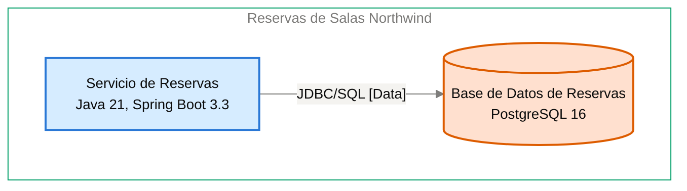

# Especificación de Componente — Base de Datos de Reservas

<!-- managed by sa-skills:architecture-dev-handoff — do not edit manually -->
<!-- TEMPLATE_VERSION: 4.3.1 -->
| Field | Value |
|-------|-------|
| Componente | Base de Datos de Reservas |
| Número de componente | 5.3 |
| Equipo | [NOT DOCUMENTED — add **Owner:** field to docs/components/03-base-de-datos-de-reservas.md] |
| Versión de la Especificación de Componente | 4.3.1 |
| Versión de la Vista de Ejecución | 4.3.1 |
| Versión de los Estándares | 4.3.1 |
| Versión de la arquitectura | 1.0.0 |
| Versión del componente | 1.0.1 |
| Generado | 2026-10-18 |
| Documento fuente del componente | [../../docs/components/reservas-de-salas-northwind/03-base-de-datos-de-reservas.md](../../docs/components/reservas-de-salas-northwind/03-base-de-datos-de-reservas.md) |

### Índice rápido por rol <!-- SECTION: Role Quick Index -->

| Audience | Read first in this document |
|----------|-----------------------------|
| **Dev** | § 1 Responsabilidad → § 2 Posición → § 3 Contratos propios → § 4 Invariantes → § 7 Restricciones → § 8 Deliberadamente sin especificar |
| **QA** | § 3 Contratos propios → § 4 Invariantes → § 5 Presupuestos → § 9 Aceptación |
| **Ops / SRE** | § 5 Presupuestos → § 7 Restricciones → § 10 Activos |

El orden de lectura de los cuatro documentos del kit está en `../README.md`.

Este documento es el **panel para este equipo**. Especifica solo intención y restricciones. La estructura interna, la elección de persistencia dentro de los límites propios, el idioma de código, la organización de módulos y la estrategia de pruebas quedan deliberadamente sin especificar: son del equipo.

Se lee junto con [`../SYSTEM_RUNTIME_VIEW.md`](../SYSTEM_RUNTIME_VIEW.md) (visión del sistema completo), [`../CROSS_CUTTING_STANDARDS.md`](../CROSS_CUTTING_STANDARDS.md) (reglas globales) y cada Contrato de Interfaz enlazado (continuidad con los servicios vecinos).

---

## 1. Responsabilidad <!-- SECTION: Responsibility -->

Base de Datos de Reservas es la fuente de verdad de las 42 salas de las 3 sedes y de las reservas con su estado, incluidas las cancelaciones. Rechaza por construcción, con una restricción de exclusión de PostgreSQL 16, toda reserva confirmada superpuesta con otra de la misma sala ([ADR-102](../../adr/ADR-102-impedir-reservas-dobles-con-restriccion-de-exclusion-en.md)). NO es responsable de la lógica de negocio ni de la coordinación de reservas (a cargo de Servicio de Reservas), ni de ofrecer acceso de lectura o escritura a ningún otro servicio ([ADR-003](../../adr/ADR-003-postgresql-relational-store.md)).

---

## 2. Posición <!-- SECTION: Position -->

**Aparece en los flujos:** F-01 hop 3 (Consulta de disponibilidad), F-02 hop 4 (Creación de reserva), F-03 hop 5 (Cancelación de reserva)

**Interfaces entrantes**:

- [servicio-de-reservas→base-de-datos-de-reservas](../interfaces/servicio-de-reservas→base-de-datos-de-reservas.md) — I-04

**Interfaces salientes**:

No hay interfaces salientes documentadas.

**Interfaces sin Contrato de Interfaz**:

Ninguna.

**Panel** — este componente y sus vecinos en el diagrama de contenedores, recortado de `docs/03` (generado, nunca se edita a mano):

Cut of `docs/03-architecture-layers.md` § Diagram: C4 Level 2 — Container — Base de Datos de Reservas and its neighbours (generated, never hand-edited):

---

## 3. Contratos propios <!-- SECTION: Contracts Owned -->

Contratos que este componente publica. Los esquemas viven en los archivos de activos enlazados: esta tabla lista solo títulos, versiones y consumidores.

| Contract | Version | Consumers | Asset |
|----------|--------:|-----------|-------|
| — | — | — | Sin contratos propios. |

---

## 4. Invariantes <!-- SECTION: Invariants -->

Condiciones que se cumplen siempre, con independencia de la implementación. Cada invariante es un enunciado verificable: QA cubre cada uno con una prueba.

- **INV-01** La base guarda las 42 salas de las 3 sedes, con capacidad y equipamiento.
- **INV-02** La base guarda cada reserva con su estado, incluidas las cancelaciones.
- **INV-03** La base rechaza, con una restricción de exclusión, toda reserva confirmada que se superponga con otra confirmada de la misma sala ([ADR-102](../../adr/ADR-102-impedir-reservas-dobles-con-restriccion-de-exclusion-en.md)).
- **INV-04** La integridad ante superposición la garantiza el motor, no la aplicación.
- **INV-05** Solo Servicio de Reservas lee y escribe las tablas de la base ([ADR-003](../../adr/ADR-003-postgresql-relational-store.md)).
- **INV-06** La consistencia es fuerte en toda lectura y escritura.
- **INV-07** El esquema cambia solo mediante migraciones versionadas ([ADR-003](../../adr/ADR-003-postgresql-relational-store.md)).

---

## 5. Presupuestos (de la descomposición) <!-- SECTION: Budgets -->

Tomados textualmente de [`../SYSTEM_RUNTIME_VIEW.md § Budget Decomposition`](../SYSTEM_RUNTIME_VIEW.md#budget-decomposition), filas que referencian este componente. No se repite el SLO global: solo la asignación de este componente.

| Aspect | Allocation | Source |
|--------|-----------:|--------|
| Latencia p99 | [NOT DOCUMENTED — run /sa-analysis:architecture-analysis latency-budget] | [`SYSTEM_RUNTIME_VIEW.md`](../SYSTEM_RUNTIME_VIEW.md) hop Servicio de Reservas → Base de Datos de Reservas |
| Error budget | [NOT DOCUMENTED — run /sa-analysis:architecture-analysis latency-budget] | [`SYSTEM_RUNTIME_VIEW.md`](../SYSTEM_RUNTIME_VIEW.md) |
| Throughput (pico) | [NOT DOCUMENTED — run /sa-analysis:architecture-analysis latency-budget] | [`SYSTEM_RUNTIME_VIEW.md`](../SYSTEM_RUNTIME_VIEW.md) |
| Throughput (sostenido) | [NOT DOCUMENTED — run /sa-analysis:architecture-analysis latency-budget] | [`SYSTEM_RUNTIME_VIEW.md`](../SYSTEM_RUNTIME_VIEW.md) |
| Techo de costo | [NOT DOCUMENTED — run /sa-analysis:architecture-analysis latency-budget] | [`SYSTEM_RUNTIME_VIEW.md`](../SYSTEM_RUNTIME_VIEW.md) |

Si falta el análisis de Latency Budget, las filas muestran `[NOT DOCUMENTED — run /sa-analysis:architecture-analysis latency-budget]` y la brecha se repite en § 11.

---

## 6. Propiedad de datos <!-- SECTION: Data Ownership -->

Propiedad exclusiva. No existe propiedad mutable compartida en el sistema.

**Es dueño de (fuente autoritativa):**

Ningún dato de negocio. El dueño de los datos que guarda es Servicio de Reservas ([ADR-003](../../adr/ADR-003-postgresql-relational-store.md)), según la tabla de propiedad del Contrato de Interfaz [servicio-de-reservas→base-de-datos-de-reservas](../interfaces/servicio-de-reservas→base-de-datos-de-reservas.md).

**Guarda (sin ser dueño; dueño: Servicio de Reservas):**

- Salas
- Reservas
- Registro de auditoría de cancelaciones
- Claves de idempotencia

**Garantiza:**

- La restricción de exclusión que rechaza dos reservas confirmadas superpuestas de una sala ([ADR-102](../../adr/ADR-102-impedir-reservas-dobles-con-restriccion-de-exclusion-en.md)).

**Lee (vía contrato, no es dueño):**

No hay lecturas externas.

**No debe acceder a:**

- Las tablas de cualquier otro servicio — cada servicio es dueño de su esquema ([ADR-003](../../adr/ADR-003-postgresql-relational-store.md)).

---

## 7. Restricciones <!-- SECTION: Constraints -->

Cada restricción tiene una razón (regla de Cross-Cutting Standards, ADR o invariante). Una restricción sin razón es deriva en espera: se cita una o se elimina la fila.

**Obligatorias:**

- PostgreSQL 16 gestionado por Plataforma Northwind — per [ADR-003](../../adr/ADR-003-postgresql-relational-store.md)
- Esquema versionado con migraciones en el repositorio del servicio (Flyway en Java) — per [ADR-003](../../adr/ADR-003-postgresql-relational-store.md)
- Restricciones de integridad de negocio (unicidad, no superposición) declaradas en la base, no solo en el código — per [ADR-003](../../adr/ADR-003-postgresql-relational-store.md)
- Restricción de exclusión contra reservas confirmadas superpuestas de la misma sala — per [ADR-102](../../adr/ADR-102-impedir-reservas-dobles-con-restriccion-de-exclusion-en.md)

**Prohibidas:**

- Lectura o escritura directa de las tablas por cualquier servicio distinto de Servicio de Reservas — per [ADR-003](../../adr/ADR-003-postgresql-relational-store.md)
- Garantizar la no superposición solo en la aplicación — per [ADR-102](../../adr/ADR-102-impedir-reservas-dobles-con-restriccion-de-exclusion-en.md)

---

## 8. Deliberadamente sin especificar <!-- SECTION: Deliberately Unspecified -->

El equipo decide lo siguiente:

- Estructura interna (organización de módulos, límites de paquetes)
- Elección de persistencia dentro del límite propio
- Idioma de código y subconjunto de framework
- Estrategia de pruebas (reparto entre unitarias e integración, herramientas)
- Caché local y pools en proceso

Especificar de más aquí sustituiría el criterio del equipo por prescripción. Si te encuentras especificando alguno de los puntos anteriores, escala: pertenece a Cross-Cutting Standards (si es de toda la institución) o a un ADR (si es de todo el proyecto), no a una Especificación de Componente.

---

## 9. Aceptación <!-- SECTION: Acceptance -->

- [ ] Los contratos de § 3 están publicados y verificados por los consumidores
- [ ] Los presupuestos de § 5 se demuestran bajo carga
- [ ] Las pruebas cubren los invariantes de § 4
- [ ] La semántica de fallo de las interfaces se ejercita (inyección de fallos según el Contrato de Interfaz)
- [ ] Se verifica la conformidad con Cross-Cutting Standards; toda desviación se registra según [`../CROSS_CUTTING_STANDARDS.md § Deviations`](../CROSS_CUTTING_STANDARDS.md#deviations)

---

## 10. Activos <!-- SECTION: Assets -->

Activos entregables generados junto con esta Especificación de Componente.

| Asset | File | Description |
|-------|------|-------------|
| DDL Script | [ddl.sql](../assets/03-base-de-datos-de-reservas/ddl.sql) | Esquema de base de datos (CREATE TABLE, índices, restricciones) |
| C4 Component Descriptor | [c4-descriptor.md](../assets/03-base-de-datos-de-reservas/c4-descriptor.md) | Ficha operativa de una página para SRE e infraestructura |

Los activos viven en `handoffs/assets/03-base-de-datos-de-reservas/`.

---

## 11. Preguntas abiertas <!-- SECTION: Open Questions -->

Brechas detectadas al generar la Especificación de Componente: valores ausentes en la documentación de arquitectura y en los artefactos de origen (Runtime View, Cross-Cutting Standards, Contratos de Interfaz).

| Section | What is missing | Where to fix it | What it blocks |
|---------|-----------------|-----------------|----------------|
| § Metadata | Equipo propietario del componente | `docs/components/reservas-de-salas-northwind/03-base-de-datos-de-reservas.md`: agregar el campo **Owner:** | Asignar responsable de la entrega |
| § Position | ID del diagrama del Panel | Registro de diagramas de `docs/03-architecture-layers.md` | Referenciar el diagrama de forma estable |
| § Budgets | Latencia p99, error budget, throughput y techo de costo del hop Servicio de Reservas → Base de Datos de Reservas | `/sa-analysis:architecture-analysis latency-budget` | Demostrar los presupuestos bajo carga (§ 9) |
| Assets — c4-descriptor.md | Responsable | agregar `**Owner:**` a docs/components/reservas-de-salas-northwind/03-base-de-datos-de-reservas.md | escalamiento y propiedad en la CMDB |
| Assets — c4-descriptor.md | Capacidad | docs/components/reservas-de-salas-northwind/03-base-de-datos-de-reservas.md § Capacity <!-- LABEL: Capacity --> | dimensionamiento y planificación de capacidad |
| Assets — c4-descriptor.md | Host · IP · SO · Dominio | docs/09-operational-considerations.md | registro en la CMDB y reglas de red |
| Assets — security.md | Data Sensitivity | analysis/DATA-SENSITIVITY-*.md — run /sa-analysis:architecture-analysis data-sensitivity | se desconoce la clasificación de los datos que maneja el componente |
| Assets — ddl.sql | Columnas de la tabla de salas | docs/components/reservas-de-salas-northwind/03-base-de-datos-de-reservas.md | No se puede crear la tabla de salas. |
| Assets — ddl.sql | Columnas de la tabla de reservas | docs/components/reservas-de-salas-northwind/03-base-de-datos-de-reservas.md | No se puede crear la tabla de reservas ni su estado. |
| Assets — ddl.sql | Columnas del registro de auditoría de cancelaciones | docs/components/reservas-de-salas-northwind/03-base-de-datos-de-reservas.md | No se puede crear la tabla de auditoría. |
| Assets — ddl.sql | Columnas de las claves de idempotencia | docs/components/reservas-de-salas-northwind/03-base-de-datos-de-reservas.md | No se puede crear la tabla de claves de idempotencia. |
| Assets — ddl.sql | Restricción de exclusión (ADR-102): columnas y tipo de rango | docs/components/reservas-de-salas-northwind/03-base-de-datos-de-reservas.md | No se puede declarar la restricción EXCLUDE contra reservas dobles. |

---

*Generated by `sa-skills:architecture-dev-handoff` on 2026-10-18*
*Source: /home/shadowx4fox/Project/Personal/northwind-reservas/ARCHITECTURE.md*
