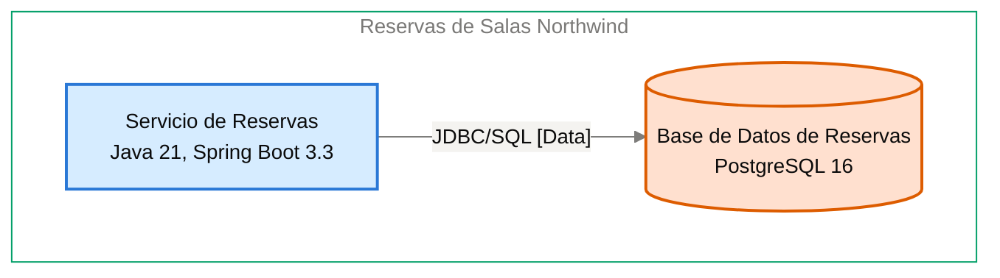

# Especificación de Componente — Base de Datos de Reservas

<!-- managed by sa-skills:architecture-dev-handoff — do not edit manually -->
<!-- TEMPLATE_VERSION: 4.3.1 -->
| Field | Value |
|-------|-------|
| Componente | Base de Datos de Reservas |
| Número de componente | 5.3 |
| Equipo | [NOT DOCUMENTED — add **Owner:** field to docs/components/reservas-de-salas-northwind/03-base-de-datos-de-reservas.md] |
| Versión de la Especificación de Componente | 4.3.1 |
| Versión de la Vista de Ejecución | 4.3.1 |
| Versión de los Estándares | 4.3.1 |
| Versión de la arquitectura | 1.0.0 |
| Versión del componente | 1.0.0 |
| Generado | 2026-10-18 |
| Documento fuente del componente | [../../docs/components/reservas-de-salas-northwind/03-base-de-datos-de-reservas.md](../../docs/components/reservas-de-salas-northwind/03-base-de-datos-de-reservas.md) |

### Índice rápido por rol <!-- SECTION: Role Quick Index -->

| Audience | Read first in this document |
|----------|-----------------------------|
| **Dev** | § 1 Responsabilidad → § 2 Posición → § 3 Contratos propios → § 4 Invariantes → § 7 Restricciones → § 8 Deliberadamente sin especificar |
| **QA** | § 3 Contratos propios → § 4 Invariantes → § 5 Presupuestos → § 9 Aceptación |
| **Ops / SRE** | § 5 Presupuestos → § 7 Restricciones → § 10 Activos |

El orden de lectura de los cuatro documentos del kit está en `../README.md`.

Este es el **panel para este equipo**. Especifica solo intención y restricción. La estructura interna, la elección de persistencia dentro de los límites propios, el idioma de programación, la organización de módulos y la estrategia de pruebas quedan deliberadamente sin especificar; las decide el equipo.

Se lee junto con [`../SYSTEM_RUNTIME_VIEW.md`](../SYSTEM_RUNTIME_VIEW.md) (visión del sistema completo), [`../CROSS_CUTTING_STANDARDS.md`](../CROSS_CUTTING_STANDARDS.md) (reglas globales) y cada Contrato de Interfaz enlazado (continuidad con los servicios adyacentes).

---

## 1. Responsabilidad <!-- SECTION: Responsibility -->

Base de Datos de Reservas es la fuente de verdad de las 42 salas de las 3 sedes (capacidad y equipamiento) y de las reservas con su estado, incluidas las cancelaciones. Rechaza por construcción, con una restricción de exclusión de PostgreSQL 16 ([ADR-102](../../adr/ADR-102-impedir-reservas-dobles-con-restriccion-de-exclusion-en.md)), toda reserva confirmada que se superponga con otra de la misma sala. NO es responsable de coordinar la integridad ante superposición desde la aplicación (la garantiza el motor, no el Servicio de Reservas), ni de ofrecer acceso a otros servicios (propiedad exclusiva del Servicio de Reservas), ni de operar el motor gestionado (a cargo de Plataforma Northwind, [ADR-003](../../adr/ADR-003-postgresql-relational-store.md)).

---

## 2. Posición <!-- SECTION: Position -->

**Aparece en los flujos:** F-01 hop 3, F-02 hop 4, F-03 hop 5

**Interfaces de entrada** (inbound):

- [servicio-de-reservas→base-de-datos-de-reservas](../interfaces/servicio-de-reservas→base-de-datos-de-reservas.md) — I-04

**Interfaces de salida** (outbound):

No hay interfaces de salida documentadas.

**Interfaces sin Contrato de Interfaz**:

Ninguna.

**Panel** — este componente y sus vecinos en el diagrama de contenedores, recortado de `docs/03` (generado, nunca se edita a mano):

Cut of `docs/03-architecture-layers.md` § Diagram: C4 Level 2 — Container — Base de Datos de Reservas and its neighbours (generated, never hand-edited):

---

## 3. Contratos propios <!-- SECTION: Contracts Owned -->

Contratos que este componente publica. Los esquemas viven en los activos enlazados; esta tabla lista solo títulos, versiones y consumidores.

| Contract | Version | Consumers | Asset |
|----------|--------:|-----------|-------|
| — | — | — | No hay contratos propios. |

---

## 4. Invariantes <!-- SECTION: Invariants -->

Condiciones que se cumplen siempre, sea cual sea la implementación. Cada invariante es un enunciado verificable; QA cubre cada una con una prueba.

- **INV-01** Nunca existen dos reservas confirmadas con intervalos superpuestos para la misma sala; el motor las rechaza con una restricción de exclusión ([ADR-102](../../adr/ADR-102-impedir-reservas-dobles-con-restriccion-de-exclusion-en.md)).
- **INV-02** La integridad ante superposición la garantiza el motor, no la aplicación; no depende de coordinación en el Servicio de Reservas.
- **INV-03** Las 42 salas de las 3 sedes se guardan con capacidad y equipamiento.
- **INV-04** Cada reserva se guarda con su estado; las cancelaciones se conservan.
- **INV-05** Solo el Servicio de Reservas lee o escribe las tablas de este componente ([ADR-003](../../adr/ADR-003-postgresql-relational-store.md)).
- **INV-06** Las restricciones de integridad que exige el negocio (unicidad, no superposición) se declaran en la base, no solo en el código ([ADR-003](../../adr/ADR-003-postgresql-relational-store.md)).
- **INV-07** Todo cambio de esquema se aplica mediante migraciones versionadas ([ADR-003](../../adr/ADR-003-postgresql-relational-store.md)).
- **INV-08** La consistencia es fuerte en lecturas y escrituras de salas y reservas.

---

## 5. Presupuestos (desde la descomposición) <!-- SECTION: Budgets -->

Tomados literalmente de las filas de [`../SYSTEM_RUNTIME_VIEW.md § Budget Decomposition`](../SYSTEM_RUNTIME_VIEW.md#budget-decomposition) que referencian este componente. No se repite el SLO global; solo la asignación de este componente.

| Aspect | Allocation | Source |
|--------|-----------:|--------|
| Latencia p99 | [NOT DOCUMENTED — run /sa-analysis:architecture-analysis latency-budget] | Servicio de Reservas → Base de Datos de Reservas, sin presupuesto documentado |
| Error budget | [NOT DOCUMENTED — run /sa-analysis:architecture-analysis latency-budget] | — |
| Throughput (pico) | [NOT DOCUMENTED — run /sa-analysis:architecture-analysis latency-budget] | — |
| Throughput (sostenido) | [NOT DOCUMENTED — run /sa-analysis:architecture-analysis latency-budget] | — |
| Techo de costo | [NOT DOCUMENTED — run /sa-analysis:architecture-analysis latency-budget] | — |

---

## 6. Propiedad de datos <!-- SECTION: Data Ownership -->

Propiedad exclusiva. No existe propiedad mutable compartida en el sistema.

**Es dueño de (fuente autoritativa):**

[NOT DOCUMENTED — the descriptor has no data-ownership section — add one, or leave the Component Specification § 6 to state it]

**Lee (vía contrato, sin ser dueño):**

Sin lecturas externas.

**No debe acceder a:**

Sin prohibiciones explícitas.

---

## 7. Restricciones <!-- SECTION: Constraints -->

Cada restricción tiene un motivo (regla de Cross-Cutting Standards, ADR o invariante). Una restricción sin motivo es deriva en potencia; se cita uno o se elimina la fila.

**Obligatorias:**

- PostgreSQL 16 gestionado por Plataforma Northwind como motor relacional — per [ADR-003](../../adr/ADR-003-postgresql-relational-store.md)
- Esquema versionado con migraciones en el repositorio del servicio (Flyway en Java) — per [ADR-003](../../adr/ADR-003-postgresql-relational-store.md)
- Respaldo diario con retención de 30 días — per [ADR-003](../../adr/ADR-003-postgresql-relational-store.md)
- Restricción de exclusión de PostgreSQL contra reservas confirmadas superpuestas por sala (ADR en estado Proposed) — per [ADR-102](../../adr/ADR-102-impedir-reservas-dobles-con-restriccion-de-exclusion-en.md)

**Prohibidas:**

- Lectura o escritura directa de las tablas por cualquier servicio distinto del Servicio de Reservas — per [ADR-003](../../adr/ADR-003-postgresql-relational-store.md)
- Declarar la integridad de no superposición solo en el código de la aplicación — per [ADR-003](../../adr/ADR-003-postgresql-relational-store.md) y [ADR-102](../../adr/ADR-102-impedir-reservas-dobles-con-restriccion-de-exclusion-en.md)

---

## 8. Deliberadamente sin especificar <!-- SECTION: Deliberately Unspecified -->

El equipo es dueño de las siguientes decisiones:

- Estructura interna (organización de módulos, límites de paquetes)
- Elección de persistencia dentro del límite propio
- Idioma de programación y subconjunto del framework
- Estrategia de pruebas (reparto unitarias/integración, herramientas)
- Caché local, pooling en proceso

Sobreespecificar aquí reemplazaría el criterio por la prescripción. Si te encuentras especificando alguno de los puntos anteriores, escala: pertenece a Cross-Cutting Standards (si es de toda la institución) o a un ADR (si es de todo el proyecto), no a una Especificación de Componente.

---

## 9. Aceptación <!-- SECTION: Acceptance -->

- [ ] Los contratos de § 3 están publicados y verificados por los consumidores
- [ ] Los presupuestos de § 5 se demuestran bajo carga
- [ ] Las invariantes de § 4 están cubiertas por pruebas
- [ ] La semántica de fallo de las interfaces se ejerce (inyección de fallos según el Contrato de Interfaz)
- [ ] Se verifica la conformidad con Cross-Cutting Standards; cualquier desviación se registra según [`../CROSS_CUTTING_STANDARDS.md § Deviations`](../CROSS_CUTTING_STANDARDS.md#deviations)

---

## 10. Activos <!-- SECTION: Assets -->

Activos entregables generados junto con esta Especificación de Componente.

| Asset | File | Description |
|-------|------|-------------|
| Script DDL | [ddl.sql](assets/03-base-de-datos-de-reservas/ddl.sql) | Esquema de base de datos (CREATE TABLE, índices, restricciones) |
| Descriptor C4 del componente | [c4-descriptor.md](assets/03-base-de-datos-de-reservas/c4-descriptor.md) | Ficha operativa de una página para SRE/infraestructura |

Los activos viven en `handoffs/assets/03-base-de-datos-de-reservas/`.

---

## 11. Preguntas abiertas <!-- SECTION: Open Questions -->

Vacíos detectados al generar la Especificación de Componente: valores ausentes en la documentación de arquitectura o en los artefactos previos (Vista de Ejecución, Cross-Cutting Standards, Contratos de Interfaz).

| Section | What is missing | Where to fix it | What it blocks |
|---------|-----------------|-----------------|----------------|
| § Metadata | Equipo propietario del componente | `docs/components/reservas-de-salas-northwind/03-base-de-datos-de-reservas.md`, campo **Owner:** | Asignar responsabilidad del componente |
| § Position | ID del diagrama C4 Nivel 2 en el panel | Registro de diagramas de `docs/03-architecture-layers.md` | Referenciar el diagrama de forma estable |
| § Budgets | Latencia p99, error budget, throughput y techo de costo del salto Servicio de Reservas → Base de Datos de Reservas | `/sa-analysis:architecture-analysis latency-budget` | Pruebas de carga y aceptación de § 5 |
| § Data Ownership | Entidades y tablas propias | `docs/components/reservas-de-salas-northwind/03-base-de-datos-de-reservas.md`, sección de propiedad de datos | Esquema DDL y verificación de propiedad |
| Assets — ddl.sql | Columnas de la tabla de salas (capacidad, equipamiento, sede) | docs/components/reservas-de-salas-northwind/03-base-de-datos-de-reservas.md | No se puede crear la tabla de salas; el archivo no contiene ningún CREATE TABLE. |
| Assets — ddl.sql | Columnas de la tabla de reservas (estado, cancelaciones) | docs/components/reservas-de-salas-northwind/03-base-de-datos-de-reservas.md | No se puede crear la tabla de reservas. |
| Assets — ddl.sql | Restricción de exclusión (ADR-102): columnas y tipo de rango | docs/components/reservas-de-salas-northwind/03-base-de-datos-de-reservas.md | No se puede declarar la restricción que impide reservas confirmadas superpuestas. |
| Assets — c4-descriptor.md | Responsable | agregar `**Owner:**` a docs/components/reservas-de-salas-northwind/03-base-de-datos-de-reservas.md | escalamiento y propiedad en la CMDB |
| Assets — c4-descriptor.md | Capacidad | docs/components/reservas-de-salas-northwind/03-base-de-datos-de-reservas.md § Capacity <!-- LABEL: Capacity --> | dimensionamiento y planificación de capacidad |
| Assets — c4-descriptor.md | Host · IP · SO · Dominio | docs/09-operational-considerations.md | registro en la CMDB y reglas de red |
| Assets — security.md | Authentication I-04 | authentication of I-04: state it in docs/07-security-architecture.md | la interfaz falla cerrada: no se abre sin su autenticación |
| Assets — security.md | STRIDE | analysis/STRIDE-*.md — run /sa-analysis:architecture-analysis stride | se desconocen las amenazas que la construcción debe mitigar |
| Assets — security.md | Data Sensitivity | analysis/DATA-SENSITIVITY-*.md — run /sa-analysis:architecture-analysis data-sensitivity | se desconoce la clasificación de los datos que maneja el componente |

---

*Generado por `sa-skills:architecture-dev-handoff` el 2026-10-18*
*Fuente: /home/runner/work/northwind-reservas/northwind-reservas/ARCHITECTURE.md*
