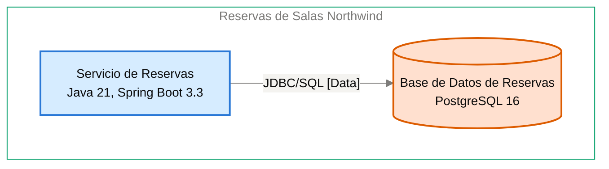

# Especificación de Componente — Base de Datos de Reservas

<!-- managed by sa-skills:architecture-dev-handoff — do not edit manually -->
<!-- TEMPLATE_VERSION: 4.3.1 -->
| Field | Value |
|-------|-------|
| Componente | Base de Datos de Reservas |
| Número de componente | 5.3 |
| Equipo | [NOT DOCUMENTED — add **Owner:** field to docs/components/reservas-de-salas-northwind/03-base-de-datos-de-reservas.md] |
| Versión de la Especificación de Componente | 4.3.1 |
| Versión de la Vista de Ejecución | 4.3.1 |
| Versión de los Estándares | 4.3.1 |
| Versión de la arquitectura | 1.1.1 |
| Versión del componente | 1.0.1 |
| Generado | 2026-10-19 |
| Documento fuente del componente | [docs/components/reservas-de-salas-northwind/03-base-de-datos-de-reservas.md](../../docs/components/reservas-de-salas-northwind/03-base-de-datos-de-reservas.md) |

### Índice rápido por rol <!-- SECTION: Role Quick Index -->

| Audience | Read first in this document |
|----------|-----------------------------|
| **Dev** | § 1 Responsabilidad → § 2 Posición → § 3 Contratos propios → § 4 Invariantes → § 7 Restricciones → § 8 Deliberadamente no especificado |
| **QA** | § 3 Contratos propios → § 4 Invariantes → § 5 Presupuestos → § 9 Aceptación |
| **Ops / SRE** | § 5 Presupuestos → § 7 Restricciones → § 10 Activos |

El orden de lectura de los cuatro documentos del kit está en `../README.md`.

Este documento es el **panel para este equipo**. Especifica solo intención y restricción. La estructura interna, la elección de persistencia dentro de los límites propios, el idioma de programación, la organización de módulos y la estrategia de pruebas quedan deliberadamente sin especificar: son decisión del equipo.

Léase junto con [`../SYSTEM_RUNTIME_VIEW.md`](../SYSTEM_RUNTIME_VIEW.md) (historia del sistema completo), [`../CROSS_CUTTING_STANDARDS.md`](../CROSS_CUTTING_STANDARDS.md) (reglas globales) y cada Interface Contract enlazado (continuidad con los servicios adyacentes).

---

## 1. Responsabilidad <!-- SECTION: Responsibility -->

Base de Datos de Reservas es la fuente de verdad de las 42 salas de las 3 sedes y de las reservas, incluidas sus cancelaciones, el registro de auditoría de cancelaciones y las claves de idempotencia. Rechaza por construcción, con una restricción de exclusión de PostgreSQL 16, dos reservas confirmadas superpuestas de la misma sala ([ADR-102](../../adr/ADR-102-impedir-reservas-dobles-con-restriccion-de-exclusion-en.md)). NO es responsable de coordinar la integridad desde la aplicación (la garantiza el motor, no el Servicio de Reservas), ni de dar acceso a otros servicios: su único dueño y único cliente es el Servicio de Reservas.

---

## 2. Posición <!-- SECTION: Position -->

**Aparece en los flujos:** F-01 hop 3 (Consulta de disponibilidad), F-02 hop 4 (Creación de reserva), F-03 hop 5 (Cancelación de reserva)

**Interfaces ascendentes** (entrantes):

- [servicio-de-reservas→base-de-datos-de-reservas](../interfaces/servicio-de-reservas→base-de-datos-de-reservas.md) — I-04

**Interfaces descendentes** (salientes):

No hay interfaces salientes documentadas.

**Interfaces sin Interface Contract**:

Ninguna.

**Panel** — este componente y sus vecinos en el diagrama de contenedores, extraído de `docs/03` (generado, nunca se edita a mano):

Cut of `docs/03-architecture-layers.md` § Diagram: C4 Level 2 — Container — Base de Datos de Reservas and its neighbours (generated, never hand-edited):

---

## 3. Contratos propios <!-- SECTION: Contracts Owned -->

Contratos que este componente publica. Los esquemas viven en los archivos de activos enlazados; esta tabla lista solo títulos, versiones y consumidores.

| Contract | Version | Consumers | Asset |
|----------|--------:|-----------|-------|
| — | — | — | No hay contratos propios. |

---

## 4. Invariantes <!-- SECTION: Invariants -->

Condiciones que se cumplen en todo momento, sin importar la implementación. Cada invariante es verificable; QA cubre cada una con una prueba.

- **INV-01** La base guarda las 42 salas de las 3 sedes, con capacidad y equipamiento.
- **INV-02** La base guarda cada reserva con su estado; una cancelación conserva el registro de la reserva.
- **INV-03** La base rechaza toda reserva confirmada que se superponga con otra reserva confirmada de la misma sala, mediante una restricción de exclusión ([ADR-102](../../adr/ADR-102-impedir-reservas-dobles-con-restriccion-de-exclusion-en.md)).
- **INV-04** Solo el Servicio de Reservas lee y escribe las tablas de la base ([ADR-003](../../adr/ADR-003-postgresql-relational-store.md)).
- **INV-05** Las restricciones de integridad que exige el negocio (unicidad, no superposición) se declaran en la base, no solo en el código ([ADR-003](../../adr/ADR-003-postgresql-relational-store.md)).
- **INV-06** Todo cambio de esquema se aplica con una migración versionada ([ADR-003](../../adr/ADR-003-postgresql-relational-store.md)).

---

## 5. Presupuestos (de la descomposición) <!-- SECTION: Budgets -->

Extraído de [`../SYSTEM_RUNTIME_VIEW.md § Budget Decomposition`](../SYSTEM_RUNTIME_VIEW.md#budget-decomposition), filas que referencian este componente. No se repite el SLO global: solo la asignación de este componente.

| Aspect | Allocation | Source |
|--------|-----------:|--------|
| Latencia p99 | [NOT DOCUMENTED — run /sa-analysis:architecture-analysis latency-budget] | [NOT DOCUMENTED — run /sa-analysis:architecture-analysis latency-budget] |
| Error budget | [NOT DOCUMENTED — run /sa-analysis:architecture-analysis latency-budget] | [NOT DOCUMENTED — run /sa-analysis:architecture-analysis latency-budget] |
| Throughput (pico) | [NOT DOCUMENTED — run /sa-analysis:architecture-analysis latency-budget] | [NOT DOCUMENTED — run /sa-analysis:architecture-analysis latency-budget] |
| Throughput (sostenido) | [NOT DOCUMENTED — run /sa-analysis:architecture-analysis latency-budget] | [NOT DOCUMENTED — run /sa-analysis:architecture-analysis latency-budget] |
| Techo de costo | [NOT DOCUMENTED — run /sa-analysis:architecture-analysis latency-budget] | [NOT DOCUMENTED — run /sa-analysis:architecture-analysis latency-budget] |

Sin análisis de Latency Budget, las filas muestran el marcador `[NOT DOCUMENTED]` y el vacío se registra en § 11.

---

## 6. Propiedad de datos <!-- SECTION: Data Ownership -->

Propiedad exclusiva. No existe propiedad mutable compartida en el sistema.

**Es dueño de (fuente autoritativa):**

- Salas
- Reservas
- Registro de auditoría de cancelaciones
- Claves de idempotencia

El Servicio de Reservas es el dueño de esta base ([ADR-003](../../adr/ADR-003-postgresql-relational-store.md)).

**Lee (vía contrato, sin ser dueño):**

Sin lecturas externas.

**No debe acceder a:**

Sin prohibiciones explícitas.

---

## 7. Restricciones <!-- SECTION: Constraints -->

Cada restricción tiene una razón (regla de Cross-Cutting Standards, ADR o invariante). Una restricción sin razón se desvía con el tiempo: se cita una o se elimina.

**Obligatorias:**

- PostgreSQL 16 gestionado por Plataforma Northwind — per [ADR-003](../../adr/ADR-003-postgresql-relational-store.md)
- Esquema versionado con migraciones en el repositorio del servicio (Flyway en Java) — per [ADR-003](../../adr/ADR-003-postgresql-relational-store.md)
- Restricción de exclusión de PostgreSQL contra reservas confirmadas superpuestas de la misma sala (ADR en estado Proposed) — per [ADR-102](../../adr/ADR-102-impedir-reservas-dobles-con-restriccion-de-exclusion-en.md)
- Respaldo diario con retención de 30 días — per [ADR-003](../../adr/ADR-003-postgresql-relational-store.md)

**Prohibidas:**

- Lectura o escritura directa de las tablas por un servicio distinto del Servicio de Reservas — per [ADR-003](../../adr/ADR-003-postgresql-relational-store.md)
- Garantizar la no superposición solo en el código de la aplicación — per [ADR-102](../../adr/ADR-102-impedir-reservas-dobles-con-restriccion-de-exclusion-en.md)

---

## 8. Deliberadamente no especificado <!-- SECTION: Deliberately Unspecified -->

El equipo es dueño de las siguientes decisiones:

- Estructura interna (organización de módulos, límites de paquetes)
- Elección de persistencia dentro del límite propio
- Idioma de programación y subconjunto de framework
- Estrategia de pruebas (reparto unitarias/integración, herramientas)
- Caché local, pooling en proceso

Sobreespecificar aquí reemplazaría el criterio por la prescripción. Si se está especificando alguno de los puntos anteriores, se escala: pertenece a Cross-Cutting Standards (si es de toda la institución) o a un ADR (si es de todo el proyecto), no a una Especificación de Componente.

---

## 9. Aceptación <!-- SECTION: Acceptance -->

- [ ] Contratos de § 3 publicados y verificados por los consumidores
- [ ] Presupuestos de § 5 demostrados bajo carga
- [ ] Invariantes de § 4 cubiertas por pruebas
- [ ] Semántica de fallo de las interfaces ejercitada (inyección de fallos según el Interface Contract)
- [ ] Conformidad con Cross-Cutting Standards verificada; toda desviación registrada según [`../CROSS_CUTTING_STANDARDS.md § Deviations`](../CROSS_CUTTING_STANDARDS.md#deviations)

---

## 10. Activos <!-- SECTION: Assets -->

Activos entregables generados junto con esta Especificación de Componente.

| Asset | File | Description |
|-------|------|-------------|
| DDL Script | [ddl.sql](assets/03-base-de-datos-de-reservas/ddl.sql) | Esquema de base de datos (CREATE TABLE, índices, restricciones) |
| C4 Component Descriptor | [c4-descriptor.md](assets/03-base-de-datos-de-reservas/c4-descriptor.md) | Resumen operativo de una página para SRE/infraestructura |

Los activos viven en `handoffs/assets/03-base-de-datos-de-reservas/`.

---

## 11. Preguntas abiertas <!-- SECTION: Open Questions -->

Vacíos detectados al generar la Especificación de Componente: valores ausentes en la documentación de arquitectura o en los artefactos de origen (Runtime View, Cross-Cutting Standards, Interface Contracts).

| Section | What is missing | Where to fix it | What it blocks |
|---------|-----------------|-----------------|----------------|
| § Position | ID del diagrama del panel | Registro de diagramas | Referenciar el diagrama de forma estable |
| § Budgets | Asignación de latencia p99 | `/sa-analysis:architecture-analysis latency-budget` | Pruebas de carga del presupuesto |
| § Budgets | Error budget | `/sa-analysis:architecture-analysis latency-budget` | Criterio de aceptación de errores |
| § Budgets | Throughput pico | `/sa-analysis:architecture-analysis latency-budget` | Dimensionar la base |
| § Budgets | Throughput sostenido | `/sa-analysis:architecture-analysis latency-budget` | Dimensionar la base |
| § Budgets | Techo de costo | `/sa-analysis:architecture-analysis latency-budget` | Validar el costo operativo |
| Assets — ddl.sql | Columnas de salas | docs/components/reservas-de-salas-northwind/03-base-de-datos-de-reservas.md | No se puede crear la tabla de salas; los docs solo dan 42 salas de 3 sedes, capacidad y equipamiento. |
| Assets — ddl.sql | Columnas de reservas | docs/components/reservas-de-salas-northwind/03-base-de-datos-de-reservas.md | No se puede crear la tabla de reservas; los docs solo mencionan el estado. |
| Assets — ddl.sql | Columnas del registro de auditoría de cancelaciones | docs/components/reservas-de-salas-northwind/03-base-de-datos-de-reservas.md | No se puede crear la tabla de auditoría. |
| Assets — ddl.sql | Columnas de claves de idempotencia | docs/components/reservas-de-salas-northwind/03-base-de-datos-de-reservas.md | No se puede crear la tabla de claves de idempotencia. |
| Assets — ddl.sql | Definición de la restricción de exclusión (ADR-102) | docs/components/reservas-de-salas-northwind/03-base-de-datos-de-reservas.md | Faltan columnas, tipo de rango y condición de estado confirmado; no se puede declarar el EXCLUDE. |
| Assets — c4-descriptor.md | Responsable | agregar `**Owner:**` a docs/components/reservas-de-salas-northwind/03-base-de-datos-de-reservas.md | escalamiento y propiedad en la CMDB |
| Assets — c4-descriptor.md | Capacidad | docs/components/reservas-de-salas-northwind/03-base-de-datos-de-reservas.md § Capacity <!-- LABEL: Capacity --> | dimensionamiento y planificación de capacidad |
| Assets — c4-descriptor.md | Host · IP · SO · Dominio | docs/09-operational-considerations.md | registro en la CMDB y reglas de red |
| Assets — security.md | Data Sensitivity | analysis/DATA-SENSITIVITY-*.md — run /sa-analysis:architecture-analysis data-sensitivity | se desconoce la clasificación de los datos que maneja el componente |

---

*Generated by `sa-skills:architecture-dev-handoff` on 2026-10-19*
*Source: /home/runner/work/northwind-reservas/northwind-reservas/ARCHITECTURE.md*
