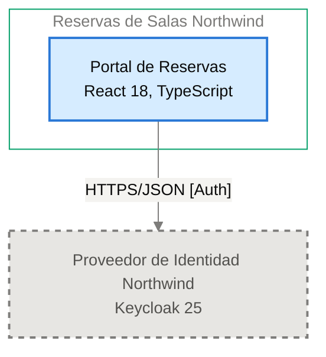

# Contrato de Interfaz: Portal de Reservas → Proveedor de Identidad Northwind

<!-- managed by sa-skills:architecture-dev-handoff — do not edit manually -->
<!-- TEMPLATE_VERSION: 4.3.1 -->
| Field | Value |
|-------|-------|
| Arista relacionada | E-01 |
| Versión de la Vista de Ejecución | 4.3.1 |
| Versión de los Estándares | 4.3.1 |
| Decisión | [ADR-002](../../adr/ADR-002-oidc-keycloak-identity.md) |
| Generado | 2026-10-19 |

### Índice rápido por rol <!-- SECTION: Role Quick Index -->

| Audience | Read first in this document |
|----------|-----------------------------|
| **Dev** | Interacción → Estado de entrada → Estado de salida → Supuestos mutuos → Propiedad |
| **QA** | Semántica de fallos → Estado de entrada → Estado de salida → Supuestos mutuos |
| **Ops / SRE** | Semántica de fallos → Observabilidad en la interfaz → Registro de cambios |

El orden de lectura de los cuatro documentos del handoff está en `../README.md`.

Contrato de continuidad entre dos servicios adyacentes. Aquí se originan la mayoría de los defectos de integración. Cada supuesto mutuo es vinculante. Cambiar uno es un cambio de interfaz, no un cambio local.

---

## Interacción <!-- SECTION: Interaction -->

| Aspect | Value |
|--------|-------|
| Estilo | sync (request-response) |
| Transporte | HTTPS/JSON [Auth] |
| Contrato | [NOT DOCUMENTED — add contract reference to docs/05-integration-points.md] |
| Compatibilidad | ver [CROSS_CUTTING_STANDARDS § Versioning](../CROSS_CUTTING_STANDARDS.md#versioning) |

**Panel** — el par en el diagrama de contenedores, extraído de `docs/03` (generado, nunca editado a mano):

Cut of `docs/03-architecture-layers.md` § Diagram: C4 Level 2 — Container — Portal de Reservas → Proveedor de Identidad Northwind (generated, never hand-edited):

---

## Estado de entrada <!-- SECTION: Entry state -->

Lo que el Proveedor de Identidad Northwind puede asumir como cierto cuando se le invoca:

- [NOT DOCUMENTED — docs/components/proveedor-de-identidad-northwind.md no tiene tabla de comunicación entrante]

---

## Estado de salida <!-- SECTION: Exit state -->

Lo que el Proveedor de Identidad Northwind garantiza al responder o emitir:

- [NOT DOCUMENTED — docs/components/proveedor-de-identidad-northwind.md no tiene tabla de comunicación entrante]

---

## Supuestos mutuos (vinculantes) <!-- SECTION: Mutual assumptions -->

Los supuestos listados aquí son vinculantes. Cambiar uno es un cambio de interfaz, no un cambio local.

**El upstream asume:**

- [NOT DOCUMENTED — docs/components/reservas-de-salas-northwind/01-portal-de-reservas.md no tiene tabla de comunicación saliente]

**El downstream asume:**

- [NOT DOCUMENTED — docs/components/proveedor-de-identidad-northwind.md no tiene tabla de comunicación entrante]

---

## Semántica de fallos <!-- SECTION: Failure semantics -->

Responsabilidades fila por fila ante cada condición de fallo. Las celdas del upstream y del downstream definen juntas el contrato de recuperación.

| Condition | Upstream behaviour | Downstream behaviour |
|-----------|--------------------|----------------------|
| timeout | [NOT DOCUMENTED] | [NOT DOCUMENTED] |
| downstream no disponible | [NOT DOCUMENTED] | — |
| poison message | — | [NOT DOCUMENTED] |
| fallo parcial | [NOT DOCUMENTED] | [NOT DOCUMENTED] |
| versiones incompatibles | [NOT DOCUMENTED] | [NOT DOCUMENTED] |

Falla de autenticación: el Portal de Reservas redirige al inicio de sesión (I-01).

Clasificación de cascada (de `analysis/BLAST_RADIUS-*.md`): [NOT DOCUMENTED — run /sa-analysis:architecture-analysis blast-radius]

---

## Propiedad <!-- SECTION: Ownership -->

Datos propiedad del upstream y de solo lectura por contrato desde el lado del downstream. No existe propiedad mutable compartida en el sistema.

| Direction | Fields / entities |
|-----------|-------------------|
| Propiedad del upstream | Ningún dato persistente; los tokens viven solo en memoria del navegador ([ADR-104](../../adr/ADR-104-manejo-de-tokens-oidc-en-la-spa-sin.md)) |
| Propiedad del downstream | [NOT DOCUMENTED — docs/components/proveedor-de-identidad-northwind.md no tiene sección de propiedad de datos] |
| Solo lectura (vía esta interfaz) | Token de acceso con el rol `recepcion` y el atributo `sede`, en memoria del navegador |

---

## Observabilidad en la interfaz <!-- SECTION: Observability at the interface -->

La interfaz debe poder depurarse desde cualquiera de sus extremos sin cruzar logs entre equipos.

| Signal | Requirement |
|--------|-------------|
| Correlación | per [CROSS_CUTTING_STANDARDS § Observability](../CROSS_CUTTING_STANDARDS.md#observability-conventions) |
| Métricas requeridas (ambos lados) | Métricas RED (tasa, errores, duración) por operación, según [ADR-004](../../adr/ADR-004-opentelemetry-observability.md) |
| Campos de log | JSON estructurado con `trace_id`, `span_id`, `service.name` y nivel; sin tokens ni datos personales completos ([ADR-004](../../adr/ADR-004-opentelemetry-observability.md)) |

---

## Registro de cambios <!-- SECTION: Change log -->

Los cambios de interfaz requieren un ADR nuevo — ver [Return Path](../SYSTEM_RUNTIME_VIEW.md#return-path).

| Date | Change | ADR |
|------|--------|----:|
| 2026-10-19 | Contrato de interfaz inicial | [ADR-002](../../adr/ADR-002-oidc-keycloak-identity.md) |

---

*Generado por `sa-skills:architecture-dev-handoff` el 2026-10-19*
*Fuentes: `docs/05-integration-points.md`, `analysis/BLAST_RADIUS-*.md`, `adr/`*
