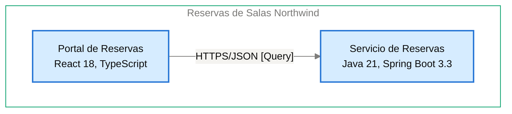

# Contrato de Interfaz: Portal de Reservas → Servicio de Reservas

<!-- managed by sa-skills:architecture-dev-handoff — do not edit manually -->
<!-- TEMPLATE_VERSION: 4.3.1 -->
| Field | Value |
|-------|-------|
| Arista relacionada | E-02 |
| Versión de la Vista de Ejecución | 4.3.1 |
| Versión de los Estándares | 4.3.1 |
| Decisión | [ADR-103](../../adr/ADR-103-idempotencia-de-la-creacion-de-reservas-con-clave.md) |
| Generado | 2026-10-20 |

### Índice rápido por rol <!-- SECTION: Role Quick Index -->

| Audience | Read first in this document |
|----------|-----------------------------|
| **Dev** | Interacción → Estado de entrada → Estado de salida → Supuestos mutuos → Propiedad |
| **QA** | Semántica de fallos → Estado de entrada → Estado de salida → Supuestos mutuos |
| **Ops / SRE** | Semántica de fallos → Observabilidad en la interfaz → Registro de cambios |

El orden de lectura de los cuatro documentos del handoff está en `../README.md`.

Contrato de continuidad entre dos servicios adyacentes. Aquí se originan la mayoría de los defectos de integración: cada supuesto mutuo es vinculante.
Cambiar uno es un cambio de interfaz, no un cambio local.

---

## Interacción <!-- SECTION: Interaction -->

| Aspect | Value |
|--------|-------|
| Estilo | sync (request-response) |
| Transporte | HTTPS/JSON [Query] |
| Contrato | API REST con contrato OpenAPI 3.1 como fuente de la interfaz ([ADR-001](../../adr/ADR-001-rest-openapi-apis.md)); archivo del contrato: [NOT DOCUMENTED — add contract reference to docs/05-integration-points.md] |
| Compatibilidad | Versión mayor en la ruta (`/v1/…`); un cambio incompatible publica `/v2` y mantiene `/v1` al menos 90 días ([ADR-001](../../adr/ADR-001-rest-openapi-apis.md)). Ver [CROSS_CUTTING_STANDARDS § Versioning](../CROSS_CUTTING_STANDARDS.md#versioning) |

**Panel** — el par en el diagrama de contenedores, recortado de `docs/03` (generado, nunca editado a mano):

Cut of `docs/03-architecture-layers.md` § Diagram: C4 Level 2 — Container — Portal de Reservas → Servicio de Reservas (generated, never hand-edited):

---

## Estado de entrada <!-- SECTION: Entry state -->

Lo que el Servicio de Reservas puede asumir como cierto al ser invocado:

- La solicitud llega por HTTPS/JSON con JWT (integración I-02).
- El token de acceso viaja en la cabecera `Authorization`; sin token válido, el Servicio de Reservas responde 401.
- La creación de reservas incluye `Idempotency-Key`, generada por el Portal de Reservas en cada confirmación ([ADR-103](../../adr/ADR-103-idempotencia-de-la-creacion-de-reservas-con-clave.md)).
- El contexto de traza viaja en `traceparent` (W3C Trace Context, [ADR-004](../../adr/ADR-004-opentelemetry-observability.md)).
- Garantía de orden entre solicitudes: [NOT DOCUMENTED].

---

## Estado de salida <!-- SECTION: Exit state -->

Lo que el Servicio de Reservas garantiza al responder o emitir:

- Una creación con `Idempotency-Key` repetida devuelve la respuesta guardada; el servicio guarda clave y respuesta 24 horas en la Base de Datos de Reservas ([ADR-103](../../adr/ADR-103-idempotencia-de-la-creacion-de-reservas-con-clave.md)).
- Una reserva confirmada superpuesta para la misma sala es rechazada por la restricción de exclusión de PostgreSQL ([ADR-102](../../adr/ADR-102-impedir-reservas-dobles-con-restriccion-de-exclusion-en.md)).
- La cancelación solo procede para el dueño de la reserva o para un token con rol `recepcion` cuyo atributo `sede` coincide con la sede de la sala; en otro caso responde "no autorizado" y la reserva sigue "Confirmada" ([ADR-105](../../adr/ADR-105-autorizacion-por-rol-recepcion-y-atributo-sede-del.md)).
- Cada cancelación escribe el registro de auditoría en la misma transacción ([ADR-106](../../adr/ADR-106-retencion-de-24-meses-purga-de-datos-y.md)).
- Los errores siguen RFC 9457 (`application/problem+json`) con un campo `code` estable ([ADR-001](../../adr/ADR-001-rest-openapi-apis.md)).

---

## Supuestos mutuos (vinculantes) <!-- SECTION: Mutual assumptions -->

Los supuestos listados aquí son vinculantes. Cambiar uno es un cambio de interfaz, no un cambio local.

**El upstream asume:**

- [NOT DOCUMENTED — docs/components/reservas-de-salas-northwind/01-portal-de-reservas.md has no Outbound communication table]
- El Servicio de Reservas busca la `Idempotency-Key` antes de insertar ([ADR-103](../../adr/ADR-103-idempotencia-de-la-creacion-de-reservas-con-clave.md)).

**El downstream asume:**

- El Portal de Reservas envía el token de acceso en `Authorization` en cada solicitud (I-02).
- El Portal de Reservas genera una `Idempotency-Key` por cada confirmación de reserva ([ADR-103](../../adr/ADR-103-idempotencia-de-la-creacion-de-reservas-con-clave.md)).
- El token de acceso dura 5 minutos y el Portal de Reservas lo renueva en silencio ([ADR-104](../../adr/ADR-104-manejo-de-tokens-oidc-en-la-spa-sin.md)).

---

## Semántica de fallos <!-- SECTION: Failure semantics -->

Responsabilidades fila por fila bajo cada condición de fallo. Las celdas del upstream y del downstream definen juntas el contrato de recuperación.

| Condition | Upstream behaviour | Downstream behaviour |
|-----------|--------------------|----------------------|
| timeout | [NOT DOCUMENTED] | Idempotente sobre `Idempotency-Key` en la creación; la respuesta se conserva 24 horas |
| downstream no disponible | [NOT DOCUMENTED] | — |
| poison message | — | [NOT DOCUMENTED] |
| fallo parcial | [NOT DOCUMENTED] | La auditoría de cancelación se escribe en la misma transacción que la cancelación |
| versiones incompatibles | [NOT DOCUMENTED] | Publica `/v2` ante un cambio incompatible y mantiene `/v1` al menos 90 días |

Clasificación de cascada (de `analysis/BLAST_RADIUS-*.md`): [NOT DOCUMENTED — run /sa-analysis:architecture-analysis blast-radius]

---

## Propiedad <!-- SECTION: Ownership -->

Datos que posee el upstream y que el downstream solo lee a través del contrato. No existe propiedad mutable compartida en el sistema.

| Direction | Fields / entities |
|-----------|-------------------|
| Propiedad del upstream | Ningún dato persistente; los tokens viven solo en memoria del navegador ([ADR-104](../../adr/ADR-104-manejo-de-tokens-oidc-en-la-spa-sin.md)) |
| Propiedad del downstream | Salas, reservas (con su cancelación y motivo), registro de auditoría de cancelaciones y claves de idempotencia con su respuesta durante 24 horas |
| Solo lectura (vía esta interfaz) | Disponibilidad y reservas del Servicio de Reservas, leídas por el Portal de Reservas (I-02) |

---

## Observabilidad en la interfaz <!-- SECTION: Observability at the interface -->

La interfaz debe poder depurarse desde cualquiera de sus extremos sin cruzar logs entre equipos.

| Signal | Requirement |
|--------|-------------|
| Correlación | per [CROSS_CUTTING_STANDARDS § Observability](../CROSS_CUTTING_STANDARDS.md#observability-conventions) |
| Métricas requeridas (ambos lados) | Métricas RED (tasa, errores, duración) por operación ([ADR-004](../../adr/ADR-004-opentelemetry-observability.md)) |
| Campos de log | JSON estructurado con `trace_id`, `span_id`, `service.name` y nivel; sin tokens ni datos personales completos ([ADR-004](../../adr/ADR-004-opentelemetry-observability.md)) |

---

## Registro de cambios <!-- SECTION: Change log -->

Los cambios de interfaz requieren un nuevo ADR — ver [Return Path](../SYSTEM_RUNTIME_VIEW.md#return-path).

| Date | Change | ADR |
|------|--------|----:|
| 2026-10-19 | Contrato de interfaz inicial | [ADR-103](../../adr/ADR-103-idempotencia-de-la-creacion-de-reservas-con-clave.md) |
| 2026-10-20 | ADR-103, ADR-102, ADR-104, ADR-105 y ADR-106 pasan a Accepted; se añade ADR-108 (caché Caffeine interna del Servicio de Reservas), sin cambio en el contrato de la interfaz | [ADR-103](../../adr/ADR-103-idempotencia-de-la-creacion-de-reservas-con-clave.md) |

---

*Generated by `sa-skills:architecture-dev-handoff` on 2026-10-20*
*Sources: `docs/05-integration-points.md`, `analysis/BLAST_RADIUS-*.md`, `adr/`*
