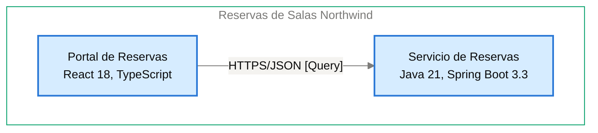

# Contrato de Interfaz: Portal de Reservas → Servicio de Reservas

<!-- managed by sa-skills:architecture-dev-handoff — do not edit manually -->
<!-- TEMPLATE_VERSION: 4.3.1 -->
| Field | Value |
|-------|-------|
| Arista relacionada | E-02 |
| Versión de la Vista de Ejecución | 4.3.1 |
| Versión de los Estándares | 4.3.1 |
| Decisión | [ADR-103](../../adr/ADR-103-idempotencia-de-la-creacion-de-reservas-con-clave.md) |
| Generado | 2026-10-19 |

### Índice rápido por rol <!-- SECTION: Role Quick Index -->

| Audience | Read first in this document |
|----------|-----------------------------|
| **Dev** | Interacción → Estado de entrada → Estado de salida → Supuestos mutuos → Propiedad |
| **QA** | Semántica de fallos → Estado de entrada → Estado de salida → Supuestos mutuos |
| **Ops / SRE** | Semántica de fallos → Observabilidad en la interfaz → Registro de cambios |

El orden de lectura de los cuatro documentos del kit está en `../README.md`.

Contrato de continuidad entre dos servicios adyacentes. Aquí se originan la mayoría de los defectos de integración: cada supuesto mutuo es vinculante. Cambiar uno es un cambio de interfaz, no un cambio local.

---

## Interacción <!-- SECTION: Interaction -->

| Aspect | Value |
|--------|-------|
| Estilo | sync (request-response) |
| Transporte | HTTPS/JSON [Query] |
| Contrato | OpenAPI 3.1 versionado en el repositorio del servicio ([ADR-001](../../adr/ADR-001-rest-openapi-apis.md)); versión mayor en la ruta (`/v1/…`) |
| Compatibilidad | Un cambio incompatible publica `/v2` y mantiene `/v1` al menos 90 días ([ADR-001](../../adr/ADR-001-rest-openapi-apis.md)); ver [CROSS_CUTTING_STANDARDS § Versioning](../CROSS_CUTTING_STANDARDS.md#versioning) |

**Panel** — el par en el diagrama de contenedores, recortado de `docs/03` (generado, nunca editado a mano):

Cut of `docs/03-architecture-layers.md` § Diagram: C4 Level 2 — Container — Portal de Reservas → Servicio de Reservas (generated, never hand-edited):

---

## Estado de entrada <!-- SECTION: Entry state -->

Lo que el Servicio de Reservas puede asumir como cierto al ser invocado:

- La solicitud lleva el token de acceso (JWT) en `Authorization`; sin token válido responde 401 (I-02).
- El Servicio de Reservas valida el JWT (RS256) en cada solicitud con las llaves públicas JWKS del Proveedor de Identidad Northwind ([ADR-002](../../adr/ADR-002-oidc-keycloak-identity.md)).
- La creación de reservas envía `Idempotency-Key`, generada en el navegador por cada confirmación ([ADR-103](../../adr/ADR-103-idempotencia-de-la-creacion-de-reservas-con-clave.md)).
- Cada llamada HTTP propaga W3C Trace Context (`traceparent`) ([ADR-004](../../adr/ADR-004-opentelemetry-observability.md)).
- El token de acceso dura 5 minutos y el Portal de Reservas lo renueva en silencio ([ADR-104](../../adr/ADR-104-manejo-de-tokens-oidc-en-la-spa-sin.md)).

---

## Estado de salida <!-- SECTION: Exit state -->

Lo que el Servicio de Reservas garantiza al responder:

- Atiende consulta, reserva, listado y cancelación (I-02) con errores RFC 9457 (`application/problem+json`) y campo `code` estable ([ADR-001](../../adr/ADR-001-rest-openapi-apis.md)).
- Guarda la clave de idempotencia y su respuesta 24 horas en la Base de Datos de Reservas; una clave repetida devuelve la respuesta guardada ([ADR-103](../../adr/ADR-103-idempotencia-de-la-creacion-de-reservas-con-clave.md)).
- Una reserva confirmada superpuesta para la misma sala es rechazada por la restricción de exclusión de PostgreSQL ([ADR-102](../../adr/ADR-102-impedir-reservas-dobles-con-restriccion-de-exclusion-en.md)).
- La cancelación solo procede para el dueño de la reserva o un token con rol `recepcion` y atributo `sede` igual a la sede de la sala; en otro caso responde "no autorizado" y la reserva sigue "Confirmada" ([ADR-105](../../adr/ADR-105-autorizacion-por-rol-recepcion-y-atributo-sede-del.md)).
- La cancelación escribe el registro de auditoría en la misma transacción ([ADR-106](../../adr/ADR-106-retencion-de-24-meses-purga-de-datos-y.md)).

---

## Supuestos mutuos (vinculantes) <!-- SECTION: Mutual assumptions -->

Los supuestos listados aquí son vinculantes. Cambiar uno es un cambio de interfaz, no un cambio local.

**Upstream assume:**

- [NOT DOCUMENTED — `docs/components/reservas-de-salas-northwind/01-portal-de-reservas.md` no tiene tabla Outbound communication]
- El Servicio de Reservas busca la `Idempotency-Key` antes de insertar ([ADR-103](../../adr/ADR-103-idempotencia-de-la-creacion-de-reservas-con-clave.md)).

**Downstream asume:**

- El Portal de Reservas envía JWT válido en `Authorization` en cada llamada (I-02).
- El Portal de Reservas genera una `Idempotency-Key` por cada confirmación de reserva ([ADR-103](../../adr/ADR-103-idempotencia-de-la-creacion-de-reservas-con-clave.md)).
- El Portal de Reservas guarda los tokens solo en memoria del navegador ([ADR-104](../../adr/ADR-104-manejo-de-tokens-oidc-en-la-spa-sin.md)).

---

## Semántica de fallos <!-- SECTION: Failure semantics -->

Responsabilidades fila por fila ante cada condición de fallo. Las celdas de upstream y downstream definen juntas el contrato de recuperación.

| Condition | Upstream behaviour | Downstream behaviour |
|-----------|--------------------|----------------------|
| timeout | [NOT DOCUMENTED] | Idempotente sobre `Idempotency-Key` en la creación; la clave y su respuesta se conservan 24 horas ([ADR-103](../../adr/ADR-103-idempotencia-de-la-creacion-de-reservas-con-clave.md)) |
| downstream no disponible | [NOT DOCUMENTED] | — |
| poison message | — | [NOT DOCUMENTED] |
| fallo parcial | [NOT DOCUMENTED] | Auditoría de cancelación en la misma transacción ([ADR-106](../../adr/ADR-106-retencion-de-24-meses-purga-de-datos-y.md)); superposición rechazada por la base ([ADR-102](../../adr/ADR-102-impedir-reservas-dobles-con-restriccion-de-exclusion-en.md)) |
| versiones incompatibles | [NOT DOCUMENTED] | Cambio incompatible publica `/v2` y mantiene `/v1` al menos 90 días ([ADR-001](../../adr/ADR-001-rest-openapi-apis.md)) |

Cascade classification (from `analysis/BLAST_RADIUS-*.md`): [NOT DOCUMENTED — run /sa-analysis:architecture-analysis blast-radius]

---

## Propiedad <!-- SECTION: Ownership -->

Datos del upstream y del downstream; el otro lado solo los lee a través del contrato. Ninguna propiedad mutable compartida en el sistema.

| Direction | Fields / entities |
|-----------|-------------------|
| Propiedad del upstream | Ningún dato persistente; los tokens viven solo en memoria del navegador ([ADR-104](../../adr/ADR-104-manejo-de-tokens-oidc-en-la-spa-sin.md)) |
| Propiedad del downstream | Salas; reservas (con su cancelación y motivo); registro de auditoría de cancelaciones; claves de idempotencia con su respuesta durante 24 horas; todo en la Base de Datos de Reservas ([ADR-003](../../adr/ADR-003-postgresql-relational-store.md)) |
| Solo lectura (vía esta interfaz) | Disponibilidad y reservas del Servicio de Reservas (I-02), leídas por el Portal de Reservas |

---

## Observabilidad en la interfaz <!-- SECTION: Observability at the interface -->

La interfaz se depura desde cualquiera de sus extremos sin cruzar logs entre equipos.

| Signal | Requirement |
|--------|-------------|
| Correlación | per [CROSS_CUTTING_STANDARDS § Observability](../CROSS_CUTTING_STANDARDS.md#observability-conventions) |
| Métricas requeridas (ambos lados) | Métricas RED (tasa, errores, duración) por operación ([ADR-004](../../adr/ADR-004-opentelemetry-observability.md)) |
| Campos de log | JSON estructurado con `trace_id`, `span_id`, `service.name` y nivel; sin tokens ni datos personales completos ([ADR-004](../../adr/ADR-004-opentelemetry-observability.md)) |

---

## Registro de cambios <!-- SECTION: Change log -->

Los cambios de interfaz requieren un ADR nuevo — ver [Return Path](../SYSTEM_RUNTIME_VIEW.md#return-path).

| Date | Change | ADR |
|------|--------|----:|
| 2026-10-19 | Contrato de interfaz inicial | [ADR-103](../../adr/ADR-103-idempotencia-de-la-creacion-de-reservas-con-clave.md) |

---

*Generated by `sa-skills:architecture-dev-handoff` on 2026-10-19*
*Sources: `docs/05-integration-points.md`, `analysis/BLAST_RADIUS-*.md`, `adr/`*
