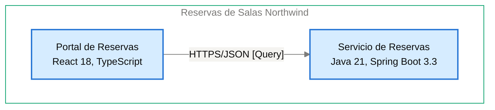

# Contrato de Interfaz: Portal de Reservas → Servicio de Reservas

<!-- managed by sa-skills:architecture-dev-handoff — do not edit manually -->
<!-- TEMPLATE_VERSION: 4.3.1 -->
| Field | Value |
|-------|-------|
| Arista relacionada | E-02 |
| Versión de la Vista de Ejecución | 4.3.1 |
| Versión de los Estándares | 4.3.1 |
| Decisión | [ADR-103](../../adr/ADR-103-idempotencia-de-la-creacion-de-reservas-con-clave.md) |
| Generado | 2026-10-18 |

### Índice rápido por rol <!-- SECTION: Role Quick Index -->

| Audience | Read first in this document |
|----------|-----------------------------|
| **Dev** | Interacción → Estado de entrada → Estado de salida → Supuestos mutuos → Propiedad |
| **QA** | Semántica de fallos → Estado de entrada → Estado de salida → Supuestos mutuos |
| **Ops / SRE** | Semántica de fallos → Observabilidad en la interfaz → Registro de cambios |

El orden de lectura de los cuatro documentos del handoff está en `../README.md`.

Contrato de continuidad entre dos servicios adyacentes. Aquí se origina la mayoría de los defectos de integración: cada supuesto mutuo es vinculante. Cambiar uno es un cambio de interfaz, no un cambio local.

---

## Interacción <!-- SECTION: Interaction -->

| Aspect | Value |
|--------|-------|
| Estilo | sync |
| Transporte | HTTPS/JSON [Query] |
| Contrato | OpenAPI 3.1 versionado en el repositorio del servicio ([ADR-001](../../adr/ADR-001-rest-openapi-apis.md)); [NOT DOCUMENTED — add contract reference to docs/05-integration-points.md] |
| Compatibilidad | Versión mayor en la ruta (`/v1/…`); un cambio incompatible publica `/v2` y mantiene `/v1` al menos 90 días ([ADR-001](../../adr/ADR-001-rest-openapi-apis.md)). Ver [CROSS_CUTTING_STANDARDS § Versioning](../CROSS_CUTTING_STANDARDS.md#versioning) |

**Panel** — el par en el diagrama de contenedores, recortado de `docs/03` (generado, nunca editado a mano):

Cut of `docs/03-architecture-layers.md` § Diagram: C4 Level 2 — Container — Portal de Reservas → Servicio de Reservas (generated, never hand-edited):

---

## Estado de entrada <!-- SECTION: Entry state -->

Lo que el Servicio de Reservas puede dar por cierto al ser invocado:

- El Portal de Reservas envía el token de acceso en `Authorization` (`docs/05-integration-points.md`, I-02).
- La creación de reservas lleva `Idempotency-Key`, generada en el navegador por cada confirmación ([ADR-103](../../adr/ADR-103-idempotencia-de-la-creacion-de-reservas-con-clave.md)).
- Propagación de contexto con `traceparent` (W3C Trace Context) en cada llamada HTTP ([ADR-004](../../adr/ADR-004-opentelemetry-observability.md)).
- [NOT DOCUMENTED — `02-servicio-de-reservas.md` no tiene tabla Inbound communication; garantías de orden no documentadas]

---

## Estado de salida <!-- SECTION: Exit state -->

Lo que el Servicio de Reservas garantiza al responder o emitir:

- Sin token válido, responde 401 (`docs/05-integration-points.md`, I-02).
- Guarda clave y respuesta de `Idempotency-Key` 24 horas en la Base de Datos de Reservas; busca la clave antes de insertar ([ADR-103](../../adr/ADR-103-idempotencia-de-la-creacion-de-reservas-con-clave.md)).
- Los errores siguen RFC 9457 (`application/problem+json`) con un campo `code` estable ([ADR-001](../../adr/ADR-001-rest-openapi-apis.md)).
- La Base de Datos de Reservas rechaza toda reserva confirmada superpuesta para la misma sala ([ADR-102](../../adr/ADR-102-impedir-reservas-dobles-con-restriccion-de-exclusion-en.md)).
- [NOT DOCUMENTED — eventos o tópicos emitidos]

---

## Supuestos mutuos (vinculantes) <!-- SECTION: Mutual assumptions -->

Los supuestos listados aquí son vinculantes. Cambiar uno es un cambio de interfaz, no un cambio local.

**El upstream asume:**

- [NOT DOCUMENTED — `01-portal-de-reservas.md` no tiene tabla Outbound communication]
- El Servicio de Reservas busca la `Idempotency-Key` antes de insertar y conserva clave y respuesta 24 horas ([ADR-103](../../adr/ADR-103-idempotencia-de-la-creacion-de-reservas-con-clave.md)).

**El downstream asume:**

- [NOT DOCUMENTED — `02-servicio-de-reservas.md` no tiene tabla Inbound communication]
- El Portal de Reservas genera una clave nueva por cada confirmación y la envía en `Idempotency-Key` ([ADR-103](../../adr/ADR-103-idempotencia-de-la-creacion-de-reservas-con-clave.md)).

---

## Semántica de fallos <!-- SECTION: Failure semantics -->

Responsabilidades fila por fila ante cada condición de fallo. Las celdas del upstream y del downstream definen juntas el contrato de recuperación.

| Condition | Upstream behaviour | Downstream behaviour |
|-----------|--------------------|----------------------|
| timeout | [NOT DOCUMENTED — política de reintento y presupuesto] | Idempotente sobre `Idempotency-Key` en la creación de reservas ([ADR-103](../../adr/ADR-103-idempotencia-de-la-creacion-de-reservas-con-clave.md)) |
| downstream no disponible | [NOT DOCUMENTED] | — |
| poison message | — | [NOT DOCUMENTED] |
| fallo parcial | [NOT DOCUMENTED] | [NOT DOCUMENTED] |
| versiones incompatibles | [NOT DOCUMENTED] | Publica `/v2` y mantiene `/v1` al menos 90 días ([ADR-001](../../adr/ADR-001-rest-openapi-apis.md)) |

Clasificación de cascada (de `analysis/BLAST_RADIUS-*.md`): [NOT DOCUMENTED — run /sa-analysis:architecture-analysis blast-radius]

---

## Propiedad <!-- SECTION: Ownership -->

Datos propiedad del upstream y de solo lectura mediante contrato desde el lado downstream. No existe propiedad mutable compartida en el sistema.

| Direction | Fields / entities |
|-----------|-------------------|
| Propiedad del upstream | [NOT DOCUMENTED — `01-portal-de-reservas.md` no tiene sección de propiedad de datos] |
| Propiedad del downstream | Reservas, y clave de idempotencia con su respuesta, en la Base de Datos de Reservas ([ADR-003](../../adr/ADR-003-postgresql-relational-store.md), [ADR-103](../../adr/ADR-103-idempotencia-de-la-creacion-de-reservas-con-clave.md)) |
| Solo lectura (vía esta interfaz) | [NOT DOCUMENTED] |

---

## Observabilidad en la interfaz <!-- SECTION: Observability at the interface -->

La interfaz debe poder depurarse desde cualquiera de sus extremos sin cruzar logs entre equipos.

| Signal | Requirement |
|--------|-------------|
| Correlación | per [CROSS_CUTTING_STANDARDS § Observability](../CROSS_CUTTING_STANDARDS.md#observability-conventions) |
| Métricas requeridas (ambos lados) | Métricas RED (tasa, errores, duración) por operación ([ADR-004](../../adr/ADR-004-opentelemetry-observability.md)) |
| Campos de log | JSON estructurado con `trace_id`, `span_id`, `service.name` y nivel; sin tokens ni datos personales completos ([ADR-004](../../adr/ADR-004-opentelemetry-observability.md)) |

---

## Registro de cambios <!-- SECTION: Change log -->

Los cambios de interfaz requieren un ADR nuevo — ver [Return Path](../SYSTEM_RUNTIME_VIEW.md#return-path).

| Date | Change | ADR |
|------|--------|----:|
| 2026-10-18 | Contrato de interfaz inicial | [ADR-103](../../adr/ADR-103-idempotencia-de-la-creacion-de-reservas-con-clave.md) |

---

*Generado por `sa-skills:architecture-dev-handoff` el 2026-10-18*
*Fuentes: `docs/05-integration-points.md`, `analysis/BLAST_RADIUS-*.md`, `adr/`*
