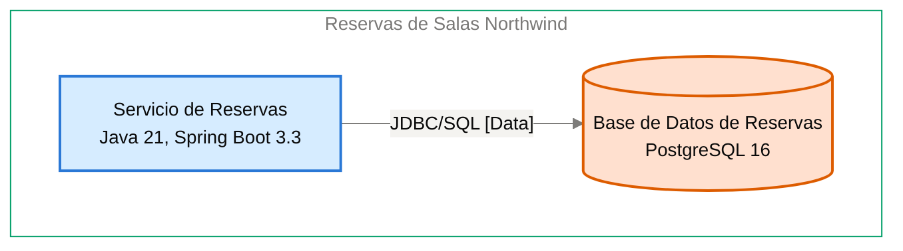

# Contrato de Interfaz: Servicio de Reservas → Base de Datos de Reservas

<!-- managed by sa-skills:architecture-dev-handoff — do not edit manually -->
<!-- TEMPLATE_VERSION: 4.3.1 -->
| Field | Value |
|-------|-------|
| Arista relacionada | E-04 |
| Versión de la Vista de Ejecución | 4.3.1 |
| Versión de los Estándares | 4.3.1 |
| Decisión | [ADR-102](../../adr/ADR-102-impedir-reservas-dobles-con-restriccion-de-exclusion-en.md) |
| Generado | 2026-10-19 |

### Índice rápido por rol <!-- SECTION: Role Quick Index -->

| Audience | Read first in this document |
|----------|-----------------------------|
| **Dev** | Interacción → Estado de entrada → Estado de salida → Supuestos mutuos → Propiedad |
| **QA** | Semántica de fallos → Estado de entrada → Estado de salida → Supuestos mutuos |
| **Ops / SRE** | Semántica de fallos → Observabilidad en la interfaz → Registro de cambios |

El orden de lectura de los cuatro documentos del kit está en `../README.md`.

Contrato de continuidad entre dos servicios adyacentes. Aquí se originan la mayoría de los defectos de integración: cada supuesto mutuo es vinculante.
Cambiar uno es un cambio de interfaz, no un cambio local.

---

## Interacción <!-- SECTION: Interaction -->

| Aspect | Value |
|--------|-------|
| Estilo | sync (request-response) |
| Transporte | JDBC/SQL [Data] |
| Contrato | [NOT DOCUMENTED — add contract reference to docs/05-integration-points.md] |
| Compatibilidad | ver [CROSS_CUTTING_STANDARDS § Versioning](../CROSS_CUTTING_STANDARDS.md#versioning) |

**Panel** — el par en el diagrama de contenedores, recortado de `docs/03` (generado, nunca editado a mano):

Cut of `docs/03-architecture-layers.md` § Diagram: C4 Level 2 — Container — Servicio de Reservas → Base de Datos de Reservas (generated, never hand-edited):

---

## Estado de entrada <!-- SECTION: Entry state -->

Lo que la Base de Datos de Reservas puede asumir como cierto cuando se la invoca:

- El Servicio de Reservas es el único que lee y escribe sus tablas ([ADR-003](../../adr/ADR-003-postgresql-relational-store.md)).
- La conexión usa JDBC con TLS.
- Las credenciales de base de datos se inyectan desde el gestor de secretos ([ADR-005](../../adr/ADR-005-kubernetes-container-runtime.md)).
- Las claves de idempotencia llegan como filas del Servicio de Reservas; la búsqueda precede al insert ([ADR-103](../../adr/ADR-103-idempotencia-de-la-creacion-de-reservas-con-clave.md)).
- Propagación de identidad del usuario a la base: [NOT DOCUMENTED].
- Garantía de orden: [NOT DOCUMENTED].

---

## Estado de salida <!-- SECTION: Exit state -->

Lo que la Base de Datos de Reservas garantiza cuando responde:

- Guarda salas, reservas, registro de auditoría de cancelaciones y claves de idempotencia.
- Rechaza toda reserva confirmada superpuesta para la misma sala con una restricción de exclusión de PostgreSQL ([ADR-102](../../adr/ADR-102-impedir-reservas-dobles-con-restriccion-de-exclusion-en.md)).
- Conserva claves de idempotencia y su respuesta 24 horas ([ADR-103](../../adr/ADR-103-idempotencia-de-la-creacion-de-reservas-con-clave.md)).
- Conserva reservas y auditoría 24 meses; una purga programada las elimina ([ADR-106](../../adr/ADR-106-retencion-de-24-meses-purga-de-datos-y.md)).
- Eventos o tópicos emitidos: [NOT DOCUMENTED].

---

## Supuestos mutuos (vinculantes) <!-- SECTION: Mutual assumptions -->

Los supuestos listados aquí son vinculantes. Cambiar uno es un cambio de interfaz, no un cambio local.

**El upstream asume:**

- La Base de Datos de Reservas rechaza reservas confirmadas superpuestas; el Servicio de Reservas no coordina esa integridad ([ADR-102](../../adr/ADR-102-impedir-reservas-dobles-con-restriccion-de-exclusion-en.md)).
- Las claves de idempotencia y su respuesta persisten 24 horas ([ADR-103](../../adr/ADR-103-idempotencia-de-la-creacion-de-reservas-con-clave.md)).
- La auditoría de cancelación se escribe en la misma transacción que la cancelación ([ADR-106](../../adr/ADR-106-retencion-de-24-meses-purga-de-datos-y.md)).

**El downstream asume:**

- El Servicio de Reservas es el único lector y escritor de sus tablas (I-04).
- El Servicio de Reservas se conecta por JDBC con TLS.
- El esquema evoluciona con migraciones Flyway del repositorio del servicio ([ADR-003](../../adr/ADR-003-postgresql-relational-store.md)).

---

## Semántica de fallos <!-- SECTION: Failure semantics -->

Responsabilidades fila por fila ante cada condición de fallo. Las celdas del upstream y del downstream definen juntas el contrato de recuperación.

| Condition | Upstream behaviour | Downstream behaviour |
|-----------|--------------------|----------------------|
| timeout | [NOT DOCUMENTED] | [NOT DOCUMENTED] |
| downstream no disponible | La solicitud responde error de servicio; reintento y breaker: [NOT DOCUMENTED] | — |
| poison message | — | [NOT DOCUMENTED] |
| fallo parcial | Escribe cancelación y auditoría en una sola transacción ([ADR-106](../../adr/ADR-106-retencion-de-24-meses-purga-de-datos-y.md)); compensación: [NOT DOCUMENTED] | Rechaza la reserva superpuesta con la restricción de exclusión ([ADR-102](../../adr/ADR-102-impedir-reservas-dobles-con-restriccion-de-exclusion-en.md)); contrato de compensación: [NOT DOCUMENTED] |
| versiones incompatibles | [NOT DOCUMENTED] | [NOT DOCUMENTED] |

Clasificación de cascada (de `analysis/BLAST_RADIUS-*.md`): [NOT DOCUMENTED — run /sa-analysis:architecture-analysis blast-radius]

---

## Propiedad <!-- SECTION: Ownership -->

Datos propiedad del upstream y de solo lectura por contrato desde el lado downstream. No existe propiedad mutable compartida en el sistema.

| Direction | Fields / entities |
|-----------|-------------------|
| Propiedad del upstream | Salas; reservas (con su cancelación y motivo); registro de auditoría de cancelaciones; claves de idempotencia con su respuesta (24 horas) |
| Propiedad del downstream | Restricción de exclusión sobre reservas confirmadas superpuestas ([ADR-102](../../adr/ADR-102-impedir-reservas-dobles-con-restriccion-de-exclusion-en.md)); guarda las tablas del Servicio de Reservas sin ser su dueño ([ADR-003](../../adr/ADR-003-postgresql-relational-store.md)) |
| Solo lectura (vía esta interfaz) | [NOT DOCUMENTED] — las lecturas de solo lectura del Servicio de Reservas (JWKS, `sub`, rol `recepcion`, atributo `sede`) no pasan por esta interfaz |

---

## Observabilidad en la interfaz <!-- SECTION: Observability at the interface -->

La interfaz debe poder depurarse desde cualquiera de los dos extremos sin unir logs entre equipos.

| Signal | Requirement |
|--------|-------------|
| Correlación | per [CROSS_CUTTING_STANDARDS § Observability](../CROSS_CUTTING_STANDARDS.md#observability-conventions) |
| Métricas requeridas (ambos lados) | Métricas RED (tasa, errores, duración) por operación ([ADR-004](../../adr/ADR-004-opentelemetry-observability.md)); métricas específicas de la interfaz: [NOT DOCUMENTED — add per-interface metrics to docs/09-operational-considerations.md] |
| Campos de log | JSON estructurado con `trace_id`, `span_id`, `service.name` y nivel; sin tokens ni datos personales completos ([ADR-004](../../adr/ADR-004-opentelemetry-observability.md)) |

---

## Registro de cambios <!-- SECTION: Change log -->

Los cambios de interfaz requieren un ADR nuevo — ver [Return Path](../SYSTEM_RUNTIME_VIEW.md#return-path).

| Date | Change | ADR |
|------|--------|----:|
| 2026-10-19 | Contrato de interfaz inicial | [ADR-102](../../adr/ADR-102-impedir-reservas-dobles-con-restriccion-de-exclusion-en.md) |

---

*Generado por `sa-skills:architecture-dev-handoff` el 2026-10-19*
*Fuentes: `docs/05-integration-points.md`, `analysis/BLAST_RADIUS-*.md`, `adr/`*
