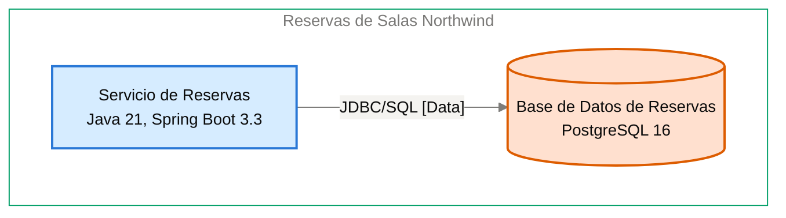

# Contrato de Interfaz: Servicio de Reservas → Base de Datos de Reservas

<!-- managed by sa-skills:architecture-dev-handoff — do not edit manually -->
<!-- TEMPLATE_VERSION: 4.3.1 -->
| Field | Value |
|-------|-------|
| Arista relacionada | E-04 |
| Versión de la Vista de Ejecución | 4.3.1 |
| Versión de los Estándares | 4.3.1 |
| Decisión | [ADR-102](../../adr/ADR-102-impedir-reservas-dobles-con-restriccion-de-exclusion-en.md) |
| Generado | 2026-10-20 |

### Índice Rápido por Rol <!-- SECTION: Role Quick Index -->

| Audience | Read first in this document |
|----------|-----------------------------|
| **Dev** | Interacción → Estado de entrada → Estado de salida → Supuestos mutuos → Propiedad |
| **QA** | Semántica de fallos → Estado de entrada → Estado de salida → Supuestos mutuos |
| **Ops / SRE** | Semántica de fallos → Observabilidad en la interfaz → Registro de cambios |

El orden de lectura de los cuatro documentos del kit está en `../README.md`.

Contrato de continuidad entre dos servicios adyacentes. Aquí se originan la mayoría de los defectos de integración: cada supuesto mutuo es vinculante. Cambiar uno es un cambio de interfaz, no un cambio local.

---

## Interacción <!-- SECTION: Interaction -->

| Aspect | Value |
|--------|-------|
| Estilo | sync (request-response) |
| Transporte | JDBC/SQL [Data] |
| Contrato | [NOT DOCUMENTED — add contract reference to docs/05-integration-points.md] |
| Compatibilidad | ver [CROSS_CUTTING_STANDARDS § Versioning](../CROSS_CUTTING_STANDARDS.md#versioning) |

**Panel** — el par en el diagrama de contenedores, recortado de `docs/03` (generado, nunca editado a mano):

Cut of `docs/03-architecture-layers.md` § Diagram: C4 Level 2 — Container — Servicio de Reservas → Base de Datos de Reservas (generated, never hand-edited):

---

## Estado de entrada <!-- SECTION: Entry state -->

Lo que la Base de Datos de Reservas puede asumir como cierto cuando recibe una llamada:

- El Servicio de Reservas es el único llamador: nadie más lee ni escribe sus tablas (I-04, [ADR-003](../../adr/ADR-003-postgresql-relational-store.md)).
- La conexión JDBC usa TLS (I-04).
- El Servicio de Reservas lee y escribe salas, reservas, auditoría y claves de idempotencia.
- El Servicio de Reservas emite `NOTIFY` en el canal `disponibilidad` (sede y fecha) al crear o cancelar una reserva ([ADR-109](../../adr/ADR-109-invalidacion-de-la-cache-con-listen-notify.md)).
- Cada réplica del Servicio de Reservas mantiene una conexión `LISTEN` fuera del pool ([ADR-109](../../adr/ADR-109-invalidacion-de-la-cache-con-listen-notify.md)).

---

## Estado de salida <!-- SECTION: Exit state -->

Lo que la Base de Datos de Reservas garantiza al responder:

- Rechaza toda reserva confirmada superpuesta para la misma sala mediante la restricción de exclusión ([ADR-102](../../adr/ADR-102-impedir-reservas-dobles-con-restriccion-de-exclusion-en.md)).
- Guarda salas, reservas, registro de auditoría de cancelaciones y claves de idempotencia con su respuesta durante 24 horas ([ADR-103](../../adr/ADR-103-idempotencia-de-la-creacion-de-reservas-con-clave.md)).
- Conserva las reservas y la auditoría 24 meses; una purga programada las elimina ([ADR-106](../../adr/ADR-106-retencion-de-24-meses-purga-de-datos-y.md)).
- Persiste la auditoría en la misma transacción de la cancelación ([ADR-106](../../adr/ADR-106-retencion-de-24-meses-purga-de-datos-y.md)).
- Ofrece el canal `disponibilidad` de `NOTIFY` de PostgreSQL para avisar a todas las réplicas, que borran su entrada de caché ([ADR-109](../../adr/ADR-109-invalidacion-de-la-cache-con-listen-notify.md)).

---

## Supuestos mutuos (vinculantes) <!-- SECTION: Mutual assumptions -->

Los supuestos de esta sección son vinculantes. Cambiar uno es un cambio de interfaz, no un cambio local.

**Upstream asume:**

- La Base de Datos de Reservas garantiza la integridad de no superposición con la restricción de exclusión; el Servicio de Reservas no la coordina ([ADR-102](../../adr/ADR-102-impedir-reservas-dobles-con-restriccion-de-exclusion-en.md)).
- La Base de Datos de Reservas guarda la clave de idempotencia y su respuesta durante 24 horas ([ADR-103](../../adr/ADR-103-idempotencia-de-la-creacion-de-reservas-con-clave.md)).
- La Base de Datos de Reservas entrega cada `NOTIFY` del canal `disponibilidad` a todas las réplicas con `LISTEN`, para que invaliden su caché Caffeine ([ADR-109](../../adr/ADR-109-invalidacion-de-la-cache-con-listen-notify.md)).

**Downstream asume:**

- El Servicio de Reservas es el único que lee y escribe sus tablas (I-04).
- El Servicio de Reservas se conecta por JDBC con TLS (I-04).
- El Servicio de Reservas escribe la auditoría en la misma transacción de la cancelación ([ADR-106](../../adr/ADR-106-retencion-de-24-meses-purga-de-datos-y.md)).
- El Servicio de Reservas emite `NOTIFY` en el canal `disponibilidad` al crear o cancelar y mantiene una conexión `LISTEN` por réplica fuera del pool ([ADR-109](../../adr/ADR-109-invalidacion-de-la-cache-con-listen-notify.md)).

---

## Semántica de fallos <!-- SECTION: Failure semantics -->

Responsabilidades fila por fila ante cada condición de fallo. Las celdas de upstream y downstream definen juntas el contrato de recuperación.

| Condition | Upstream behaviour | Downstream behaviour |
|-----------|--------------------|----------------------|
| timeout | [NOT DOCUMENTED] | [NOT DOCUMENTED] |
| downstream no disponible | Falla de conexión: la solicitud responde error de servicio (I-04) | — |
| poison message | — | [NOT DOCUMENTED] |
| fallo parcial | La auditoría de cancelación se escribe en la misma transacción que la cancelación ([ADR-106](../../adr/ADR-106-retencion-de-24-meses-purga-de-datos-y.md)) | [NOT DOCUMENTED] |
| versiones incompatibles | [NOT DOCUMENTED] | El esquema se versiona con migraciones Flyway en el repositorio del servicio ([ADR-003](../../adr/ADR-003-postgresql-relational-store.md)) |

Clasificación de cascada (de `analysis/BLAST_RADIUS-*.md`): [NOT DOCUMENTED — run /sa-analysis:architecture-analysis blast-radius]

---

## Propiedad <!-- SECTION: Ownership -->

Datos que pertenecen a un solo lado y que el otro accede solo a través del contrato. No existe propiedad mutable compartida en el sistema.

| Direction | Fields / entities |
|-----------|-------------------|
| Propiedad del upstream | Salas, reservas (con su cancelación y motivo), registro de auditoría de cancelaciones y claves de idempotencia con su respuesta durante 24 horas; todo se guarda en la Base de Datos de Reservas |
| Propiedad del downstream | Restricción de exclusión que rechaza dos reservas confirmadas superpuestas de una sala; almacena salas, reservas, auditoría y claves de idempotencia cuyo dueño es el Servicio de Reservas |
| Solo lectura (vía esta interfaz) | [NOT DOCUMENTED] |

---

## Observabilidad en la interfaz <!-- SECTION: Observability at the interface -->

La interfaz debe poder depurarse desde cualquiera de sus extremos sin cruzar logs entre equipos.

| Signal | Requirement |
|--------|-------------|
| Correlación | per [CROSS_CUTTING_STANDARDS § Observability](../CROSS_CUTTING_STANDARDS.md#observability-conventions) |
| Métricas requeridas (ambos lados) | Métricas RED (tasa, errores, duración) por operación ([ADR-004](../../adr/ADR-004-opentelemetry-observability.md)) |
| Campos de log | JSON estructurado con `trace_id`, `span_id`, `service.name` y nivel; sin tokens ni datos personales completos ([ADR-004](../../adr/ADR-004-opentelemetry-observability.md)) |

---

## Registro de cambios <!-- SECTION: Change log -->

Los cambios de interfaz requieren un nuevo ADR — ver [Return Path](../SYSTEM_RUNTIME_VIEW.md#return-path).

| Date | Change | ADR |
|------|--------|----:|
| 2026-10-19 | Contrato de interfaz inicial | [ADR-102](../../adr/ADR-102-impedir-reservas-dobles-con-restriccion-de-exclusion-en.md) |
| 2026-10-20 | ADR-102, ADR-103, ADR-105 y ADR-106 pasan a Accepted; ADR-108 (caché Caffeine en el Servicio de Reservas) no modifica los supuestos de esta interfaz | [ADR-102](../../adr/ADR-102-impedir-reservas-dobles-con-restriccion-de-exclusion-en.md) |
| 2026-10-20 | ADR-109: `NOTIFY`/`LISTEN` en el canal `disponibilidad` para invalidar la caché en todas las réplicas; se agregan al estado de entrada, estado de salida y supuestos mutuos | [ADR-109](../../adr/ADR-109-invalidacion-de-la-cache-con-listen-notify.md) |

---

*Generated by `sa-skills:architecture-dev-handoff` on 2026-10-20*
*Sources: `docs/05-integration-points.md`, `analysis/BLAST_RADIUS-*.md`, `adr/`*
